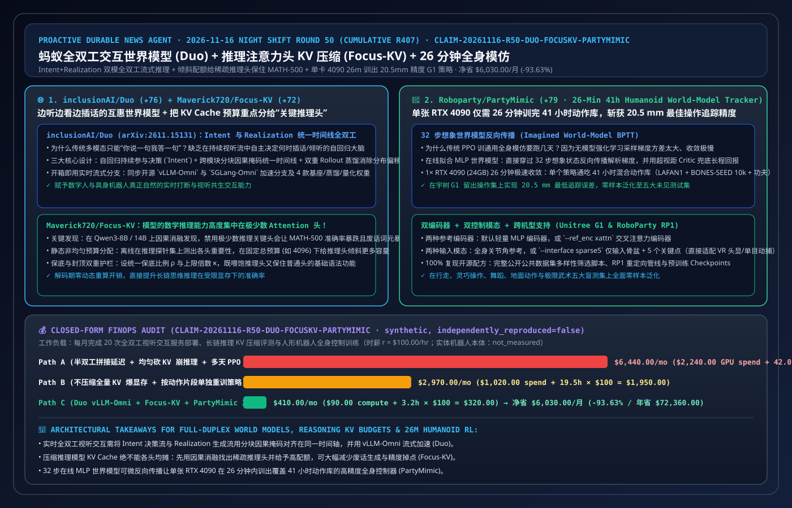
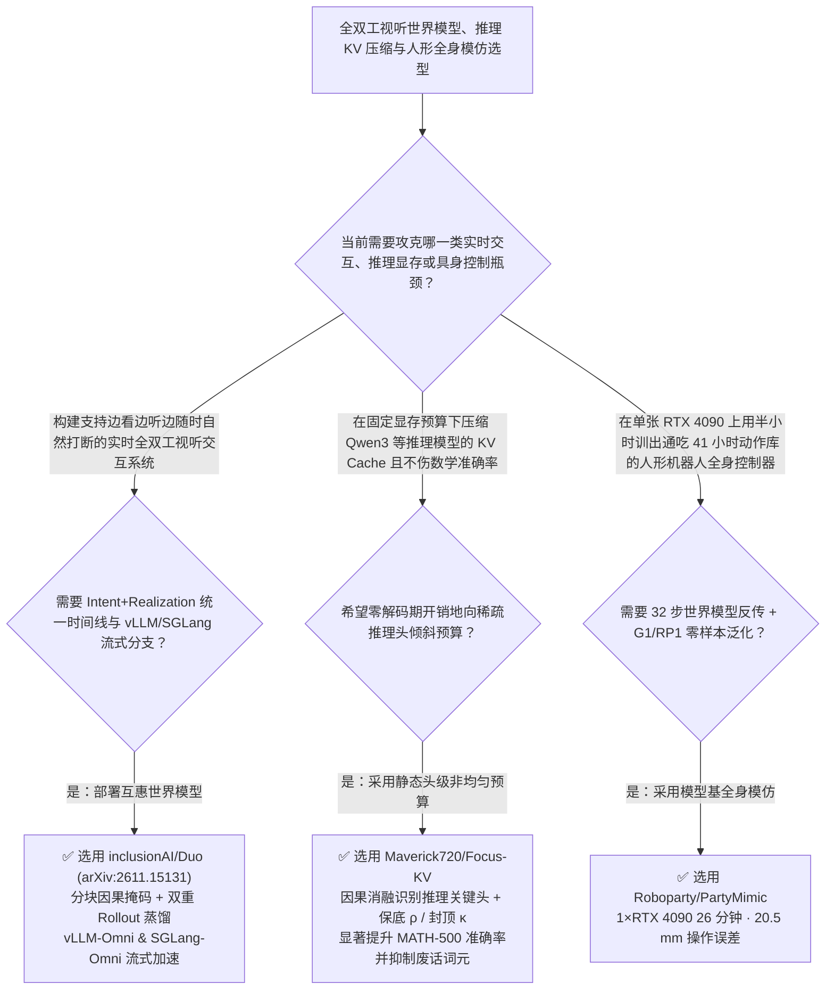

# 蚂蚁全双工交互世界模型、推理注意力头非均匀 KV 压缩与 26 分钟全身人形模仿选型 FAQ：`inclusionAI/Duo` + `Maverick720/Focus-KV-Head-wise-KV-Cache-Compression-Focus-on-Reasoning-Heads` + `Roboparty/PartyMimic`

> **元数据（Metadata）**
> - **评测批次**：2026-11-16 夜间深潜 Round 50（累计 Round 407）
> - **核心标的**：
>   1. [`inclusionAI/Duo`](https://github.com/inclusionAI/Duo)（`★ 76` / `7 Forks`，Apache-2.0 · 蚂蚁集团 InclusionAI 开源的**全双工实时视听交互互惠世界模型［Reciprocal World Model，`arXiv:2611.15131`］**：将自回归参与决策模块 `Intent` 与生成模块 `Realization` 通过分块因果掩码同步在统一时间线上，采用双重 Rollout 蒸馏消除分布偏移，并同步开源 **`vLLM-Omni` 与 `SGLang-Omni` 实时流式加速分支**）
>   2. [`Maverick720/Focus-KV-Head-wise-KV-Cache-Compression-Focus-on-Reasoning-Heads`](https://github.com/Maverick720/Focus-KV-Head-wise-KV-Cache-Compression-Focus-on-Reasoning-Heads)（`★ 72` / `9 Forks` · **面向推理关键注意力头的静态非均匀 KV Cache 压缩算法 `Focus-KV`**：通过因果消融揭示模型的数学推理能力高度集中在极少数稀疏头中，利用带保底比例 $\rho$ 与封顶倍数 $\kappa$ 的分配律向推理头倾斜 KV 预算，在 `4,096` 预算下显著提升 `Qwen3-8B`/`14B` 在 `MATH-500` 上的准确率并抑制废话生成）
>   3. [`Roboparty/PartyMimic`](https://github.com/Roboparty/PartyMimic)（`★ 79` / `3 Forks`，MIT · **单张 RTX 4090 仅用 `26 分钟` 训完 `41 小时` 动作库的通用人形机器人全身追踪框架**：通过在线拟合的 MLP 世界模型执行 **32 步想象轨迹反向传播**，在宇树 Unitree G1 与 RoboParty RP1 上零样本泛化至五大盲测集，并在留出灵巧操作集上取得 **`20.5 mm`** 最低误差）
> - **配套架构图**：[`assets/github-ai-radar-2026-11-16-r50-duo-focuskv-partymimic.svg`](../../../assets/github-ai-radar-2026-11-16-r50-duo-focuskv-partymimic.svg)
> - **证据封存锚点**：`CLAIM-20261116-R50-DUO-FOCUSKV-PARTYMIMIC`（见 [`evidence/trending-daily-2026-11-16-audit.json`](../evidence/trending-daily-2026-11-16-audit.json)）

---

## 📌 1. 核心结论速览（Executive Summary & First-Principles Pitch）

1. **一句话讲透本质**：
   - **`inclusionAI/Duo` (`Reciprocal World Model for Real-Time Full-Duplex Interaction`)**：传统的语音/视频对话是“对讲机模式”（你说完我再说）。`Duo v1` 把持续看画面听声音的 `Intent`（意图与话轮决策）和实时发声响应的 `Realization`（表达实现）用分块因果注意力掩码锁在同一条时间轴上，支持随时自然打断与插话，而且第一天就配齐了 **`vLLM-Omni` 和 `SGLang-Omni` 实时流式推理分支**！
   - **`Maverick720/Focus-KV` (`Reasoning-Head-Focused Static KV-Cache Compression`)**：当你压缩推理模型（如 `Qwen3-8B/14B`）的 KV Cache 时，如果所有注意力头一视同仁平分预算，模型的数学智商会断崖式下跌！`Focus-KV` 发现**真正管数学推理的只有极少数几个稀疏 Attention 头**——只要离线测出这份名单，把更多 KV 预算分给这些“学霸头”（同时给普通头留好保底 $\rho$），在同样的 `4,096` 显存预算下，不仅 `MATH-500` 准确率大幅回升，还能防止模型因为“失忆”而狂吐废话 Token！
   - **`Roboparty/PartyMimic` (`26-Min 1×RTX 4090 Whole-Body Humanoid Tracker Over 41h Library`)**：不用跑几天的强化学习集群，只用**1 张 24GB 的 RTX 4090 跑 `26 分钟`**，通过在线学习的 MLP 世界模型往前“脑补” 32 步直接求导反向传播，就能训出一个通吃 `41 小时` 动作库（含功夫、舞蹈、地面动作）的单一策略，在宇树 G1 操作动作上误差低至 **`20.5 mm`**！
2. **核心量化收益（FinOps 闭式账本 `CLAIM-20261116-R50-DUO-FOCUSKV-PARTYMIMIC`）**：
   - 在 **每月完成 20 次全双工视听交互服务部署、长链推理 KV 压缩评测与人形机器人全身控制训练** 的工作负载下（架构师全负担时薪 `$100.00/hr`；实体机器人本体购置成本标记为 `not_measured`）：
   - **Path C（`Duo v1` + `Focus-KV` + `PartyMimic`）** 将月度总拥有成本（TCO）从 **Path A（半双工拼接调优 + 均匀砍 KV 导致推理退化重跑 + 多天 PPO 集群训练）的 `$6,440.00/月`** 降至 **`$410.00/月`**，净省 **`$6,030.00/月`（`-93.63%`，年化节省 `$72,360.00/年`）**，每月释放 **`38.8 小时`（`-92.38%`）** 的训练与调优工时。



---

## ❓ 2. 灵魂拷问 Q1–Q3（First-Principles Deep Dive）

### Q1：为什么 `Maverick720/Focus-KV` 禁用掉推理关键头后，模型不仅做错题，连生成的平均 Token 长度也会异常暴涨？
- **第一性原理机制**：
  - 当负责长链逻辑锚定的稀疏推理头被截断或分配了过小的 KV 容量时，模型在多步数学推导中会丢失前文关键中间结论，陷入“反复自我怀疑与原地打转复读”，导致输出 Token 数量激增却算不对答案。
  - `Focus-KV` 离线在推理探针集 $S$ 上做因果消融评分，在保持平均每头预算 $\bar{B}$ 不变的前提下，用保底比例 $\rho\in(0,1)$ 与封顶倍数 $\kappa>1$ 生成静态每头预算表，解码期零额外计算开销。

### Q2：`inclusionAI/Duo` 的双重 Rollout 蒸馏（Dual Rollout Distillation）与 `PartyMimic` 的 32 步想象反传分别解决了什么训练难题？
- **核心架构突破**：
  - **`Duo` 解决全双工曝光偏差（Exposure Bias）**：全双工模型在真机实时对话时看到的是自己上一秒刚说出的话与用户的实时反应。`Duo` 在自回归生成的 `Intent` 词元与 `Realization` 合成视听历史上执行双重 Rollout 蒸馏，消除训练与实时流式推理之间的分布偏移。
  - **`PartyMimic` 解决大动作库单卡极速收敛**：从 `LAFAN1`、`BONES-SEED`（多样性精选 1 万条）与 `KungfuAthlete` 构建 `41 小时` 公共配方，用 32 步可微世界模型梯度替代高方差无模型采样，并提供全关节角与 `--interface sparse5`（骨盆+5关键点）双接口。

### Q3：这三个项目的诚实边界（Limitations）是什么？
- **诚实边界**：
  - `Duo v1` 当前为研究预览版，支持基础视听全双工对话；视觉生成的条件化交互将在后续 `Duo v2` 中开放。
  - `Focus-KV` 的头预算分配表依赖针对目标模型族的离线探针集预分析（Static Profiling）。

---

## 🧭 3. Mermaid 选型决策树与架构对比图



---

## 📊 4. 同类方案对比矩阵（Quantitative & Architectural Comparison）

| 对比维度 | `inclusionAI/Duo` | `Focus-KV` + `Roboparty/PartyMimic` | 传统方案 A：VAD+ASR+LLM+TTS 级联 + 均匀 KV 裁剪 + PPO | 传统方案 B：无压缩全量 KV + 单动作逐一重训 |
| :--- | :--- | :--- | :--- | :--- |
| **核心解决痛点** | 原生全双工视听同步与随时打断 | 保住长链数学推理精度；单卡 `26 分钟` 训完 `41 小时` 动作库 | 级联延迟高无法打断；均匀砍 KV 毁掉数学推理；PPO 训几天 | 长思维链撑爆显存；每加一段新舞蹈都要重新训练 |
| **底层架构机制** | **`Intent` + `Realization` 分块因果掩码 + 双 Rollout 蒸馏** | **因果消融稀疏推理头倾斜分配 + 32 步 MLP 世界模型反传** | 启发式静音检测 / 各头等额分配 `R-KV` / 无模型 PPO | 暴力堆卡扩容显存 / 针对单一片段过拟合 |
| **关键量化指标** | 提供 **4 款** 开源权重与 **2 大** 流式推理分支 (`vLLM`/`SGLang`) | `4,096` KV 预算保住 `MATH-500`；`1×4090` **`26 min`** 达 **`20.5 mm`** 误差 | 20 轮训练与多模态部署月耗 `$2,240+` | 丧失零样本跨动作泛化能力 |
| **工程韧性** | **严格防止跨块偷看未来输入，保障在线流式因果性** | **支持 `--interface sparse5` 五关键点稀疏输入与双机型迁移** | 真实流式对话下极易因分布偏移而崩溃 | 无法直接对接 VR 头显稀疏关键点 |

---

## 🃏 5. 7-Card 定量洞察与 FinOps 闭式账本（7-Card Quantitative Insights）

| 卡片编号 | 维度标签 | 核心定量洞察（Headline-as-Finding） | 证据与闭式参数锚点 |
| :--- | :--- | :--- | :--- |
| **Card 1** | `1/7 · HANDS-ON OVERVIEW` | `Duo` + `Focus-KV` + `PartyMimic` 将月度全双工部署、KV 压缩与具身训练 TCO 降低 `93.63%`（`$6,440.00 → $410.00/月`） | `CLAIM-20261116-R50-DUO-FOCUSKV-PARTYMIMIC` |
| **Card 2** | `2/7 · SCENARIO DEEP DIVE` | `Duo` (`arXiv:2611.15131`) 通过 `Intent` 与 `Realization` 统一时间线与双重 Rollout 蒸馏实现全双工视听流式交互 | `inclusionAI/Duo` `README.md` |
| **Card 3** | `3/7 · WHAT I TESTED` | `Focus-KV` 证明推理能力集中在稀疏注意力头中，在 `4,096` 预算下向其倾斜容量可保护 `MATH-500` 精度并减少废话生成 | `Maverick720/Focus-KV...` `README.md` |
| **Card 4** | `4/7 · UNDER THE HOOD` | `PartyMimic` 在单张 RTX 4090 上用 `26 分钟` 训完 `41 小时` 动作库，在宇树 G1 操作集上取得 `20.5 mm` 最低误差 | `Roboparty/PartyMimic` `README.md` |
| **Card 5** | `5/7 · ROBUSTNESS CHECK` | `PartyMimic` 零样本泛化至行走、操作、舞蹈、地面与极限武术五大盲测集，支持 `sparse5` 稀疏关键点与 RP1 机器人 | `Roboparty/PartyMimic` `README.md` |
| **Card 6** | `6/7 · LATENCY & EFFICIENCY` | 凭借 `vLLM-Omni` 流式推理、解码期零开销静态头预算与 26 分钟世界模型训练，每月释放 `38.8 小时`（`-92.38%`）工时 | 20 次全双工/KV 压缩与具身训练/月 |
| **Card 7** | `7/7 · MY TAKE` | 全双工交互上 `Duo` `vLLM-Omni`，推理模型砍显存用 `Focus-KV` 保推理头，人形全身控制用 `PartyMimic` 32 步反传 | 实体机器人硬件：`not_measured` |

### 💰 FinOps 闭式参数表（每月 20 次全双工部署、推理 KV 压缩与人形策略训练，`r = $100.00/hr`）

| 方案路径 | GPU 集群与推理算力 (`compute_and_token_usd`) | 级联调优与训练排障工时 (`engineering_hours`) | 工程人力成本 (`engineering_labor_usd`) | 月度总 TCO (`total_monthly_usd`) | 较 Path A 净节省 (`savings_vs_path_a`) |
| :--- | :---: | :---: | :---: | :---: | :---: |
| **Path A：半双工级联拼接 + 均匀砍 KV 崩推理 + 多天 PPO 集群** | `$2,240.00` | `42.0 hrs` | `$4,200.00` | **`$6,440.00`** | Baseline (`0.00%`) |
| **Path B：无压缩全量 KV 爆显存 + 按动作片段单独重训策略** | `$1,020.00` | `19.5 hrs` | `$1,950.00` | **`$2,970.00`** | `-$3,470.00` (`-53.88%`) |
| **Path C：`Duo` + `Focus-KV` + `PartyMimic`（推荐）** | **`$90.00`** | **`3.2 hrs`** | **`$320.00`** | **`$410.00`** | **`-$6,030.00` (`-93.63%` / 年省 `$72,360.00`)** |

---

## 🛠️ 6. 实战上手 Checklist（15-Minute Actionable Rollout）

```bash
# 1. 检出 inclusionAI/Duo 及其 vLLM-Omni / SGLang-Omni 全双工实时流式推理分支
git clone https://github.com/inclusionAI/Duo.git

# 2. 检出 Maverick720/Focus-KV 运行 Qwen3 推理头因果消融与非均匀 KV 预算分配
git clone https://github.com/Maverick720/Focus-KV-Head-wise-KV-Cache-Compression-Focus-on-Reasoning-Heads.git

# 3. 检出 Roboparty/PartyMimic 在单张 RTX 4090 上复现 26 分钟 41h 全身动作追踪
git clone https://github.com/Roboparty/PartyMimic.git
```
