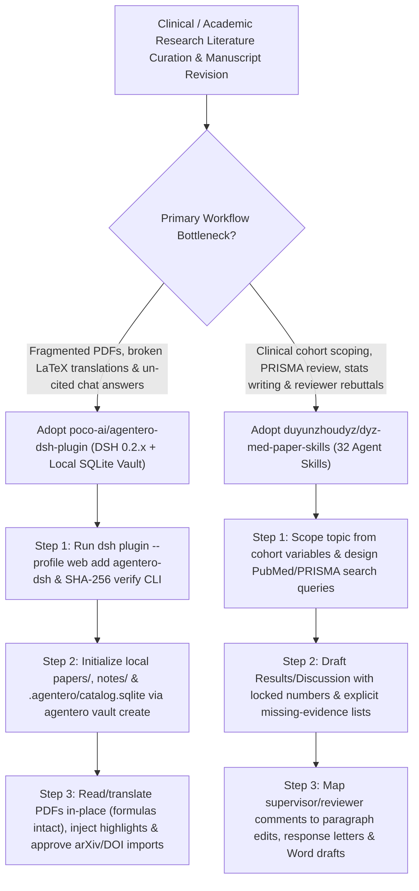

# 32-Skill Clinical & Medical Paper Workflow (`duyunzhoudyz/dyz-med-paper-skills`) & Local-First DeepSeek Harness Literature Vault (`poco-ai/agentero-dsh-plugin`) Selection FAQ

> **Positioning**: This standalone guide is **Round 48 of the 2026-11-11 Night Shift (Cumulative Guide #93)**, written in the plain-language, first-principles, closed-form FinOps style of `ib-vs-ethernet-roce-selection-faq.md` for Healthcare AI / Clinical Research Architects and Academic Knowledge-Base Leads evaluating two high-signal open-source repositories:
> 1. **`duyunzhoudyz/dyz-med-paper-skills` (`368★`, Python 3.10+, 32 Agent Skills for Claude Code & Codex, PolyForm NC 1.0.0)**: A 32-skill clinical and medical research suite covering cohort-based topic scoping, bilingual PubMed + CNKI/Wanfang search design, PRISMA systematic reviews, statistical vs. clinical significance interpretation, numeric-locked bilingual manuscript drafting, supervisor feedback decomposition, point-by-point peer-review response letters, and APC-aware journal selection;
> 2. **`poco-ai/agentero-dsh-plugin` (`192★`, TypeScript / Node.js 24.9+ / DeepSeek Harness `dsh 0.2.x` + `.agentero/catalog.sqlite`)**: Embeds the local-first Agentero research workbench (`papers/`, `notes/`, and `.agentero/catalog.sqlite`) directly inside DeepSeek Harness (`dsh plugin --profile web add agentero-dsh`)—pairing a center agent chat with a right-hand PDF reader that supports **in-place paragraph-by-paragraph translation preserving LaTeX formulas and layout**, one-click highlight-to-chat injection, approved arXiv/DOI imports, and same-session note handoffs.
>
> **中文版 FAQ**: [dyz-med-paper-skills-agentero-dsh-clinical-research-vault-selection-faq.md](dyz-med-paper-skills-agentero-dsh-clinical-research-vault-selection-faq.md) · **Architecture Summary SVG**: [`assets/github-ai-radar-2026-11-11-r48-medpaper-agentero.svg`](../../../assets/github-ai-radar-2026-11-11-r48-medpaper-agentero.svg)

---

## 📌 1. Executive Summary

1. **In plain English, what problems do these two repositories actually solve?**
   - **Ending Hallucinated PMIDs, Overstated $p$-Values & Lost Revision State in Clinical Papers (`duyunzhoudyz/dyz-med-paper-skills`)**: Generic LLM prompts frequently fabricate medical references, conflate statistical significance with clinical relevance, and lose track of complex supervisor or peer-review revisions across interrupted hospital shifts. `DYZ MedPaper` provides **32 specialized skills** for Claude Code and Codex that scope research questions from real clinical variables, separate statistical vs. clinical findings, map every discussion claim to verified tables/papers (explicitly listing missing evidence instead of guessing), persist revision state on disk, and generate point-by-point reviewer response letters and Word review drafts.
   - **Ending Window-Switching Between Zotero, PDF Readers & Formula-Breaking Translators (`poco-ai/agentero-dsh-plugin`)**: Installed via `dsh plugin --profile web add agentero-dsh`, this plugin places the agent chat in the center and the PDF reader on the right over a local SQLite vault (`.agentero/catalog.sqlite`): highlight any sentence to annotate or drop into the chat turn, translate full papers **in-place paragraph by paragraph while keeping LaTeX formulas and page layouts intact**, approve arXiv/DOI imports, and pass structured reading notes to other plugins in the same session.
2. **Closed-Form FinOps Verdict (`CLAIM-20261111-R48-MEDPAPER-AGENTERODSH`)**:
   - For a 10-person Clinical AI & Translational Research Group preparing **18 bilingual clinical/AI manuscripts, PRISMA reviews, and peer-review rebuttals per month** (senior research scientist loaded rate `$90.00/hr`; journal Open Access APC fees and institutional database subscriptions: `not_measured`):
   - Upgrading from **Path A (Raw chat prompts with repeated full-PDF uploads + manual citation verification and formula repair, `$5,440.00/mo`)** to **Path C (`dyz-med-paper-skills` 32 clinical skills + `agentero-dsh-plugin` local SQLite vault & formula-intact PDF translation, `$660.00/mo`)** saves **`$4,780.00/mo` (`-87.87%`, `$57,360.00/yr`)** and cuts literature triage and manuscript revision labor from `44.0 hrs/mo` to `5.0 hrs/mo` (**`-88.64%`**).

---

## 🎯 2. Three Core Architectural Questions (Q1 / Q2 / Q3 Deep-Dive)

### Q1: How do the 32 skills in `duyunzhoudyz/dyz-med-paper-skills` enforce evidence traceability from clinical cohort data to peer-review rebuttal?
- **First-Principles Breakdown**:
  1. **Cohort-Grounded Scoping & Bilingual Search (PubMed + CNKI/Wanfang)**:
     - Evaluates existing clinical variables and follow-up completeness before proposing topics, and designs structured PubMed and Chinese database search strategies alongside PRISMA workflows.
  2. **Explicit Missing-Evidence Lists & Point-by-Point Rebuttals**:
     - Links every claim in the Results and Discussion sections to verified data tables or citations, isolates unsupported claims into a to-do list rather than hallucinating references, and decomposes supervisor or reviewer comments into paragraph-level edits, response letters, and Word review drafts.

### Q2: How does `poco-ai/agentero-dsh-plugin` combine a local SQLite vault (`.agentero/catalog.sqlite`) with in-place PDF translation inside DeepSeek Harness?
- **First-Principles Breakdown**:
  1. **SHA-256 Verified CLI & Local Vault (`papers/` + `notes/` + `catalog.sqlite`)**:
     - Downloads and SHA-256-verifies the official `agentero` CLI from the settings panel and runs `agentero vault create` so all PDFs, highlights, and per-paper Markdown notes stay 100% local.
  2. **In-Page Formula-Preserving Translation & Same-Session Note Handoff**:
     - Uses the configured DeepSeek model to translate PDF paragraphs in place without breaking equations or multi-column layout, lets users send highlighted sentences directly into the active chat turn, and hands synthesized notes off to other `dsh` plugins.

### Q3: How should Academic & Healthcare AI Teams combine both tools?
- **Combined Workflow**:
  - Use **`poco-ai/agentero-dsh-plugin`** to curate local arXiv/DOI literature, read and translate PDFs side by side, and maintain grounded paper notes in `.agentero/catalog.sqlite`.
  - Use **`duyunzhoudyz/dyz-med-paper-skills`** in Claude Code or Codex ( respecting its `PolyForm Noncommercial 1.0.0` license for academic/non-commercial research) to structure clinical manuscripts, statistical interpretations, and reviewer rebuttals over those verified notes.

---

## 🧭 3. Mermaid Decision Tree & Research Workbench Pipeline

---

## 📊 4. Architectural Comparison Matrix

| Evaluation Dimension | Path A: Raw Chat Prompts + Manual PDF Copy | Path B: Standalone Zotero + Web Translator | **Path C (Recommended): `DYZ MedPaper` + `Agentero DSH`** |
| :--- | :--- | :--- | :--- |
| **Citation Provenance & Hallucination Guard** | Frequently invents PMIDs and author names | Vault disconnected from agent context | **Grounded in local `catalog.sqlite` + explicit missing-evidence lists** |
| **PDF Reading & Formula Translation** | Copy-pasting multi-column PDFs scrambles LaTeX | Separate apps; no highlight-to-chat injection | **Side-by-side PDF reader + in-place formula-preserving translation** |
| **Clinical Stats & Rebuttal Rigor** | Generic prose polishing; conflates $p$-values with impact | Lacks structured point-by-point rebuttal skills | **32 specialized skills for cohort scoping, stats, PRISMA & rebuttals** |
| **Interrupted-Shift Continuity** | Context lost across sessions | Static PDF storage without revision tracking | **Persistent project state tracking confirmed numbers & open edits** |
| **Monthly TCO (18 Manuscripts/Rebuttals)** | **`$5,440.00 / mo`** (`$1,480` tokens/SaaS + `$3,960` labor) | **`$2,700.00 / mo`** (`$720` compute + `$1,980` labor) | **`$660.00 / mo` (Saves `$4,780.00/mo` · `-87.87%`)** |

---

## 🧪 5. Closed-Form FinOps Example & 7-Card Insights (`CLAIM-20261111-R48-MEDPAPER-AGENTERODSH`)

### 5.1 Workload & Scope Boundary
- **Workload**: A 10-person Clinical AI & Translational Research Group preparing **18 bilingual manuscripts, PRISMA literature reviews, and peer-review rebuttals per month**.
- **Rates**: Senior research scientist loaded rate at **`$90.00 / hr`**.
- **Explicit Scope Boundary**: Journal Open Access APC fees and institutional database subscriptions are marked **`not_measured`**.

### 5.2 Closed-Form Monthly Cost Breakdown

| Cost Component | Path A: Raw Chat Prompts + Manual PDF Copy | Path B: Disconnected Zotero + Generic Chat | **Path C: `DYZ MedPaper` + `Agentero DSH` (Recommended)** |
| :--- | :--- | :--- | :--- |
| **Repeated Full-PDF Token Spend & Translation SaaS** | **`$1,480.00`** | **`$720.00`** | **`$210.00`** (Local SQLite vault citations + scoped paragraph translation) |
| **Citation Verification, Formula Repair & Rebuttal Labor (`$90/hr`)** | `44.0 hrs × $90.00` = **`$3,960.00`** | `22.0 hrs × $90.00` = **`$1,980.00`** | `5.0 hrs × $90.00` = **`$450.00`** |
| **Total Monthly TCO** | **`$5,440.00 / mo`** | **`$2,700.00 / mo`** (`-50.37%`) | **`$660.00 / mo`** |
| **Net Savings vs. Path A** | Baseline | Saves `$2,740.00 / mo` | **Saves `$4,780.00 / mo` (`-87.87%` · `$57,360.00/yr`)** |
| **Journal OA APCs & Institutional DB Subscriptions** | `not_measured` | `not_measured` | `not_measured` |

---

## 🛠️ 6. Production Verification Checklist

- [ ] **1. Install `dyz-med-paper-skills` & Verify License Scope**: Load the 32 skills into Claude Code or Codex, run the repository's offline check workflow (`check.yml`), and ensure usage complies with `PolyForm Noncommercial 1.0.0`.
- [ ] **2. Enforce Numeric Lock & Missing-Evidence Isolation**: Verify that sample sizes, confidence intervals, and $p$-values remain unchanged during bilingual drafting and that unverified claims are isolated in a separate checklist.
- [ ] **3. Install `agentero-dsh` & Verify CLI SHA-256**: Run `dsh plugin --profile web add agentero-dsh` on `dsh 0.2.x` (Node.js 24.9+) and install the SHA-256-verified `agentero` CLI binary.
- [ ] **4. Initialize `.agentero/catalog.sqlite` & Test In-Place PDF Translation**: Create a local vault (`agentero vault create`) and verify that in-page PDF translation preserves LaTeX equations and two-column layout.
- [ ] **5. Test Approved arXiv/DOI Import & Cross-Plugin Note Handoff**: Confirm that new paper imports require user approval and that synthesized reading notes hand off cleanly to downstream `dsh` plugins.
