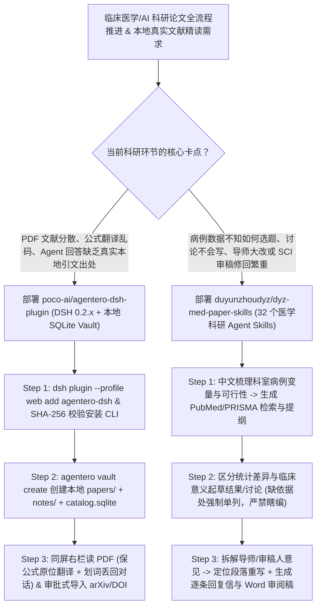

# 32 技能临床医学科研论文工作流（`duyunzhoudyz/dyz-med-paper-skills`）与 DeepSeek Harness 本地文献库插件（`poco-ai/agentero-dsh-plugin`）深度选型 FAQ

> **文档定位**：本专题是 **2026-11-11 夜班第 48 轮（累计第 93 篇）独立六段式选型指南**，严格对标 `ib-vs-ethernet-roce-selection-faq.md` 的通俗第一性原理与闭式 FinOps 核算规范，面向医疗健康 AI（Healthcare AI）解决方案架构师与科研知识库工程负责人，深度拆解今日在临床医学论文全流程 Agent 技能与本地优先（Local-First）双栏文献阅读工作台赛道爆发的两大新锐开源仓：
> 1. **`duyunzhoudyz/dyz-med-paper-skills`（`368★`，Python 3.10+，32 个医学科研与写作 Agent Skills，适配 Claude Code / Codex）**：围绕医生与医学研究生真实的科室病例条件与轮转节奏定制——覆盖**科室现有变量选题可行性评估、PubMed + 知网/万方/维普中英文检索策略、PRISMA 系统综述、统计显著性与临床意义拆解、严锁数字与术语的中英论文起草、导师意见段落级落实、逐条审稿修回信（Reviewer Response）以及兼顾版面费（APC）预算的选刊匹配**；
> 2. **`poco-ai/agentero-dsh-plugin`（`192★`，TypeScript / Node.js 24.9+，DeepSeek Harness `dsh 0.2.x` 插件 + `.agentero/catalog.sqlite` 本地文献库）**：把本地优先科研工作台 Agentero 的 **文献库（`papers/`）、笔记库（`notes/`）与保留公式版面的原位 PDF 全文翻译器** 直接嵌入 DeepSeek Harness 同屏窗口——左边对话、右边读论文，划词即可高亮/批注/丢回对话，Agent 按 arXiv / DOI 审批入库并可将整理好的阅读笔记无缝交给同会话其他插件！
>
> **English Version**: [dyz-med-paper-skills-agentero-dsh-clinical-research-vault-selection-faq.en.md](dyz-med-paper-skills-agentero-dsh-clinical-research-vault-selection-faq.en.md) · **架构总结图**: [`assets/github-ai-radar-2026-11-11-r48-medpaper-agentero.svg`](../../../assets/github-ai-radar-2026-11-11-r48-medpaper-agentero.svg)

---

## 📌 一、核心结论速览（Executive Summary）

1. **一句话大白话讲透这两个项目到底解决了什么痛点？**
   - **终结“通用大模型写医学论文瞎编 PMID 文献、把统计 $p<0.05$ 直接吹成重大临床突破、以及值班被打断后下次完全忘掉改到哪”的痛点（`duyunzhoudyz/dyz-med-paper-skills`）**：临床医生做科研最怕模型“没依据硬编”和“脱离科室随访现实”。`DYZ MedPaper` 的 **32 个技能**坚持两项铁律：① **先用中文把临床问题、现有指标缺失项和统计逻辑聊透，再生成英文/中文稿件**，且强制把每个论点绑定到结果表与已核实文献（缺依据的地方单独列出清单，绝不捏造）；② **持久化项目进度记录**——把已确认的数字、导师提出的“讨论太散/创新性不够”以及未处理的审稿人意见全部记在项目目录里，值完夜班回来让 Agent 读记录就能无缝接着改，并直出供导师审阅的基础 Word 稿！
   - **终结“读论文要在 Zotero、PDF 阅读器、网页翻译和聊天框之间来回切窗口、且翻译后数学公式全乱码”的痛点（`poco-ai/agentero-dsh-plugin`）**：通过 `dsh plugin --profile web add agentero-dsh` 一键装进 DeepSeek Harness 后，**聊天在中间、PDF 论文在右边**：读到哪句划词就能直接丢进当前对话轮次，或调用当前配置的 DeepSeek 模型**在 PDF 原页面上逐段替换翻译（完整保留公式与双栏版面）**；Agent 可直接检索你本地 `.agentero/catalog.sqlite` 里的真实论文与专属笔记，按 arXiv / DOI 经你审批后下载入库，并把提炼出的笔记线索移交给同会话内的代码或实验插件！
2. **闭式 FinOps 投资回报结论（`CLAIM-20261111-R48-MEDPAPER-AGENTERODSH`）**：
   - 以 10 人医疗 AI 转化医学与学术研究团队每月推进 **18 篇中英文临床/算法论文起草、PRISMA 文献综述与审稿意见逐条修回** 为基准（高级临床科研/AI 算法研究员含税费率 `$90.00/hr`；期刊 Open Access 版面费 APC 与医院机构数据库订购年费：`not_measured`）：
   - 从 **Path A（裸调聊天窗口反复粘贴整篇 PDF + 人工核查虚构文献与修复公式乱码，月均 `$5,440.00`）** 升级至 **Path C（`dyz-med-paper-skills` 32 技能临床证据门禁 + `agentero-dsh-plugin` 本地 SQLite 文献库与原位保公式翻译，月均 `$660.00`）**，每月净省 **`$4,780.00/mo`（降幅 `-87.87%`，年省 `$57,360.00/yr`）**，并将文献整理、数据核对与修回信撰写工时从 `44.0 hrs/mo` 压缩至 `5.0 hrs/mo`（节省 **`-88.64%`**）。

---

## 🎯 二、三大灵魂拷问（Q1 / Q2 / Q3 深度原理解析）

### Q1：`duyunzhoudyz/dyz-med-paper-skills` 的 32 个技能是如何覆盖“科室病例 → 统计解读 → 导师改稿 → 审稿修回”全链路的？
- **第一性原理拆解**：
  1. **立足真实临床约束的选题与中英双源检索**：
     - 不搞空中楼阁的选题：先盘点手头病例样本量、随访时长与缺失变量，输出可行性判断与补料清单；检索阶段同时生成 **PubMed（MeSH 词表 + 布尔检索式）** 与中文库（知网/万方/维普）检索方案及 PRISMA 筛选流程。
  2. **严格区分“统计学差异”与“临床意义” + 缺据单列机制**：
     - 在解读统计结果与重写讨论（Discussion）时，强制按照“主要发现 → 与既有文献对比 → 临床实际意义 → 研究局限性”四段论推进，明确标出哪里重复、哪里结论说过了头，并将缺乏文献或统计支撑的论断单独拎出待办清单。
  3. **段落级导师改稿定位与逐条审稿修回（Reviewer Response）**：
     - 将导师笼统的批注或审稿人长达数页的意见逐条拆解，精确映射到正文具体段落与修改顺序，同步生成逐条回复信（Point-by-Point Response Letter）、正文修订位置对照表及基础 Word 审阅稿。

### Q2：`poco-ai/agentero-dsh-plugin` 是如何在 DeepSeek Harness（`dsh`）中实现本地 `.agentero/catalog.sqlite` 闭环与原位保公式翻译的？
- **第一性原理拆解**：
  1. **本地优先知识库结构（`papers/` + `notes/` + `.agentero/catalog.sqlite`）**：
     - 插件在设置页提供一键下载并校验 **SHA-256** 的官方 `agentero` CLI，调用 `agentero vault create` 在本地初始化结构化文献仓；所有 PDF 原文、高亮批注与每篇论文专属 Markdown 笔记 100% 存储在本地磁盘。
  2. **PDF 原页面逐段替换翻译（保留公式与版面）+ 划词直投对话**：
     - 内置 PDF 阅读器支持目录跳转、全文检索与划词操作（复制、高亮、批注、翻译、**一键加入当前对话**）；开启全文翻译时，直接复用 `dsh` 配置的 DeepSeek 模型在原 PDF 页面上逐段原位替换文本，完美保留数学公式、图表与排版结构。
  3. **审批式文献入库与同会话跨插件交接**：
     - Agent 按 arXiv、DOI 或 URL 搜到新论文后，经用户审批入库并自动补全元数据；讨论生成的阅读提纲与笔记可直接交给同一 `dsh` 会话中的其他插件继续处理。

### Q3：医疗 AI 与科研团队如何将 `dyz-med-paper-skills` 与 `agentero-dsh-plugin` 组合使用？
- **黄金组合落地范式**：
  - 用 **`poco-ai/agentero-dsh-plugin`** 作为日常**本地文献积累、PDF 保公式双语精读与真实引文索引底座**（彻底杜绝虚构参考文献）；
  - 用 **`duyunzhoudyz/dyz-med-paper-skills`** 的 32 个技能驱动 **临床课题设计、结果表解读、章节起草、导师意见改稿与 SCI 审稿意见修回**！

---

## 🧭 三、Mermaid 选型决策树与临床科研双引擎流水线

---

## 📊 四、同类科研工具核心能力对比矩阵（Selection Matrix）

| 评估维度 | Path A：普通聊天窗口 + 手工复制粘贴 PDF | Path B：独立 Zotero + 通用网页翻译插件 | **Path C（推荐）：`DYZ MedPaper` + `Agentero DSH`** |
| :--- | :--- | :--- | :--- |
| **引文真实性与防幻觉机制** | 极易编造看似逼真的假 PMID 与假作者 | 文献库与 Agent 割裂，需手动导出条目喂给模型 | **直连本地 `catalog.sqlite` 真实文献库 + 缺依据强制单列清单** |
| **PDF 阅读、公式翻译与对话联动** | 复制双栏 PDF 文字顺序错乱，公式变乱码 | 翻译与 Agent 聊天分处两个软件，划词无法直投对话 | **同窗口右栏读 PDF，原位保公式逐段翻译 + 划词一键丢回对话** |
| **临床统计解读与审稿修回深度** | 只会套话润色，分不清统计显著与临床意义 | 无针对医学修回信（Response Letter）的结构化技能 | **32 个专科技能覆盖选题、PRISMA、统计解读、导师改稿与逐条修回** |
| **跨轮转/值班中断状态保持** | 关掉窗口或上下文超长后前功尽弃 | 仅存静态 PDF，不记已确认数字与待办修改项 | **持久化项目进度、已核实数字与待办清单，一键导出 Word 审阅稿** |
| **月度总拥有成本（18 篇稿件/修回）** | **`$5,440.00 / mo`**（`$1,480` Token/SaaS + `$3,960` 人工） | **`$2,700.00 / mo`**（`$720` 算力 + `$1,980` 人工） | **`$660.00 / mo`（净省 `$4,780.00/mo` · `-87.87%`）** |

---

## 🧪 五、定量 FinOps 算例与 7-Card 洞察（`CLAIM-20261111-R48-MEDPAPER-AGENTERODSH`）

### 5.1 测算基准与显式边界（Scope & Boundaries）
- **场景设定**：10 人医疗 AI 与临床科研转化团队，每月并行推进 **18 项临床/算法课题的文献综述、中英稿件撰写与审稿意见修回**。
- **费率假设**：高级临床科研与 AI 研究员全包时薪 **`$90.00 / hr`**。
- **显式边界声明（Explicit Not-Measured Boundary）**：目标期刊 Open Access 版面费（APC）与医院/高校图书馆商业文献数据库订阅年费标记为 **`not_measured`**，本表核算 PDF 翻译/上下文 Token 开销与研究员查证/改稿工时。

### 5.2 三路径月度成本闭式对照表

| 成本分项 | Path A：裸聊窗口反复传 PDF + 商业翻译润色 SaaS | Path B：独立文献软件 + 通用提示词 | **Path C：`DYZ MedPaper` + `Agentero DSH`（推荐）** |
| :--- | :--- | :--- | :--- |
| **长 PDF 重复上传 Token 与翻译/润色 SaaS 费用** | **`$1,480.00`** | **`$720.00`** | **`$210.00`**（本地 SQLite 精准引用 + 按需原位段落翻译） |
| **假文献核查、公式排版修复与审稿意见逐条对齐工时（`$90/hr`）** | `44.0 hrs × $90.00` = **`$3,960.00`** | `22.0 hrs × $90.00` = **`$1,980.00`** | `5.0 hrs × $90.00` = **`$450.00`** |
| **月度总成本（Monthly TCO）** | **`$5,440.00 / mo`** | **`$2,700.00 / mo`**（`-50.37%`） | **`$660.00 / mo`** |
| **相对 Path A 净节省** | 基准线（Baseline） | 净省 `$2,740.00 / mo` | **净省 `$4,780.00 / mo`（`-87.87%` · 年省 `$57,360.00/yr`）** |
| **期刊 OA 版面费（APC）与机构数据库年费** | `not_measured` | `not_measured` | `not_measured` |

---

## 🛠️ 六、生产级落地核验 Checklist

- [ ] **1. `dyz-med-paper-skills` 32 技能安装与离线自检**：将技能装入 Claude Code 或 Codex，运行仓库自带的 Offline checks 验证 32 个技能模板与项目状态文件读写正常（注意遵守 `PolyForm Noncommercial 1.0.0` 非商业学术许可边界）。
- [ ] **2. 数字/术语锁定与“缺依据单列”门禁**：在中英翻译与讨论重写时，核对结果表中的样本量 $n$、均值/置信区间与 $p$ 值零漂移，并检查 Agent 是否将缺失文献支撑的句子单独列出而非自行编造。
- [ ] **3. `agentero-dsh` 插件安装与 CLI SHA-256 校验**：在 Node.js 24.9+ 与 `dsh 0.2.x` 环境下执行 `dsh plugin --profile web add agentero-dsh`，在设置页一键下载并校验 `agentero` CLI 的 SHA-256 签名。
- [ ] **4. `agentero vault create` 本地库初始化与原位翻译验证**：创建包含 `papers/`、`notes/` 与 `.agentero/catalog.sqlite` 的本地 Vault，测试双栏带公式 PDF 的原页面逐段替换翻译与划词直投对话。
- [ ] **5. 审批式文献入库与跨插件笔记交接**：验证 Agent 按 arXiv/DOI 导入新论文时的显式审批弹窗，并测试将阅读笔记在同会话内移交给下游写作技能生成提纲。
