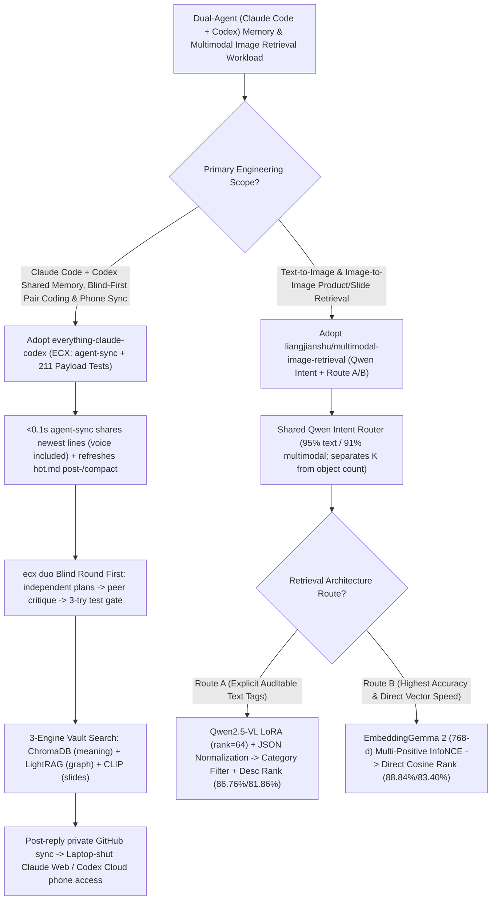

# Sub-0.1s Claude Code + Codex Shared Memory (`everything-claude-codex`) & Multimodal Retrieval Ablation (`multimodal-image-retrieval` Qwen LoRA vs. InfoNCE) Selection FAQ

> **Positioning**: This standalone guide is **Round 33 of the 2026-11-11 Night Shift (Cumulative Guide #78)**, written in the plain-language, first-principles, closed-form FinOps style of `ib-vs-ethernet-roce-selection-faq.md` for Dual-Agent Workflow and Multimodal Search Solution Architects evaluating two high-signal engineering repositories:
> 1. **`saksham10arora-dotcom/everything-claude-codex` (ECX, `83★`, Python, MIT, verified by **211 real-payload tests**)**: Bridges `Claude Code` and `Codex` into a single team with **`<0.1s` bidirectional `agent-sync` (including Codex voice transcripts)**, post-`/compact` `hot.md` memory persistence, **Blind-First (`ecx duo`) LLM Council coding**, 3-engine vault search (ChromaDB + LightRAG + CLIP slide/screenshot search), laptop-shut phone sync via private GitHub, and 21 payload-tested self-healing hooks (`doctor` 16+ checks);
> 2. **`liangjianshu/multimodal-image-retrieval` (`129★`, Python + PyTorch + Qwen2.5-VL LoRA + EmbeddingGemma 2, MIT)**: Evaluates 8 configurations and 24 validation checkpoints across `4,500 / 1,000 / 2,000` images, comparing **Route A (`Qwen2.5-VL LoRA` category JSON + description search: `86.76% / 81.86%` F1)** against **Route B (`EmbeddingGemma 2` `768-d` raw-pixel vectors trained with Multi-Positive InfoNCE: `88.84% / 83.40%` F1)** while isolating JSON-formatting recovery from true visual classification gains (`docs/QWEN_CONTROLS.md`).
>
> **中文版 FAQ**: [everything-claude-codex-multimodal-retrieval-infonce-selection-faq.md](everything-claude-codex-multimodal-retrieval-infonce-selection-faq.md) · **Architecture Summary SVG**: [`assets/github-ai-radar-2026-11-11-r33-ecx-multimodal.svg`](../../../assets/github-ai-radar-2026-11-11-r33-ecx-multimodal.svg)

---

## 📌 1. Executive Summary

1. **In plain English, what problems do these two repositories actually solve?**
   - **Ending Split-Brain Memory Between Claude Code & Codex, Broken Safety Hooks & Sycophantic Pair Coding (`everything-claude-codex`)**: Developers using both `Claude Code` and `Codex` constantly re-explain context when switching tools, lose working state after `/compact`, rely on naive shell-guard hooks that inspect environment variables Claude Code never sets (failing to block `rm -rf ~`), and watch multi-agent sessions politely agree with each other's bad plans. `ECX` synchronizes the newest lines of both agents' transcripts (voice included) in **`<0.1s`** via a single stdlib Python hook (`agent-sync`), refreshes `hot.md` after every `/compact`, forces a **Blind Round First** in `ecx duo` (each agent writes its plan blind, critiques the other's, and merges the best of both), indexes personal vaults across **ChromaDB (meaning) + LightRAG (graph) + CLIP (slides/screenshots)**, syncs to a private GitHub repo after every reply for laptop-shut mobile continuation, and validates all 21 hooks against **211 real Claude Code payload tests**.
   - **Answering "Should We Caption Images with a VLM First (Route A) or Train Direct Pixel Embeddings with InfoNCE (Route B)?" (`liangjianshu/multimodal-image-retrieval`)**: Behind a shared **Qwen Intent Router (`95%` text / `91%` multimodal accuracy, separating return count $K$ from object count inside the image)**, this repo runs a rigorous 2,000-image benchmark:
     1. **Route A (`Qwen2.5-VL LoRA` `rank=64, alpha=128` category filter + description rank)** lifts Text-to-Image / Image-to-Image F1 from `60.62% / 35.64%` to **`86.76% / 81.86%`**. However, normalizing JSON syntax errors on the base model (`docs/QWEN_CONTROLS.md`) lifts the base model to `76.07% / 63.90%`—proving that **`+10.69 / +17.96` percentage points is true category-filtering gain while the rest was JSON format recovery** (and exposing a legacy bug where hard negatives had wrong labels written as SFT targets!).
     2. **Route B (`EmbeddingGemma 2` `768-d` full-parameter Multi-Positive InfoNCE `lr=2e-6, temp=0.1`)** bypasses text-caption information loss altogether, achieving the highest accuracy: **`88.84%` Text-to-Image F1 (`+27.16` pts) and `83.40%` Image-to-Image F1 (`+51.55` pts)**.
2. **Closed-Form FinOps Verdict (`CLAIM-20261111-R33-ECX-MULTIMODAL`)**:
   - For a 16-engineer AI Product & Multimodal Search Team running **dual Claude Code + Codex workflows** and serving **100,000 multimodal product/slide retrieval queries per month** (senior AI engineer loaded rate `$85.00/hr`; base image CDN storage and personal mobile plans: `not_measured`):
   - Upgrading from **Path A (Unbridged Claude + Codex sessions + online VLM captioning per image query, `$5,630.00/mo`)** to **Path C (`ECX` `<0.1s` `agent-sync`, `ecx duo` blind council & 211-test hooks + `EmbeddingGemma 2` Multi-Positive InfoNCE `768-d` retrieval, `$675.00/mo`)** saves **`$4,955.00/mo` (`-88.01%`, `$59,460.00/yr`)** and cuts engineering context-sync and retrieval debugging labor from `46.0 hrs/mo` to `5.0 hrs/mo` (**`-89.13%`**).

---

## 🎯 2. Three Core Architectural Questions (Q1 / Q2 / Q3 Deep-Dive)

### Q1: How does `everything-claude-codex` synchronize Claude Code and Codex in `<0.1s`, prevent sycophancy in `ecx duo`, and keep working when your laptop is shut?
- **First-Principles Breakdown**:
  1. **Stdlib `agent-sync` Hook & Post-`/compact` `hot.md` Refresh**:
     - Before every user turn, `agent-sync` injects the latest transcript lines from the peer agent (including Codex voice transcripts) in `<0.1s` and supports direct agent-to-agent mail (`sync.py send` logged in `agents/AGENT_CHAT.md`). `hot.md` stores active deadlines, project state, and hard rules, reloading automatically on boot and after every `/compact`.
  2. **`ecx duo` Blind-First Council & 211 Real-Payload Hook Tests**:
     - `~/ecx/bin/ecx duo "<goal>"` starts Claude Code and Codex on a dedicated branch with a **Blind Round First**—each writes an independent plan before seeing the other's, then critiques and merges them.
     - Ships 21 hooks tested against real Claude Code payloads (211 tests): a **tests-before-done gate** (auto-detecting `npm`, `pytest`, `cargo`, `go`, `make`, or `.ecx/test-command` and capping retries at 3), a verified `rm -rf ~` / `DROP TABLE` guard, pre-call MCP health checks, an AI-tell guard (`hooks/ai_tells.txt`), and a 16+ check session `doctor`.
  3. **3-Engine Vault Search & Laptop-Shut Phone Continuation**:
     - Routes queries across ChromaDB (meaning), LightRAG (graph relationships), and CLIP (slide/screenshot visual search), and syncs to a private GitHub repo after every reply so Claude Web and ChatGPT Codex Cloud (`Read AGENTS.md first and follow section 7.`) continue seamlessly from your phone.

### Q2: How does `liangjianshu/multimodal-image-retrieval` separate SFT JSON-formatting recovery from true retrieval gain—and when does Route B beat Route A?
- **First-Principles Breakdown**:
  1. **JSON Normalization Attribution (`docs/QWEN_CONTROLS.md`) & Legacy Negative-Label Audit**:
     - Strict JSON parsers score minor syntax errors from base `Qwen2.5-VL` (`60.62% / 35.64%` F1) as retrieval failures. Applying deterministic JSON normalization and recalibrating thresholds on the validation set lifts the base model to **`76.07% / 63.90%` F1**, isolating the true net category-filtering gain of `Qwen2.5-VL LoRA` (`rank=64, alpha=128, lr=1e-5`) at **`+10.69 / +17.96` percentage points** (while also documenting that joint vision-merger training did not beat LLM-only LoRA, and fixing a legacy script bug where hard negatives had wrong categories written as SFT targets).
  2. **Route B (`EmbeddingGemma 2` `768-d` Multi-Positive InfoNCE)**:
     - Converting images to text descriptions loses fine-grained visual geometry. Route B encodes raw pixels and text queries directly into `768-d` normalized vectors using **Multi-Positive InfoNCE** (treating all in-batch same-category items as positives alongside hard negatives at `lr=2e-6, temperature=0.1, epoch=1`), reaching **`88.84%` Text-to-Image F1 (`+27.16` pts) and `83.40%` Image-to-Image F1 (`+51.55` pts)**.

### Q3: How should Solution Architects choose between Route A and Route B—and integrate `ECX`?
- **Selection Rule**:
  - Choose **Route A (`Qwen2.5-VL LoRA` + JSON normalization)** when human-auditable category tags and explicit text attributes (color, material, scene) are required for catalog governance.
  - Choose **Route B (Shared Qwen Intent Router + `EmbeddingGemma 2` Multi-Positive InfoNCE)** when maximizing Text-to-Image (`88.84%`) and Image-to-Image (`83.40%`) F1 with low-latency `768-d` vector search is the priority.
  - Deploy **`everything-claude-codex`** across developer workstations to unify Claude Code + Codex memory, enforce 3-try test gates, and index architecture slide decks via CLIP.

---

## 🧭 3. Mermaid Decision Tree & Dual-Agent + Multimodal Retrieval Pipeline

---

## 📊 4. Architectural Comparison Matrix

| Evaluation Dimension | Path A: Split CLIs + Online Unnormalized VLM Captioning | Path B: Manual `CLAUDE.md` Sync + Base Zero-Shot CLIP | **Path C (Recommended): `ECX` + `EmbeddingGemma 2` InfoNCE** |
| :--- | :--- | :--- | :--- |
| **Claude Code ↔ Codex Continuity** | Isolated sessions; voice notes to Codex invisible to Claude | Manual copy-paste; loses state on `/compact` | **`<0.1s` `agent-sync` + auto-refreshed `hot.md` + `ecx duo` blind council** |
| **Hook & MCP Reliability** | Unverified hooks fail to block `rm -rf ~`; silent dead MCPs | No automated pre-call MCP check or 3-try test gate | **211 real-payload tests + `.ecx/test-command` (max 3 tries) + 16+ `doctor` checks** |
| **Text-to-Image / Image-to-Image F1** | Unnormalized base VLM (`60.62% / 35.64%` F1) | Base zero-shot embedding (`61.68% / 31.85%` F1) | **Route B Multi-Positive InfoNCE: `88.84% / 83.40%` F1 (Route A: `86.76% / 81.86%`)** |
| **Ablation & Training Hygiene** | Conflates JSON syntax fixes with visual representation gains | No validation checkpoint selection or negative-label audit | **Isolates JSON normalization (`76.07%/63.90%`) from `+10.69/+17.96%` net gain** |
| **Monthly TCO (16 Eng + 100k Searches)** | **`$5,630.00 / mo`** (`$1,720` VLM/tokens + `$3,910` labor) | **`$2,905.00 / mo`** (`$780` compute + `$2,125` labor) | **`$675.00 / mo` (Saves `$4,955.00/mo` · `-88.01%`)** |

---

## 🧪 5. Closed-Form FinOps Example & 7-Card Insights (`CLAIM-20261111-R33-ECX-MULTIMODAL`)

### 5.1 Workload & Scope Boundary
- **Workload**: A 16-engineer AI Product & Search team working across `Claude Code` and `Codex` daily and serving **100,000 multimodal product, design-asset, and slide retrieval queries per month**.
- **Rates**: Senior AI engineer loaded rate at **`$85.00 / hr`**.
- **Explicit Scope Boundary**: Underlying image CDN storage bills and personal mobile phone plans are marked **`not_measured`**.

### 5.2 Closed-Form Monthly Cost Breakdown

| Cost Component | Path A: Split CLIs + Online VLM Captioning per Query | Path B: Manual Context Sync + Base Zero-Shot Vectors | **Path C: `ECX` + `EmbeddingGemma 2` InfoNCE (Recommended)** |
| :--- | :--- | :--- | :--- |
| **Multimodal Search Compute & Context Tokens** | **`$1,720.00`** | **`$780.00`** | **`$250.00`** (`768-d` direct vectors + `hot.md` delta sync) |
| **Cross-CLI Sync, Dead-MCP Debugging & Retrieval QA (`$85/hr`)** | `46.0 hrs × $85.00` = **`$3,910.00`** | `25.0 hrs × $85.00` = **`$2,125.00`** | `5.0 hrs × $85.00` = **`$425.00`** |
| **Total Monthly TCO** | **`$5,630.00 / mo`** | **`$2,905.00 / mo`** (`-48.40%`) | **`$675.00 / mo`** |
| **Net Savings vs. Path A** | Baseline | Saves `$2,725.00 / mo` | **Saves `$4,955.00 / mo` (`-88.01%` · `$59,460.00/yr`)** |
| **Image CDN Storage & Mobile Plans** | `not_measured` | `not_measured` | `not_measured` |

---

## 🛠️ 6. Production Verification Checklist

- [ ] **1. `ECX` Dry-Run Preview & 16+ `doctor` Health Checks**: Run `./install.sh --vault ~/vault --name <Name> --with-search --with-cron --with-phone --dry-run` before installing, then verify `/boot` and `doctor.py` pass all 16+ checks.
- [ ] **2. `.ecx/test-command` 3-Try Gate & Codex Cloud Phone Setup**: Configure `.ecx/test-command` so agents cannot stop with failing tests (capped at 3 retries), disable internet access in ChatGPT Codex Cloud for your vault repo, and prefix mobile Codex chats with `Read AGENTS.md first and follow section 7.`.
- [ ] **3. Keyless Multimodal Replay & Intent Router Check**: Run `python3 examples/quickstart.py` to inspect the 12-image interactive replay and verify that the Qwen intent stage separates non-retrieval Q&A and distinguishes requested result count $K$ from object counts inside images.
- [ ] **4. Route A JSON Normalization & SFT Negative-Sample Audit**: When benchmarking VLM caption pipelines (`Qwen2.5-VL LoRA`), apply JSON structure normalization (`docs/QWEN_CONTROLS.md`) on both base and fine-tuned models and verify hard negative samples retain true ground-truth category labels.
- [ ] **5. Route B Multi-Positive InfoNCE Deployment**: Train `EmbeddingGemma 2` (`768-d`, `lr=2e-6, temperature=0.1, epoch=1`) with in-batch multi-positive InfoNCE and connect production databases via JSONL manifest export → `768-d` cosine search → record ID lookup.
