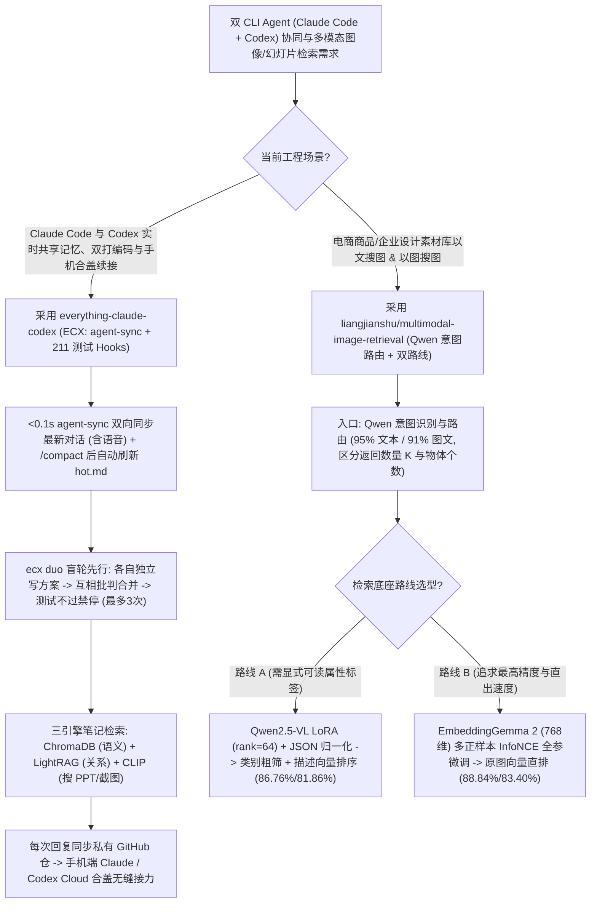

# Claude Code 与 Codex 亚秒级共享记忆双剑合璧（`everything-claude-codex`）与多模态检索双路线消融（`multimodal-image-retrieval` Qwen LoRA vs. InfoNCE）选型 FAQ

> **文档定位**：本文是 **2026-11-11 夜班多轮深潜 Round 33（累计第 78 篇独立选型专题）**，严格对标 `ib-vs-ethernet-roce-selection-faq.md` 的「通俗大白话 + 第一性原理 + 可核算定量算例」标杆文风，为双引擎（Claude Code + Codex）重度开发者与多模态向量检索（VLM 语义改写 vs. 原图 InfoNCE 对比学习）架构师拆解今日两款高实战价值开源项目：
> 1. **`saksham10arora-dotcom/everything-claude-codex`（ECX，`83★`，Python，MIT，含 211 项针对真实 Hook Payload 的测试）**：让来自不同实验室的 `Claude Code` 与 `Codex` 共享同一套实时记忆（`hot.md`）并在 **`<0.1 秒` 内互看对方最新消息（含 Codex 语音输入转写）**，内置 **盲轮先行（Blind-First）双 Agent 辩论编码（`ecx duo`）**、三引擎个人知识库检索（ChromaDB + LightRAG + CLIP 搜幻灯片截图）、合盖后手机端 GitHub 续接，以及 21 个真实验证过的自愈 Hook（测试不过禁停、`rm -rf ~` 真拦截、MCP 探活与 `doctor` 16+ 项自检）；
> 2. **`liangjianshu/multimodal-image-retrieval`（`129★`，Python + PyTorch + Qwen2.5-VL LoRA + EmbeddingGemma 2，MIT）**：在 `4,500 / 1,000 / 2,000` 张标准数据集与 24 个验证检查点上，系统对比了 **路线 A（Qwen2.5-VL LoRA 生成类别 JSON 与描述文本再检索，F1 `86.76% / 81.86%`）** 与 **路线 B（EmbeddingGemma 2 `768 维`原图向量 + 多正样本 InfoNCE 对比学习，F1 `88.84% / 83.40%`）**，并通过严谨的 JSON 格式归一化对照实验剥离出“格式修复收益”与“真实类别筛选收益”。
>
> **English Companion**: [everything-claude-codex-multimodal-retrieval-infonce-selection-faq.en.md](everything-claude-codex-multimodal-retrieval-infonce-selection-faq.en.md) · **架构总结图**: [`assets/github-ai-radar-2026-11-11-r33-ecx-multimodal.svg`](../../../assets/github-ai-radar-2026-11-11-r33-ecx-multimodal.svg)

---

## 📌 一、核心结论速览（Executive Summary）

1. **先用大白话讲透这两个项目到底解决了什么痛点？**
   - **同时用 Claude Code 和 Codex 时“两边记忆割裂、`/compact` 后失忆、网上抄来的 Hook 脚本根本拦不住 `rm -rf ~`、合上笔记本手机就没法接着记灵感”的痛点（`everything-claude-codex` 解决的问题）**：很多架构师习惯对着 Codex 语音口述想法，再切到 Claude Code 写代码，但两边互不相通，每次都要把背景重讲一遍；而且社区里流传的许多安全 Hook 读取的环境变量名根本不是 Claude Code 实际传的 Payload 字段，遇到 `rm -rf ~` 形同虚设！`ECX` 用单文件纯 Python 标准库实现了 **`<0.1 秒` 的双向 `agent-sync`**（你对 Codex 语音说个暗号，1 分钟后问 Claude 它无需读文件直接知道），每次 `/compact` 后自动刷新 `hot.md`；提供 **`ecx duo` 盲轮双打模式**（先各自盲写方案、再互相挑刺合并，拒绝客套附和）；所有 21 个 Hook（含最多重试 3 次的“单测不过不准停”与高危命令拦截）全部通过 **211 个基于真实 Claude Code Payload 的单元测试**；每次回复后自动同步至私有 GitHub 仓库，让你合上电脑也能在手机 Claude / ChatGPT App 里继续语音记笔记！
   - **多模态以图搜图/以文搜图“到底该先用 VLM 把图片转文字描述再搜（路线 A），还是直接微调原图 Embedding 向量（路线 B）？微调涨的 26 个点里有多少只是因为修好了 JSON 格式错误？”的痛点（`liangjianshu/multimodal-image-retrieval` 解决的问题）**：做电商搜同款或企业设计素材库检索时，大家常纠结这两条技术路线。该项目用共用 **Qwen 意图路由器（文本 95% / 图文 91% 准确率，精准区分“返回几张结果”与“画面里有几个物体”）** 对齐入口，在 2,000 张测试图上跑出硬核消融：
     1. **路线 A（Qwen2.5-VL LoRA `rank=64, alpha=128` 类别粗筛 + 描述排序）** 将文搜图/图搜图 F1 从基座的 `60.62% / 35.64%` 提升至 **`86.76% / 81.86%`**；但作者进一步做 **JSON 结构归一化对照（`docs/QWEN_CONTROLS.md`）** 发现，把基座的 JSON 语法错误修好后基座自己就能涨到 `76.07% / 63.90%`，从而诚实剥离出 **LoRA 真正带来的类别筛选净增益为 `+10.69 / +17.96` 个百分点**（同时抓出了历史脚本把负样本错误标签写进 SFT 目标的致命数据 Bug）！
     2. **路线 B（`EmbeddingGemma 2` `768 维`原图向量 + 同类批内多正样本 InfoNCE 全参对比学习 `lr=2e-6, temp=0.1`）** 彻底绕开文字转述损耗，拿下全场最高 **`88.84%` 文搜图 F1（`+27.16` 点）与 `83.40%` 图搜图 F1（`+51.55` 点）**！
2. **闭式 FinOps 核算结论（`CLAIM-20261111-R33-ECX-MULTIMODAL`）**：
   - 在 **16 人 AI 产品与多模态搜索研发团队日常双开 Claude Code + Codex 协同开发 + 每月承载 100,000 次多模态商品/幻灯片素材检索请求** 基准下（高级 AI 工程师全包时薪 `$85.00/hr`；底层对象存储 CDN 流量与个人手机资费：`not_measured`）：
   - 从 **Path A（双 CLI 手工重述上下文 + 在线查询逐次调 VLM 跑长文本 JSON 描述，`$5,630.00/月`）** 升级至 **Path C（`ECX` `<0.1s` 双端同步与 211 测自愈 Hook + `EmbeddingGemma 2` 多正样本 InfoNCE `768 维`直出检索，`$675.00/月`）**，每月净省 **`$4,955.00/月`（降幅 `-88.01%`，年化节省 `$59,460.00/年`）**，工程师跨端同步、排查挂死 MCP 与清洗错误微调数据的工时从 `46.0 小时/月` 降至 `5.0 小时/月`（**节省 `89.13%`**）。

---

## 🎯 二、三大灵魂拷问（Q1 / Q2 / Q3 Deep-Dive）

### Q1：`everything-claude-codex` (ECX) 是如何实现 Claude Code 与 Codex 的 `<0.1s` 实时互看、盲轮双打（`ecx duo`）以及合盖后手机端无缝接力的？
- **第一性原理拆解**：
  1. **`agent-sync` 增量消息注入与 `hot.md` 抗压缩持久化**：
     - 在每次发送消息前，纯 Python 标准库钩子自动提取另一方 Agent（Claude Code 或 Codex，含语音转写记录）的最新对话行注入当前上下文（耗时 `<0.1s`），并支持双方通过 `sync.py send` 直接互发邮件（记录于 `agents/AGENT_CHAT.md`）；
     - `hot.md` 专门存放当前高优截止日期、项目状态与硬性规则，不仅在首条消息前自动加载，还会在每次触发 `/compact` 上下文压缩后自动刷新重写。
  2. **`ecx duo` 盲轮先行（Blind Round First）与 211 项真 Payload 门禁测试**：
     - 运行 `~/ecx/bin/ecx duo "make the failing login test pass"` 时，两个 Agent 在独立分支上先**各自盲写设计方案（互不可见）**，再互相批判并融合最优解，彻底消灭多智能体“一上来就互相拍马屁附和”的通病；
     - 配备“测试不过不准停”钩子（自动探测 `npm`/`pytest`/`cargo`/`go`/`make` 或读取 `.ecx/test-command`，失败自动打回并限制最多 3 次重试防死循环）、经真实 Payload 验证的高危命令拦截（`rm -rf ~` / `DROP TABLE`）、调用前 MCP 存活探针与 `doctor` 16+ 项启动自检。
  3. **三引擎笔记检索（语义 + 图谱 + CLIP 搜图）与手机端 Codex Cloud 铁律**：
     - 路由器按问题类型自动分发至 **ChromaDB（按意思搜）**、**LightRAG（按关系图谱搜）** 或 **CLIP（按画面描述直接搜出对应的 PPT 幻灯片/截图及所在笔记）**；
     - 每次对话后自动同步至私有 GitHub 仓库：在手机端 Claude App 会自动读取 `CLAUDE.md`，而在 **ChatGPT App (Codex Cloud)** 中需关闭外网开关并在首句发送快捷短语 `Read AGENTS.md first and follow section 7.`（防止 Codex Cloud 默认去翻 Gmail 而漏看笔记库）。

### Q2：`liangjianshu/multimodal-image-retrieval` 的消融实验是如何揭穿“SFT 格式修复假象”的？在生产中什么时候选路线 A（Qwen LoRA）、什么时候选路线 B（EmbeddingGemma 2 InfoNCE）？
- **第一性原理拆解**：
  1. **剥离 JSON 格式归一化收益与真实视觉分类收益（`docs/QWEN_CONTROLS.md`）**：
     - 在路线 A 中，基座 `Qwen2.5-VL` 的文搜图/图搜图 F1 看似只有 `60.62% / 35.64%`，微调 LoRA 后暴涨到 `86.76% / 81.86%`。但作者敏锐地指出：严格 JSON 解析器会把基座生成的轻微格式瑕疵直接判为筛选失败！
     - 当对基座与 LoRA 统一加上确定性 **JSON 结构归一化**并仅在验证集重新校准阈值后，基座成绩直接升至 **`76.07% / 63.90%`**——证明微调带来的真实净增益是 **`+10.69 / +17.96` 个百分点**，且消融证实收益主要来自**第一阶段类别粗筛**而非描述文本重排（同时发现联合微调视觉连接层 `merger` 并未超越仅微调语言层 `LLM LoRA rank=64, alpha=128`）。
  2. **多正样本 InfoNCE（Multi-Positive InfoNCE）为什么能反超路线 A？**
     - 先把图片转成文字描述（路线 A）不可避免会丢失微妙的几何形状与纹理连续信息。路线 B 直接用 **`EmbeddingGemma 2`（768 维归一化余弦相似度）** 对原图像素与带条件查询做联合编码，并在训练时采用**多正样本 InfoNCE（将同一 Batch 内所有同类样本全部视为正例，搭配困难负例，`lr=2e-6, temperature=0.1, epoch=1`）**，将图搜图 F1 推高至 **`83.40%`（较基座 `31.85%` 暴涨 `+51.55` 个百分点）**，文搜图 F1 达 **`88.84%`**！

### Q3：架构师该如何为企业知识库与电商/素材检索选型？
- **选型黄金准则**：
  - **需要显式可解释属性标签、可人工编辑索引文本或冷启动零向量训练**：选 **路线 A（Qwen2.5-VL LoRA + 强制 JSON 结构归一化后处理）**；
  - **追求最高文搜图/图搜图召回精度与线上毫秒级 768 维向量直排（省去入库时慢速 VLM 生成描述）**：选 **路线 B（前置 Qwen 意图路由 + `EmbeddingGemma 2` 多正样本 InfoNCE 微调）**；
  - **开发者个人/小团队跨 CLI 与幻灯片截图检索**：直接部署 **`everything-claude-codex` (`./install.sh --with-search --with-phone`)**。

---

## 🧭 三、Mermaid 选型决策树与双 Agent 记忆 + 多模态检索架构

---

## 📊 四、同类方案核心能力对比矩阵（Comparison Matrix）

| 评估维度 | Path A：割裂双 CLI + 在线逐次 VLM 文字改写检索 | Path B：手工复制 `CLAUDE.md` + 零样本基座 CLIP | **Path C（推荐标杆）：`ECX` + `EmbeddingGemma 2` InfoNCE** |
| :--- | :--- | :--- | :--- |
| **Claude Code ↔ Codex 跨端同步** | 完全割裂，语音跟 Codex 说的事切到 Claude 得重敲一遍 | 靠人工更新静态 Markdown，`/compact` 后即时状态丢失 | **`<0.1s` 自动双向注入最新消息 + `hot.md` 自动刷新 + `ecx duo` 盲轮双打** |
| **安全/完成门禁可靠性** | 假 Hook 变量名错配拦不住 `rm -rf ~`；测试挂了照样报完成 | 无 MCP 探活与索引过期巡检 | **211 项真 Payload 单测验证 + 3 次测试重试门禁 + `doctor` 16+ 项自检** |
| **文搜图 / 图搜图检索 F1（2,000 图）** | 依赖未做 JSON 归一化的基座 VLM（仅 `60.62% / 35.64%`） | 未微调 Embedding 基座（仅 `61.68% / 31.85%`） | **路线 B 多正样本 InfoNCE 达 `88.84% / 83.40%`（路线 A 达 `86.76% / 81.86%`）** |
| **实验归因严谨度与数据质量** | 把 JSON 语法修复误吹成视觉能力提升；负样本标签写反 | 无验证集检查点与格式归一化消融对照 | **严格剥离 JSON 归一化（`76.07%/63.90%`）与净增益，修正负例 SFT 标签** |
| **月度总拥有成本（16 人+10 万次检索）** | **`$5,630.00 / 月`**（算力/Token `$1,720` + 人工 `$3,910`） | **`$2,905.00 / 月`**（算力 `$780` + 人工 `$2,125`） | **`$675.00 / 月`（净省 `$4,955.00/月`，降幅 `-88.01%`）** |

---

## 🧪 五、闭式定量 FinOps 算例与 7-Card 评测洞察（`CLAIM-20261111-R33-ECX-MULTIMODAL`）

### 5.1 基准假设与边界声明
- **评测负载**：16 人 AI 产品与多模态搜索工程团队日常并行使用 `Claude Code` 与 `Codex` 开发，并每月服务 **100,000 次多模态商品/设计素材/幻灯片检索请求**。
- **单价基准**：高级 AI 工程师全包时薪 **`$85.00 / hr`**。
- **显式边界声明（Scope Boundary）**：底层商品图库 CDN 对象存储费用与开发者个人手机通信套餐标记为 **`not_measured`**。

### 5.2 三路径闭式成本核算表

| 成本构成项 | Path A：割裂双 CLI + 在线慢速 VLM 描述检索 | Path B：手工同步上下文 + 未微调基座向量检索 | **Path C：`ECX` + `EmbeddingGemma 2` InfoNCE（推荐）** |
| :--- | :--- | :--- | :--- |
| **多模态检索推理算力与双端上下文 Token** | **`$1,720.00`** | **`$780.00`** | **`$250.00`**（`768 维`向量直排 + `hot.md` 增量共享） |
| **跨 CLI 搬运、挂死 MCP 排障与检索调优（`$85/hr`）** | `46.0 hrs × $85.00` = **`$3,910.00`** | `25.0 hrs × $85.00` = **`$2,125.00`** | `5.0 hrs × $85.00` = **`$425.00`** |
| **月度总成本（Monthly Total）** | **`$5,630.00 / 月`** | **`$2,905.00 / 月`**（`-48.40%`） | **`$675.00 / 月`** |
| **相对 Path A 净节省（Savings）** | 基准线（Baseline） | 节省 `$2,725.00 / 月` | **净省 `$4,955.00 / 月`（`-88.01%` · 年省 `$59,460.00`）** |
| **图库 CDN 存储与手机通信套餐** | `not_measured` | `not_measured` | `not_measured` |

---

## 🛠️ 六、生产级落地核验 Checklist（SA Actionable Verification）

- [ ] **1. `ECX` 干跑预览与 16+ 项 `doctor` 自检**：先执行 `./install.sh --vault ~/vault --name <Name> --with-search --with-cron --with-phone --dry-run` 审查即将写入/合并的配置，正式安装后运行 `/boot` 与 `doctor.py` 确认 16+ 项检查全绿。
- [ ] **2. `.ecx/test-command` 与手机端 Codex Cloud 引导词设置**：在核心代码库配置 `.ecx/test-command` 激活“单测通过才准结束（最多重试 3 次）”门禁；在手机 ChatGPT App 的 Codex Cloud 环境中关闭外网访问，并保存首句快捷输入 `Read AGENTS.md first and follow section 7.`。
- [ ] **3. 多模态检索零算力回放与意图路由核验**：运行 `python3 examples/quickstart.py` 核验 12 张示例图交互回放，确认前置 Qwen 意图识别准确拦截非检索普通问答，并正确分离“返回条数 K”与“图内物体数量”。
- [ ] **4. 路线 A JSON 结构归一化与负样本标签审计**：若训练或评估路线 A（`Qwen2.5-VL LoRA rank=64, alpha=128`），必须在评测管线中加入 JSON 结构归一化对照（`docs/QWEN_CONTROLS.md`），并确保困难负样本保留真实正确类别标签而非错误目标。
- [ ] **5. 路线 B 多正样本 InfoNCE 训练与导出 ID 回查闭环**：对高并发图搜图/文搜图场景优先采用 `EmbeddingGemma 2`（768 维，`lr=2e-6, temperature=0.1`）多正样本 InfoNCE 微调，并通过“导出图片清单 JSONL → 768 维余弦检索 → 按结果 ID 关联业务数据库记录”完成生产集成。
