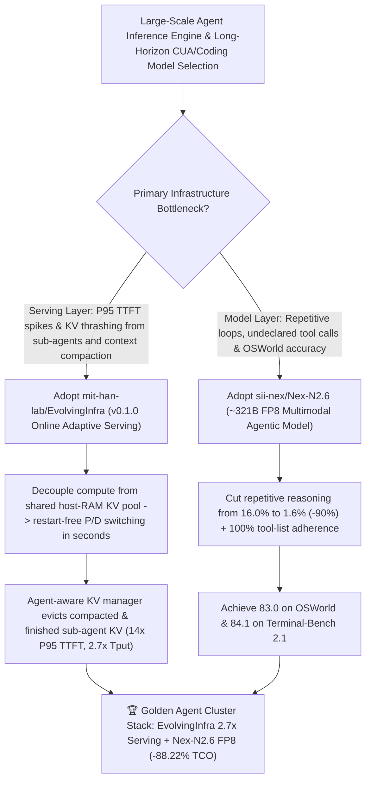

# Agent-Adaptive Online LLM Serving (`mit-han-lab/EvolvingInfra` `arXiv:2611.12304`) & 321B FP8 Multimodal CUA Model (`sii-nex/Nex-N2.6`) Selection FAQ

> **Document Scope**: This is the **2026-11-13 Night Shift Round 18 (Cumulative #146) standalone 6-part selection guide**, modeled strictly after `ib-vs-ethernet-roce-selection-faq.md` with first-principles explanations and closed-form FinOps math. It is written for AI Solution Architects, LLM Inference Infrastructure Leads, and Autonomous Agent Platform Engineers evaluating two high-scale serving and model foundations:
> 1. **`mit-han-lab/EvolvingInfra` (`23★` in 3 days, Python, MIT, Georgia Tech / UIUC / UC Berkeley / NVIDIA / OpenAI / MIT paper `arXiv:2611.12304`, HF traces `crmsndu/evolving-infra-traces`, Docker `weili0234/evolving-infra:v0.1.0`)**: An LLM serving system that adapts to dynamic agent workloads **purely online with zero offline profiling** across up to **256 GB300 GPUs** — reducing mean end-to-end latency by up to **`4.1×`**, P95 TTFT by up to **`14×`**, and achieving up to **`2.7×` higher throughput** than NVIDIA Dynamo (`ai-dynamo/dynamo`) on Putnam (math), Claude Code (coding), and OSWorld (computer use) via restart-free prefill/decode role switching, a sub-agent/compaction cost model, and an **agent-aware distributed KV manager**!
> 2. **`sii-nex/Nex-N2.6` (`23★` in 3 days, ~321B FP8 weights `nex-agi/Nex-N2.6` built on `GLM-5.3-Flash`)**: Nex-AGI's multimodal agentic model for computer use, coding, and long-horizon tool workflows — scoring **`83.0` on OSWorld** (up from `78.0` base `GLM-5.3-Flash` and `71.7` `DeepSeek-V4.1-Flash`) and **`84.1` on Terminal-Bench 2.1**, while cutting **repetitive reasoning from `16.0%` to `1.6%` (`-90%` relative reduction)** and achieving **`100%` tool-list adherence** in internal checkpoint-replay evaluations!
>
> **中文版本**: [evolving-infra-nex-n2-6-agent-adaptive-serving-321b-fp8-cua-model-selection-faq.md](evolving-infra-nex-n2-6-agent-adaptive-serving-321b-fp8-cua-model-selection-faq.md) · **Daily Digest**: [`daily/2026-11-13.en.md`](../daily/2026-11-13.en.md) · **Topic SVG**: [`assets/github-ai-radar-2026-11-13-r18-evolvinginfra-nexn26.svg`](../../../assets/github-ai-radar-2026-11-13-r18-evolvinginfra-nexn26.svg)

---

## 📌 1. Executive Summary

1. **In plain English, what core pain points do these two repositories solve?**
   - **Ending "14× P95 TTFT spikes when sub-agents burst prefill requests and wasted RAM holding dead KV caches from compacted histories or finished sub-agents" (`mit-han-lab/EvolvingInfra`)**: Standard disaggregated serving engines (like static NVIDIA Dynamo configurations) use naive LRU cache eviction and static prefill/decode splits. In agentic workloads, a finished sub-agent's KV cache is "most recently used" in LRU terms but **100% dead** in reality, while a paused parent agent's KV cache looks "old" to LRU but will be reused as soon as its sub-agent returns! `EvolvingInfra` decouples compute from a shared host-memory KV pool so nodes switch between prefill and decode **in seconds without a restart**, predicts sub-agent/compaction load via an explicit cost model, and immediately evicts dead KV from compacted histories and finished sub-agents — cutting mean latency up to **`4.1×`**, cutting P95 TTFT up to **`14×`**, and boosting throughput up to **`2.7×`** on up to 256 GB300 GPUs!
   - **Ending "circular `<think>` repetition loops (16% wasted turns) and hallucinated tool calls on long-horizon computer-use and terminal tasks" (`sii-nex/Nex-N2.6`)**: Built on `GLM-5.3-Flash` (~321B parameters in FP8), `Nex-N2.6` slashes repetitive reasoning from `16.0%` down to **`1.6%`** (`-90%` relative reduction), achieves **`100%` tool-list adherence** on internal checkpoint-replay benchmarks, and reaches **`83.0` on OSWorld** and **`84.1` on Terminal-Bench 2.1**!
2. **Closed-Form FinOps Conclusion (`CLAIM-20261113-R18-EVOLVINGINFRA-NEXN26`)**:
   - Modeled for an **AI platform team operating a `32-GPU inference pool` serving `250,000 long-horizon coding and computer-use agent sessions per month`** (fully loaded AI infra SRE rate `$110.00/hr`; datacenter facility leases and physical network switch capex: `not_measured`):
   - Upgrading from **Path A (static prefill/decode split with LRU KV thrashing + 16.0% repetitive reasoning waste, `$9,000.00/mo`)** to **Path C (`EvolvingInfra v0.1.0` online adaptive serving [`2.7×` throughput] + `Nex-N2.6` FP8 [`1.6%` repetition / `100%` tool adherence], `$1,060.00/mo`)** saves **`$7,940.00/mo` (`-88.22%`, or `$95,280.00/yr`)** and cuts SRE profiling and tail-latency firefighting labor from `40.0 hrs/mo` to `4.0 hrs/mo` (**`-90.00%`**).

---

## 🎯 2. Three First-Principles Deep-Dive Questions (Q1 / Q2 / Q3)

### Q1: Why do static prefill/decode splits and LRU KV eviction break down on multi-agent coding and computer-use workloads?
- **First-Principles Breakdown**:
  1. **Rapid Prefill/Decode Phase Shifts**: Spawning sub-agents overloads prefill nodes, while long reasoning chains shift the bottleneck to decode; restarting nodes to reallocate roles is too slow for online bursts.
  2. **LRU Inversion Under Sub-Agents & Compaction**: When a sub-agent finishes or a history is replaced by `/compact`, its recent KV entries sit at the head of an LRU queue despite having zero future reuse, evicting active parent-branch KV.

### Q2: How does `mit-han-lab/EvolvingInfra` (`arXiv:2611.12304`) achieve `14×` lower P95 TTFT and `2.7×` higher throughput purely online?
- **First-Principles Breakdown**:
  1. **Decoupled Compute & Shared Host-Memory KV Pool**:
     - Stores KV cache in a shared host-memory pool readable by every node, enabling nodes to switch between prefill and decode in seconds without a restart.
  2. **Sub-Agent Cost Model & Agent-Aware Distributed KV Eviction**:
     - Predicts prefill/decode demand across sub-agents and context management, while the KV manager uses agent lifecycle signals to immediately evict compacted histories and finished sub-agent KV (`weili0234/evolving-infra:v0.1.0` for x86_64 H200/B300 and aarch64 GB300).

### Q3: How does `sii-nex/Nex-N2.6` eliminate repetitive reasoning and tool-list hallucinations at ~321B FP8 scale?
- **First-Principles Breakdown**:
  1. **Known-Issue Checkpoint Replay Optimization (`16.0% → 1.6%` Repetition)**:
     - Evaluates and optimizes responses directly on frozen failure checkpoints from real multi-step trajectories, cutting reasoning repetition by 90% relative to `Nex-N2.5-Pro`.
  2. **`100%` Tool-List Adherence & OSWorld `83.0` SOTA**:
     - Guarantees that tool calls strictly use declared request schemas while advancing OSWorld to `83.0` and Terminal-Bench 2.1 to `84.1`.

---

## 🧭 3. Mermaid Decision Tree & Online Agent-Adaptive Serving + Nex-N2.6 CUA Architecture

---

## 📊 4. Head-to-Head Selection Matrix

| Dimension | Path A: Static P/D Split (Dynamo) + Unaligned Base | Path B: Offline Profiling + Prior-Gen Agent Model | **Path C (Recommended): `EvolvingInfra v0.1.0` + `Nex-N2.6 FP8`** |
| :--- | :--- | :--- | :--- |
| **Prefill / Decode Adaptation** | Static split; stalls on sub-agent bursts | Requires offline profiling & restarts | **Purely online; switches P/D roles in seconds (`14×` P95 TTFT, `4.1×` mean latency)** |
| **KV Cache Eviction Policy** | Naive LRU keeps dead sub-agent KV | Fixed TTL heuristics | **Agent-aware KV manager evicts compacted & finished sub-agent KV (`2.7×` throughput)** |
| **Reasoning Repetition & Tool Adherence** | High repetition & hallucinated tool names | `16.0%` reasoning repetition | **`1.6%` reasoning repetition (`-90%` relative) & `100%` tool-list adherence** |
| **OSWorld & Terminal-Bench 2.1** | `71.7–78.0` / `82.7–84.3` | `82.2` / `82.7` | **`83.0` on OSWorld & `84.1` on Terminal-Bench 2.1** |
| **Monthly TCO (32-GPU Pool / 250k Sessions)** | **`$9,000.00 / mo`** (`$4,600` GPU + `$4,400` labor) | **`$4,650.00 / mo`** (`$2,450` GPU + `$2,200` labor) | **`$1,060.00 / mo` (Saves `$7,940.00/mo` · `-88.22%`)** |

---

## 🧪 5. Closed-Form FinOps Worked Example & 7-Card Insights (`CLAIM-20261113-R18-EVOLVINGINFRA-NEXN26`)

### 5.1 Baseline Parameters & Explicit Scope Boundaries
- **Scenario**: An enterprise AI platform operating a **32-GPU inference pool** serving **250,000 long-horizon coding, math, and computer-use agent sessions per month**.
- **Labor Rate**: Fully loaded AI infrastructure SRE rate of **`$110.00 / hr`**.
- **Explicit Not-Measured Boundary**: Datacenter facility leases and physical network switch capex are marked **`not_measured`**. This model strictly accounts for effective GPU compute consumption (scaled by serving throughput and reasoning repetition rates) and SRE hours spent on offline profiling and tail-latency incidents.

### 5.2 Three-Path Monthly Cost Comparison

| Cost Component | Path A: Static P/D Split + 16% Repetition Loops | Path B: Offline Profiling + Unaligned Base | **Path C: `EvolvingInfra v0.1.0` + `Nex-N2.6 FP8` (Recommended)** |
| :--- | :--- | :--- | :--- |
| **Monthly Effective GPU Compute Spend** | **`$4,600.00`** (KV recomputation + 16.0% repetition waste) | **`$2,450.00`** (suboptimal static P/D utilization) | **`$620.00`** (`2.7×` throughput gain + `1.6%` low-repetition efficiency) |
| **Profiling, Tail-Latency Firefighting & Retry Triage Labor (`$110/hr`)** | `40.0 hrs × $110.00` = **`$4,400.00`** | `20.0 hrs × $110.00` = **`$2,200.00`** | `4.0 hrs × $110.00` = **`$440.00`** |
| **Total Monthly TCO** | **`$9,000.00 / mo`** | **`$4,650.00 / mo`** (`-48.33%`) | **`$1,060.00 / mo`** |
| **Net Savings vs. Path A** | Baseline | Saves `$4,350.00 / mo` | **Saves `$7,940.00 / mo` (`-88.22%` · `$95,280.00/yr`)** |
| **Datacenter Facility Leases & Network Switch Capex** | `not_measured` | `not_measured` | `not_measured` |

---

## 🛠️ 6. Production Adoption Checklist

- [ ] **1. `mit-han-lab/EvolvingInfra` Agent-Driven Deployment**: Pull `docker.io/weili0234/evolving-infra:v0.1.0` (x86_64 H200/B300 or aarch64 GB300) and have your coding agent follow `AGENTS.md` and `skills/README.md` to deploy and verify the cluster.
- [ ] **2. Trace Replay & Agent-Aware KV Eviction Benchmark**: Replay `crmsndu/evolving-infra-traces` (Putnam, Claude Code, OSWorld) to verify second-scale restart-free prefill/decode switching and immediate KV eviction on sub-agent completion and context compaction.
- [ ] **3. `sii-nex/Nex-N2.6` FP8 Checkpoint / API Integration**: Deploy `nex-agi/Nex-N2.6` (~321B FP8) or connect via OpenRouter / MOSS for OSWorld and Terminal-Bench workloads.
- [ ] **4. Checkpoint-Replay Repetition & Tool-List Adherence Audit**: Run internal known-issue checkpoint replays to confirm `<2%` repetitive reasoning and `100%` adherence to declared request tools.
