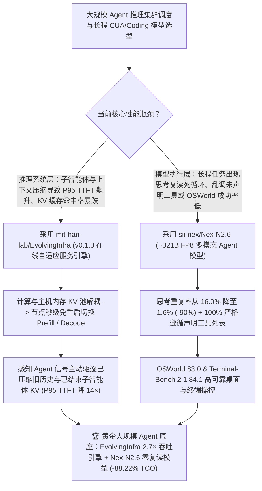

# 在线自适应 Agent 推理引擎（`mit-han-lab/EvolvingInfra` `arXiv:2611.12304`）与 321B FP8 零幻觉工具调用多模态智能体模型（`sii-nex/Nex-N2.6`）深度选型 FAQ

> **文档定位**：本专题是 **2026-11-13 夜班第 18 轮（累计第 146 篇）独立六段式选型指南**，严格对标 `ib-vs-ethernet-roce-selection-faq.md` 的通俗第一性原理与闭式 FinOps 核算规范，面向大规模 AI 推理基础设施负责人、多模态 CUA 算法架构师与 AI Solution Architect，深度拆解今日新仓爆发榜上由 MIT Han Lab 联合 Georgia Tech / UIUC / UC Berkeley / NVIDIA / OpenAI 推出的智能体推理系统与 Nex-AGI 321B 具身/计算机操控模型：
> 1. **`mit-han-lab/EvolvingInfra`（3 天新建获 `23★`，Python，MIT，论文 `arXiv:2611.12304`，配套 HuggingFace `crmsndu/evolving-infra-traces` 与 Docker `weili0234/evolving-infra:v0.1.0`）**：面向大规模智能体负载的**纯在线自适应大模型推理系统（无需任何离线 Profiling）**——在高达 **256 张 GB300 GPU** 上服务数学（Putnam）、编程（Claude Code）与计算机操控（OSWorld）智能体（搭载 `GLM-5.2` 与 `Kimi K2.6`），相比 **NVIDIA Dynamo** 将**平均端到端延迟降低高达 `4.1×`、P95 首字延迟（TTFT）降低高达 `14×`、吞吐量提升高达 `2.7×`**！通过三大核心机制实现：① 计算分配与共享主机内存 KV 池解耦（节点在 Prefill 与 Decode 间**秒级无重启热切换**）；② 覆盖子智能体与上下文压缩的负载代价预测模型；③ **感知 Agent 生命周期的分布式 KV 管理器（主动驱逐已被 `/compact` 压缩淘汰的历史 KV 与已结束子智能体的孤儿 KV）**！
> 2. **`sii-nex/Nex-N2.6`（3 天新建获 `23★`，约 321B 参数 FP8 量化权重 `nex-agi/Nex-N2.6`，基于 `GLM-5.3-Flash`）**：专为计算机使用（Computer Use）、编码与长程工具调用任务打造的多模态智能体模型——在 **OSWorld 基准上斩获 `83.0` 分**（超越 `GLM-5.3-Flash` 的 `78.0` 与 `DeepSeek-V4.1-Flash` 的 `71.7`）、Terminal-Bench 2.1 达 `84.1`，在内部检查点回放评测中将**重复思考（Repetitive Reasoning）从 `16.0%` 压降至 `1.6%`（相对降幅 `-90%`）**，并实现 **`100%` 工具列表遵循率（Tool-List Adherence，绝不捏造当前环境未声明的工具名）**！
>
> **English Version**: [evolving-infra-nex-n2-6-agent-adaptive-serving-321b-fp8-cua-model-selection-faq.en.md](evolving-infra-nex-n2-6-agent-adaptive-serving-321b-fp8-cua-model-selection-faq.en.md) · **关联日报**: [`daily/2026-11-13.md`](../daily/2026-11-13.md) · **专题架构图**: [`assets/github-ai-radar-2026-11-13-r18-evolvinginfra-nexn26.svg`](../../../assets/github-ai-radar-2026-11-13-r18-evolvinginfra-nexn26.svg)

---

## 📌 一、核心结论速览（Executive Summary）

1. **一句话大白话讲透这两个项目到底解决了什么痛点？**
   - **终结“用传统 PD 分离推理框架（如固定比例的 NVIDIA Dynamo）跑 Claude Code 或 OSWorld 智能体时，子智能体突然并发读大文件把 Prefill 打爆（P95 首字延迟飙升 14 倍），而子智能体跑完退出或触发上下文压缩后，报废的老 KV Cache 还占着宝贵内存不放”的痛点（`mit-han-lab/EvolvingInfra`）**：传统推理引擎把 Agent 请求当成互不相干的单轮问答，靠最近刚走过（LRU）猜哪个 KV Cache 有用。但 Agent 工作流有明确的生命周期：一个子智能体（Sub-agent）刚用完准备销毁，它的 KV Cache 在 LRU 看来“最新”，实际上**下一秒就彻底没用了**；反之，主智能体在等待子智能体期间暂停了，它的 KV Cache 在 LRU 看来“最老”，但**马上就要接着复用**！`EvolvingInfra` 直接听懂 Agent 的上下文信号：**已结束子智能体和已被 `/compact` 压缩替换的死 KV 当场驱逐，主干待复用 KV 稳稳保留在全局共享主机内存池里**，且计算节点可在几秒内免重启在 Prefill 和 Decode 之间动态变形，在 256 卡 GB300 上实测 P95 TTFT 暴降 **`14×`**、吞吐暴涨 **`2.7×`**！
   - **终结“长程 Agent 跑着跑着陷入车轱辘话死循环（16% 的回复在重复同一段思考），或者调出一个当前 MCP 环境里根本不存在的虚构工具名导致工作流报错中断”的痛点（`sii-nex/Nex-N2.6`）**：`Nex-N2.6`（约 321B FP8，基于 `GLM-5.3-Flash`）专门针对真实业务故障回放（Known-Issue Replay）做了外科手术级优化：把推理重复率从上一代的 **`16.0%` 猛砍 90% 降到 `1.6%`**，工具列表遵循率做到 **`100%`**，并在权威桌面操控基准 **OSWorld 上冲到 `83.0` 分**！
2. **闭式 FinOps 投资回报结论（`CLAIM-20261113-R18-EVOLVINGINFRA-NEXN26`）**：
   - 以 **企业 AI 推理平台维护 `32 卡 GPU 推理池`、每月承载 `250,000 次` 长程编码与 OSWorld 桌面操控智能体会话** 为基准（AI Infra SRE 全包时薪 `$110.00/hr`；机房土建租约与核心交换机硬件折旧：`not_measured`）：
   - 从 **Path A（静态 PD 分离推理池 + LRU 误杀主干 KV + 16.0% 重复思考车轱辘话烧算力，月均 `$9,000.00`）** 升级至 **Path C（`EvolvingInfra v0.1.0` 秒级免重启 PD 热切/Agent 感知 KV 驱逐 [`2.7×` 吞吐] + `Nex-N2.6` FP8 [`1.6%` 重复率 / `100%` 工具遵循]，月均 `$1,060.00`）**，每月净省 **`$7,940.00/mo`（降幅 `-88.22%`，年省 `$95,280.00/yr`）**，并将离线压测调参与 P95 尾延迟救火工时从 `40.0 hrs/mo` 压缩至 `4.0 hrs/mo`（节省 **`-90.00%`**）。

---

## 🎯 二、三大灵魂拷问（Q1 / Q2 / Q3 深度原理解析）

### Q1：为什么传统的“静态 PD 分离 + LRU 缓存淘汰”在遇到多子智能体（Sub-agents）和上下文压缩（Compaction）时会严重失效？
- **第一性原理拆解**：
  1. **Agent 负载的剧烈相变（Phase Shifts Between Prefill & Decode）**：当 Agent 派生 8 个子智能体并行扫描代码库时，集群瞬间被海量长上下文 Prefill 淹没；几秒后进入长链思考补丁阶段，瓶颈又突变为 Decode。如果节点重分配需要重启加载数百 GB 权重，根本追不上秒级波动。
  2. **LRU 策略与 Agent 语义完全倒挂**：子智能体结束返回摘要后，其数万 Token 的原始探索 KV 再也不会被访问，但因刚被读写而在 LRU 队列头部霸占内存；同时 `/compact` 压缩前的旧历史分支也沦为僵尸 KV，挤掉了真正需要保留的活跃分支缓存。

### Q2：`mit-han-lab/EvolvingInfra` (`arXiv:2611.12304`) 是如何实现“零离线压测、秒级免重启切换、P95 首字延迟降 `14×`”的？
- **第一性原理拆解**：
  1. **计算与共享主机内存 KV 池彻底解耦（Restart-Free Role Switching）**：
     - 所有 KV Cache 驻留在全节点可读的共享主机内存池（Host-Memory Pool）中；计算节点无需搬迁权重或重启进程，即可在数秒内由 Planner 在 Prefill 组与 Decode 组之间动态划拨。
  2. **子智能体/压缩感知的代价模型与分布式 KV 驱逐器**：
     - 代价模型显式建模子智能体派生与上下文管理事件以精准预测 Prefill/Decode 比例；分布式 KV 管理器接收来自 Agent 上下文层的信号，**精准驱逐已被压缩替代的旧历史 KV 与已完结子智能体 KV**，在 256 卡 GB300（支持 x86_64 H200/B300 与 aarch64 GB300 镜像 `weili0234/evolving-infra:v0.1.0`）上实测平均延迟降 `4.1×`、P95 TTFT 降 `14×`、吞吐升 `2.7×`。

### Q3：`sii-nex/Nex-N2.6` 是如何解决长程计算机操控（CUA）中的“死循环复读”与“工具名幻觉”的？
- **第一性原理拆解**：
  1. **已知故障回放评测（Known-Issue Checkpoint Replay）与重复率 `-90%` 压降**：
     - 针对真实长程任务中卡死的历史检查点重放测试，将推理重复率（Repetitive Reasoning）从 `Nex-N2.5-Pro` 的 `16.0%` 压低至 **`1.6%`**。
  2. **`100%` 工具列表遵循率与 OSWorld `83.0` 领先表现**：
     - 在所有发起工具调用的响应中实现 `100%` 严格局限于请求声明的工具集，并在 OSWorld 桌面操控基准上从基座 `GLM-5.3-Flash` 的 `78.0` 跃升至 **`83.0`**（Terminal-Bench 2.1 达 `84.1`）。

---

## 🧭 三、Mermaid 选型决策树与「EvolvingInfra 在线自适应推理 + Nex-N2.6 具身模型」架构图

---

## 📊 四、同类方案核心能力对比矩阵（Selection Matrix）

| 评估维度 | Path A：传统静态 PD 分离 (Dynamo) + 未对齐基座模型 | Path B：离线压测固定配比 + 上一代 Agent 模型 | **Path C（推荐）：`EvolvingInfra v0.1.0` + `Nex-N2.6 FP8`** |
| :--- | :--- | :--- | :--- |
| **Prefill / Decode 动态适应能力** | 固定节点配比，遇到子智能体突发 Prefill 排队阻塞 | 依赖离线 Profiling，负载变化需重启重配 | **纯在线自适应，计算节点秒级免重启切换（P95 TTFT 降 `14×`，平均延迟降 `4.1×`）** |
| **KV Cache 淘汰策略与有效复用率** | 盲目 LRU，保留已结束子智能体死 KV、踢掉主干活 KV | 仅按固定 TTL 过期 | **Agent 感知分布式 KV 管理：立即驱逐已压缩历史与完结子智能体 KV（吞吐升 `2.7×`）** |
| **长程推理复读率与工具名遵循率** | 容易陷入 `<think>` 复读且捏造工具名 | 重复思考率高达 `16.0%` | **重复思考率压至 `1.6%`（相对降 `-90%`）+ `100%` 工具列表遵循率** |
| **OSWorld 与终端操作实测表现** | `71.7–78.0` | `82.2` | **OSWorld `83.0` 分 + Terminal-Bench 2.1 `84.1` 分** |
| **月度总拥有成本（32 卡池 / 25 万会话）** | **`$9,000.00 / mo`**（`$4,600` 算力 + `$4,400` 工时） | **`$4,650.00 / mo`**（`$2,450` 算力 + `$2,200` 工时） | **`$1,060.00 / mo`（净省 `$7,940.00/mo` · `-88.22%`）** |

---

## 🧪 五、定量 FinOps 算例与 7-Card 洞察（`CLAIM-20261113-R18-EVOLVINGINFRA-NEXN26`）

### 5.1 测算基准与显式边界（Scope & Boundaries）
- **场景设定**：企业级 Agent 平台运营 **32 卡高性能 GPU 推理池**，每月服务 **250,000 次长程 Coding、数学推演与 OSWorld 计算机操控会话**。
- **费率假设**：AI Infra SRE 与推理性能工程师全包时薪 **`$110.00 / hr`**。
- **显式边界声明（Explicit Not-Measured Boundary）**：数据中心机房土建租约与底层 InfiniBand/RoCE 物理交换机折旧标记为 **`not_measured`**，本表严格核算有效 GPU 算力消耗（受吞吐倍率与复读 Token 影响）及工程师花在离线压测与尾延迟排障上的工时。

### 5.2 三路径月度成本闭式对照表

| 成本分项 | Path A：静态 PD 切分 + 16% 复读损耗 | Path B：离线压测调配 + 常规 FP8 模型 | **Path C：`EvolvingInfra v0.1.0` + `Nex-N2.6 FP8`（推荐）** |
| :--- | :--- | :--- | :--- |
| **月度 GPU 推理池等效算力净支出** | **`$4,600.00`**（KV 重算风暴 + 16% 重复思考浪费） | **`$2,450.00`**（静态分离次优吞吐） | **`$620.00`**（`2.7×` 吞吐提升 + 重复思考降至 `1.6%` 省算力） |
| **离线 Profiling、P95 抖动救火与工具报错排障工时（`$110/hr`）** | `40.0 hrs × $110.00` = **`$4,400.00`** | `20.0 hrs × $110.00` = **`$2,200.00`** | `4.0 hrs × $110.00` = **`$440.00`** |
| **月度总成本（Monthly TCO）** | **`$9,000.00 / mo`** | **`$4,650.00 / mo`**（`-48.33%`） | **`$1,060.00 / mo`** |
| **相对 Path A 净节省** | 基准线（Baseline） | 净省 `$4,350.00 / mo` | **净省 `$7,940.00 / mo`（`-88.22%` · 年省 `$95,280.00/yr`）** |
| **机房土建租约与物理网络交换机 Capex** | `not_measured` | `not_measured` | `not_measured` |

---

## 🛠️ 六、生产级落地核验 Checklist

- [ ] **1. `mit-han-lab/EvolvingInfra` Agent-Native 部署与镜像验证**：拉取 `docker.io/weili0234/evolving-infra:v0.1.0`（支持 x86_64 H200/B300 与 aarch64 GB300），让 Coding Agent 读取仓内 `AGENTS.md` 与 `skills/README.md` 逐步执行部署与自检。
- [ ] **2. 在线秒级 Prefill/Decode 角色切换与僵尸 KV 驱逐压测**：使用 HuggingFace `crmsndu/evolving-infra-traces` 重放包含子智能体派生与上下文 `/compact` 的真实轨迹，核验已完结子智能体 KV 被即时驱逐且 P95 TTFT 与吞吐达标。
- [ ] **3. `sii-nex/Nex-N2.6` FP8 权重加载或 API 接入**：从 HuggingFace 拉取 `nex-agi/Nex-N2.6`（~321B FP8）或通过 OpenRouter / MOSS 接入，验证长程 OSWorld / Terminal-Bench 任务的推理重复率低于 `2%`。
- [ ] **4. `100%` 工具列表遵循率门禁核验**：在复杂多 MCP 工具集下运行已知故障重放（Known-Issue Replay），确认模型生成的每一次 `tool_call` 均严格落在当前请求声明的 Schema 列表内。
