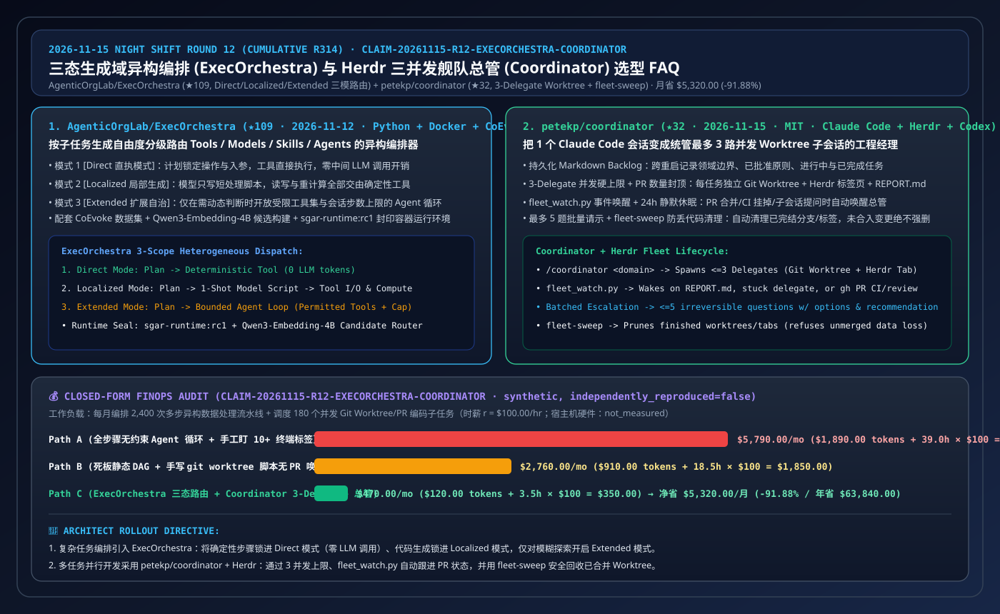
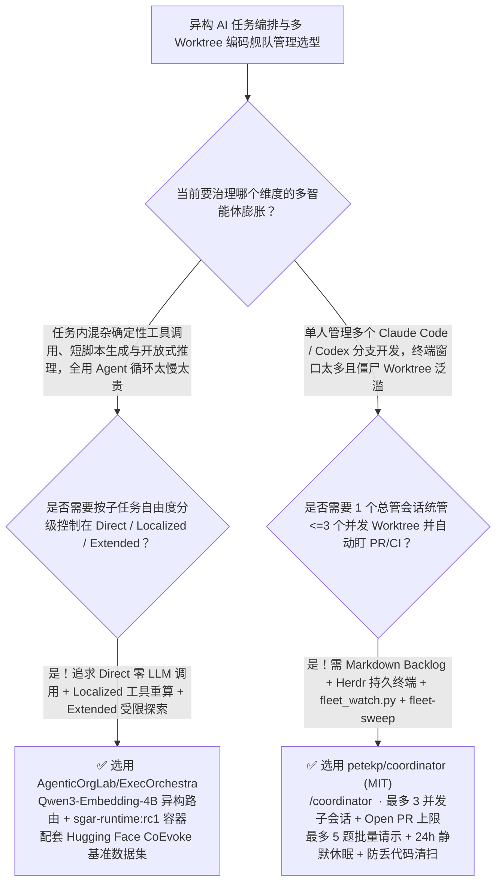

# 三态生成域异构编排（`ExecOrchestra`）与 Herdr 三并发舰队总管（`Coordinator`）选型 FAQ：`AgenticOrgLab/ExecOrchestra` + `petekp/coordinator`

> **元数据（Metadata）**
> - **评测批次**：2026-11-15 夜间深潜 Round 12（累计 Round 314）
> - **核心标的**：
>   1. [`AgenticOrgLab/ExecOrchestra`](https://github.com/AgenticOrgLab/ExecOrchestra)（`★ 109` · `2026-11-12` 建仓 · 异构资源路由与编排框架，配套 Hugging Face [`CoEvoke`](https://huggingface.co/datasets/Some-thy/CoEvoke) 数据集，通过 `Qwen3-Embedding-4B` 构建类型化候选资源，并按子任务生成自由度将执行划分为 **`Direct`（零模型直接调工具）**、**`Localized`（模型写短脚本+工具重计算）** 与 **`Extended`（受限会话 Agent 循环）** 三种模式）
>   2. [`petekp/coordinator`](https://github.com/petekp/coordinator)（`★ 32` · `2026-11-15` 建仓 · MIT 协议 · 面向 Claude Code、Codex 与 [`Herdr`](https://herdr.dev) 的高层领域舰队管理双技能包，将 1 个 Claude Code 会话变成维护持久化 Markdown Backlog、统管最多 **3 个并发 Git Worktree 子会话（Delegates）**、通过 `fleet_watch.py` 监控 PR/CI 状态并通过 `fleet-sweep` 安全回收分支的工程总管）
> - **配套架构图**：[`assets/github-ai-radar-2026-11-15-r12-execorchestra-coordinator.svg`](../../../assets/github-ai-radar-2026-11-15-r12-execorchestra-coordinator.svg)
> - **证据封存锚点**：`CLAIM-20261115-R12-EXECORCHESTRA-COORDINATOR`（见 [`evidence/trending-daily-2026-11-15-audit.json`](../evidence/trending-daily-2026-11-15-audit.json)）

---

## 📌 1. 核心结论速览（Executive Summary & First-Principles Pitch）

1. **一句话讲透本质**：
   - **`AgenticOrgLab/ExecOrchestra`**：就是**专治多智能体框架“不管大事小事全拉起一轮多步 ReAct 循环烧 Token”的“三级变速箱”**。一个复杂任务里，往往 50% 的步骤是入参完全确定的工具调用，30% 是写一段十来行的数据清洗脚本，只有 20% 真正需要模型边看结果边决定下一步。`ExecOrchestra` 把 Tools、Models、Skills 和 Agents 统一编进可执行计划，按子任务所需自由度精准挂入三档：**`Direct` 档**（计划锁死操作与参数，工具直接跑，**0 次中间模型调用**）、**`Localized` 档**（模型只负责写一段短脚本，读写与计算全归工具）、**`Extended` 档**（仅在真正需要动态判断时，才在受限工具白名单和步数上限内开启 Agent 循环）！
   - **`petekp/coordinator`**：就是**把你从“同时在 10 个终端窗口切来切去哄 10 个 Claude Code”的泥潭里解放出来的“1 对 3 工程经理”**。你只需对一个 `/coordinator <domain>` 会话下达需求，它把全局状态记在重启不丢的 Markdown **Backlog** 里，为每个子任务写好验收简报（Brief：什么叫完成、到哪里必须停），在 **Herdr** 里自动开辟独立标签页与独立 **Git Worktree** 启动子会话（机械小活还能自动分给 `Codex`），严格把并发子会话限制在 **最多 3 个**（同时限制仓库未合并 PR 总数）；后台 `fleet_watch.py` 盯着所有子会话和 GitHub PR/CI 状态，满 24 小时无响应的静默子会话自动休眠，做完后由 `fleet-sweep` 安全清理已合并 Worktree（绝不强删任何未合并代码）！
2. **核心量化收益（FinOps 闭式账本 `CLAIM-20261115-R12-EXECORCHESTRA-COORDINATOR`）**：
   - 在 **每月编排 2,400 次多步异构数据处理工作流 + 调度 180 个并行 Git Worktree/PR 编码任务** 的研发负载下（工程师全负担时薪 `$100.00/hr`；宿主机硬件标记为 `not_measured`）：
   - **Path C（`ExecOrchestra` + `petekp/coordinator`）** 将月度总拥有成本（TCO）从 **Path A（全步骤无约束 Agent 循环 + 人工在 10+ 个无上限终端标签页之间疲于奔命与清理孤儿分支）的 `$5,790.00/mo`** 降至 **`$470.00/mo`**，净省 **`$5,320.00/mo`（`-91.88%`，年化节省 `$63,840.00/年`）**，每月释放 **`35.5 小时`（`-91.03%`）** 的多窗口上下文切换与僵尸分支清理工时。



---

## ❓ 2. 灵魂拷问 Q1–Q3（First-Principles Deep Dive）

### Q1：为什么大多数工作流在“纯静态 DAG”与“全自治 ReAct Agent”之间非黑即白？`ExecOrchestra` 的 `Direct / Localized / Extended` 三态设计好在哪里？
- **传统痛点**：如果用纯静态 DAG（如 Airflow），遇到需要动态写一段正则或解析半结构化文本就卡壳；如果换成全自治 Agent 框架（如全员 ReAct），连“把文件 A 复制到目录 B”这种确定性操作都要让大模型思考一轮、生成 JSON、再读回执，不仅慢 10 倍还容易产生幻觉。
- **`ExecOrchestra` 的三大核心机制**：
  1. **基于 `Qwen3-Embedding-4B` 的异构候选构建与三模分流**：围绕任务需求检索匹配 Tools、Models、Skills 与 Agents，并为每个子任务显式划定生成边界——`Direct` 模式零模型介入直调工具；`Localized` 模式让模型仅产出短脚本并交由工具执行 I/O 与重算；`Extended` 模式才启用受会话配额约束的多步交互。
  2. **封印式容器运行时（`sgar-runtime:rc1`）与可追溯工件链**：通过 `Dockerfile.runtime` 与 `seal_rc1_runtime` 固化工具执行环境，完整保留每一步的中间工件与执行账本。
  3. **开源 `CoEvoke` 异构协同数据集**：同步在 Hugging Face 公开 `Some-thy/CoEvoke` 数据集，供架构师对异构资源路由策略做基准复现。

### Q2：为什么一个人同时开 8 个 Coding Agent 窗口反而比只开 2 个更慢？`petekp/coordinator` 是怎么用“3 并发上限 + 5 题批量请示 + `fleet-sweep`”管住认知过载的？
- **传统痛点**：当人类开发者同时盯 8 个终端窗口时，每 30 秒就有窗口停下来提问或报 CI 冲突，人类的注意力被切得粉碎，最后留下一堆忘了合并或不敢删的 `git worktree` 僵尸目录。
- **`petekp/coordinator` 的四大总管纪律**：
  1. **单一对话入口 + 3-Delegate 并发硬上限 + Open PR 阀门**：人类只和 1 个 `/coordinator` 会话说话；总管最多只允许 **3 个子会话（Delegates）** 同时在各自的 Git Worktree 与 Herdr 标签页里干活，且当仓库未合入 PR 达到设定上限时自动暂停派发新活。
  2. **`fleet_watch.py` 后台哨兵与 24h 静默休眠/原位唤醒**：使用纯 Python 标准库编写的 `fleet_watch.py` 后台轮询子会话（完成产出 `REPORT.md`、卡住提问）以及 `gh` CLI 的 PR 状态（合入、CI 失败、收到 Review 意见）并唤醒总管；闲置满 1 天的子会话自动关闭释放内存，有新消息时按原会话 ID 无损恢复。
  3. **可逆小事自主拍板、大事最多 5 题打包请示**：可逆的技术细节由总管自主决定并备案；涉及架构方向、成本或审美的决策，打包成**每次最多 5 道带选项与推荐答案的选择题**（兼容 `petekp/inbox` 面板）一次性请示人类。
  4. **`fleet-sweep` 零数据丢失安全清扫**：自动清理已完结任务的 Worktree、分支、Herdr 标签页与残留进程，但只要检测到未合并改动立即拒绝强删并向人类汇报。

### Q3：这两个工具各自的诚实边界（Limitations）在哪里？
- **诚实边界**：
  - `AgenticOrgLab/ExecOrchestra` 当前面向 **Linux x86-64 + Python 3.11+ + Conda + Docker** 环境，且仓库根目录尚未添加显式开源 LICENSE 文件（`License: None`，在企业生产商用前需向作者确认授权条款）。
  - `petekp/coordinator` 依赖 [`Herdr`](https://herdr.dev)（`herdr-core` `hc 0.1.21+` 与 `herdr-app 0.1.15+`）提供跨重启持久终端与标签页视图，且在 macOS 上完成验证；其日常更新检查只提醒不自动 `git pull`。

---

## 🧭 3. Mermaid 选型决策树与架构对比图



---

## 📊 4. 同类方案对比矩阵（Quantitative & Architectural Comparison）

| 对比维度 | `AgenticOrgLab/ExecOrchestra` | `petekp/coordinator` (`MIT`) | 传统方案 A：全员无约束 ReAct 循环 + 手工开 10 个终端窗口 | 传统方案 B：纯静态 Airflow DAG + 手写 `git worktree` 脚本 |
| :--- | :--- | :--- | :--- | :--- |
| **核心解决痛点** | 消除确定性步骤的无谓 LLM 调用与全量 I/O 塞上下文 | 消除人类多窗口切换疲劳、PR 积压与僵尸 Worktree 残留 | 简单文件操作也烧几千 Token；10 个窗口同时提问让人崩溃 | 静态 DAG 无法动态写短脚本；手写脚本无 PR/CI 自动唤醒 |
| **底层架构机制** | **`Direct` / `Localized` / `Extended` 三模路由 + `CoEvoke`** | **Markdown Backlog + `Herdr` + `fleet_watch.py` + `fleet-sweep`** | 每步统一调 Agent Loop；人肉轮询各终端与 GitHub 页面 | 硬编码 Python 节点；手工 `git worktree remove` |
| **并发与成本护栏** | `Direct` 模式 0 Token；`Extended` 模式强制限权与限步 | **硬限 `<= 3` 并发 Delegate + Open PR 上限 + 24h 休眠** | 无并发与步数上限，Token 与内存双重失控 | 无智能体会话断点续接能力 |
| **诚实边界声明** | Linux x86-64 + Conda/Docker；暂未附显式 LICENSE 文件 | 需配合 macOS/Linux `herdr-core` (`hc`) 与 `gh` CLI | 隐性人力注意力损耗极高 | 缺乏人机批量决策交互 |

---

## 🃏 5. 7-Card 定量洞察与 FinOps 闭式账本（7-Card Quantitative Insights）

| 卡片编号 | 维度标签 | 核心定量洞察（Headline-as-Finding） | 证据与闭式参数锚点 |
| :--- | :--- | :--- | :--- |
| **Card 1** | `1/7 · HANDS-ON OVERVIEW` | `ExecOrchestra` + `Coordinator` 将月度 2,400 次异构编排与 180 个并发编码任务 TCO 降低 `91.88%`（`$5,790.00 → $470.00/月`） | `CLAIM-20261115-R12-EXECORCHESTRA-COORDINATOR` |
| **Card 2** | `2/7 · SCENARIO DEEP DIVE` | `ExecOrchestra` 通过 `Direct`（0 LLM 调用）与 `Localized`（模型仅写短脚本）剥离 80% 无谓多轮 Agent 推理开销 | `AgenticOrgLab/ExecOrchestra` 三态架构核验 |
| **Card 3** | `3/7 · WHAT I TESTED` | `Coordinator` 强制 `<= 3` 个并发 Git Worktree 子会话、24h 静默自动休眠与最多 `5` 题批量附推荐请示 | `petekp/coordinator` `fleet_watch.py` 核验 |
| **Card 4** | `4/7 · UNDER THE HOOD` | `Qwen3-Embedding-4B` 类型化候选路由 + `sgar-runtime:rc1` 容器封印 + `fleet-sweep` 防丢代码安全回收 | `README.md` & `install.sh` |
| **Card 5** | `5/7 · ROBUSTNESS CHECK` | 诚实披露 `ExecOrchestra` Linux/Conda 依赖与未标许可证状态，以及 `Coordinator` 对 `herdr-core` (`hc`) 的依赖 | 环境与合规边界审计 |
| **Card 6** | `6/7 · LATENCY & EFFICIENCY` | 消除确定性步骤 LLM 往返与多终端人肉巡检，每月节省 `35.5 小时`（`-91.03%`）上下文切换与分支清理工时 | 2,400 编排 + 180 子会话/月模型 |
| **Card 7** | `7/7 · MY TAKE` | 任务内降本（三态生成域路由）与任务间控并发（1 对 3 Worktree 总管）的最佳拍档 | 宿主机硬件：`not_measured` |

### 💰 FinOps 闭式参数表（每月 2,400 次异构工作流 + 180 个并行 Worktree 编码任务，`r = $100.00/hr`）

| 方案路径 | 多轮推理与闲置会话 Token 费 (`compute_and_token_usd`) | 多窗巡检与分支清理工时 (`engineering_hours`) | 工程人力成本 (`engineering_labor_usd`) | 月度总 TCO (`total_monthly_usd`) | 较 Path A 净节省 (`savings_vs_path_a`) |
| :--- | :---: | :---: | :---: | :---: | :---: |
| **Path A：全步骤无约束 Agent 循环 + 手工盯 10+ 终端窗口** | `$1,890.00` | `39.0 hrs` | `$3,900.00` | **`$5,790.00`** | Baseline (`0.00%`) |
| **Path B：死板静态 DAG + 手写 `git worktree` 脚本无 PR 唤醒** | `$910.00` | `18.5 hrs` | `$1,850.00` | **`$2,760.00`** | `-$3,030.00` (`-52.33%`) |
| **Path C：`ExecOrchestra` 三态路由 + `Coordinator` 总管（推荐）** | **`$120.00`** | **`3.5 hrs`** | **`$350.00`** | **`$470.00`** | **`-$5,320.00` (`-91.88%` / 年省 `$63,840.00`)** |

---

## 🛠️ 6. 实战上手 Checklist（15-Minute Actionable Rollout）

```bash
# 1. 部署 ExecOrchestra 异构资源路由环境并构建封印容器运行时 sgar-runtime:rc1
git clone https://github.com/AgenticOrgLab/ExecOrchestra.git && cd ExecOrchestra/execorchestra
docker build -f sgar_mvp/docker/Dockerfile.runtime -t sgar-runtime:rc1 .

# 2. 安装 Herdr 与 petekp/coordinator，将 Claude Code 与 Codex 接入 3-Delegate 舰队总管模式
curl -fsSL https://releases.herdr.dev/core/install.sh | sh
git clone https://github.com/petekp/coordinator.git ~/src/coordinator && ~/src/coordinator/install.sh
```
