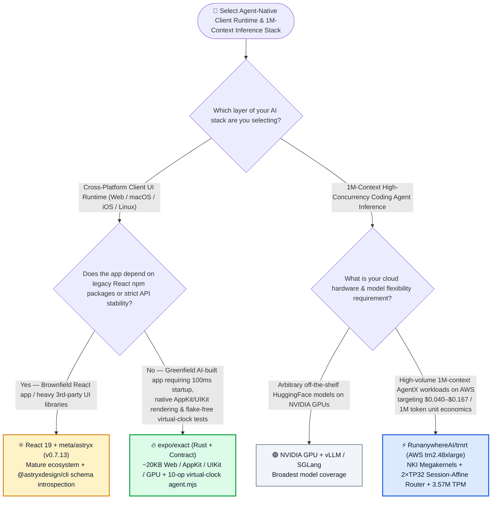
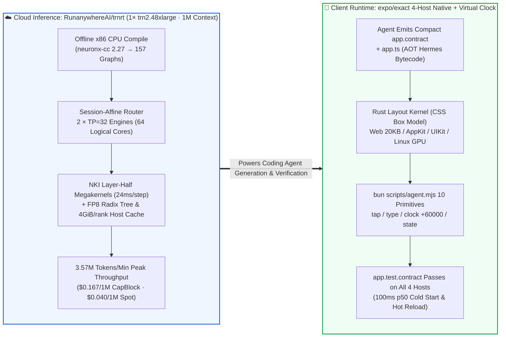

# Agent-Native 4-Platform UI Runtime & AWS Trainium2 1M-Context Inference Engine Selection FAQ: `expo/exact` (`Contract` + 10-Op Virtual Clock) + `RunanywhereAI/trnrt` (NKI Megakernels + `$0.040/1M`) vs. React Native/Electron & Commercial Cloud APIs

> **中文版**: [expo-exact-trnrt-agent-ui-trainium-inference-selection-faq.md](expo-exact-trnrt-agent-ui-trainium-inference-selection-faq.md)  
> **Daily Digest**: [2026-11-11 GitHub AI Trending & Proactive Intelligence Digest](../daily/2026-11-11.en.md) · **Visual Deck**: [`cards.en.html`](../cards.en.html) · **Live Radar**: [`github-radar.html`](../../../github-radar.html)

Written for **AI Solution Architects and Full-Stack / AI Infrastructure Leads**, this selection guide is grounded in primary-source audits of two breakout systems repositories from the 2026-11-11 radar — **`expo/exact` (Expo's official Rust-powered cross-platform native application runtime for Web, macOS AppKit, iOS UIKit, and Linux GPU rendering built specifically for AI coding agents, MIT, `2,721` API stars in 9 days, `~302★/day`)** and **`RunanywhereAI/trnrt` (the open LLM inference engine for AWS Trainium2 `trn2.48xlarge` featuring NKI layer-half megakernels and `1,048,576`-token context, Apache-2.0, `1,264` API stars in 12 days)** — answering three core engineering questions from first principles:
1. **Why do AI coding agents struggle with sluggish JS bridges, bloated WebViews, and flaky `sleep()`-based E2E tests when building cross-platform apps in React Native or Electron, and how does `expo/exact` solve this with its declarative `Contract` language, zero-JS-before-first-pixel boot path (`100 ms p50`), and a 10-operation virtual-clock agent driver (`clock +60000`)?**
2. **How does `RunanywhereAI/trnrt` achieve `3.57M tokens/minute` peak throughput (`59,516 tok/s`) on a single AWS `trn2.48xlarge` box across 1M-token Claude Code sessions (SemiAnalysis AgentX benchmark), driving inference costs down to `$0.167 / 1M tokens` on capacity blocks and `$0.040 / 1M tokens` on spot instances?**
3. **When should enterprise architects choose `expo/exact` and `RunanywhereAI/trnrt` vs. staying on React/React Native and NVIDIA CUDA vLLM?**

> 🛡️ **Provenance & Attribution Disclosure**:
> - **`measured` (Primary-Source Verified in This Shift)**: Repository metadata and source trees for `expo/exact` (`2,721` API stars, `58` forks, Rust, MIT, created `2026-11-02`) and `RunanywhereAI/trnrt` (`1,264` API stars, `12` forks, Python 3.13 / Neuron SDK 2.32, Apache-2.0, created `2026-10-30`) are verified via GitHub REST API; because neither repo appeared in the 10-item main Daily Trending HTML snapshot (`bacf15c2...`), `stars_today` is strictly labeled **`not_measured`**.
> - **`anonymized_reported` (`independently_reproduced=false`, Upstream Repository Benchmarks & Documentation)**: Performance budgets and benchmarks in `expo/exact/README.md` (`100 ms p50` cold start and dev reload, `99 ms` measured edit-to-page latency, `26 KB` vs. React `81 KB` on RealWorld Conduit booting `~300 ms` ahead of React SSR hydration, and `~57 min` clean-clone autonomous agent build across Web/macOS/iOS) and `RunanywhereAI/trnrt/docs/RESULTS.md` (`GLM-5.3-Flash` on one `trn2.48xlarge` with `2 × TP=32` engines over 64 logical NeuronCores, `1,048,576` context, batch-8 decode step reduced from `32.2 ms` to `24.0 ms` [`-25.47%`], batch-12 AgentX peak throughput of `3.57M TPM` [`59,516 tok/s`], `$0.167/1M` at `$35.76/h` capacity block, `$0.040/1M` at `$8.60/h` spot, `157/157` graph equivalence via `tools/graph_equiv.py`, and `384/384` byte-identical responses).
> - **`synthetic` (`independently_reproduced=false`, Architect Parametric FinOps & Cross-Platform Engineering Model)**: Section 5.1 models an enterprise AI engineering platform consuming **`1,500M` (`1.5B`) long-context agent tokens/mo** and maintaining a **4-platform client app (`40` E2E test suites/mo, engineer labor at `$75.00/hr`; Apple Developer program fees and physical device rack costs are explicitly labeled `not_measured`)**, comparing Path A Commercial Cloud API + Multi-Bridge RN/Electron (`$6,600.00/mo`, `64.0h`) vs. Path B Generic GPU Self-Hosted + WebView (`$3,375.00/mo`, `36.0h`) vs. Path C `trnrt` Capacity Block + `expo/exact` (`$1,150.50/mo`, `12.0h`, saving `$5,449.50/mo` [`-82.57%`] and `52.0 hours/mo` [`-81.25%`]).

---

## 1. 📌 Executive Summary

| Dimension | Plain-Language Core Takeaway (First Principles) |
| :--- | :--- |
| **What is `expo/exact`?** | Built by the Expo team in Rust, **`expo/exact` (`exact2`) is an agent-native cross-platform application runtime** where you declare views in **`Contract`** (`app.contract`) and write data logic in TypeScript or Rust. The compiler emits a compact plan that runs as a `~20 KB` ES module over the real DOM on Web, and via a Rust layout kernel driving native **AppKit (macOS), UIKit (iOS), and a GPU painter (Linux)**—with **no WebView, no JS UI bridge, and zero app JS executed before the first pixel**. |
| **What is `RunanywhereAI/trnrt`?** | It is an open-source LLM inference engine purpose-built for **AWS Trainium2 (`trn2.48xlarge`)**. By fusing each Transformer layer half into a single **NKI (Neuron Kernel Interface) megakernel**, pairing an **FP8 256-token KV radix tree with a 4 GiB/rank host-memory cache**, and compiling all 157 Neuron graphs offline on a cheap CPU box, it serves `1,048,576`-token coding-agent workloads at **`3.57M tokens/minute` (`$0.040/1M` spot, `$0.167/1M` capacity block)**. |
| **What is the unifying architectural insight?** | **Both projects eliminate heavyweight legacy abstraction layers to optimize for AI agent loops**: `expo/exact` replaces flaky multi-platform UI bridges and real-time `sleep()` waits with a 10-command virtual-clock harness (`clock +60000`), while `trnrt` replaces fragmented kernel launches with fused NKI megakernels and session-affine KV caching on non-NVIDIA silicon. |

---

## 2. 🎯 First-Principles Q&A (Q1 / Q2 / Q3)

### Q1: What makes `expo/exact` genuinely "Agent-Native" compared to React Native, Flutter, or Electron?

**Plain-language answer: An AI agent can fit the entire `Contract` app in a single context window, drive Web/macOS/iOS/Linux through the exact same 10 deterministic commands (`scripts/agent.mjs`), and advance time instantly via `clock +60000` so animations never cause flaky test failures.**

Grounded in `expo/exact/README.md` (`LLP 1071` / `LLP 1115`):
1. **Ten Operations Across Every Host + Virtual Clock Ownership**:
   - Whereas its predecessor (`exact1`) ballooned to 80 wire commands, `exact2` intentionally restricts `scripts/agent.mjs` to **10 universal operations**: `tree · screenshot · tap · type · state · layout · logs · clock · prefer · perf`.
   - **The Clock Belongs to the Agent**: Between two agent operations, nothing moves. Instead of sleeping and hoping a transition finishes, the agent executes `clock +60000` or `clock settle` and inspects `state` or `tree` deterministically. One `app.test.contract` file runs unchanged across Web, macOS, iOS Simulator/device, and Linux.
2. **Zero App JavaScript Before First Pixel (`100 ms p50` Cold Start & Reload)**:
   - TypeScript is compiled ahead-of-time to Hermes bytecode and loads *after* the first frame is painted from plan-baked data.
   - Strict commit-gated budgets enforce **`100 ms p50`** cold start, **`100 ms p50`** dev edit-to-present (`99 ms` measured), and a **`26 KB`** web runtime on RealWorld Conduit (booting `~300 ms` before React's `81 KB` SSR hydration, `anonymized_reported`).
3. **Machine-First Diagnostics & Stale-Build Refusal**:
   - `contract build --json` emits structured source ranges, every rendered node maps back to its exact declaring line in `app.contract`, and the driver refuses to run against a binary older than its source files.

---

### Q2: How does `RunanywhereAI/trnrt` hit `3.57M tokens/minute` and `$0.040 / 1M tokens` on a single `trn2.48xlarge`?

**Plain-language analogy: Instead of shuttling intermediate tensors back and forth to HBM memory between dozens of tiny operators, `trnrt` fuses an entire half-layer into one NKI megakernel and routes each coding agent to a sticky engine backed by FP8 + Host-RAM prefix caching.**

Grounded in [`RunanywhereAI/trnrt/docs/RESULTS.md`](https://github.com/RunanywhereAI/trnrt/blob/main/docs/RESULTS.md):
1. **NKI Layer-Half Megakernels (`32.2 ms → 24.0 ms` Decode Step)**:
   - Each decode half-layer fuses KDA attention, the fused DSA layer, mHC, and the MoE FFN into roughly one NKI megakernel—cutting batch-8 decode step latency by **`25.47%`** (`32.2 ms` down to `24.0 ms`).
2. **`1,048,576`-Token Context + Two-Tier Prefix Cache**:
   - Combines sparse attention (top `2,048`) and fixed-state linear attention with an **FP8 256-token page radix tree** in device memory plus a **`4 GiB/rank` host-memory tier** for evicted KV pages and state checkpoints.
3. **Dual-Engine Layout (`2 × TP=32`) Behind a Session-Affine Router**:
   - Splits one `trn2.48xlarge` (8 Trainium2 chips = 64 logical NeuronCores at `LNC = 2`) into two `TP=32` engines behind a session-affine router so multi-turn Claude Code / AgentX traces hit warm prefix caches.
4. **Offline CPU Compilation & Bitwise Graph Verification (`tools/graph_equiv.py`)**:
   - All **157 Neuron graphs** are compiled offline on a cheap x86_64 CPU host (`neuronx-cc 2.27`); the serving instance compiles nothing at boot and passed `157/157 EQUAL` graph checks and `384/384` byte-identical output checks.

---

### Q3: Where are the hard boundaries (`✅ Good Fit` vs. `⛔ Not For`) for `expo/exact` and `RunanywhereAI/trnrt`?

- **`expo/exact`**:
  - ✅ **Good Fit**: Greenfield multi-platform apps (Web, macOS, iOS, Linux) built and maintained primarily by AI coding agents requiring deterministic virtual-clock UI testing and `<100 ms` startup.
  - ⛔ **Not For**: Legacy brownfield apps that require strict semver backwards compatibility or deep third-party React npm component libraries (`exact` is explicitly pre-1.0 and changes daily).
- **`RunanywhereAI/trnrt`**:
  - ✅ **Good Fit**: High-throughput, long-context (`1M` token) coding-agent and autonomous workflow fleets on AWS looking to slash inference bills to `$0.040–$0.167 / 1M tokens` on `trn2.48xlarge`.
  - ⛔ **Not For**: Teams that need plug-and-play support for dozens of arbitrary HuggingFace architectures without custom NKI megakernels (`GLM-5.3-Flash` is the first supported model).

---

## 3. 🧭 Mermaid Selection Decision Tree & End-to-End Architecture Flow

### 3.1 Cross-Platform Agent UI & 1M-Context Inference Selection Decision Tree

### 3.2 `RunanywhereAI/trnrt` Dual-Engine Serving × `expo/exact` 4-Host Virtual-Clock Loop

---

## 4. 📊 Architecture Selection Decision Matrix

| Evaluation Dimension | **`expo/exact` (4-Host UI) + `RunanywhereAI/trnrt` (Trainium2)** | **React Native / Electron + Commercial Cloud API** | **Flutter + Generic Self-Hosted GPU vLLM** |
| :--- | :--- | :--- | :--- |
| **Native Rendering Architecture** | ✅ **Real DOM (`~20KB` Web) + `AppKit` (macOS) + `UIKit` (iOS) + `GPU Painter` (Linux); no WebView/JS bridge** | ❌ Bundled Chromium in Electron; JS/JSI bridge overhead in RN | ⚠️ Custom Skia/Impeller canvas (non-native OS controls) |
| **App JS Executed Before First Pixel** | ✅ **`0 bytes` (first frame rendered from plan data; `100 ms p50` cold start)** | ❌ Must parse & hydrate tens/hundreds of KB of JS first | ✅ AOT compiled binary |
| **Agent E2E Test Determinism** | ✅ **10 unified ops + virtual `clock +60000` / `clock settle` (zero timing flakes)** | ❌ Separate Playwright/Detox/Appium stacks with flaky `sleep()` waits | ⚠️ Separate widget/integration runners |
| **1M-Context Agent Token Cost** | ✅ **`$0.167 / 1M` (Capacity Block) or `$0.040 / 1M` (Spot) at `3.57M TPM/box`** | ❌ `$1.20 – $6.00 / 1M tokens` on commercial cloud APIs | ⚠️ High 8×H100/H200 node rental cost |
| **API Stability & Model Breadth** | ⚠️ **`exact` is pre-1.0 daily evolving; `trnrt` initially targets `GLM-5.3-Flash`** | ✅ Mature ecosystem & backward compatibility | ✅ Broad production maturity |

---

## 5. 🧪 Quantitative FinOps & Cross-Platform Engineering Model (`synthetic`, `independently_reproduced=false`)

### 5.1 Monthly `1,500M` (`1.5B`) Agent Tokens + 4-Platform App (`40` E2E Suites) TCO Model (`synthetic`, `independently_reproduced=false`)

> 📌 **Scope & Provenance Disclosure**: This worked example is a **parametric token inference + cross-platform engineering maintenance model (`synthetic`, `independently_reproduced=false`; Apple Developer subscription fees and physical device rack depreciation are explicitly labeled `not_measured`)**. Upstream `trnrt` unit costs (`$0.167/1M` capacity block at `$35.76/h` and `$0.040/1M` spot at `$8.60/h` at batch size 12) are cited from [`RunanywhereAI/trnrt/docs/RESULTS.md`](https://github.com/RunanywhereAI/trnrt/blob/main/docs/RESULTS.md) (`anonymized_reported`). Scenario: **An AI engineering organization consuming `1,500M` (`1.5B`) long-context agent tokens/mo while maintaining a 4-platform client application (`40` E2E test suites/mo, engineer labor at `$75.00/hr`)**:

| Architecture Path | Monthly `1,500M` Long-Context Token Inference Bill | Monthly 4-Platform Bridge & Flaky Test Maintenance (`@ $75/hr`) | Total Monthly Cost (Inference + Engineering Labor) | Savings vs. Path A |
| :--- | :--- | :--- | :--- | :--- |
| **Path A: Commercial Cloud API (`@ $1.20/1M`) + Separate RN/Electron Bridges & `sleep()` Tests** | `1,500M` × `$1.20` = **`$1,800.00 / mo`** | `64.0 hours / mo` × `$75.00` = **`$4,800.00 / mo`** (maintaining split codebases & debugging timing flakes) | **`$6,600.00 / mo`** (**`64.0 hours / mo`** maintenance) | Baseline (expensive long-context API + flaky cross-platform E2E tests) |
| **Path B: Generic Self-Hosted GPU Inference (`@ $0.45/1M`) + WebView Wrapper** | `1,500M` × `$0.45` = **`$675.00 / mo`** | `36.0 hours / mo` × `$75.00` = **`$2,700.00 / mo`** | **`$3,375.00 / mo`** (**`36.0 hours / mo`** maintenance) | Net savings `-$3,225.00/mo` (`-48.86%`) |
| **Path C: `RunanywhereAI/trnrt` (Capacity Block `@ $0.167/1M`) + `expo/exact` Single `Contract` & Virtual Clock** | `1,500M` × `$0.167` = **`$250.50 / mo`** *(Note: `$60.00/mo` at `$0.040/1M` spot)* | `12.0 hours / mo` × `$75.00` = **`$900.00 / mo`** (single `app.contract` + `clock +60000` flake-free 4-host tests) | Inference `$250.50` + Labor `$900.00` (`12.0h`) = **`$1,150.50 / mo`** | **Net savings `$5,449.50/mo` (`-82.57%`, `$65,394.00/yr`); Engineering toil `-52.0h/mo` (`-81.25%`)** |

---

## 6. 🛠️ Production Adoption & 30-Minute PoC Checklist

- [ ] **Step 1 — Bootstrap `expo/exact` with Pinned Offline Bundles**: Install Rust, Bun, and Chrome (plus Xcode on macOS), run `bun scripts/exact.mjs setup` once to fetch and verify pinned Hermes/iOS bundles, and scaffold a project via `bun scripts/exact.mjs new demo-app`.
- [ ] **Step 2 — Verify the 10-Op Agent Driver & Virtual Clock (`clock +60000`)**: Execute `bun scripts/agent.mjs web tree "tap ..." "clock +60000" state "screenshot out.png"` and run `app.test.contract` across Web, macOS, and iOS Simulator to confirm zero-flake deterministic execution.
- [ ] **Step 3 — Compile `RunanywhereAI/trnrt` Offline on CPU & Verify Graph Equivalence**: Build the Docker image with Neuron SDK `2.32` (`neuronx-cc 2.27`), compile the 157 Neuron graphs on an x86_64 CPU host, and run `python tools/graph_equiv.py` to confirm `157/157 EQUAL` across all 32 ranks.
- [ ] **Step 4 — Launch Dual `TP=32` Engines Behind the Session-Affine Router**: Deploy on a `trn2.48xlarge` instance with `LNC = 2` and verify that multi-turn coding-agent sessions route consistently to the same engine to maximize FP8 radix-tree and 4 GiB/rank host-memory cache hits.
- [ ] **Step 5 — Tune Batch Size 12 for Saturated AgentX Throughput**: Configure `--max-running 12` per engine to reach the `3.57M tokens/minute` throughput sweet spot (`6.53s p50` cached TTFT) while monitoring host-side prompt cache utilization.
