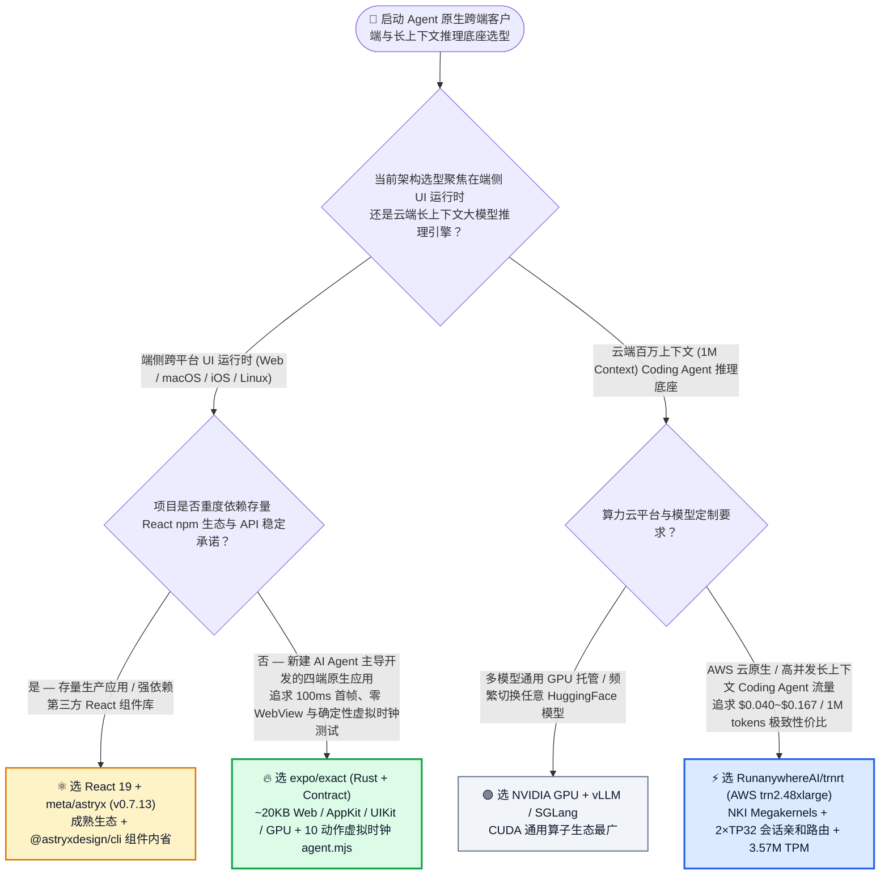
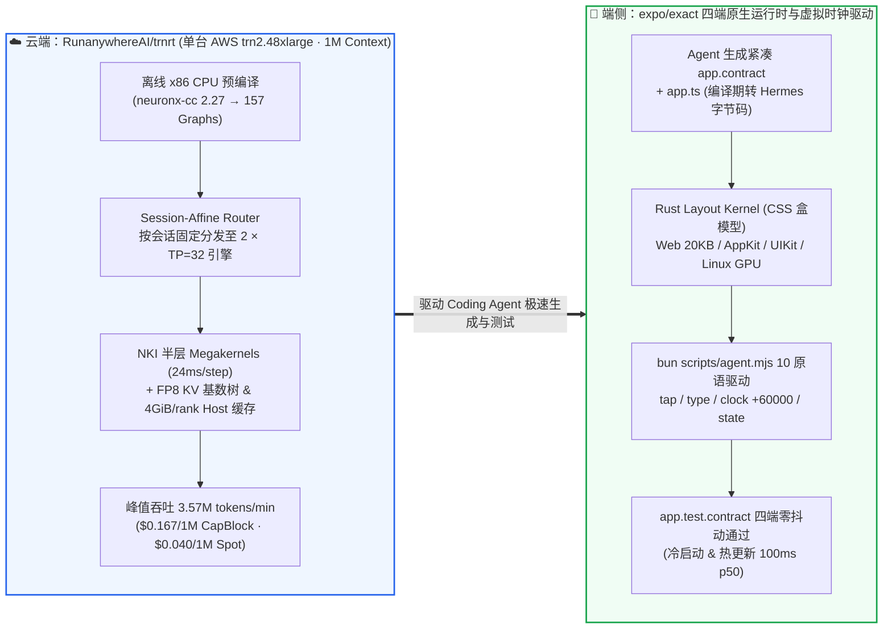

# Agent 原生四端 UI 运行时与 AWS Trainium2 百万上下文推理引擎选型常见问题解答：`expo/exact`（`Contract` + 10 动作虚拟时钟）+ `RunanywhereAI/trnrt`（NKI Megakernels + `$0.040/1M`）vs React Native/Electron & 商用云 API

> **English Edition**: [expo-exact-trnrt-agent-ui-trainium-inference-selection-faq.en.md](expo-exact-trnrt-agent-ui-trainium-inference-selection-faq.en.md)  
> **关联日报**: [2026-11-11 GitHub AI 最热榜单与情报摘要](../daily/2026-11-11.md) · **视觉评测卡**: [`cards.html`](../cards.html) · **在线面板**: [`zh-github-radar.html`](../../../zh-github-radar.html)

本文档面向 **AI Solution Architect（AI 解决方案架构师）与全栈/算力基础设施负责人**，基于 2026-11-11 GitHub 新仓爆发榜（Track B）与热榜两款极具代表性的硬核系统项目 —— **`expo/exact`（Expo 官方开源的纯 Rust 跨四端「Web / macOS AppKit / iOS UIKit / Linux GPU」Agent-Native 原生应用运行时，MIT，建仓 9 天狂揽 `2,721★`，日均 `+302★/d`）** 与 **`RunanywhereAI/trnrt`（面向 AWS Trainium2 `trn2.48xlarge` 的开源大模型推理引擎，基于 NKI 层级超级融合算子与双层 FP8 前缀缓存跑通 `1,048,576` 百万上下文，Apache-2.0，建仓 12 天揽获 `1,264★`）** 的一手源码与 [`docs/RESULTS.md`](https://github.com/RunanywhereAI/trnrt/blob/main/docs/RESULTS.md) 深度核验，用通俗大白话与第一性原理解答：
1. **为什么让 AI Coding Agent 写传统 React Native / Electron 跨端应用并跑 UI 自动化测试时，总会掉进“JS 桥接卡顿、包体积臃肿、以及 `sleep(2000)` 等待动画导致 E2E 测试偶发挂掉”的泥潭？`expo/exact` 是如何用「`Contract` 声明式语言 + 首帧零 JS 执行 + 归 Agent 所有的 10 动作虚拟时钟（`clock +60000`）」彻底终结这些痛点的？**
2. **当团队跑 Claude Code / OpenClaw 这类超长上下文（1M Token）、高并发子智能体扇出的任务时，为什么在英伟达 GPU 紧缺或商用云 API 昂贵时，AWS Trainium2 + `RunanywhereAI/trnrt` 能把单台机器吞吐推到 `3.57M tokens/分钟`、把百万 Token 成本打到 `$0.167`（Capacity Block）甚至 `$0.040`（Spot）？**
3. **在企业架构选型中，什么时候该坚持 React / React Native / CUDA vLLM，什么时候该切入 `expo/exact` 与 `RunanywhereAI/trnrt`？**

> 🛡️ **数据来源、归属核验与证据分级声明（Provenance & Attribution Disclosure）**：
> - **`measured`（本班次一手实测抓取）**：`expo/exact`（`2,721` API Stars，`58` Forks，Rust，MIT，创建于 `2026-11-02`）与 `RunanywhereAI/trnrt`（`1,264` API Stars，`12` Forks，Python 3.13 / Neuron SDK 2.32，Apache-2.0，创建于 `2026-10-30`）均通过 GitHub REST API 源码树、README 与 [`docs/RESULTS.md`](https://github.com/RunanywhereAI/trnrt/blob/main/docs/RESULTS.md) 一手核验；两者不在主日榜 24h DOM 快照内，故 `stars_today` 严格标注为 **`not_measured`**。
> - **`anonymized_reported`（`independently_reproduced=false`，上游仓库文档与基准评测声明）**：`expo/exact` 官方 README 披露的性能预算与实测数据（冷启动至可交互首帧 `100 ms p50`、修改保存至热更新呈现 `99 ms`、RealWorld Conduit 基准 `26 KB` vs React `81 KB` 且比 React SSR 水合快 `~300 ms`、干净克隆从零构建 Todo 应用并通过 Web/macOS/iOS 三端测试耗时 `~57 分钟`）及 `RunanywhereAI/trnrt/docs/RESULTS.md` 披露的 SemiAnalysis AgentX 基准（单台 `trn2.48xlarge` 双引擎 `2 × TP=32`、`1,048,576` 上下文、Batch-8 解码步从 `32.2 ms` 降至 `24.0 ms` [`-25.47%`]、Batch-12 峰值吞吐 `3.57M tokens/min` [`59,516 tok/s`]、Capacity Block `$35.76/h` 折合 `$0.167 / 1M tokens`、Spot `$8.60/h` 折合 `$0.040 / 1M tokens`、`tools/graph_equiv.py` 157 张图 100% EQUAL 且 384/384 请求字节级一致）。
> - **`synthetic`（`independently_reproduced=false`，架构师参数化 FinOps 与跨端维护工时算例）**：第 5.1 节「月度 `1,500M`（15 亿）长上下文 Agent Tokens + 四端原生应用 `40 套` E2E 测试套件维护（工程师综合工时费 `$75.00/h`；Apple 开发者账号年费与真机机柜费明确标注为 `not_measured`）」的闭式成本对比（Path A 商用云 API + 传统多端桥接 `$6,600.00/月` vs Path B 普通自建推理 + WebView 壳 `$3,375.00/月` vs Path C `trnrt` Capacity Block + `expo/exact` `$1,150.50/月`，净省 `$5,449.50/月` [`-82.57%`] 与 `52.0 小时/月` [`-81.25%`] 工程维护工时）。

---

## 1. 📌 核心结论速览（Executive Summary）

| 评估维度 | 一句话大白话核心结论（直指本质） |
| :--- | :--- |
| **`expo/exact` 到底是个什么东西？** | 它是 React Native 背后核心推手 Expo 团队用 Rust 从头打造的**“专为 AI Agent 编写、运行、观察和验收而生的四端原生应用运行时（`exact2`）”**：你用极简的声明式语言 **`Contract`** 写界面、用 TS/Rust 写数据逻辑，编译器生成一份紧凑计划（Plan），在 Web 上变成 `~20 KB` 的原生 DOM 模块，在 macOS/iOS/Linux 上由 Rust 布局内核直接驱动 **AppKit / UIKit / GPU** 渲染——**没有 WebView、没有 JS UI 桥、首像素前 0 字节业务 JS 运行**！ |
| **`RunanywhereAI/trnrt` 到底是个什么东西？** | 它是专门为亚马逊自研 AI 芯片 **AWS Trainium2 (`trn2.48xlarge`)** 打造的开源大模型推理引擎。它没有照搬通用 GPU 的碎算子调度，而是用 **NKI（Neuron Kernel Interface）把每半层网络融合成 1 个超级算子（Megakernel）**，配合 **FP8 KV 基数树 + 主机内存双层前缀缓存** 与 **离线 CPU 预编译**，在单台 `trn2.48xlarge` 上跑出了 **1M（104.8 万）上下文、`3.57M tokens/分钟` 峰值吞吐，把每百万 Token 推理成本砸到了 `$0.040`（Spot）/ `$0.167`（Capacity Block）**！ |
| **这两者合在一起给 AI 架构师什么启示？** | **端侧与算力侧同时进入“去中间层（De-Layering）”时代**：端侧砍掉臃肿的 React VDOM 水合与 WebView 桥，用 10 个固定动作 + 虚拟时钟（`clock +60000`）让 AI Agent 100% 确定性地开发和测试四端原生 App；云端砍掉通用运行时的在线编译与碎算子开销，用 NKI Megakernel 在非英伟达算力上跑出极致的 Coding Agent 长上下文性价比！ |

---

## 2. 🎯 第一性原理灵魂三问（Q1 / Q2 / Q3 大白话拆解）

### Q1：为什么说传统前端/跨端框架是“面向人类手写设计”的，而 `expo/exact` 是真正“面向 AI Agent 原生设计”的？

**先说大白话结论：因为人类能容忍“用肉眼等动画播完再点按钮”和“跨 15 个文件找一个隐式状态 Bug”，但 AI Agent 需要的是“全仓装进一个上下文窗口、报错直接说怎么改、且连时间流逝都能用命令精确控制”！**

根据 `expo/exact` 官方架构规范（`LLP 1071` / `LLP 1115`），它通过三大第一性原理设计彻底改造了跨端开发：
1. **十动作极简操控契约 + 虚拟时钟归 Agent 所有（The Clock Belongs to the Agent）**：
   - 它的前代原型（`exact1`）曾把 Agent 驱动接口膨胀到了 80 个命令，导致模型频繁调错；`exact2` 痛定思痛，将全平台驱动接口严格锁死为 **10 个原语**：`tree · screenshot · tap · type · state · layout · logs · clock · prefer · perf`（统一通过 `bun scripts/agent.mjs` 在 Web、macOS、iOS 模拟器/真机、Linux 上完全一致地运行）。
   - **最惊艳的设计是 `clock`**：在两次 Agent 操作之间，画面时间是完全静止的！Agent 根本不需要写脆弱的 `sleep(2000)` 去等弹窗过渡动画结束，而是直接发送 `clock +60000` 或 `clock settle`，瞬间推演完动画并读取最终状态，**彻底消灭了 UI 自动化测试里的时序偶发故障（Timing Flakes）**！
2. **首帧零 JS 执行（Zero App JS Before First Pixel）与 100ms 铁律**：
   - 业务逻辑 TypeScript 在构建期直接编译为 Hermes 字节码，且严格在**第一帧像素已经画上屏幕之后**才加载；首帧画面直接来自烘焙进 `Contract` 计划的数据。
   - 每次 Commit 强制考核性能红线：冷启动至可交互首帧 **`100 ms p50`**、代码修改保存至屏幕更新 **`100 ms p50`**（实测 `99 ms`）；在 RealWorld ("Conduit") 基准中，Web 端仅用 `26 KB` 代码（React 为 `81 KB`），且比 React SSR 水合完成快约 **`300 ms`**（`anonymized_reported`）。
3. **机器可读诊断与防陈旧构建锁**：
   - `contract build --json` 输出带稳定 ID 与源码范围的结构化诊断；屏幕上的任何一个 UI 节点都通过开发期 Source Map 精准回溯到声明它的那一行 `app.contract`；如果构建产物比源码旧，`agent.mjs` 驱动器会直接拒绝执行并明确提示需要重编的命令。

---

### Q2：`RunanywhereAI/trnrt` 是如何在单台 AWS `trn2.48xlarge` 上跑通 100 万上下文并把成本降到 `$0.040 / 1M tokens` 的？

**大白话比喻：如果把标准推理框架比作“每做一道工序都要把零件放回仓库（HBM 显存）再领出来”，`trnrt` 的 NKI Megakernel 就是“把半层神经网络的所有工序焊成一条全封闭流水线，零件在芯片高速缓存（SBUF）里一口气加工到底”！**

根据 [`RunanywhereAI/trnrt/docs/RESULTS.md`](https://github.com/RunanywhereAI/trnrt/blob/main/docs/RESULTS.md) 一手实测数据，其四大核心技术支柱为：
1. **NKI 半层超级融合算子（One Fused Megakernel per Layer Half）**：
   - 针对 `GLM-5.3-Flash` 等现代混合架构，使用 AWS Neuron Kernel Interface (NKI) 将 KDA 注意力、融合 DSA 层、mHC 与稀疏 MoE FFN 融合成每半层约 1 个 Megakernel，直接把 Batch-8 单步解码耗时从 `32.2 ms` 压缩到 **`24.0 ms`（提速 `25.47%`）**。
2. **`1,048,576`（1M）上下文 + FP8 基数树与主机内存双层前缀缓存**：
   - 结合稀疏注意力（Top `2,048`）与固定状态大小的线性注意力支持 1M 上下文；
   - 针对 Coding Agent（如 Claude Code）长会话反复重发相同前缀的特征，构建了 **256-token 页粒度的 FP8 KV 基数树（Radix Tree）**，并为每个 Rank 挂载 **4 GiB 主机内存（Host RAM）二级缓存**存放被驱逐的 KV 页与状态检查点。
3. **单箱双引擎（`2 × TP=32`）+ 会话亲和路由（Session-Affine Router）**：
   - 一台 `trn2.48xlarge`（含 64 个逻辑 NeuronCores，`LNC = 2`）切分为 **2 个独立的 `TP=32` 推理引擎**，前置 Session-Affine Router 确保同一个 Coding Agent 的多轮子任务固定打到同一个引擎实例上，最大化命中本地前缀缓存。
4. **离线 CPU 预编译 + 157 张计算图 100% 等价核验（`tools/graph_equiv.py`）**：
   - 所有 157 张 Neuron 计算图均在廉价 x86_64 CPU 主机上通过 `neuronx-cc 2.27` 离线编译完成，昂贵的 `trn2.48xlarge` 启动时直接加载预编译图（零在线编译等待），且通过 `tools/graph_equiv.py` 在 32 个 Rank、157 张图上 100% 验证 `EQUAL`，384/384 请求输出字节级完全一致！

---

### Q3：作为 AI 架构师，什么时候该选 `expo/exact` 和 `RunanywhereAI/trnrt`，什么时候不该选（⛔ Not For）？

- **关于 `expo/exact` 的清醒边界**：
  - ✅ **极佳适用（Good Fit）**：希望让 AI Agent 全权负责从 UI 编写到 Web/macOS/iOS/Linux 四端自动化视觉与状态验收的全新绿地项目（Greenfield Apps）、内部工具、高频交互终端。
  - ⛔ **暂不适用（Not For）**：要求 API 向后兼容、或者严重依赖现成庞大 npm 第三方 React UI 组件生态的存量生产巨石应用（因为官方明确声明 `exact` 目前处于 pre-1.0 阶段，每日快速演进且暂不承诺向后兼容）。
- **关于 `RunanywhereAI/trnrt` 的清醒边界**：
  - ✅ **极佳适用（Good Fit）**：已经在 AWS 云上、拥有大量长上下文 Coding Agent / SWE-Agent 批处理或内部研发助手流量，希望利用 AWS Trainium2 (`trn2.48xlarge`) Spot（`$0.040/1M`）或 Capacity Block（`$0.167/1M`）大幅降低百万上下文推理账单的团队。
  - ⛔ **暂不适用（Not For）**：需要每天频繁切换几十种冷门小众模型权重（当前首发深度定制支持 `GLM-5.3-Flash`，新模型需适配 NKI Megakernel 与离线编译图）或单并发极低流量的场景。

---

## 3. 🧭 Mermaid 选型决策树与端云协同架构图

### 3.1 跨平台 Agent 原生客户端与百万上下文推理底座选型决策树（Decision Tree）

### 3.2 `RunanywhereAI/trnrt` 单箱双引擎架构 × `expo/exact` 虚拟时钟四端闭环图

---

## 4. 📊 同类方案全方位选型决策矩阵（Decision Matrix）

| 评估维度 | **`expo/exact` (四端 UI) + `RunanywhereAI/trnrt` (Trainium2)** | **React Native / Electron + 商用云大模型 API** | **Flutter + 自建通用 GPU vLLM** |
| :--- | :--- | :--- | :--- |
| **四端原生渲染机制** | ✅ **Web 原生 DOM (`~20KB`) + macOS `AppKit` + iOS `UIKit` + Linux `GPU Painter`（零 WebView/零 JS 桥）** | ❌ Electron 自带百 MB Chromium；RN 依赖 JS 桥/JSI 同步 | ⚠️ 自绘 Skia/Impeller 画布（非系统原生 AppKit/UIKit 控件） |
| **首像素前 JS 执行开销** | ✅ **严格 0 字节（首帧数据直接烘焙进 Plan，冷启动 `100 ms p50`）** | ❌ 必须先下载解析并水合数十至数百 KB JS Bundle | ✅ AOT 编译机器码（但包体积较大） |
| **AI Agent 自动化测试稳定性** | ✅ **10 个跨平台固定原语 + `clock +60000` 虚拟时钟推进，0 时序偶发抖动** | ❌ 依赖 Playwright/Detox/Appium 多套工具，动画等待极易 Flaky | ⚠️ 依赖 `WidgetTester` 或外部驱动，与 Web/桌面端割裂 |
| **1M 长上下文 Agent 推理成本** | ✅ **单台 `trn2.48xlarge` 跑 `3.57M TPM`，Capacity Block `$0.167/1M`、Spot `$0.040/1M`** | ❌ 商用长上下文 API 高达 `$1.20 ~ $6.00 / 1M tokens` | ⚠️ 需 8×H100/H200 昂贵节点，算力租赁单价高 |
| **生产成熟度与向后兼容** | ⚠️ **`exact` 处于 pre-1.0 每日演进；`trnrt` 首发聚焦 `GLM-5.3-Flash`** | ✅ 生态极其成熟，向后兼容性强 | ✅ 生产成熟度高 |

---

## 5. 🧪 定量算例与 7-Card 评测洞察（Quantitative Example & 7-Card Insights）

### 5.1 月度 15 亿（1,500M）Agent Tokens + 四端应用 40 套 E2E 测试维护闭式成本算例（`synthetic`，`independently_reproduced=false`）

> 📌 **透明口径与边界声明（Scope & Provenance）**：本算例为架构师评估研发平台算力与跨端工程效率的 **Token 推理 + 跨端工程师维护工时参数化算例（`synthetic` model；Apple 开发者账号年费与物理真机测试机架折旧费明确标注为 `not_measured`）**。其中 `RunanywhereAI/trnrt` 的 `$0.167 / 1M tokens`（Capacity Block `$35.76/h`）与 `$0.040 / 1M tokens`（Spot `$8.60/h`）直接引用自上游 [`docs/RESULTS.md`](https://github.com/RunanywhereAI/trnrt/blob/main/docs/RESULTS.md) Batch-12 实测表（`anonymized_reported`）。场景设定为：**中型 AI 研发平台每月消耗 `1,500M`（15 亿）长上下文 Coding Agent Tokens，并持续维护一套覆盖 Web、macOS、iOS、Linux 四端的客户端应用及 `40 套` 端到端 UI 自动化测试（工程师综合工时费按 `$75.00 / 小时` 计算）**：

| 方案路径 | 每月 1,500M (15亿) 长上下文 Token 推理账单 | 每月四端桥接适配与 Flaky E2E 测试排障工时 (`@ $75/h`) | 每月总综合成本（推理 + 跨端工程工时） | 相对 Path A 降本增效幅度 |
| :--- | :--- | :--- | :--- | :--- |
| **Path A：商用云长上下文 API (`@ $1.20/1M`) + React Native/Electron 多套桥接与 `sleep` 测试维护** | `1,500M` × `$1.20` = **`$1,800.00 / 月`** | `64.0 小时 / 月` × `$75.00` = **`$4,800.00 / 月`**（维护多套前端代码与排查动画时序偶发失败） | **`$6,600.00 / 月`** （耗费 **`64.0 小时 / 月`** 跨端维护工时） | 基线（云端长上下文账单贵，多端 UI 测试频繁偶发挂掉） |
| **Path B：普通自建 GPU 推理 (`@ $0.45/1M`) + 传统跨端 WebView 套壳维护** | `1,500M` × `$0.45` = **`$675.00 / 月`** | `36.0 小时 / 月` × `$75.00` = **`$2,700.00 / 月`** | **`$3,375.00 / 月`** （耗费 **`36.0 小时 / 月`** 工时） | 综合降本 `-$3,225.00/月` (`-48.86%`) |
| **Path C：`RunanywhereAI/trnrt` (Capacity Block `@ $0.167/1M`) + `expo/exact` 单一 `Contract` & 虚拟时钟测试** | `1,500M` × `$0.167` = **`$250.50 / 月`** *(注：若用 Spot `@ $0.040/1M` 仅需 `$60.00/月`)* | `12.0 小时 / 月` × `$75.00` = **`$900.00 / 月`**（一份 `app.contract` + `clock +60000` 零抖动跑通四端） | 推理 `$250.50` + 工时 `$900.00` (`12.0h`) = **`$1,150.50 / 月`** | **月度净省 `$5,449.50/月` (`-82.57%`，年省 `$65,394.00`)；跨端维护工时省 `52.0h/月` (`-81.25%`)** |

---

## 6. 🛠️ 架构师生产落地与 30 分钟 PoC 核验清单（Production & PoC Checklist）

- [ ] **Step 1 — 初始化 `expo/exact` 并体验 99ms 极速热更新闭环**：在安装好 Rust、Bun 与 Chrome（macOS 另需 Xcode）的开发机上运行 `bun scripts/exact.mjs setup`（一次性下载并校验预编译 Hermes/iOS 绑定），执行 `bun scripts/exact.mjs new demo-app` 启动示例应用。
- [ ] **Step 2 — 用 `scripts/agent.mjs` 实测 10 动作原语与虚拟时钟（`clock`）**：运行 `bun scripts/agent.mjs web tree "tap ..." "clock +60000" state "screenshot out.png"`，验证在不写任何 `sleep` 等待的情况下，同一份 `app.test.contract` 能否在 Web、macOS 与 iOS 模拟器上 100% 确定性通过。
- [ ] **Step 3 — 在廉价 x86 CPU 主机执行 `RunanywhereAI/trnrt` 离线计算图编译与等价校验**：在 Neuron SDK `2.32` (`neuronx-cc 2.27`) 容器内运行离线编译，并执行 `python tools/graph_equiv.py`，确认全部 32 个 Rank、157 张计算图输出 `EQUAL`。
- [ ] **Step 4 — 在单台 `trn2.48xlarge` 拉起双引擎 (`2 × TP=32`) 与会话亲和路由**：启动 `trnrt` OpenAI 兼容服务端，确认前置 Session-Affine Router 生效，使多轮长上下文 Coding Agent 请求稳定命中 FP8 KV 基数树与每 Rank 4 GiB 的主机内存缓存。
- [ ] **Step 5 — 按 Batch-12 饱和水位配置并发槽位**：参考 AgentX 实测曲线，将每引擎解码批次设为 `12`（整机服务 32 并发 Coding Agents），监控缓存命中后的首 Token 延迟（Cached TTFT `p50 ~6.53s`）与整机吞吐（目标 `~3.57M tokens/min`）。
