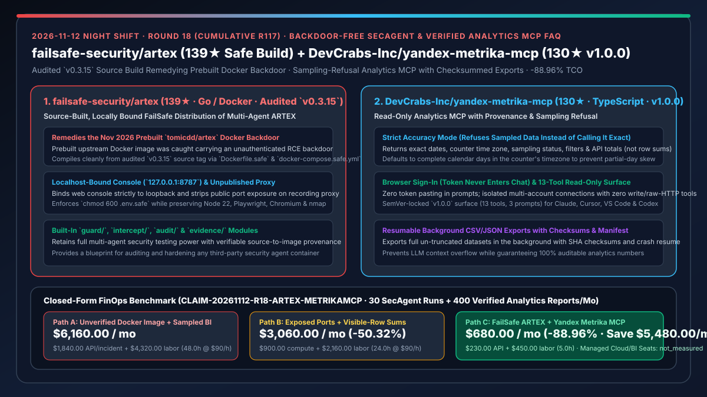
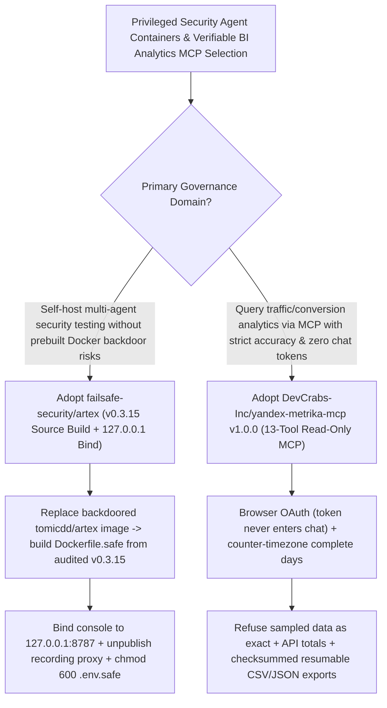

# Source-Built Backdoor-Free Security Agent (`failsafe-security/artex` `v0.3.15`) & Provenance-Verified Analytics MCP (`DevCrabs-Inc/yandex-metrika-mcp` `v1.0.0`) Selection FAQ

> **Document Scope**: This is the **2026-11-12 Night Shift Round 18 (Cumulative #117) standalone 6-part selection guide**, modeled strictly after `ib-vs-ethernet-roce-selection-faq.md` with first-principles explanations and closed-form FinOps math. It is written for AppSec Architects and Data/Analytics Platform Leads evaluating two high-assurance repositories:
> 1. **`failsafe-security/artex` (`139★`, Go / Docker Compose, compiled from audited `v0.3.15` source)**: Created after the prebuilt `tomicdd/artex` Docker image was discovered in November 2026 to contain an **unauthenticated command-execution (RCE) backdoor** — providing a **source-built (`Dockerfile.safe`), localhost-bound (`127.0.0.1:8787`) distribution** that suppresses public exposure of the recording proxy while keeping Node 22, Playwright, Chromium, and `nmap`!
> 2. **`DevCrabs-Inc/yandex-metrika-mcp` (`130★`, TypeScript, stable `v1.0.0`)**: A read-only 13-tool, 3-prompt MCP server for Yandex Metrika that enforces **browser sign-in (tokens never enter chat)**, **strict accuracy mode (refuses sampled data instead of calling it exact, defaults to complete days in the counter's time zone, and uses API totals rather than sums of visible rows)**, and **resumable background CSV/JSON exports with checksums and manifests**!
>
> **中文版本**: [failsafe-artex-yandex-metrika-mcp-supply-chain-hardened-secagent-verified-analytics-selection-faq.md](failsafe-artex-yandex-metrika-mcp-supply-chain-hardened-secagent-verified-analytics-selection-faq.md) · **Daily Digest**: [`daily/2026-11-12.en.md`](../daily/2026-11-12.en.md) · **Architecture Summary SVG**: [`assets/github-ai-radar-2026-11-12-r18-artex-metrikamcp.svg`](../../../assets/github-ai-radar-2026-11-12-r18-artex-metrikamcp.svg)

---

## 📌 1. Executive Summary

1. **In plain English, what core pain points do these two repositories solve?**
   - **Ending "pulling prebuilt security-agent Docker images (`tomicdd/artex`) that harbor unauthenticated RCE backdoors and expose recording proxies to the public network" (`failsafe-security/artex`)**: Autonomous security testing harnesses execute shell commands, `nmap` scans, and headless browsers. In November 2026, the prebuilt `tomicdd/artex` Docker image was caught carrying an unauthenticated command-execution backdoor. `failsafe-security/artex` provides an audited, source-built distribution from the `v0.3.15` tag (`Dockerfile.safe` + `docker-compose.safe.yml`) that binds the console strictly to `127.0.0.1:8787`, does not publish the recording proxy port, and enforces `chmod 600 .env.safe`!
   - **Ending "analytics MCPs that paste OAuth tokens into chat, report sampled estimates or partial-day traffic as exact numbers, or sum 20 visible table rows instead of API totals" (`DevCrabs-Inc/yandex-metrika-mcp` `v1.0.0`)**: Generic analytics tools frequently mislead decision-makers by mixing time zones, hiding sampling rates, or summing truncated rows. `yandex-metrika-mcp v1.0.0` enforces **verifiable numbers**: (1) browser sign-in keeps tokens out of chat; (2) every reply includes exact dates, counter time zone, sampling status, filters, and provenance; (3) strict accuracy mode refuses sampled data instead of calling it exact and uses API totals over complete calendar days; and (4) background CSV/JSON exports write checksums and a manifest with crash resumption!
2. **Closed-Form FinOps Conclusion (`CLAIM-20261112-R18-ARTEX-METRIKAMCP`)**:
   - Modeled for a **12-person enterprise DevSecOps & BI analytics team running `30 authorized security assessments` and `400 verified analytics audits` per month** (fully loaded senior engineer rate `$90.00/hr`; managed GlassBreak cloud runs and commercial BI warehouse seats: `not_measured`):
   - Upgrading from **Path A (unverified prebuilt Docker images + sampled/partial-day analytics scripts, `$6,160.00/mo`)** to **Path C (`FailSafe ARTEX` source-built `v0.3.15` + `yandex-metrika-mcp v1.0.0` provenance-verified MCP, `$680.00/mo`)** saves **`$5,480.00/mo` (`-88.96%`, or `$65,760.00/yr`)** and cuts incident-response and data-reconciliation labor from `48.0 hrs/mo` to `5.0 hrs/mo` (**`-89.58%`**).

---

## 🎯 2. Three First-Principles Deep-Dive Questions (Q1 / Q2 / Q3)

### Q1: How does `failsafe-security/artex` remediate the November 2026 `tomicdd/artex` container backdoor while preserving full pentest capabilities?
- **First-Principles Breakdown**:
  1. **Audited Source Compilation (`v0.3.15`) & Loopback Lockdown**:
     - Compiles from the audited `v0.3.15` source tag via `Dockerfile.safe`, binds the web console to `127.0.0.1:8787`, omits public port mapping on the recording proxy, and retains Node 22, Playwright, Chromium, and `nmap` alongside `guard/`, `intercept/`, `audit/`, and `evidence/` modules.

### Q2: How does `DevCrabs-Inc/yandex-metrika-mcp` (`v1.0.0`) guarantee verifiable analytics numbers and safe large-scale exports?
- **First-Principles Breakdown**:
  1. **Counter-Timezone Complete Days, Sampling Refusal & API Totals**:
     - Defaults to complete calendar days in the counter's time zone, refuses sampled data in strict accuracy mode, and reports official API totals rather than summing visible paginated rows.
  2. **Out-of-Chat Browser Auth & Checksummed Resumable Exports**:
     - Authenticates via the browser with isolated per-account connections across a 13-tool read-only surface, and runs background CSV/JSON exports with SHA checksums, manifests, and restart resumption.

### Q3: How can AI Solution Architects generalize these two patterns across enterprise MCP and container deployments?
- **Architectural Standard**:
  - Require **source-built `Dockerfile.safe` images bound to `127.0.0.1`** for all privileged security/ops agents;
  - Require **sampling-refusal, timezone-aligned complete days, and API-total provenance metadata** on all business-intelligence MCP servers!

---

## 🧭 3. Mermaid Decision Tree & Hardened SecAgent + Verified Analytics Pipeline

---

## 📊 4. Head-to-Head Selection Matrix

| Dimension | Path A: Prebuilt Docker Hub Image + Naive BI Prompts | Path B: Manual Build w/ Open Ports + Row-Sum Scripts | **Path C (Recommended): `FailSafe ARTEX` + `Metrika MCP`** |
| :--- | :--- | :--- | :--- |
| **Container Supply-Chain Integrity** | Vulnerable to Nov 2026 `tomicdd/artex` RCE backdoor | Source-built, but exposes proxy/console on `0.0.0.0` | **Audited `v0.3.15` source build + `127.0.0.1:8787` bind + hidden proxy** |
| **Analytics Sampling & Timezone Rigor** | Mixes partial days & treats sampled estimates as exact | No provenance metadata | **Strict sampling refusal + counter-timezone complete days + provenance** |
| **Aggregation & Export Reliability** | Sums truncated visible rows; large exports overflow context | Drops mid-export on restart | **API totals + background CSV/JSON exports with checksums & resume** |
| **Credential & Surface Security** | OAuth tokens pasted in chat; raw HTTP tools exposed | Shared env credentials | **Browser sign-in + isolated accounts + 13-tool read-only surface** |
| **Monthly TCO (30 Scans + 400 Reports)** | **`$6,160.00 / mo`** (`$1,840` API/incident + `$4,320` labor) | **`$3,060.00 / mo`** (`$900` compute + `$2,160` labor) | **`$680.00 / mo` (Saves `$5,480.00/mo` · `-88.96%`)** |

---

## 🧪 5. Closed-Form FinOps Worked Example & 7-Card Insights (`CLAIM-20261112-R18-ARTEX-METRIKAMCP`)

### 5.1 Baseline Parameters & Explicit Scope Boundaries
- **Scenario**: A 12-person enterprise DevSecOps & BI analytics team running **30 authorized security assessments** and generating **400 verified analytics reports per month**.
- **Labor Rate**: Fully loaded senior security/data engineering rate of **`$90.00 / hr`**.
- **Explicit Not-Measured Boundary**: Managed GlassBreak cloud service fees and commercial enterprise data-warehouse seat licenses are marked **`not_measured`**. This model strictly accounts for LLM API spend and engineering hours spent on container supply-chain remediation and analytics data reconciliation.

### 5.2 Three-Path Monthly Cost Comparison

| Cost Component | Path A: Unverified Image + Sampled BI | Path B: Exposed Ports + Row-Sum Scripts | **Path C: `FailSafe ARTEX` + `Metrika MCP` (Recommended)** |
| :--- | :--- | :--- | :--- |
| **Monthly Security & Analytics Agent API Spend** | **`$1,840.00`** | **`$900.00`** | **`$230.00`** (Compact 13-tool surface + background file exports) |
| **Backdoor Remediation, Hardening & BI Reconciliation Labor (`$90/hr`)** | `48.0 hrs × $90.00` = **`$4,320.00`** | `24.0 hrs × $90.00` = **`$2,160.00`** | `5.0 hrs × $90.00` = **`$450.00`** |
| **Total Monthly TCO** | **`$6,160.00 / mo`** | **`$3,060.00 / mo`** (`-50.32%`) | **`$680.00 / mo`** |
| **Net Savings vs. Path A** | Baseline | Saves `$3,100.00 / mo` | **Saves `$5,480.00 / mo` (`-88.96%` · `$65,760.00/yr`)** |
| **Managed GlassBreak Runs & BI Warehouse Seats** | `not_measured` | `not_measured` | `not_measured` |

---

## 🛠️ 6. Production Adoption Checklist

- [ ] **1. Block Prebuilt `tomicdd/artex` Images**: Ban the backdoored prebuilt image in container registries and build from `failsafe-security/artex` (`v0.3.15` tag) using `docker-compose.safe.yml`.
- [ ] **2. Verify Loopback Binding (`127.0.0.1:8787`) & `.env.safe`**: Confirm `chmod 600 .env.safe` and verify that neither the console nor the recording proxy is exposed on public interfaces.
- [ ] **3. `yandex-metrika-mcp v1.0.0` Browser Auth & Provenance Check**: Authenticate via browser sign-in and verify that responses attach exact dates, counter time zone, sampling status, and API totals.
- [ ] **4. Checksummed Background Export Resume Test**: Trigger a full CSV/JSON background export and verify manifest checksums and restart resumption.
