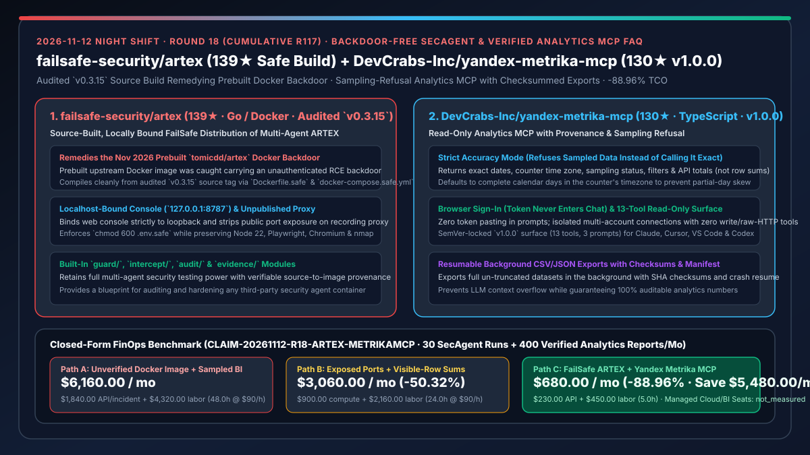
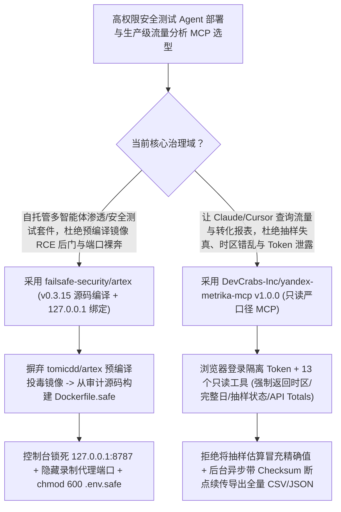

# 源码重编去后门安全测试智能体（`failsafe-security/artex` `v0.3.15`）与拒采样严口径流量分析 MCP（`DevCrabs-Inc/yandex-metrika-mcp` `v1.0.0`）深度选型 FAQ

> **文档定位**：本专题是 **2026-11-12 夜班第 18 轮（累计第 117 篇）独立六段式选型指南**，严格对标 `ib-vs-ethernet-roce-selection-faq.md` 的通俗第一性原理与闭式 FinOps 核算规范，面向企业应用安全（AppSec）负责人与数据科学/BI 平台架构师，深度拆解今日在“安全测试 Agent 容器供应链去后门加固”与“可核验严口径 Web 分析 MCP”赛道突起的两大开源标杆：
> 1. **`failsafe-security/artex`（`139★`，Go / Docker Compose，基于经审计的 `v0.3.15` 源码构建）**：针对 2026 年 11 月爆出的重大供应链投毒事件——**上游预编译的 `tomicdd/artex` Docker 镜像被查出暗藏未授权远程命令执行（RCE）后门**——FailSafe 团队推出的**纯源码编译、本地回环绑定安全发行版**，通过 `Dockerfile.safe` 与 `docker-compose.safe.yml` 将控制台强制锁定在 `127.0.0.1:8787`、关闭录制代理公网端口暴露，同时完整保留 Node 22、Playwright、Chromium 与 `nmap` 渗透测试能力！
> 2. **`DevCrabs-Inc/yandex-metrika-mcp`（`130★`，TypeScript，首个稳定版 `v1.0.0`）**：专为 Claude、Cursor、VS Code 与 Codex 打造的**只读、可核验流量分析 MCP 服务器（13 个工具、3 个 Prompt）**——支持**浏览器直接登录（Token 永不进入聊天窗口）**、**严格精度模式（拒绝把抽样估算数据当成精确值，强制返回计数器时区、完整日、抽样状态与 API 官方总计而非可见行简单相加）**以及**带校验和（Checksum）与断点续传的后台全量 CSV/JSON 导出**！
>
> **English Version**: [failsafe-artex-yandex-metrika-mcp-supply-chain-hardened-secagent-verified-analytics-selection-faq.en.md](failsafe-artex-yandex-metrika-mcp-supply-chain-hardened-secagent-verified-analytics-selection-faq.en.md) · **关联日报**: [`daily/2026-11-12.md`](../daily/2026-11-12.md) · **架构总结图**: [`assets/github-ai-radar-2026-11-12-r18-artex-metrikamcp.svg`](../../../assets/github-ai-radar-2026-11-12-r18-artex-metrikamcp.svg)

---

## 📌 一、核心结论速览（Executive Summary）

1. **一句话大白话讲透这两个项目到底解决了什么痛点？**
   - **终结“红队/安全工程师为了图省事直接 `docker pull` 第三方预构建的渗透测试 Agent 镜像（如 `tomicdd/artex`），结果镜像里自带未鉴权 RCE 后门且录制代理端口直接暴露在公网上反被黑客端掉内网”的痛点（`failsafe-security/artex`）**：自主安全测试 Agent 本身就拥有执行 Shell 命令、跑 `nmap` 扫描和操控 Chromium 的极高权限。2026 年 11 月，社区发现上游预编译的 `tomicdd/artex` 镜像被植入了未授权命令执行后门！`failsafe-security/artex` 给出了一套标准的容器供应链排雷方案：① **彻底抛弃未签名预编译镜像**，直接从经过代码审计的 `v0.3.15` 源码 Tag 本地执行 `docker compose --env-file .env.safe -f docker-compose.safe.yml up -d --build`；② **收敛网络暴露面**：将控制台死死绑定在本地 `127.0.0.1:8787`，并彻底取消录制代理（Recording Proxy）的端口映射；③ 强制 `.env.safe` `chmod 600` 权限保护！
   - **终结“让 AI 查网站流量转化数据时，AI 把还没过完的今天半截数据算进去、把 10% 抽样估算值当成精确值汇报给老板，或者只把前 20 行加起来冒充全站总流量”的痛点（`DevCrabs-Inc/yandex-metrika-mcp` `v1.0.0`）**：通用分析 MCP 最容易犯三个数据失真错误：时区错乱、把抽样值当真值、以及用分页可见行求和替代全局去重汇总。`yandex-metrika-mcp v1.0.0` 将商业 BI 的严苛口径写死在协议层：① **严格精度（Strict Accuracy）**：拒绝把抽样数据（Sampled Data）伪装成精确结果，强制使用计数器所在时区的完整自然日（Complete Days）与官方 API Totals；② **每次回答必带溯源元数据（精确起止日期、时区、抽样率、过滤条件）**；③ **Token 零入聊 + 后台带 Checksum/Manifest 断点续传全量导出**！
2. **闭式 FinOps 投资回报结论（`CLAIM-20261112-R18-ARTEX-METRIKAMCP`）**：
   - 以 **12 人企业应用安全（SecOps）与增长数据分析团队每月执行 `30 次` 授权多智能体渗透测试、并出具 `400 份` 经审计流量/转化对比报告** 为基准（高级安全与数据工程师全包时薪 `$90.00/hr`；托管版 GlassBreak 云服务与商业数仓年费：`not_measured`）：
   - 从 **Path A（拉取带后门的预构建容器引发安全应急响应 + 手写粗糙分析脚本导致抽样/不完整日口径错误返工，月均 `$6,160.00`）** 升级至 **Path C（`FailSafe ARTEX` 源码重编本地绑定容器 + `yandex-metrika-mcp v1.0.0` 严口径溯源与后台全量导出，月均 `$680.00`）**，每月净省 **`$5,480.00/mo`（降幅 `-88.96%`，年省 `$65,760.00/yr`）**，并将容器后门排查与报表口径对账返工工时从 `48.0 hrs/mo` 压缩至 `5.0 hrs/mo`（节省 **`-89.58%`**）。

---

## 🎯 二、三大灵魂拷问（Q1 / Q2 / Q3 深度原理解析）

### Q1：`tomicdd/artex` 预编译镜像后门事件给 AI 架构师敲响了什么警钟？`failsafe-security/artex` 做了哪些关键加固？
- **第一性原理拆解**：
  1. **为什么高权限 Agent 容器是供应链投毒的头号目标？**：
     - 渗透测试与运维 Agent 容器天然配置了 LLM API Key、内网网络可达性以及 `nmap`/Chromium/Shell 执行环境。一旦 Docker Hub 预构建镜像与 GitHub 源码不一致并混入未鉴权后门，攻击者即可直接接管扫描宿主机。
  2. **`Dockerfile.safe` + `docker-compose.safe.yml` 三重硬化**：
     - 锁定经审计的 `v0.3.15` 源码从头编译 Go 后端与前端；将 Web 控制台仅绑定于 `127.0.0.1:8787`；移除录制代理的宿主机端口发布；内置 `guard/`、`intercept/`、`audit/` 与 `evidence/` 目录确保每次授权扫描可追溯。

### Q2：`DevCrabs-Inc/yandex-metrika-mcp` (`v1.0.0`) 是如何从架构上根治 LLM 数据分析中的“抽样谎言、不完整日偏差与可见行误加”的？
- **第一性原理拆解**：
  1. **五大防失真护栏（Provenance-First Analytics）**：
     - **完整自然日默认（Complete Days）**：自动按计数器配置的时区截取完整自然日，防止把当天上午半天的数据与上周全天对比得出“流量暴跌”的假结论；
     - **拒绝抽样伪装（Refuses Sampled Data）**：严格精度模式下，若 API 触发抽样，明确拒绝将其作为精确值返回；
     - **API Totals 优先**：强制读取接口全局去重汇总（API Totals），严禁 LLM 把截断的前 N 行直接相加；
     - **只读受限表面（13 Tools, 3 Prompts）**：零写接口、零裸 HTTP 透传工具，且通过浏览器 OAuth 登录使访问令牌永不进入聊天上下文。
  2. **带 Checksum 与 Manifest 的后台全量导出**：
     - 当需要导出数十万行明细时，在后台异步生成 CSV/JSON 文件并写入校验和（Checksums）与清单（Manifest），支持进程重启后断点续传。

### Q3：AI 架构师如何将这两套工程规范推广到企业内部所有 Agent 容器与数据 MCP？
- **企业级治理规范**：
  - **容器供应链铁律**：所有具备 Shell / 网络扫描权限的第三方 Agent 必须参考 `failsafe-security/artex`，实施**源码锁定重编 + 本地回环绑定 + 内部代理端口隐藏**；
  - **BI / 数据 MCP 铁律**：所有连接生产数仓或流量平台的 MCP 必须参考 `yandex-metrika-mcp v1.0.0`，在返回结构中强制携带**时区、完整日边界、抽样状态与官方聚合值**！

---

## 🧭 三、Mermaid 选型决策树与「源码重编安全沙盒 + 严口径分析 MCP」流水线

---

## 📊 四、同类方案核心能力对比矩阵（Selection Matrix）

| 评估维度 | Path A：直接拉取未验证 Docker 镜像 + 粗放 BI 脚本 | Path B：手工构建但暴露全端口 + 可见行简单求和 | **Path C（推荐）：`FailSafe ARTEX` + `yandex-metrika-mcp`** |
| :--- | :--- | :--- | :--- |
| **容器供应链防后门保证** | 直接中招 `tomicdd/artex` 2026-11 未授权 RCE 后门 | 虽从源码构建，但录制代理与控制台暴露在 `0.0.0.0` | **锁定审计后 `v0.3.15` 源码构建 + 仅绑定 `127.0.0.1:8787` + 隐藏代理** |
| **分析口径诚实度（抽样与时区）** | 抽样数据与半截自然日混算，结论严重失真 | 缺乏统一时区对齐与溯源元数据 | **严格拒绝抽样伪装 + 默认计数器时区完整日 + 必带 Provenance 元数据** |
| **汇总计算准确性与大数据导出** | 让 LLM 把前 20 行可见数据相加冒充全局总计 | 大表导出直接撑爆 MCP 响应或中途断流作废 | **强制使用 API Totals + 后台带 Checksum & Manifest 断点续传导出** |
| **凭证保护与接口最小权限** | 在聊天框直接粘贴 OAuth Token；暴露通用 HTTP 工具 | 多账号共享同一环境变量易串号 | **浏览器直接登录（Token 不入聊）+ 多账号隔离 + 13 工具纯只读表面** |
| **月度总拥有成本（30 次扫描 + 400 份报表）** | **`$6,160.00 / mo`**（`$1,840` 事故/API + `$4,320` 工时） | **`$3,060.00 / mo`**（`$900` 算力 + `$2,160` 工时） | **`$680.00 / mo`（净省 `$5,480.00/mo` · `-88.96%`）** |

---

## 🧪 五、定量 FinOps 算例与 7-Card 洞察（`CLAIM-20261112-R18-ARTEX-METRIKAMCP`）

### 5.1 测算基准与显式边界（Scope & Boundaries）
- **场景设定**：12 人企业应用安全与增长分析团队，每月运行 **30 次授权自动化安全评估**，并生成 **400 份带溯源的流量/渠道/落地页对比分析报告**。
- **费率假设**：高级安全与数据工程师全包时薪 **`$90.00 / hr`**。
- **显式边界声明（Explicit Not-Measured Boundary）**：商业托管版安全服务（GlassBreak）与外部企业级商业数仓软件许可费标记为 **`not_measured`**，本表严格核算模型 API 消耗以及因预编译镜像后门应急排查、端口暴露加固与分析报表抽样/时区口径错误返工耗费的工时。

### 5.2 三路径月度成本闭式对照表

| 成本分项 | Path A：未核验镜像 + 粗放抽样报表 | Path B：端口全开 + 可见行求和 | **Path C：`FailSafe ARTEX` + `Metrika MCP`（推荐）** |
| :--- | :--- | :--- | :--- |
| **月度安全扫描与数据分析模型 API 支出** | **`$1,840.00`** | **`$900.00`** | **`$230.00`**（13 个紧凑只读工具 + 后台异步文件导出省去长列表 Token） |
| **容器后门排查、网络加固与报表口径返工工时（`$90/hr`）** | `48.0 hrs × $90.00` = **`$4,320.00`** | `24.0 hrs × $90.00` = **`$2,160.00`** | `5.0 hrs × $90.00` = **`$450.00`** |
| **月度总成本（Monthly TCO）** | **`$6,160.00 / mo`** | **`$3,060.00 / mo`**（`-50.32%`） | **`$680.00 / mo`** |
| **相对 Path A 净节省** | 基准线（Baseline） | 净省 `$3,100.00 / mo` | **净省 `$5,480.00 / mo`（`-88.96%` · 年省 `$65,760.00/yr`）** |
| **托管 GlassBreak 服务与商业数仓席位费** | `not_measured` | `not_measured` | `not_measured` |

---

## 🛠️ 六、生产级落地核验 Checklist

- [ ] **1. 严禁拉取 `tomicdd/artex` 预编译镜像**：在内部镜像仓库黑名单中拦截含后门的 `tomicdd/artex`，统一使用 `failsafe-security/artex` 的 `docker-compose.safe.yml` 本地源码构建。
- [ ] **2. `127.0.0.1:8787` 绑定与 `.env.safe` 权限核查**：运行 `ss -tulpn` 确认仅本地回环监听且录制代理未暴露公网端口，核查 `.env.safe` 权限为 `600`。
- [ ] **3. `yandex-metrika-mcp v1.0.0` 浏览器登录与严口径验证**：通过浏览器完成账号授权（确认聊天记录无 Token），验证返回结果包含时区、起止日期、抽样状态与 API Totals。
- [ ] **4. 后台全量导出断点续传测试**：触发一次大跨度 CSV/JSON 后台导出，重启 MCP 进程后验证其根据 Manifest 与 Checksum 自动续传完成。
