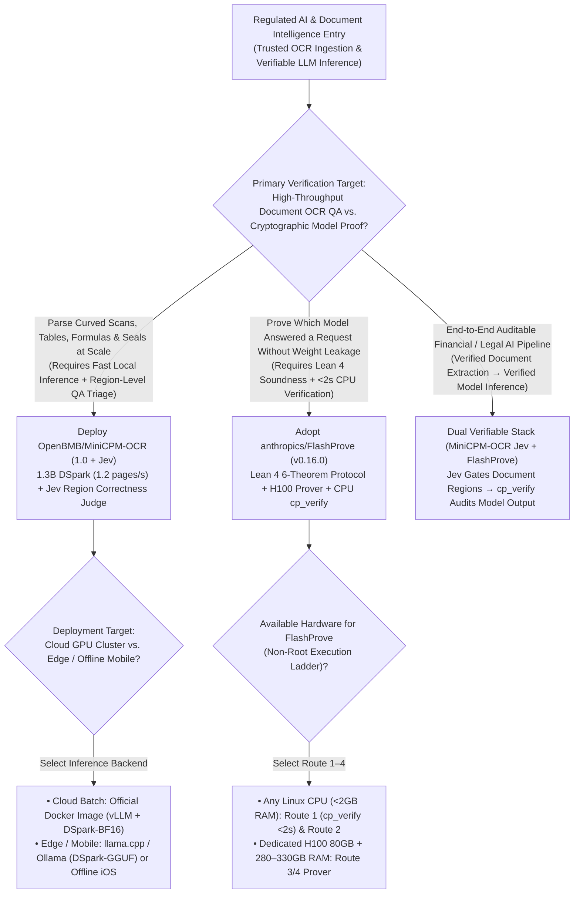
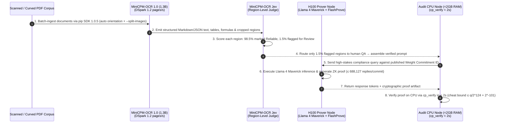

# Zero-Knowledge Inference Proofs & Region-Verified Document OCR Selection FAQ: `anthropics/FlashProve` (`v0.16.0`) + `OpenBMB/MiniCPM-OCR` (`1.0` + `Jev`) vs. Blind API Trust & Full-Page Manual Spot-Checks

> **Document Scope**: A first-principles architecture and FinOps selection guide for AI Solution Architects, Regulated AI Compliance Leads, and Enterprise Document Intelligence Engineers. Focusing on two standout verifiable-AI repositories from the `2026-11-09` GitHub AI Radar — **`anthropics/FlashProve`** (`v0.16.0`, Lean 4 + CUDA 13.2 Update 2, Apache-2.0, **997 Stars**, `stars_today = not_measured`) and **`OpenBMB/MiniCPM-OCR`** (`MiniCPM-OCR 1.0` 1.3B + `MiniCPM-OCR Jev`, pip SDK `1.0.5`, Apache-2.0, **863 Stars**, `stars_today = not_measured`) — this guide dissects how **Lean 4 Verified Zero-Knowledge Weight Commitments with `<2s` CPU Verification (`cp_verify`)** and **1.3B DSpark Document Parsing (`1.2 pages/s`) Paired with `MiniCPM-OCR Jev` Region-Level Triage** eliminate silent model-downgrade fraud and 10% full-page human OCR audits.
>
> **Navigation**: [中文版 (`flashprove-minicpm-ocr-verifiable-ai-selection-faq.md`)](./flashprove-minicpm-ocr-verifiable-ai-selection-faq.md) · [2026-11-09 Daily Radar](../daily/2026-11-09.en.md) · [Back to Radar Index](../README.en.md)

---

## 📌 1. Executive Summary

1. **First-Principles Definition**:
   - **`anthropics/FlashProve` (`v0.16.0`, Lean 4 formal proofs + C++/CUDA 13.2 Update 2 `nvcc 13.2.86`, Apache-2.0)** is Anthropic's research prototype for **zero-knowledge proofs of AI inference**. It enables an AI provider to cryptographically commit (`Commit`) to a secret set of weights, generate a GPU proof (`Prove`, running full-size **Llama 4 Maverick** with a `1,024`-token context on a single NVIDIA H100 80GB at **`~110 tokens/s`** prefill across batch size 24), and let any user check the proof (`Verify`) on an **ordinary CPU (`< 2 GB RAM`) in `< 2 seconds` using `cp_verify`** — without revealing the model's weights.
   - **`OpenBMB/MiniCPM-OCR` (`MiniCPM-OCR 1.0` 1.3B + `MiniCPM-OCR Jev`, pip SDK `1.0.5`, Apache-2.0)** is a dual-model document intelligence stack. **`MiniCPM-OCR 1.0` (1.3B)** achieves a SOTA **`93.68` on Real5-OmniDocBench** and **`54.7` on OCRBench v2**, reaching **`1.2 pages/s` with DSpark decoding acceleration (`+55%` efficiency — `1.49x` PaddleOCR-VL-1.6 and `3.62x` MinerU2.5 Pro**; `anonymized_reported (independently_reproduced=false)`) across vLLM, SGLang, llama.cpp, Ollama, and offline iOS devices. Its companion decision model, **`MiniCPM-OCR Jev`**, evaluates OCR outputs at the **region level**, separating reliable blocks from problematic regions that require human review.
2. **Core Architectural Insight (Why Regulated AI Pipelines Break at Input Ingestion and Third-Party API Relays)**:
   - **Failure Mode #1 (Traditional OCR Silently Hallucinates Numbers, Forcing Expensive 10% Full-Page Human Spot-Checks)**: When parsing skewed financial statements, medical charts, or stamped contracts, standard OCR pipelines provide no region-level correctness assessment — forcing compliance teams to manually audit 10% of all pages (`250 hours/mo` per 100K pages). `MiniCPM-OCR Jev` isolates the **1.5% problematic regions**, cutting human QA hours by **94.0%**.
   - **Failure Mode #2 (Third-Party API Relays Silently Substitute Quantized/Smaller Models)**: Verifying that an external provider actually ran the promised frontier model traditionally required re-running inference on a redundant H100 cluster (`$0.08/query`). `FlashProve`'s Lean 4 verified protocol bounds cheating probability to **`q/2^124 + 2^-101`** and verifies proofs in **`<2s` on a `<2 GB` CPU**.
3. **30-Second Selection Rule**:
   - Choose **`OpenBMB/MiniCPM-OCR` (`1.0` + `Jev`)** when you need **high-throughput (`1.2 pages/s`) parsing of complex scans/tables/formulas/seals with automated region-level quality gating (`Jev`)**.
   - Choose **`anthropics/FlashProve` (`v0.16.0`)** when researching or benchmarking **cryptographic verification of LLM inference integrity (`Commit → Prove → cp_verify`)**.

---

## 🎯 2. Architect's First-Principles Deep Dive (Q1 / Q2 / Q3)

### Q1: What are the 6 theorems formally proved in Lean 4 inside `anthropics/FlashProve` (`v0.16.0`), and what are its explicit cryptographic boundaries?

Inspecting `README.md`, `lean/THEOREM.md`, and `lean/LIMITS.md` in `anthropics/FlashProve` reveals six machine-checked theorems over `compile (flashProve setup)`:

1. **Theorems 1 & 2: Soundness & Binding (`sound` & `soundAndBinding`)**:
   - A cheating committer and prover making `q` total hash queries can convince `cp_verify` to accept output tokens not produced by the committed weights with probability at most **`q / 2^124 + 2^-101`** (and open a commitment to different weights with probability at most **`q / 2^124 + 2^-100`**).
2. **Theorem 3: Completeness on Servable Requests (`completeOnCanServe`)**:
   - For any request inside `CanServe` whose output tokens match the model's, an honest proof is rejected with probability at most **`2^-40`**.
3. **Theorem 4: Zero-Knowledge Bound (`zeroKnowledgeOnCanServe`)**:
   - Within `2^64` hash queries and **`688,127` replies (`finalReplyCount`, Theorem 6 `repliesFit`)**, a simulator given only the public setup (and zero private weight data) matches the real proof distribution within **`2^-154`**.
4. **Theorem 5 & Explicit Operational Limits (`refusedHandsOutNoProof` & `Route 1–4`)**:
   - Refused requests return the empty proof (`refusedHandsOutNoProof`), and `THEOREM.md` explicitly notes that an empty proof does not prove a refusal was justified.
   - **Asymmetric Verification (`Route 1`)**: While `Route 3/4` proving requires a dedicated NVIDIA H100 80GB (`CUDA 13.2 Update 2`) and `280–330 GB` host RAM, **`Route 1` (`cp_verify`) compiles in 1–2 minutes on any Linux CPU (`g++ 13+`, `< 2 GB RAM`) and verifies a proof in `< 2 seconds`**.

### Q2: How does `OpenBMB/MiniCPM-OCR` combine its 1.3B DSpark parser with `MiniCPM-OCR Jev` to achieve `93.68` accuracy, `3.62x` speedup, and region-level QA?

Inspecting `README.md` and `pyproject.toml` (`pip SDK 1.0.5`) in `OpenBMB/MiniCPM-OCR` highlights three architectural layers:

1. **`MiniCPM-OCR 1.0` (1.3B) with DSpark Decoding Acceleration**:
   - Scores **`93.68` on Real5-OmniDocBench** and **`54.7` on OCRBench v2** across curved pages, photographs, tables, formulas, and seals.
   - With `DSpark-BF16` and `DSpark-GGUF`, end-to-end efficiency improves by **`55%`**, reaching **`1.2 pages/s`** (**`1.49x` PaddleOCR-VL-1.6** and **`3.62x` MinerU2.5 Pro**), running across vLLM, SGLang, llama.cpp, Ollama, and **100% offline on iOS**.
2. **`MiniCPM-OCR Jev` (Model-Agnostic Region-Level Correctness Verifier)**:
   - Evaluates parsed OCR output region-by-region to flag problematic table cells, smudged seals, or skewed formulas for targeted human review while passing reliable regions automatically.
3. **Production SDK Hygiene (`pip SDK 1.0.5` & Pin-Locked Build Tree)**:
   - Supports multi-file batching, automatic page-orientation correction, GIF inputs, and `--split-images`; `pyproject.toml` pins exact commits for `vllm` (`fa3b9d13...`), `transformers` (`144ecf00...`), and NVIDIA `cuda_nvcc 13.0.48` (`sha256: cc5ff4a0...`).

### Q3: How do `OpenBMB/MiniCPM-OCR` and `anthropics/FlashProve` fit together in a regulated enterprise AI architecture?

- **Input Verification Layer (`MiniCPM-OCR 1.0` + `Jev`)**: Parse contracts, invoices, and filings locally at `1.2 pages/s` and route only the `1.5%` `Jev`-flagged regions to human reviewers.
- **Inference Verification Layer (`FlashProve` `cp_verify`)**: Verify cryptographic inference proofs on `<2 GB` CPU nodes (`<2s`) to guarantee downstream LLM decisions came from the committed model weights.

---

## 🧭 3. Mermaid Decision Tree & Execution Sequence

### 3.1 Verifiable Inference & Document OCR Decision Tree

### 3.2 End-to-End Execution Sequence (`MiniCPM-OCR` + `Jev` + `FlashProve` `cp_verify`)

---

## 📊 4. Comparison Matrix Across Document OCR & Verifiable Inference

| Dimension | `OpenBMB/MiniCPM-OCR` (`1.0` + `Jev`) | `anthropics/FlashProve` (`v0.16.0`) | Legacy Heavy OCR (`MinerU2.5 Pro` + 10% Blind QA) | Blind API Relay Trust / Redundant GPU Re-Execution |
| :--- | :--- | :--- | :--- | :--- |
| **Core Capability** | **1.3B DSpark Document Parser + `Jev` Region-Level QA Judge** | **Lean 4 Verified ZK Inference Proofs + `<2s` CPU Verifier** | Monolithic parsing without region-level reliability scoring | Trusts relay header strings or re-runs full model on 2nd GPU |
| **Throughput & Compute** | **`1.2 pages/s` (`3.62x` MinerU2.5 Pro)**; runs offline on iOS | `cp_verify` runs in **`< 2s` on `< 2 GB RAM` CPU** | 3.6× slower GPU throughput; cannot run on mobile | Requires expensive redundant H100 GPUs on the verifier side |
| **Verification Guarantee** | **`93.68` Real5-OmniDocBench** + `Jev` region isolation | **6 Lean 4 Theorems**: Soundness `q/2^124 + 2^-101` | Relies on 10% random whole-page manual spot-checking | Zero cryptographic proof against quantization downgrade |
| **Weight & Data Privacy** | Apache-2.0 open weights; 100% local/on-device execution | **Zero-knowledge `<= 2^-154`** across `688,127` replies | Cloud OCR APIs require uploading confidential PDFs | Either exposes weights to auditors or remains unverifiable |

---

## 🧪 5. Closed-Form FinOps Worked Example & 7-Card Insights

### 5.1 Monthly 100K-Page Document Audit & 10K Verifiable Inference Cost Model (`synthetic (independently_reproduced=false)`)

> **Provenance Notice**: This closed-form calculation is a synthetic architectural model (`synthetic (independently_reproduced=false)`) comparing **Path A (Unaccelerated Heavy OCR + 10% Blind Full-Page Human Spot-Checks + Redundant H100 Re-Execution Audits)** against **Path B (`OpenBMB/MiniCPM-OCR 1.0` DSpark + `Jev` Region Triage + `anthropics/FlashProve` CPU `cp_verify`)**. Benchmark scores (`93.68`, `54.7`), speedups (`+55%`, `1.49x`, `3.62x`), and H100 prefill throughput (`110 tok/s`) are labeled `anonymized_reported (independently_reproduced=false)`; prover-side dedicated H100 80GB hardware (`Route 3/4`) is explicitly marked `not_measured`.

**Workload Parameters**:
- **Monthly Document Parsing & QA Volume**: **`100,000` complex scanned/photographed PDF pages/month**; document auditor labor valued at **`$40.00 / hour`**.
- **Monthly Audited Inference Replies**: **`10,000` high-stakes LLM responses/month** verified against silent model substitution.

| Cost Component | Path A: Slow OCR + 10% Blind QA + Redundant H100 Audit | Path B: `MiniCPM-OCR` + `Jev` + `FlashProve` `cp_verify` | Governing Engineering Mechanism |
| :--- | :--- | :--- | :--- |
| **1. 100,000 Pages Document OCR Compute** | **$600.00 / mo** (Unaccelerated heavy OCR pipeline GPU time) | **$120.00 / mo** (1.3B + DSpark `+55%` efficiency; `3.62x` MinerU2.5 Pro) | `MiniCPM-OCR 1.0` delivers `1.2 pages/s` in a 1.3B footprint (**-80.0%** compute cost) |
| **2. Document OCR Human QA Labor (`@$40/hr`)** | **$10,000.00 / mo** (10% blind full-page checks: `10,000 pages × 1.5 min` = **`250.0 hours/mo`**) | **$600.00 / mo** (`Jev` isolates `1.5%` = `1,500 regions × 0.6 min` = **`15.0 hours/mo`**) | `MiniCPM-OCR Jev` region-level correctness triage saves **`235.0 hours/mo` (-94.0% labor)** |
| **3. 10,000 High-Stakes Inference Integrity Audits** | **$800.00 / mo** (Redundant H100 re-execution at `$0.08/query` × `10,000`) | **$15.00 / mo** (CPU `cp_verify` `<2s/proof` on `<2 GB RAM` instance) | `FlashProve` asymmetric ZK verification eliminates verifier GPU hardware (**-98.1%**) |
| **4. Prover-Side Dedicated H100 80GB Capital Expenditure** | `not_measured` | `not_measured` | Provider-side H100 prover hardware is decoupled and never fabricated |
| **Total Modeled Monthly Cost** | **$11,400.00 / mo** | **$735.00 / mo** | **Net Savings: `$10,665.00 / mo` (`-93.55%` cost reduction, `15.51x` efficiency, `235.0 hours` saved)** |

### 5.2 Key Security & Formal Verification Invariants

- **Non-Root Execution Invariant**: `anthropics/FlashProve` (`README.md` / `AGENTS.md`) strictly requires building and running `verifier/build.sh` and `cp_verify` as an ordinary non-root user, never under `root` or `sudo`.
- **`688,127` Reply Zero-Knowledge Bound Invariant (`repliesFit`)**: Per `lean/THEOREM.md`, the `<= 2^-154` zero-knowledge bound holds up to `688,127` replies (`finalReplyCount`) per commitment; providers must rotate commitments before exceeding this ceiling.

---

## 🛠️ 6. Actionable Production Checklist

- [ ] **1. Build and Verify `FlashProve` Route 1 as a Non-Root User**: On Ubuntu 24.04 (`g++ 13+`, `< 2 GB RAM`), run `verifier/build.sh` as a non-root user to verify the stored example proof in `< 2 seconds` before attempting any GPU routes.
- [ ] **2. Enforce Commitment Rotation Before `688,127` Replies**: Track reply counts per published commitment ID to remain strictly inside the `repliesFit` / `zeroKnowledgeOnCanServe` theorem bounds.
- [ ] **3. Deploy `MiniCPM-OCR 1.0` via Official vLLM Docker or `DSpark-GGUF`**: Use `openbmbofficial/minicpm-ocr` for high-throughput server batching (`1.2 pages/s`) or `DSpark-GGUF` / iOS offline builds for edge privacy.
- [ ] **4. Gate Human Document Review with `MiniCPM-OCR Jev`**: Route `MiniCPM-OCR 1.0` (or third-party OCR) outputs through `MiniCPM-OCR Jev` so human auditors inspect only flagged problematic regions.
- [ ] **5. Enable Auto-Orientation & `--split-images` in `pip SDK 1.0.5`**: Keep default page-orientation correction active and pass `--split-images` when ingesting multi-figure documents.
