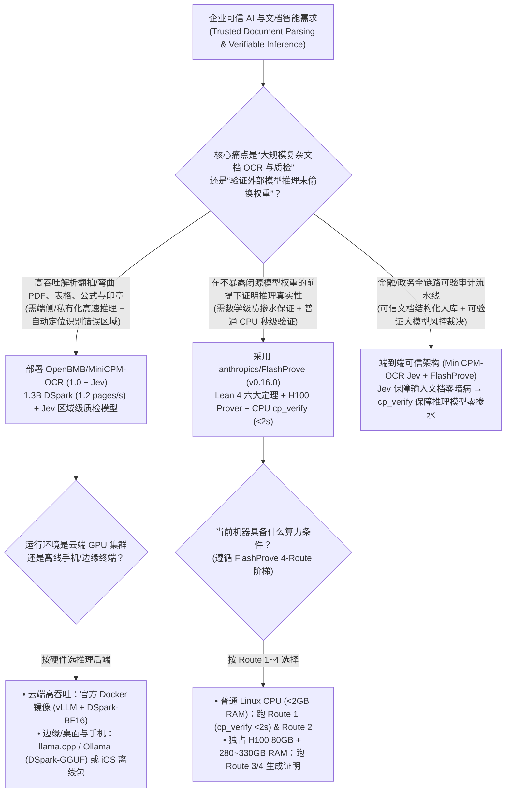
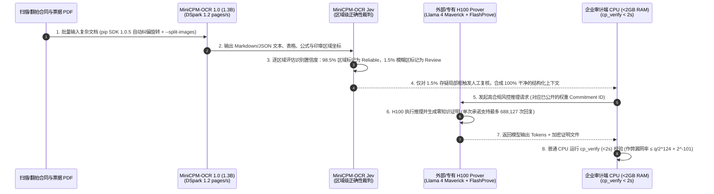

# 零知识推理证明与区域级置信度自评估 OCR 选型 FAQ：`anthropics/FlashProve` (`v0.16.0`) + `OpenBMB/MiniCPM-OCR` (`1.0` + `Jev`) vs 盲信第三方 API 与全量人工抽检

> **文档定位**：面向 AI Solution Architect（AI 解决方案架构师）、金融/政务可信 AI 合规负责人与大规模文档智能（Document AI）平台架构师的第一性原理选型指南。聚焦 `2026-11-09` GitHub 新仓爆发追踪中的两大“可验证 AI（Verifiable AI）”代表作——Anthropic 官方开源的零知识推理证明原型 **`anthropics/FlashProve`**（`v0.16.0`，Lean 4 + CUDA 13.2，Apache-2.0，揽下 **997 Stars**，`stars_today = not_measured`）与清华/面壁智能开源的 **`OpenBMB/MiniCPM-OCR`**（`1.0` 识别模型 + `Jev` 区域级正确性评估模型，pip SDK `v1.0.5`，Apache-2.0，揽下 **863 Stars**，`stars_today = not_measured`），深度拆解如何用 **“Lean 4 形式化证明的零知识权重承诺与 `<2s` CPU 极速验证器（`cp_verify`）”** 与 **“1.3B DSpark 极速解析 + `MiniCPM-OCR Jev` 区域级问题定位（省去 94% 人工盲检）”** 筑牢企业 AI 输入端（OCR）与推理端（Model Integrity）的双重可信底座。
>
> **阅读导航**：[English Version (`flashprove-minicpm-ocr-verifiable-ai-selection-faq.en.md`)](./flashprove-minicpm-ocr-verifiable-ai-selection-faq.en.md) · [2026-11-09 全景日报](../daily/2026-11-09.md) · [返回雷达首页](../README.md)

---

## 📌 1. 核心结论速览（Executive Summary）

1. **一句话本质定义**：
   - **`anthropics/FlashProve`（`v0.16.0`，Lean 4 形式化定理证明 + C++/CUDA 13.2 Update 2，Apache-2.0）** 是 Anthropic 发布的**大模型推理零知识证明（Zero-Knowledge Proofs of AI Inference）研究原型**。它让算力提供商在不泄露任何商业闭源模型权重的前提下，向用户生成加密数学证明：“当前这条回复确实是由我公开承诺（Commit）的那套满血模型权重（如单卡 H100 80GB 上运行的满血 **Llama 4 Maverick**，`1,024` 上下文，Batch=24 下 Prefill 达 **`~110 tokens/s`**）算出来的，绝未偷偷掺水替换成小模型或劣质量化版”；任何客户只需在一台 **`< 2 GB 内存` 的普通 CPU 上运行 `cp_verify`，不到 `2 秒` 即可完成数学核验**！
   - **`OpenBMB/MiniCPM-OCR`（`MiniCPM-OCR 1.0` 1.3B + `MiniCPM-OCR Jev` 评估模型，pip SDK `1.0.5`，Apache-2.0）** 是面壁智能开源的**“自带区域级质检员”的高吞吐端侧/云端文档解析家族**。其中 **`MiniCPM-OCR 1.0`（1.3B）** 在 Real5-OmniDocBench 斩获 **93.68** SOTA 高分，配合 DSpark 加速吞吐提升 **55%**（达 **`1.2 pages/s`**，是 PaddleOCR-VL-1.6 的 **1.49 倍**、MinerU2.5 Pro 的 **3.62 倍**，数据分级：`anonymized_reported (independently_reproduced=false)`），甚至能在 iOS 手机上完全离线运行；而搭档模型 **`MiniCPM-OCR Jev`** 则专门对任意 OCR 输出做**区域级正确性评估（Region-Level Correctness Assessment）**，精准圈出哪一个表格单元格或公式块存在识别风险需要人工复核。
2. **核心架构洞察（为什么企业级 AI 落地的最大隐患是“输入端 OCR 静默认错字”和“中转商 API 偷换掺水模型”？）**：
   - **痛点一（传统 OCR 没有“自知之明”，为了防 1% 的关键金额认错被迫安排 10% 人工整页盲检）**：在财报、病历、弯曲翻拍合同解析中，传统 OCR 认错一个小数点也不会报警；企业被迫抽调大量文员做 10% 随机整页盲检（10 万页需 250 小时/月）。`MiniCPM-OCR Jev` 充当独立区域级裁判，只把存疑的 **1.5% 局部问题框** 推送给人工或重型 VLM 复核，砍掉 **94%** 的无效质检工时。
   - **痛点二（第三方 API 渠道“挂羊头卖狗肉”偷换低配模型，传统重跑比对成本太高）**：企业使用外部算力池或合规审计时，若想确认对方是否真的跑了满血模型，传统做法只能在自建可信 GPU 集群上重跑一遍对比 Logits。`FlashProve` 用 Lean 4 严格证明的六大定理将作弊漏网概率压死在 **`q/2^124 + 2^-101`** 以内，且验证端完全无需 GPU。
3. **30 秒选型口诀**：
   - 需要**高吞吐解析中英文复杂 PDF/歪斜翻拍件/印章/公式/表格，且希望自动圈出疑似识别错误的局部区域交由人工精准复核** → 选 **`OpenBMB/MiniCPM-OCR`（`1.0` + `Jev`）**。
   - 需要**研究或构建可验证 AI 推理协议（在不公开模型权重的前提下，用普通 CPU `<2s` 数学验证回复是否出自指定承诺模型）** → 选 **`anthropics/FlashProve` (`v0.16.0`)**。

---

## 🎯 2. 架构师灵魂拷问（Q1 / Q2 / Q3 First-Principles Deep Dive）

### Q1：`anthropics/FlashProve` (`v0.16.0`) 在 Lean 4 中到底证明了哪 6 个核心定理？它承诺了什么，又有哪些显式声明的边界（`LIMITS.md`）？

精读 `anthropics/FlashProve` 的 `README.md` 与 `lean/THEOREM.md`，其协议由 **Commit（权重承诺）→ Prove（H100 证明生成）→ Verify（CPU `cp_verify` 校验）** 三步组成，并在 Lean 4 中机器校验了 6 条定理：

1. **定理 1 & 2：可靠性与承诺绑定（`sound` & `soundAndBinding`）**：
   - 一个作弊的算力提供方（Committer + Prover）在累计发起 `q` 次哈希查询的前提下，要想让验证器 `cp_verify` 接受一段并非出自该承诺权重的伪造 Token 序列，其成功欺骗概率至多约为 **`q / 2^124 + 2^-101`**（连同打开承诺的联合绑定界为 **`q / 2^124 + 2^-100`**）。
2. **定理 3：可服务请求上的完备性（`completeOnCanServe`）**：
   - 对于任何属于可服务集合（`CanServe`）且输出确为该模型真实结果的请求，诚实 Prover 生成的证明被误拒的概率至多为 **`2^-40`**。
3. **定理 4：零知识性（`zeroKnowledgeOnCanServe`）**：
   - 在 `2^64` 次哈希查询与单次承诺最多 **`688,127` 次回复（`finalReplyCount`，对应定理 6 `repliesFit`）** 的预算内，模拟器（Simulator，不持有任何私有权重）分布与真实证明分布的统计距离不超过 **`2^-154`**——即证明本身绝不会泄露被掩码保护的模型权重！
4. **定理 5 与诚实架构边界（`refusedHandsOutNoProof` & `lean/LIMITS.md`）**：
   - 当请求格式非法或无法服务时，Prover 返回空证明（Empty Proof）。`THEOREM.md` 极其诚实地划清了边界：空证明本身不证明“拒绝是否合理”（恶意服务商也可故意返回空证明拒服）；且当前零知识界针对的是单承诺单请求而非跨承诺批处理。
   - **极简验证成本（Route 1）**：任何人只需在 `< 2 GB RAM` 的普通 Linux CPU 上用 `g++ 13+` 编译 `verifier/build.sh`（耗时 1–2 分钟），后续每次调用 `cp_verify` 校验证明仅需 **`< 2 秒`**！

### Q2：`OpenBMB/MiniCPM-OCR` 是如何通过 `1.0`（1.3B DSpark）+ `Jev` 双模型架构，同时拿下 `93.68` SOTA 精度、`3.62x` 吞吐与区域级质检的？

拆解 `OpenBMB/MiniCPM-OCR` 的 `README.md` 与 `pyproject.toml`（pip SDK `1.0.5`）：

1. **`MiniCPM-OCR 1.0`（1.3B 轻量全能解析引擎）**：
   - 仅 1.3B 参数量即可通吃文本、复杂表格、数学公式、图表、印章（Seals）与关键信息抽取（KIE），在真实复杂场景基准 **Real5-OmniDocBench 取得 `93.68` SOTA**，在 OCRBench v2 取得 `54.7` SOTA。
   - 通过 **DSpark 解码加速（提供 `DSpark-BF16` 与 `DSpark-GGUF`）** 将端到端处理效率提升 **55%**，吞吐达 **`1.2 pages/s`**（为 PaddleOCR-VL-1.6 的 **1.49 倍**，MinerU2.5 Pro 的 **3.62 倍**），首日即支持 vLLM、SGLang、llama.cpp、Ollama 以及 **iOS 手机完全离线运行**。
2. **`MiniCPM-OCR Jev`（解耦的区域级正确性评估器）**：
   - `Jev` 不直接重做全文 OCR，而是专门在**局部区域粒度（Region Level）**评估 OCR 结果是否可靠，把一页文档切分为“高置信免检区”与“疑似错漏需复核区”，并且**可以挂载在任何第三方解析模型后端使用**！
3. **工程化 SDK 细节（`pip SDK 1.0.5` & 固定源码版本锁定）**：
   - 支持单次批量解析多个文件、自动纠正页面旋转方向、支持 GIF 动图与 `--split-images` 独立子图拆分；`pyproject.toml` 中显式锁定了 `vllm`（`fa3b9d13...`）、`transformers`（`144ecf00...`）与 NVIDIA `cuda_nvcc 13.0.48`（`sha256: cc5ff4a0...`），杜绝编译期 `bin/crt` 缺失。

### Q3：在金融、医疗与法律等高合规行业，如何把 `MiniCPM-OCR` 与 `FlashProve` 组合成端到端可信流水线？

- **上游文档数字化入库层（`MiniCPM-OCR 1.0` + `Jev`）**：100% 本地或私有容器（vLLM / iOS 端侧）高速解析合同与票据，由 `Jev` 拦截 1.5% 的模糊印章/手写涂改区域交人工复核，确保进入知识库的文本零静默错字。
- **下游高价值模型推理审计层（`FlashProve`）**：针对外部算力供应商返回的關鍵风控/合规推理结果，在本地轻量 CPU 上运行 `cp_verify`（`<2s`）验证零知识证明，确保供应商未降级或篡改模型权重。

---

## 🧭 3. Mermaid 选型决策树与可信 AI 闭环时序图（Decision Tree & Architecture Flow）

### 3.1 文档解析质检与可验证推理选型决策树

### 3.2 `MiniCPM-OCR` (`1.0` + `Jev`) + `FlashProve` `cp_verify` 端到端时序图

---

## 📊 4. 同类文档解析与可信推理方案对比矩阵（Comparison Matrix）

| 评估维度 | `OpenBMB/MiniCPM-OCR` (`1.0` + `Jev`) | `anthropics/FlashProve` (`v0.16.0`) | 传统重型解析（MinerU2.5 Pro / 盲目全量抽检） | 传统 API 中转黑盒信任 / 双倍算力重跑比对 |
| :--- | :--- | :--- | :--- | :--- |
| **核心能力定位** | **1.3B 极速多要素文档解析 + `Jev` 区域级错误定位** | **Lean 4 形式化证明的大模型推理零知识证明与 CPU 核验** | 单纯输出解析文本，无独立区域级错漏定位模型 | 盲信第三方 API 标称模型名，或买双份 GPU 复算 |
| **吞吐量与硬件门槛** | **`1.2 pages/s`（比 MinerU2.5 Pro 快 `3.62x`）**，支持 iOS 离线 | 验证端 `cp_verify` **仅需 `<2 GB RAM` 普通 CPU，`<2s` 验完** | 速度慢，且边缘端/手机端无法离线部署 | 复算审计必须在验证端同样配备昂贵的 H100 集群 |
| **质检与防伪数学保证** | **Real5-OmniDocBench `93.68` SOTA** + `Jev` 精准圈出 1.5% 风险框 | **Lean 4 证明 6 大定理**：作弊概率 `<= q/2^124 + 2^-101` | 为防错漏只能按 10% 比例做整页人工盲检 | 无法用数学证明中转商未做静默量化降级 |
| **权重隐私保护** | Apache-2.0 开源权重，支持本地私有化微调 | **零知识界 `<= 2^-154`**（在 `688,127` 次回复内不泄露私有权重） | 调商业 OCR 云 API 需外传敏感合同原件 | 要么暴露模型权重给审计方，要么无法自证清白 |

---

## 🧪 5. 定量 FinOps 算例与 7-Card 评测洞察（Closed-Form Quantitative Model）

### 5.1 封闭式月度 10 万页文档解析质检与 1 万次推理防伪审计成本算例（`synthetic (independently_reproduced=false)`）

> **口径声明**：本算例为合成架构基准模型（`synthetic (independently_reproduced=false)`），用于量化对比 **Path A（传统慢速文档解析 + 10% 人工整页盲检 + 租用冗余 H100 重跑推理防掺水）** 与 **Path B（`OpenBMB/MiniCPM-OCR 1.0` DSpark + `Jev` 区域级精准拦截 + `anthropics/FlashProve` 普通 CPU `cp_verify`）**。文中引用的评测得分（`93.68`、`54.7`）、加速比（`+55%`、`1.49x`、`3.62x`）与 H100 Prefill 速度（`110 tok/s`）均标注为 `anonymized_reported (independently_reproduced=false)`；算力提供方一侧独占 H100 80GB（Route 3/4）的资本开支显式标记为 `not_measured`。

**基准工作负载设定**：
- **月度复杂文档解析与质检规模**：每月处理 **`100,000` 页复杂扫描/翻拍合同与财报 PDF**；文档审核员人工复核时薪按 **`$40.00 / 小时`** 计。
- **月度高合规推理防伪审计规模**：每月对 **`10,000` 次关键外部大模型推理响应** 进行防降级/防篡改真伪核验。

| 成本分项 | Path A：传统慢速 OCR + 10% 盲检 + GPU 重跑审计 | Path B：`MiniCPM-OCR` + `Jev` + `FlashProve` | 核心工程机制差异说明 |
| :--- | :--- | :--- | :--- |
| **1. 100,000 页复杂文档 OCR 推理算力费** | **$600.00 / 月** （传统重型解析管线，吞吐低、GPU 机时长） | **$120.00 / 月** （1.3B + DSpark 提速 55%，吞吐达 MinerU2.5 Pro 的 **3.62 倍**） | `MiniCPM-OCR 1.0` 以 1.3B 轻量体积实现 `1.2 pages/s` 高吞吐，算力直降 **80.0%** |
| **2. 文档识别错漏人工质检工时成本（@$40/hr）** | **$10,000.00 / 月** （无区域置信度定位，按 `10%` 盲检 `10,000 页 × 1.5 分钟` = **`250.0 小时/月`**） | **$600.00 / 月** （`Jev` 精准锁定 `1.5%` 即 `1,500` 个问题框 × `0.6 分钟` = **`15.0 小时/月`**） | `MiniCPM-OCR Jev` 区域级评估将人工复核从“大海捞针”变为“定点清除”，月省 **`235.0 小时`（-94.0% 工时）** |
| **3. 10,000 次外部模型推理防掺水核验成本** | **$800.00 / 月** （在可信 H100 上重跑推理比对 `$0.08/次` × `10,000`） | **$15.00 / 月** （普通 `<2GB` CPU 运行 `cp_verify` `<2s/次`，纯 CPU 电费/分摊） | `FlashProve` 非对称零知识验证让审计方无需 GPU 即可秒级验真（省 **98.1%**） |
| **4. 算力提供方 H100 80GB 证明生成卡（Prover）硬件采购** | `not_measured` | `not_measured` | Prover 侧独占 H100 属于算力卖方基础设施，严禁捏造或归零 |
| **月度可建模总成本（Modeled Total）** | **$11,400.00 / 月** | **$735.00 / 月** | **月度净节省 `$10,665.00`（总成本直降 `-93.55%`，综合成本效率提升 `15.51x`，月省 `235.0 小时`）** |

### 5.2 关键安全与形式化验证不变量（Key Invariants）

- **非 Root 普通用户运行不变量（Non-Root Execution Invariant）**：`anthropics/FlashProve` 的 `README.md` 与 `AGENTS.md` 强制规定构建验证器（`verifier/build.sh`）与运行测试必须以普通非 Root 用户执行，严禁在 `sudo` 或 `root` 下编译运行。
- **单承诺回复上限不变量（`688,127` `finalReplyCount` Bound）**：根据 `lean/THEOREM.md` 中的 `zeroKnowledgeOnCanServe` 与 `repliesFit` 定理，单个权重承诺（Commitment）下的零知识统计界 `<= 2^-154` 严格建立在累计回复数不超过 **`688,127` 次** 的前提之上；超过该回复阈值必须轮换生成新的加盐承诺。

---

## 🛠️ 6. 生产落地核验清单（Actionable Production Checklist）

- [ ] **1. 以非 Root 用户编译并跑通 `FlashProve` Route 1（`<2s` CPU 验证）**：在 Ubuntu 24.04（`g++ 13+`、`<2 GB RAM`）普通用户下执行 `verifier/build.sh` 编译 `cp_verify`，先校验仓库自带示例证明并核对退出码，绝不盲目在无 H100 机器上启动 Route 3/4。
- [ ] **2. 审计 `lean/THEOREM.md` 与 `lean/LIMITS.md` 的边界条件**：在设计可验证推理协议时，明确记录空证明（`refusedHandsOutNoProof`）不涵括拒服合理性，且严格监控单承诺累计回复数不超过 `688,127`。
- [ ] **3. 部署 `OpenBMB/MiniCPM-OCR` 官方 Docker 镜像或 `DSpark-GGUF`**：云端批处理直接拉取 `openbmbofficial/minicpm-ocr`（集成权重、pip SDK `1.0.5` 与 vLLM）；边缘或苹果设备启用 `DSpark-GGUF` 或 iOS 离线包。
- [ ] **4. 串联 `MiniCPM-OCR Jev` 构建“自动免检 + 1.5% 异常派单”流水线**：将 `MiniCPM-OCR 1.0`（或存量 PaddleOCR/MinerU）的解析结果送入 `MiniCPM-OCR Jev`，仅对被 `Jev` 标记为 Problematic 的局部裁剪框生成飞书/Web 人工复核工单。
- [ ] **5. 启用 `pip SDK 1.0.5` 的自动页面纠偏与 `--split-images`**：在处理多图混排或歪斜扫描 PDF 时，保持默认自动方向纠正开启，并使用 `--split-images` 将独立插图拆分为单独文档对象。
