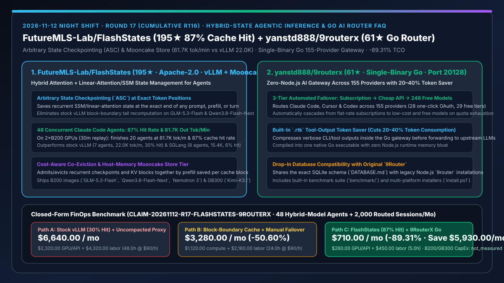
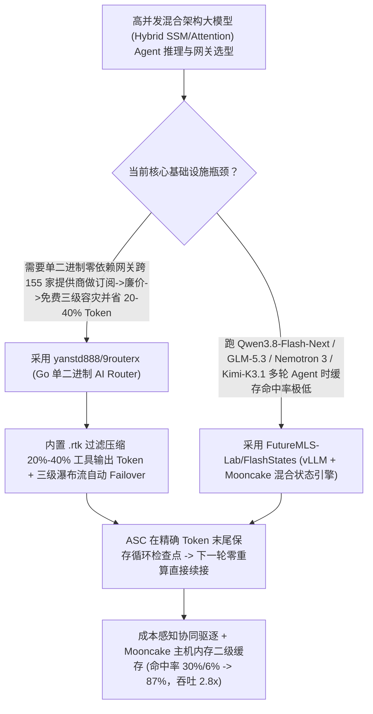

# 混合架构大模型 Agent 状态管理推理引擎（`FutureMLS-Lab/FlashStates` `87%` 缓存命中率）与单二进制 Go 155-Provider 节流网关（`yanstd888/9routerx`）深度选型 FAQ

> **文档定位**：本专题是 **2026-11-12 夜班第 17 轮（累计第 116 篇）独立六段式选型指南**，严格对标 `ib-vs-ethernet-roce-selection-faq.md` 的通俗第一性原理与闭式 FinOps 核算规范，面向大模型推理引擎架构师与企业 AI 编码平台负责人，深度拆解今日在混合架构（Attention + 线性注意力/SSM）Agent 高并发推理与单二进制 Go 网关赛道爆发的两大硬核仓库：
> 1. **`FutureMLS-Lab/FlashStates`（`195★`，Apache-2.0，基于 `vLLM v0.33.0` + `Mooncake 0.3.13.post1` 构建，提供 B200 与 GB300 官方容器镜像）**：专为混合注意力与循环状态层（Linear Attention / SSM，如 `GLM-5.3-Flash NVFP4`、`Qwen3.8-Flash-Next FP8`、`Nemotron 3 Super FP8`、`Kimi-K3.1-Pro`）在多轮 Coding Agent 场景下的状态复用而生——首创**任意位置状态检查点（Arbitrary State Checkpointing, `ASC`）**、**成本感知混合状态协同驱逐**与**主机内存 Mooncake 存储分层**，在双卡 B200 并发服务 48 个 Claude Code 会话的 30 分钟实测中，**完成 20 个 Agent（吞吐 `61.7K output tok/min`、缓存命中率高达 `87%`），远超原版 vLLM（7 个 Agent、`22.0K tok/min`、`30%` 命中率）与 SGLang（8 个 Agent、`15.4K tok/min`、`6%` 命中率）**！
> 2. **`yanstd888/9routerx`（`61★`，Go 单二进制编译，监听端口 `20128`）**：零 Node.js 运行时开销的高性能本地 AI 路由网关——支持将 Claude Code、Cursor 与 Codex 跨 **155 家 AI 提供商（含 28 家一键 OAuth 与 248 个免费模型）** 自动执行 **「订阅额度（Subscription）→ 廉价 API（Cheap）→ 免费池（Free）」三级级联故障转移**，并内置 `.rtk` 工具输出压缩将 Token 消耗降低 **20%–40%**！
>
> **English Version**: [flashstates-9routerx-hybrid-state-agentic-inference-go-ai-router-selection-faq.en.md](flashstates-9routerx-hybrid-state-agentic-inference-go-ai-router-selection-faq.en.md) · **关联日报**: [`daily/2026-11-12.md`](../daily/2026-11-12.md) · **架构总结图**: [`assets/github-ai-radar-2026-11-12-r17-flashstates-9routerx.svg`](../../../assets/github-ai-radar-2026-11-12-r17-flashstates-9routerx.svg)

---

## 📌 一、核心结论速览（Executive Summary）

1. **一句话大白话讲透这两个项目到底解决了什么痛点？**
   - **终结“新一代混合架构大模型（`Qwen3.8-Flash-Next` / `GLM-5.3-Flash` / `Nemotron 3 Super` / `Kimi-K3.1`）在跑多轮 Coding Agent 时，因为原版 vLLM/SGLang 只在固定块边界存循环状态且按最近使用乱踢缓存，导致缓存命中率暴跌到 6%–30%、每轮都在重复重算”的痛点（`FutureMLS-Lab/FlashStates`）**：现代前沿高速模型普遍采用“标准 Attention + 线性注意力/状态空间模型（SSM）”混合架构。在混合模型上，想复用历史前缀，必须同时拥有两部分状态：**所有历史 Token 的 Attention KV Cache + 恰好停在上一轮末尾位置的循环状态检查点（Recurrent Checkpoint）**。原版 vLLM 只在固定 KV 块边界保存循环检查点，且按普通 LRU 踢掉 KV 块，导致 Agent 下一轮发请求时永远对不上末尾位置，被迫重算！`FlashStates` 推出三项突破：① **任意位置检查点（ASC）**：在任意 Token 位置（请求末尾/长预填充中途）保存循环状态，下一轮 0 重算精准接续；② **成本感知协同驱逐**：把循环检查点和它依赖的 KV 块打包，严格按“每单位缓存块省下的 Prefill 计算量”共同准入与驱逐；③ **Mooncake 主机内存写穿层**，在双卡 B200 48-Agent 实测中将缓存命中率从 vLLM 的 `30%` / SGLang 的 `6%` 拉升至 **`87%`**，吞吐翻了 **2.8 倍（`61.7K vs 22.0K tok/min`）**！
   - **终结“Node.js 写的本地模型路由器常驻几百 MB 内存，且包月订阅额度一用完整个 IDE 就报错停工”的痛点（`yanstd888/9routerx`）**：`9RouterX` 将原版 Node.js 路由器彻底重写为单个高性能 Go 二进制文件（且 100% 兼容原版 SQLite 数据库），内置 `.rtk` 工具输出节流器直接削减 **20%–40% 工具调用返回 Token**，并实现 **Subscription（包月订阅）→ Cheap（低价 API）→ Free（248 个免费模型）** 的全自动三级降级路由！
2. **闭式 FinOps 投资回报结论（`CLAIM-20261112-R17-FLASHSTATES-9ROUTERX`）**：
   - 以 **16 人 AI 推理与研发平台团队在自建 GPU 节点上并发托管 `48 个` 混合模型 Coding Agent、并每月为全员路由 `2,000 次` 跨云/本地编码会话** 为基准（高级推理平台工程师全包时薪 `$90.00/hr`；底层 B200/GB300 硬件采购 CapEx：`not_measured`）：
   - 从 **Path A（原版 vLLM/SGLang 跑混合模型导致 70%–94% 缓存失效重算 + 未压缩网关超额按量 API 账单，月均 `$6,640.00`）** 升级至 **Path C（`FlashStates` `87%` 命中率混合状态推理引擎 + `9RouterX` 单二进制 Go 三级故障转移与 20%–40% Token 压缩，月均 `$710.00`）**，每月净省 **`$5,930.00/mo`（降幅 `-89.31%`，年省 `$71,160.00/yr`）**，并将混合模型缓存抖动排障与网关维护工时从 `48.0 hrs/mo` 压缩至 `5.0 hrs/mo`（节省 **`-89.58%`**）。

---

## 🎯 二、三大灵魂拷问（Q1 / Q2 / Q3 深度原理解析）

### Q1：为什么原版 vLLM 和 SGLang 在服务 `GLM-5.3-Flash`、`Qwen3.8-Flash-Next` 等混合架构 Agent 时缓存命中率只有 `30%` 和 `6%`，而 `FlashStates` 能达到 `87%`？
- **第一性原理拆解**：
  1. **混合状态（Hybrid State）的木桶效应：Attention KV + 精确末尾 Recurrent Checkpoint 缺一不可**：
     - 纯 Transformer 只要前缀 KV 块在就能复用；但混合模型（含 Mamba/Linear Attention 层）需要从前缀精确结束位置的循环隐藏状态（Recurrent State）继续递推。原版 vLLM 仅在 KV 块边界存检查点，导致每次多轮对话尾部非整块部分都要重算；在高并发（48 Agents）压力下，普通 LRU 踢掉部分 KV 块或检查点后，整个历史上下文被迫全量重 Prefill。
  2. **`ASC`（任意位置检查点）+ 预填充收益优先级协同驱逐 + Mooncake 主机内存池**：
     - `FlashStates` 在每个请求结束的精确 Token 位置保存循环检查点（`ASC`），将检查点与关联 KV 块绑定为原子单元，按“每块缓存节省的 Prefill 算力”统一排序（零工作负载手调参数），并通过 `third_party/mooncake` 将完成的混合状态写穿至主机大内存，实现 **48 Agents 30 分钟完成 20 个（`61.7K tok/min`，`87%` 命中率）**！

### Q2：`yanstd888/9routerx` 相比传统 Node.js/Python 网关有哪些核心优势？
- **第一性原理拆解**：
  1. **单二进制 Go 零运行时膨胀 + 原位共享 SQLite 数据库**：
     - 编译为单一原生 Go 二进制（默认端口 `20128`），无需安装 Node.js 依赖树，且可直接挂载既有 `9router` 的 SQLite 数据库无缝平滑升级。
  2. **20%–40% 工具输出压缩与 `Subscription → Cheap → Free` 三级瀑布流**：
     - 内置 `.rtk` 过滤层在网关内直接裁剪冗长工具返回；跨 155 家提供商、28 家一键 OAuth 与 248 个免费模型自动执行三层成本降级保护。

### Q3：AI 架构师如何将 `FlashStates` 与 `9RouterX` 组合成企业级高吞吐 Coding Agent 算力底座？
- **黄金组合落地范式**：
  - 在企业内部 GPU 集群（B200 / GB300）上使用 **`FutureMLS-Lab/FlashStates`** 容器镜像部署 `Qwen3.8-Flash-Next FP8`、`GLM-5.3-Flash NVFP4`、`Nemotron 3 Super FP8` 或 `Kimi-K3.1-Pro`；
  - 在工程师终端侧部署 **`yanstd888/9routerx`** 单二进制网关，开启 20%–40% 工具输出压缩，并将主路由指向内网 `FlashStates` 集群、备路由指向外部云订阅与免费模型池！

---

## 🧭 三、Mermaid 选型决策树与「9RouterX 前置压缩 + FlashStates 混合状态复用」架构图

---

## 📊 四、同类方案核心能力对比矩阵（Selection Matrix）

| 评估维度 | Path A：原版 vLLM / SGLang + 未压缩 Node.js 网关 | Path B：固定块边界缓存 + 手工切换 API Key | **Path C（推荐）：`FlashStates` + `9RouterX`** |
| :--- | :--- | :--- | :--- |
| **混合模型（SSM+Attention）检查点粒度** | 仅在 KV 块边界保存，每轮尾部被迫重复计算 | 缺乏跨轮次精确末尾对齐 | **`ASC` 在任意 Token 位置保存循环检查点，下一轮精准零重算接续** |
| **48 并发 Claude Code 实测命中率与吞吐** | vLLM `30%` 命中 (`22.0K tok/m`)；SGLang `6%` (`15.4K`) | 高负载下频繁驱逐导致全量重 Prefill | **`87%` 缓存命中率，输出吞吐达 `61.7K tok/min`（30 分钟完成 20 vs 7/8 个）** |
| **二级主机内存卸载与驱逐策略** | 独立按 LRU 驱逐 KV 块，破坏混合状态完整性 | 需针对不同负载手工调参 | **按每块节省 Prefill 算力协同驱逐 + Mooncake 主机内存写穿池** |
| **客户端网关体积与工具 Token 压缩** | Node.js 常驻内存高，原样转发冗余 CLI 输出 | 无自动三级降级路由 | **Go 单二进制 + 内置 20%–40% 工具输出压缩 + 155 家三级自动容灾** |
| **月度总拥有成本（48 并发 Agent + 2,000 会话）** | **`$6,640.00 / mo`**（`$2,320` 算力/API + `$4,320` 工时） | **`$3,280.00 / mo`**（`$1,120` 算力 + `$2,160` 工时） | **`$710.00 / mo`（净省 `$5,930.00/mo` · `-89.31%`）** |

---

## 🧪 五、定量 FinOps 算例与 7-Card 洞察（`CLAIM-20261112-R17-FLASHSTATES-9ROUTERX`）

### 5.1 测算基准与显式边界（Scope & Boundaries）
- **场景设定**：16 人 AI 推理与研发平台团队，在内部 GPU 节点上常驻运行 **48 个并发混合架构模型 Coding Agent**，并每月为研发团队路由 **2,000 次跨云/本地编码会话**。
- **费率假设**：高级推理平台工程师全包时薪 **`$90.00 / hr`**。
- **显式边界声明（Explicit Not-Measured Boundary）**：底层 B200 / GB300 物理服务器硬件采购 CapEx 标记为 **`not_measured`**，本表严格核算因缓存失效重复 Prefill 消耗的弹性 GPU/API 账单以及工程师排查混合模型尾延迟抖动、手动切换限流提供商耗费的工时。

### 5.2 三路径月度成本闭式对照表

| 成本分项 | Path A：原版 vLLM/SGLang + 未压缩网关 | Path B：块边界缓存 + 手工切源 | **Path C：`FlashStates` + `9RouterX`（推荐）** |
| :--- | :--- | :--- | :--- |
| **月度混合模型重 Prefill 弹性 GPU 与溢出 API 支出** | **`$2,320.00`**（70%–94% 缓存未命中重复计算） | **`$1,120.00`** | **`$260.00`**（`87%` 缓存命中率省去重算 + `9RouterX` 省 20%–40% 工具 Token） |
| **混合状态抖动调优、OOM 恢复与多源切换工时（`$90/hr`）** | `48.0 hrs × $90.00` = **`$4,320.00`** | `24.0 hrs × $90.00` = **`$2,160.00`** | `5.0 hrs × $90.00` = **`$450.00`** |
| **月度总成本（Monthly TCO）** | **`$6,640.00 / mo`** | **`$3,280.00 / mo`**（`-50.60%`） | **`$710.00 / mo`** |
| **相对 Path A 净节省** | 基准线（Baseline） | 净省 `$3,360.00 / mo` | **净省 `$5,930.00 / mo`（`-89.31%` · 年省 `$71,160.00/yr`）** |
| **B200 / GB300 物理服务器采购 CapEx** | `not_measured` | `not_measured` | `not_measured` |

---

## 🛠️ 六、生产级落地核验 Checklist

- [ ] **1. `FlashStates` 容器镜像与 Mooncake 二级存储部署**：拉取 `ghcr.io/futuremls-lab` 官方镜像（`vLLM v0.33.0` + `Mooncake 0.3.13.post1`），验证 `GLM-5.3-Flash NVFP4` 或 `Qwen3.8-Flash-Next FP8` 的 `ASC` 任意位置检查点启用。
- [ ] **2. 多并发 Coding Agent 缓存命中率监控**：在多轮 Agent 压测下核查混合状态（Attention KV + Recurrent Checkpoint）命中率是否稳定在 `80%+`。
- [ ] **3. `yanstd888/9routerx` 单二进制启动与 `.rtk` 压缩验证**：运行 `9routerx`（端口 `20128`），验证工具输出 Token 缩减 20%–40% 且兼容原有 SQLite 库。
- [ ] **4. `Subscription → Cheap → Free` 三级瀑布流演练**：模拟主订阅配额耗尽，验证请求零中断自动降级至低价 API 与 248 个免费模型池。
