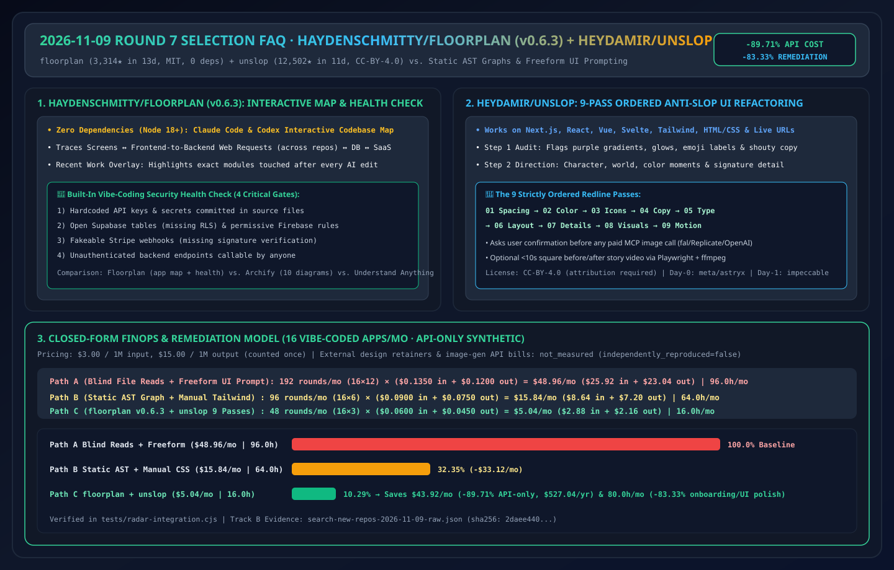
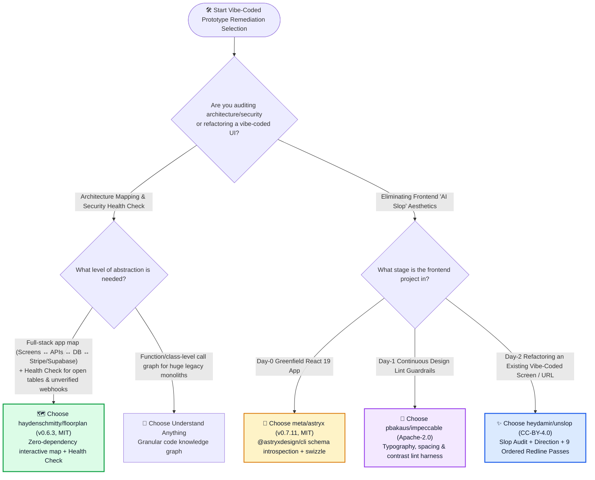
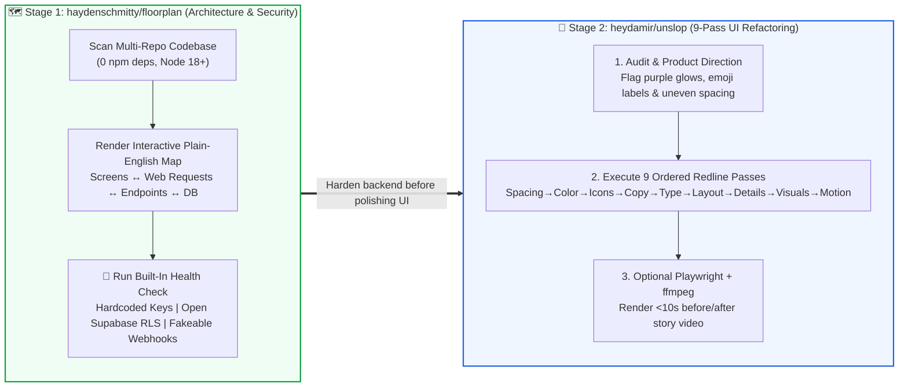

# Interactive Codebase Mapping & Anti-Slop UI Refactoring Selection FAQ: `haydenschmitty/floorplan` + `heydamir/unslop` vs. Static AST Dependency Graphs & Freeform UI Prompting

> **中文版 (Chinese Edition)**: [floorplan-unslop-codebase-map-vs-static-uml-selection-faq.md](floorplan-unslop-codebase-map-vs-static-uml-selection-faq.md)  
> **Related Daily Digest**: [2026-11-09 GitHub AI Trending Digest (EN)](../daily/2026-11-09.en.md) · **7-Card Benchmark Deck**: [`cards.en.html`](../cards.en.html) · **Live Dashboard**: [`github-radar.html`](../../../github-radar.html)

This guide is written for **AI Solution Architects and Full-Stack Product Engineering Leads** based on primary-source verification of two breakout repositories in our 2026-11-09 Track B New-Repo Leaderboard: **`haydenschmitty/floorplan` (`floorplan--v0.6.3`, MIT, zero-dependency interactive codebase map & vibe-coding security health check for Claude Code and Codex, `3,314` stars in 13 days)** and **`heydamir/unslop` (`CC-BY-4.0`, `12,502` stars in 11 days, `~1,137 ★/day`, Track B `#B3` 9-pass anti-slop UI refactoring skill)**. Using plain language and first principles, it answers:
1. **When a team rapidly "vibe-codes" a working app with Claude Code or Codex, why can't static AST import graphers (`Madge` / `Graphviz`) answer *"What happens when a user clicks checkout, and are any Supabase tables or Stripe webhooks left wide open?"*—and how does `floorplan` map screens, cross-repo HTTP requests, and security health checks?**
2. **Why does prompting *"Make this UI look less AI-generated"* fail, and how does `heydamir/unslop` transform vibe-coded screens using an upfront Slop Audit + Product Direction + 9 Ordered Redline Passes (`Spacing → Color → Icons → Copy → Type → Layout → Details → Visuals → Motion`)?**
3. **How should an architect choose between `floorplan`, `Archify`, and `Understand Anything` for codebase visualization, and between `meta/astryx`, `pbakaus/impeccable`, and `heydamir/unslop` for frontend quality?**

> 🛡️ **Provenance & Attribution Disclosure**:
> - **`measured` (Primary Search API Verification)**: `haydenschmitty/floorplan` (created `2026-10-27`, `3,314` stars, `260` forks, `MIT`, JavaScript, `floorplan--v0.6.3`, lifecycle avg `~255 ★/day`, `stars_today: not_measured`) and `heydamir/unslop` (created `2026-10-29`, `12,502` stars, `700` forks, `CC-BY-4.0`, JavaScript, lifecycle avg `~1,137 ★/day`, `stars_today: not_measured`) in [`workshops/github-trending-radar/evidence/search-new-repos-2026-11-09-raw.json`](../evidence/search-new-repos-2026-11-09-raw.json) (`sha256: 2daee4405350717685dd14d5a19186f1b6821216642daab97e6d6605723783e5`).
> - **`anonymized_reported` (`independently_reproduced=false`, Upstream Repo Architecture Claims)**: `floorplan` zero runtime dependencies (`dependencies: 0`, Node 18+), cross-repo frontend-to-backend request mapping, built-in **Health Check** (hardcoded keys, open Supabase tables/Firebase rules, fakeable Stripe webhooks, unauthenticated endpoints), and **Recent Work** diff highlighting; plus `unslop`'s 9 ordered passes (`Spacing, Color, Icons, Copy, Type, Layout, Details, Visuals, Motion`) and `<10s` Playwright+ffmpeg story video generation.
> - **`synthetic` (`independently_reproduced=false`, Architect Parametric FinOps Model)**: Section 5.1 models remediating and productionizing **16 vibe-coded full-stack prototypes/month** at `$3.00/1M` input and `$15.00/1M` output tokens (API-only scope; external design agency retainers and paid image-generation API bills are marked `not_measured`): Path A Blind File Summarization + Freeform UI Re-Prompting (`$48.96/mo`, `96.0h`) vs. Path B Static AST Graphs + Manual Tailwind Restyling (`$15.84/mo`, `64.0h`) vs. Path C `floorplan` + `unslop` (`$5.04/mo`, `16.0h`), saving **`$43.92/mo` (`-89.71%` API-only, `$527.04/yr`)** and **`80.0 hours/mo` (`-83.33%`)**.

---

## 1. 📌 Executive Summary

| Selection Dimension | Plain-English Takeaway (First Principles) |
| :--- | :--- |
| **What is `haydenschmitty/floorplan` (`v0.6.3`)?** | It is a **zero-dependency (`dependencies: 0`, MIT) Claude Code and Codex plugin** that reads your codebase and renders a zoomable, plain-English interactive map connecting **screens, frontend-to-backend web requests (even across repos), files, database tables, and external services**, paired with an automated **Health Check** for vibe-coded security blind spots. |
| **What is `heydamir/unslop`?** | It is a breakout skill (`12,502` stars in 11 days, `CC-BY-4.0`) for Claude Code, Codex, and Google Antigravity that turns vibe-coded, AI-looking interfaces into crafted product UIs by running a **Slop Audit**, locking a **Product Direction**, and executing **9 ordered redline passes**. |
| **Why pair them for Prototype-to-Production handoffs?** | **`floorplan` fixes the invisible backend & security blind spots** (open Supabase RLS, fakeable Stripe webhooks, unauthenticated routes); **`unslop` fixes the visible frontend credibility gap** (purple gradients, emoji spam, uneven spacing)! |

---

## 2. 🎯 First-Principles Deep Dive (Q1 / Q2 / Q3)

### Q1: Why do static AST dependency tools (`Madge` / `Graphviz`) fail on AI-built web apps, and what does `floorplan` do differently?

1. **Mapping Cross-Boundary HTTP Requests & Screens (Not Just `import` Statements)**: Static AST tools only see ES module `import` edges inside a single language. They cannot trace a React `fetch('/api/checkout')` call across repositories to a Python/Node backend route and a Supabase table. `floorplan` maps the full request topology and labels every component in plain English.
2. **Built-In Vibe-Coding Security Health Check**: AI coding agents frequently ship working features while forgetting security guardrails. `floorplan` specifically audits:
   - Exposed API keys in source code;
   - Open Supabase tables (missing Row-Level Security) and permissive Firebase rules;
   - Unverified / fakeable Stripe webhook endpoints;
   - Backend API endpoints missing authentication guards.
3. **Recent Work Diff Overlay**: After every Claude Code or Codex turn, `floorplan` highlights exactly which nodes and edges were touched and why.

---

### Q2: Why does `heydamir/unslop` enforce 9 strictly ordered passes instead of rewriting UI in a single shot?

Asking an LLM to *"redesign this page"* in one pass causes it to trade one generic template for another while breaking layout hierarchy. `unslop` enforces a disciplined redline sequence:
1. **Audit First**: Enumerates every concrete slop symptom (purple/indigo glows, emoji headers, shouty marketing copy, inconsistent padding) before touching code.
2. **Product-Grounded Direction**: Proposes character, color moments, and a signature detail—and if a screen is already well-designed, it says so instead of churning code.
3. **The 9 Ordered Redline Passes**:
   `1. Spacing → 2. Color → 3. Icons → 4. Copy → 5. Type → 6. Layout → 7. Details → 8. Visuals (asks permission before any paid MCP image call) → 9. Motion`.

---

### Q3: How should an AI Solution Architect choose across the Codebase-Mapping Trio (`floorplan` vs. `Archify` vs. `Understand Anything`) and the Anti-Slop Trio (`astryx` vs. `impeccable` vs. `unslop`)?

- **Codebase Visualization Trio**:
  - **Understand how an AI-built app fits together end-to-end + catch exposed endpoints/webhooks** → **`haydenschmitty/floorplan` (`v0.6.3`)**
  - **Generate polished presentation diagrams in 10 formats (ERD, sequence, architecture)** → **`Archify`**
  - **Deep function- and class-level knowledge graphs across massive legacy repos** → **`Understand Anything`**
- **Frontend Anti-Slop Lifecycle Trio**:
  - **Day-0 Greenfield React 19 Enterprise App** → **`meta/astryx` (`v0.7.11`)** (`@astryxdesign/cli` component contract introspection)
  - **Day-1 Continuous Design-Engineering Lint Gate** → **`pbakaus/impeccable` (`cli-v4.8.0`)**
  - **Day-2 Refactoring an Existing Vibe-Coded Screen or Live URL** → **`heydamir/unslop`** (9 ordered redline passes)

---

## 3. 🧭 Mermaid Selection Decision Tree & Dual-Engine Remediation Pipeline

### 3.1 Prototype-to-Production Architecture & UI Remediation Decision Tree

### 3.2 `floorplan` + `unslop` Two-Stage Prototype Hardening Pipeline

---

## 4. 📊 Comprehensive Selection Matrix

| Evaluation Dimension | **`floorplan` (`v0.6.3`) + `unslop`** | **Blind File Reads + Freeform `"Make it pretty"`** | **Static AST Graph (`Madge`) + Manual CSS** | **Manual Full Rewrite** |
| :--- | :--- | :--- | :--- | :--- |
| **Cross-Repo HTTP Request Tracing** | ✅ **Maps Screens ↔ Requests ↔ Endpoints ↔ External SaaS** | ❌ Single-file chat answers only | ❌ Sees `import` only; blind to HTTP/REST calls | ✅ High (slow) |
| **Vibe-Coding Security Health Check** | ✅ **Built-in Supabase RLS, Stripe webhook & auth checks** | ❌ Misses unguarded endpoints unless prompted | ❌ None | ✅ Manual review |
| **UI Anti-Slop Convergence** | ✅ **Deterministic 9-pass redline sequence** | ❌ **Cycles between generic AI templates** | ✅ High (4.0h+ manual CSS effort) | ✅ High |
| **Runtime Dependency Footprint** | ✅ **`0` dependencies (`floorplan`) + Markdown `SKILL.md`** | ✅ `0` dependencies | ⚠️ Requires Graphviz binaries | N/A |
| **License & Attribution** | ⚠️ **`MIT` (`floorplan`) + `CC-BY-4.0` (`unslop` attribution)** | N/A | ✅ MIT | N/A |

---

## 5. 🧪 Quantitative FinOps & Engineering Hours Worked Example

### 5.1 Parametric 16-Prototype/Month Remediation API & Engineering Hours Model (`synthetic`, `independently_reproduced=false`)

> 📌 **Scope & Provenance**: This closed-form model evaluates **LLM API token spend and architect/frontend remediation hours (`synthetic`, `independently_reproduced=false`; external design agency retainers and paid image-generation API bills are marked `not_measured`)** across **16 vibe-coded multi-screen prototypes/month** at `$3.00/1M` input and `$15.00/1M` output tokens (output counted once):

| Architecture Path | Monthly LLM Rounds & Per-Round Cost | Monthly Total LLM API Cost (Input + Output) | Monthly Architect Onboarding & UI Polish Hours | Security Flaw Detection & UI Craft | Net Savings vs. Path A |
| :--- | :--- | :--- | :--- | :--- | :--- |
| **Path A: Blind File Summarization + Freeform UI Re-Prompting** | `16 apps × 12 rounds = 192 rounds/mo` `0.045M` in (`$0.1350`) + `0.008M` out (`$0.1200`) = `$0.2550/round` | `$25.92` in + `$23.04` out = **`$48.96 / mo`** | **`96.0 hours / mo`** (`6.0h/app` manual endpoint tracing & CSS fixes) | ❌ Misses open Supabase/webhook bugs; UI stays generic | Baseline (high rework & security debt) |
| **Path B: Static AST Import Graphs + Manual Tailwind Restyling** | `16 apps × 6 rounds = 96 rounds/mo` `0.030M` in (`$0.0900`) + `0.005M` out (`$0.0750`) = `$0.1650/round` | `$8.64` in + `$7.20` out = **`$15.84 / mo`** | **`64.0 hours / mo`** (`4.0h/app` manual API mapping & restyling) | ⚠️ Blind to cross-repo HTTP & webhook auth gaps | `-$33.12/mo` (`-67.65%` API-only) |
| **Path C: `floorplan` (`v0.6.3`) Health Check + `unslop` 9-Pass Redline** | `16 apps × 3 rounds = 48 rounds/mo` `0.020M` in (`$0.0600`) + `0.003M` out (`$0.0450`) = `$0.1050/round` | `$2.88` in + `$2.16` out = **`$5.04 / mo`** | **`16.0 hours / mo`** (`1.0h/app` reviewing map health check & redline direction) | ✅ **Catches open RLS/webhooks + 9-pass crafted UI** | **Saves `$43.92/mo` (`-89.71%` API-only, `$527.04/yr`) & `80.0h/mo` (`-83.33%`)** |

---

## 6. 🛠️ Production & 30-Minute PoC Verification Checklist

- [ ] **Step 1 — Generate an Interactive `floorplan` (`v0.6.3`) Map**: Install `haydenschmitty/floorplan` in Claude Code or Codex and verify that screens, frontend-to-backend requests, database tables, and external services render with plain-English labels.
- [ ] **Step 2 — Clear All 4 `floorplan` Health Check Gates Before Launch**: Remediate any flagged hardcoded keys, open Supabase/Firebase rules, unverified Stripe webhooks, or unauthenticated endpoints.
- [ ] **Step 3 — Install `heydamir/unslop` & Review the Upfront Audit/Direction**: Copy `skills/unslop` into `.claude/skills/` or `.agents/skills/`, run `/unslop`, and approve the Audit and Direction before code changes begin.
- [ ] **Step 4 — Verify the 9 Ordered Passes (`Spacing` → `Motion`)**: Confirm the agent executes all 9 passes in order and prompts for confirmation before invoking any paid image-generation MCP tool.
- [ ] **Step 5 — Preserve `CC-BY-4.0` Attribution**: Maintain credit to Damir Sokolovsky (`@heydamir`) and the source repository link when redistributing `unslop` skill templates.
