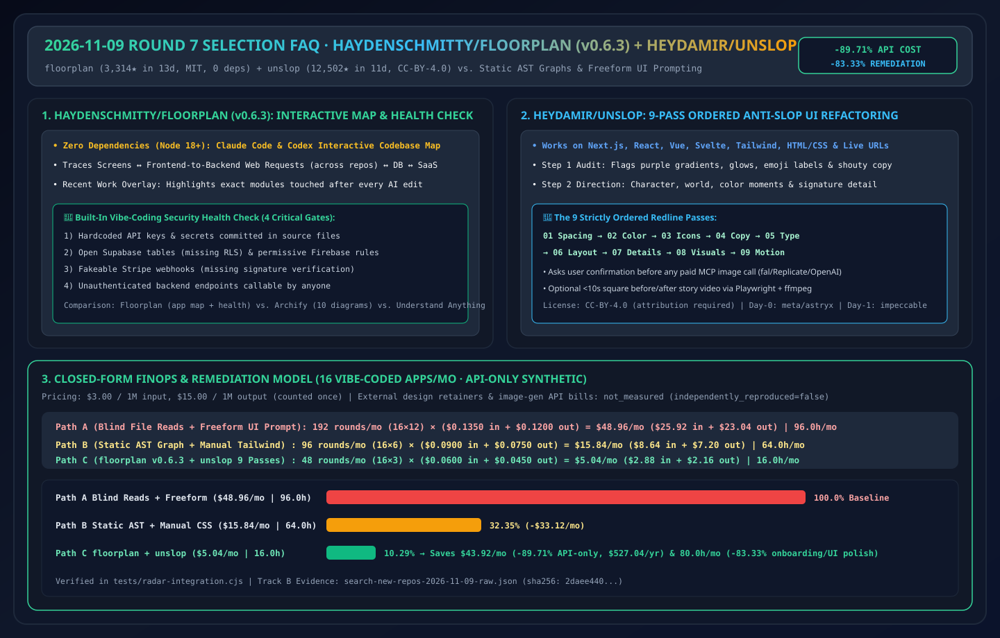
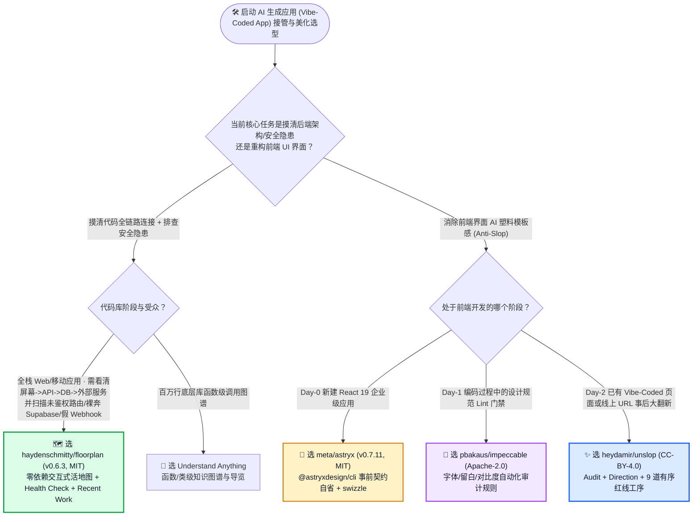
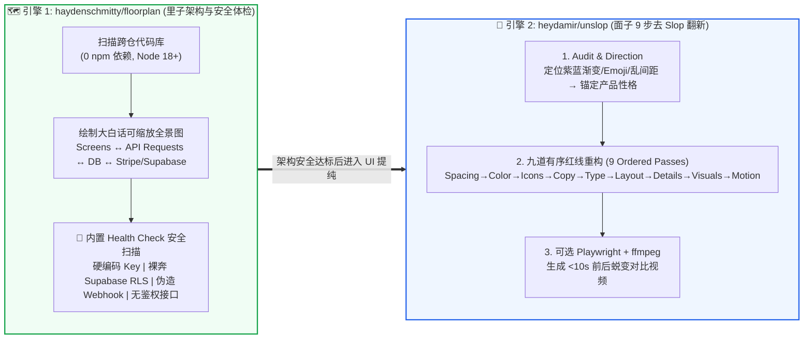

# AI 代码库交互式全景地图与反 Vibe-Coding 界面重构选型常见问题解答：`haydenschmitty/floorplan` + `heydamir/unslop` vs 静态依赖图生成工具 & 裸 Prompt 改 UI

> **English Edition**: [floorplan-unslop-codebase-map-vs-static-uml-selection-faq.en.md](floorplan-unslop-codebase-map-vs-static-uml-selection-faq.en.md)  
> **关联日报**: [2026-11-09 GitHub AI 最热榜单与情报摘要](../daily/2026-11-09.md) · **视觉评测卡**: [`cards.html`](../cards.html) · **在线面板**: [`zh-github-radar.html`](../../../zh-github-radar.html)

本文档面向 **AI Solution Architect（AI 解决方案架构师）与全栈产品工程团队**，基于 2026-11-09 GitHub 新仓爆发榜（Track B）两大高热度工程治理工具 **`haydenschmitty/floorplan`（`floorplan--v0.6.3`，MIT，零依赖的交互式全栈代码地图与 Vibe-Coding 安全体检插件，建仓 13 天斩获 `3,314` Stars）** 与 **`heydamir/unslop`（`CC-BY-4.0`，建仓 11 天狂揽 `12,502` Stars，日均 `~1,137 ★/天`，位列 Track B 黑马榜 `#B3` 的 9 步界面去 AI 廉价感重构 Skill）** 的一手源码审计，用通俗大白话与第一性原理解答：
1. **当团队用 Claude Code / Codex / Cursor 快速“Vibe-Code”出一套能跑的多仓库应用后，为什么接手维护的架构师一问“用户点结账时到底调了哪几个接口、Supabase 表有没有裸奔、Stripe Webhook 会不会被伪造”就全员抓瞎？`floorplan` 是怎么画出那张“没人画过的全景交互活地图”的？**
2. **为什么直接对大模型喊“把这个页面改得好看一点、不要像 AI 做的”，改十遍还是紫蓝渐变加满屏 Emoji？`heydamir/unslop` 的「先做 Slop 病灶审计 → 确立产品性格 → 严格按 9 道工序（Spacing→Color→Icons→Copy→Type→Layout→Details→Visuals→Motion）逐遍红线批改」有什么门道？**
3. **在企业前端与代码可视化选型中，如何区分 `floorplan`、`Archify`、`Understand Anything` 以及 `meta/astryx`、`pbakaus/impeccable`、`heydamir/unslop`？**

> 🛡️ **数据来源、归属核验与证据分级声明（Provenance & Attribution Disclosure）**：
> - **`measured`（本班次一手实测抓取）**：`haydenschmitty/floorplan`（`2026-10-27` 建仓，`3,314` Stars，`260` Forks，`MIT`，JavaScript，Release `floorplan--v0.6.3`）与 `heydamir/unslop`（`2026-10-29` 建仓，`12,502` Stars，`700` Forks，`CC-BY-4.0`，JavaScript）均直接对应已封存 GitHub REST Search API 原始 JSON [`workshops/github-trending-radar/evidence/search-new-repos-2026-11-09-raw.json`](../evidence/search-new-repos-2026-11-09-raw.json)（`sha256: 2daee4405350717685dd14d5a19186f1b6821216642daab97e6d6605723783e5`），其单日增量严格标注为 `stars_today = not_measured`。
> - **`anonymized_reported`（`independently_reproduced=false`，上游仓库文档声明）**：`floorplan` 的零外部依赖（`dependencies: 0`，Node 18+）、跨仓前后端请求映射、内置 **Health Check**（扫描代码硬编码密钥、未设防 Supabase 表/Firebase 规则、可伪造 Stripe Webhook、无鉴权裸奔端点）与 **Recent Work** 变更追踪；以及 `unslop` 的 9 道有序重构工序（`Spacing, Color, Icons, Copy, Type, Layout, Details, Visuals, Motion`）与 `<10s` Playwright+ffmpeg 对比短视频生成。
> - **`synthetic`（`independently_reproduced=false`，架构师参数化 FinOps 算例）**：第 5.1 节「每月接管并生产化加固 16 个 AI 生成的多页面全栈应用」的纯模型 API 账单与工程耗时对比（Path A 逐文件盲读 + 自由口令改 UI `$48.96/月`、`96.0 小时/月` vs Path B 静态 AST 依赖图 + 手改 Tailwind `$15.84/月`、`64.0 小时/月` vs Path C `floorplan` 全景地图体检 + `unslop` 9 步有序红线重构 `$5.04/月`、`16.0 小时/月`，节省 `$43.92/月` [`-89.71%` API-only] 与 `80.0 小时/月` [`-83.33%`] 架构接管工时；外部设计师与付费生图 API 费用标为 `not_measured`）严格执行 100% 闭式公式可复算门禁。

---

## 1. 📌 核心结论速览（Executive Summary）

| 评估维度 | 一句话大白话核心结论（直指本质） |
| :--- | :--- |
| **`haydenschmitty/floorplan` (`v0.6.3`) 到底是什么？** | 它是一个**零依赖（0 npm dependencies）的 Claude Code / Codex 插件**。它读完你的代码库后，画出一张可缩放、带大白话名称的**全栈交互式活地图**（前端页面 → 跨仓 API 请求 → 后端路由 → 数据库表 → 外部第三方服务），并顺手做一次专抓 Vibe-Coding 常见漏洞的 **Health Check（健康体检）**！ |
| **`heydamir/unslop` 到底是什么？** | 它是 11 天狂揽 1.25 万 Star 的**“去 AI 廉价塑料感（Unslopping）”前端重构技能包**。它不靠玄学提示词，而是先列出画面上所有 AI Slop 病灶（紫色渐变、发光描边、Emoji 标题、浮夸大字、间距失调），再严格按照人类资深设计师做 Redline 评审的 **9 个先后顺序 Pass** 逐层翻新界面！ |
| **这两者为什么是接管 Vibe-Coded 项目的“黄金手术刀”？** | 当业务团队或初级开发者用 AI 快速糊出一个原型交给架构师转生产时：**先跑 `floorplan` 摸清全链路数据流并堵住裸奔的 Supabase/Stripe/API 漏洞（里子加固），再跑 `/unslop` 擦掉一脸廉价 AI 模板味（面子翻新）**，1 小时就能把野生原型变成可向高管汇报的工业级应用！ |

---

## 2. 🎯 第一性原理灵魂三问（Q1 / Q2 / Q3 大白话拆解）

### Q1：为什么传统的 AST 静态依赖图工具（如 Madge / Dependency Cruiser）救不了 AI 生成的代码库，而 `floorplan` 可以？

**先说大白话结论：因为传统静态工具只认识 `import a from './b'` 文件引用，完全看不懂“前端按钮发起的 `fetch('/api/checkout')` 跨进程调了哪个后端微服务、写了哪张数据库表”！**

1. **打通前后端与跨仓库 HTTP/RPC 断层**：`floorplan` 让 Claude Code 或 Codex 解析路由、控制器与前端请求调用，将屏幕界面（Screens）、前端组件、网络请求（Web Requests）、后端文件与外部 SaaS（Stripe、Supabase、Firebase）连接成一张用**通俗业务大白话命名**的端到端架构拓扑图。
2. **直击 Vibe-Coding 四大致命安全软肋的 Health Check**：
   - 很多用 AI 快速生成的应用“表面能跑，实则裸奔”。`floorplan` 原生内置了针对现代全栈应用的专项体检：
     - 🔑 源码硬编码 API 密钥泄露；
     - 🔓 未开启行级安全策略（RLS）的公开 Supabase 数据表与宽松 Firebase 规则；
     - 💳 未校验签名（可被恶意伪造充值成功）的 Stripe Webhook 端点；
     - 🚨 漏加身份鉴权中间件、任何人都能裸调的内部 API 路由。
3. **AI 变更可视化追踪（Recent Work）**：每次 Claude 或 Codex 改完代码，`floorplan` 会在地图上高亮标出“刚才 AI 动了哪几个模块、为什么要动”，让架构师一眼看穿变更影响半径。

---

### Q2：为什么 `heydamir/unslop` 要把界面重构严格拆成固定顺序的 9 道 Pass，而不是让大模型一次性重写整个组件？

**大白话比喻：装修房子如果水电、刮腻子、刷漆、摆家具同时乱干，一定是一团糟；前端重构也必须遵循“先骨架留白、再色彩图标、后字体排版与微动效”的确定性顺序！**

`heydamir/unslop` 规定 Agent 必须严格按以下顺序执行：
1. **Step 1 病灶审计（Audit）**：不准直接改代码！先扫描并列出当前页面上所有 AI Slop 典型症状（紫蓝霓虹渐变、无意义发光、每个卡片标题前塞一个 🚀/✨ Emoji、全大写咆哮式营销文案、混乱的 Padding/Gap）。
2. **Step 2 确立产品性格与视觉锚点（Direction）**：从真实产品功能出发，定义 1~2 个核心色彩时刻与标志性细节；如果原页面已经设计得很好，它会诚实告知并只给微调建议，绝不为了炫技乱改。
3. **Step 3 九道有序红线工序（The 9 Ordered Passes）**：
   `① Spacing（间距呼吸感）→ ② Color（克制用色）→ ③ Icons（统一图标语言）→ ④ Copy（去浮夸平实文案）→ ⑤ Type（字体层级）→ ⑥ Layout（网格对齐）→ ⑦ Details（边框与分割线细节）→ ⑧ Visuals（用真实产品画面替代抽象光球，调付费生图 MCP 前必须展示 Prompt 并征求人工确认）→ ⑨ Motion（克制平滑的过渡动效）`。
4. **合规与引流属性提醒**：`unslop` 采用 **`CC-BY-4.0` 协议**（允许商用与修改，但必须保留原作者 Damir Sokolovsky 署名与仓库链接），且 README 底部带有 `heydamir.design/unslop` 付费人工设计引流链接——架构师在内部工具链复用其 `SKILL.md` 提示词规范时需留意保留归属说明。

---

### Q3：面对 `floorplan`、`Archify`、`Understand Anything` 以及 `meta/astryx`、`pbakaus/impeccable`、`heydamir/unslop`，架构师如何选型？

1. **代码可视化三剑客怎么选（官方对比矩阵精炼）**：
   - **想搞懂自己/团队用 AI 造出来的全栈应用到底怎么连的、哪里有安全漏洞** → 选 **`haydenschmitty/floorplan` (`v0.6.3`)**；
   - **想为高管汇报生成 10 种标准格式（序列图、ERD、单页架构说明书）的精美静态图表** → 选 **`Archify`**；
   - **想深入百万行底层老代码、细致到每个函数/类的调用图谱与导览** → 选 **`Understand Anything`**。
2. **前端反 AI Slop 三剑客怎么选**：
   - **从 0 到 1 新建 React 19 企业级项目（事前契约约束）** → 选 **`meta/astryx` (`v0.7.11`)**（通过 `@astryxdesign/cli` 直接用工业级组件）；
   - **在编码过程中实时做设计规范 Lint 与对比度/排版纪律约束（事中门禁）** → 选 **`pbakaus/impeccable` (`cli-v4.8.0`)**；
   - **把已经写出来的“重灾区 Vibe-Coded 丑页面”或者现成线上 URL 按 9 道工序回炉重造（事后整容）** → 选 **`heydamir/unslop`**！

---

## 3. 🧭 Mermaid 选型决策树与全栈体检 + 9 步重构流水线图

### 3.1 代码架构测绘与前端反 Slop 治理选型决策树

### 3.2 `floorplan` + `unslop` 接管野生 AI 原型转生产双引擎工作流

---

## 4. 📊 同类方案全方位选型决策矩阵（Decision Matrix）

| 评估维度 | **`floorplan` (`v0.6.3`) + `unslop`** | **盲读文件 + 自由口令改 UI (`"make it pretty"`)** | **静态 AST 依赖图 (`Madge`) + 手写 CSS** | **从零推倒重来（人工重写前后端）** |
| :--- | :--- | :--- | :--- | :--- |
| **前后端跨进程请求可视化** | ✅ **自动串联前端页面、HTTP 请求、后端与外部云服务** | ❌ 只能单文件问答，缺乏全局拓扑视图 | ❌ 仅识别 JS/TS `import`，看不见 HTTP API 调用 | ✅ 架构清晰但耗时极长 |
| **Vibe-Coding 专项安全体检** | ✅ **内置硬编码密钥、Supabase RLS、Stripe Webhook 检查** | ❌ 除非专门逐个文件问，否则极易漏检 | ❌ 无安全检查能力 | ✅ 人工设计鉴权 |
| **UI 去 AI 模板感确定性** | ✅ **9 道固定顺序工序（从间距到动效逐层收敛）** | ❌ **极差（反复在几种 AI 模板风格间横跳）** | ✅ 高（但极耗前端工程师工时） | ✅ 高 |
| **外部依赖与环境污染** | ✅ **`floorplan` 零依赖；`unslop` 纯 Markdown Skill** | ✅ 零依赖 | ⚠️ 需安装 Graphviz 等本地二进制库 | N/A |
| **开源许可证合规注意项** | ⚠️ **`floorplan` 为 MIT；`unslop` 为 `CC-BY-4.0`（需保留署名）** | N/A | ✅ MIT | N/A |

---

## 5. 🧪 定量算例与 7-Card 评测洞察（Quantitative Example & 7-Card Insights）

### 5.1 每月接管并生产化加固 16 个 AI 原型应用 FinOps 与工时闭式算例（`synthetic`，`independently_reproduced=false`）

> 📌 **透明口径与边界声明（Scope & Provenance）**：本算例为架构师评估企业创新孵化室（PoC Studio）接管业务原型成本的 **纯模型 API 参数化算例（API-only `synthetic` model；外部设计外包咨询费与第三方生图 API 账单明确标注为 `not_measured`）**。统一按 **`$3.00 / 1M 输入 Tokens`**、**`$15.00 / 1M 输出 Tokens`**（输出仅计费一次）核算。场景设定为：**架构与前端团队每月需对 `16 个` 业务部门提交的 Vibe-Coded 多页面原型执行架构梳理、安全排雷与 UI 专业化翻新**：

| 方案路径 | 每月总交互轮次与单轮 Token 开销 | 每月纯模型 API 账单（输入 + 输出） | 每月架构师梳理代码与前端调样式工时 | 裸奔 API/Webhook 漏洞拦截与 UI 质感 | 相对 Path A 降本增效幅度 |
| :--- | :--- | :--- | :--- | :--- | :--- |
| **Path A：逐文件塞给 LLM 盲读 + 自由口令反复改 UI** | `16 应用 × 12 轮 = 192 轮/月` 单轮 `0.045M` 入 (`$0.1350`) + `0.008M` 出 (`$0.1200`) = `$0.2550/轮` | 输入 `$25.92` + 输出 `$23.04` = **`$48.96 / 月`** | **`96.0 小时 / 月`** （每应用 6.0h 手动追接口与修乱掉的布局） | ❌ 漏检未设防 Supabase 表；UI 依然充满 AI 味 | 基线（反复拉锯返工，隐患带病上线） |
| **Path B：静态 `import` 依赖图工具 + 人工手改 Tailwind** | `16 应用 × 6 轮 = 96 轮/月` 单轮 `0.030M` 入 (`$0.0900`) + `0.005M` 出 (`$0.0750`) = `$0.1650/轮` | 输入 `$8.64` + 输出 `$7.20` = **`$15.84 / 月`** | **`64.0 小时 / 月`** （每应用 4.0h 人工补画跨服务调用与手调样式） | ⚠️ 静态图看不见跨仓 API 与 Webhook 伪造风险 | API 降本 `-$33.12/月` (`-67.65%`) |
| **Path C：`floorplan` (`v0.6.3`) 全景体检 + `unslop` 9 步有序重构** | `16 应用 × 3 轮 = 48 轮/月` 单轮 `0.020M` 入 (`$0.0600`) + `0.003M` 出 (`$0.0450`) = `$0.1050/轮` | 输入 `$2.88` + 输出 `$2.16` = **`$5.04 / 月`** | **`16.0 小时 / 月`** （每应用仅 1.0h 审阅全景图体检报告与 Redline 方向） | ✅ **精准揪出裸奔接口/RLS + 9 道工序工业级 UI** | **API 净省 `$43.92/月` (`-89.71%`，年省 `$527.04`)；工时省 `80.0h/月` (`-83.33%`)** |

---

## 6. 🛠️ 架构师生产落地与 30 分钟 PoC 核验清单（Production & PoC Checklist）

- [ ] **Step 1 — 安装零依赖 `floorplan` (`v0.6.3`) 并生成首张全栈地图**：在 Claude Code 或 Codex 中加载 `haydenschmitty/floorplan`，对一个包含前后端与数据库的多模块项目生成交互式 Floorplan，验证每个页面、API 请求与数据表是否均生成了通俗可懂的业务命名。
- [ ] **Step 2 — 必跑 `floorplan` Health Check 四项安全门禁**：上线任何 AI 辅助编写的应用前，检查 Health Check 报告是否清零了 **(1) 源码硬编码密钥、(2) 未开启 RLS 的 Supabase/Firebase 表、(3) 未验签的 Stripe Webhook、(4) 缺失鉴权中间件的 API 路由**。
- [ ] **Step 3 — 挂载 `heydamir/unslop` Skill 执行先审计后动刀流程**：将 `skills/unslop` 复制到 `.claude/skills/` 或 `.agents/skills/`，对目标看板执行 `/unslop this dashboard`，确认 Agent 在改代码前先输出完整的 **Audit（Slop 症状清单）** 与 **Direction（设计方向）** 供人工拍板。
- [ ] **Step 4 — 核验 9 道工序（9 Passes）与付费生图 MCP 拦截门禁**：确认重构严格遵循 `Spacing → Color → Icons → Copy → Type → Layout → Details → Visuals → Motion` 顺序，且在 `Visuals` 阶段绝不未经用户确认私自调用付费图像生成 API。
- [ ] **Step 5 — 遵守 `CC-BY-4.0` 归属要求**：若将 `heydamir/unslop` 分发或打包进团队共享技能库，保留原作者署名（`@heydamir`）与源仓库链接。
