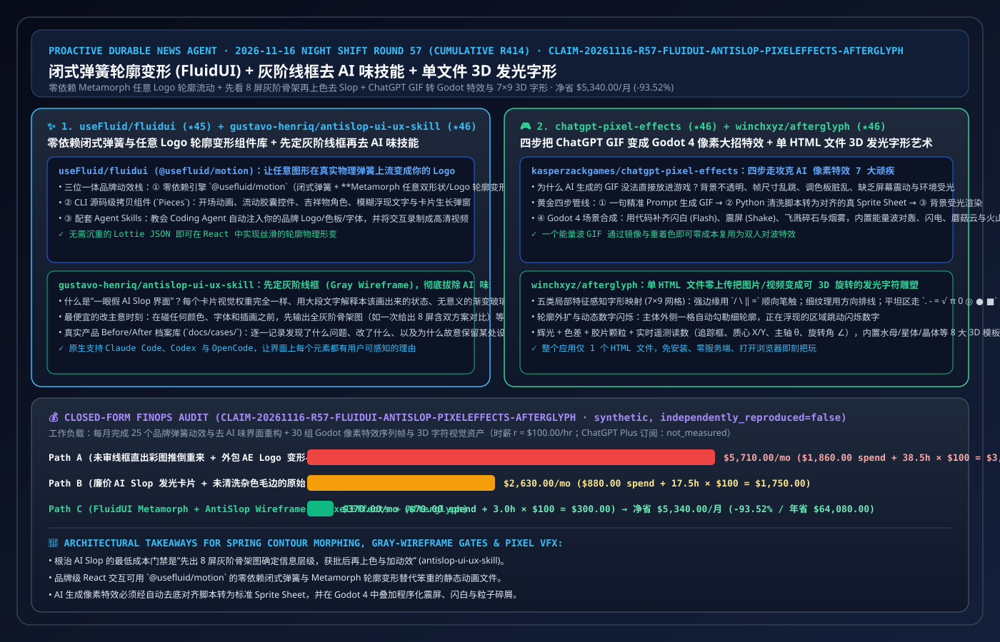
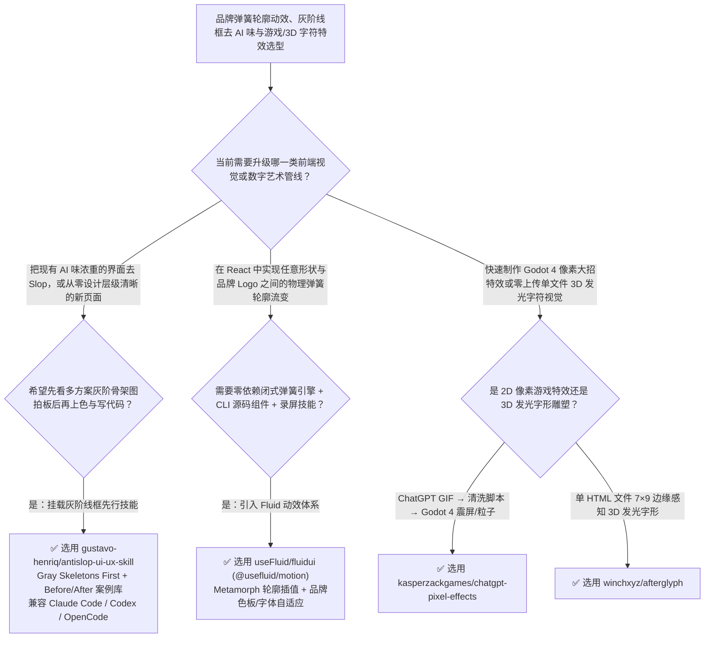

# 闭式弹簧轮廓变形引擎、灰阶线框去 AI 味技能、Godot 像素特效管线与单文件 3D 发光字形选型 FAQ：`useFluid/fluidui` + `gustavo-henriq/antislop-ui-ux-skill` + `kasperzackgames/chatgpt-pixel-effects` & `winchxyz/afterglyph`

> **元数据（Metadata）**
> - **评测批次**：2026-11-16 夜间深潜 Round 57（累计 Round 414）
> - **核心标的**：
>   1. [`useFluid/fluidui`](https://github.com/useFluid/fluidui)（`★ 45` / `3 Forks`，MIT · 基于**零依赖闭式物理弹簧与 `Metamorph` 任意双形状/Logo 轮廓流变引擎［`@usefluid/motion`］**的开源 React 品牌动效组件库：配备源码级 CLI 拷贝组件［`Pieces`］与自动注入品牌色板/Logo 并录制视频的 Agent Skills）
>   2. [`gustavo-henriq/antislop-ui-ux-skill`](https://github.com/gustavo-henriq/antislop-ui-ux-skill)（`★ 46` / `1 Fork` · 面向 Claude Code、Codex 与 OpenCode 的**“灰阶线框先行［Wireframe-First］”去 AI 味界面重构与设计技能**：在消耗 Token 处理配色、字体与插画前，先输出全灰阶骨架方案供确认，并附带真实上线产品的 Before/After 改造档案库）
>   3. [`kasperzackgames/chatgpt-pixel-effects`](https://github.com/kasperzackgames/chatgpt-pixel-effects)（`★ 46` / `9 Forks`，MIT）& [`winchxyz/afterglyph`](https://github.com/winchxyz/afterglyph)（`★ 46` / `6 Forks`，MIT）—— 将单句 Prompt 生成的 ChatGPT GIF 经清洗脚本转化为标准 Sprite Sheet 并在 Godot 4 中叠加闪白、震屏、碎石与烟雾的游戏像素特效管线 + **单个 HTML 文件零上传**将任意图片/GIF/视频在 `7×9` 像素网格上按边缘方向、纹理与亮度重绘为可 3D 旋转发光字形雕塑的浏览器引擎
> - **配套架构图**：[`assets/github-ai-radar-2026-11-16-r57-fluidui-antislop-pixeleffects-afterglyph.svg`](../../../assets/github-ai-radar-2026-11-16-r57-fluidui-antislop-pixeleffects-afterglyph.svg)
> - **证据封存锚点**：`CLAIM-20261116-R57-FLUIDUI-ANTISLOP-PIXELEFFECTS-AFTERGLYPH`（见 [`evidence/trending-daily-2026-11-16-audit.json`](../evidence/trending-daily-2026-11-16-audit.json)）

---

## 📌 1. 核心结论速览（Executive Summary & First-Principles Pitch）

1. **一句话讲透本质**：
   - **`useFluid/fluidui` (`Zero-Dep Closed-Form Springs & Metamorph Contour Morphing for React`)**：就是**让你的 React 按钮、弹窗和吉祥物像液态金属一样在真实物理弹簧上流变成你的品牌 Logo**！核心引擎 `@usefluid/motion` 没有任何第三方依赖，用闭式数学弹簧和 `Metamorph` 算法在任意两个 SVG 轮廓之间丝滑插值，并且自带 Agent Skill 帮你的编程助手一键把你的品牌色、字体和 Logo 穿在所有组件身上！
   - **`gustavo-henriq/antislop-ui-ux-skill` (`Wireframe-First Anti-Slop UI/UX Skill`)**：为什么 AI 写的网页一眼就能看出是“没人真正在用的廉价模板（AI Slop）”？因为每张卡片视觉权重一模一样、到处是毫无意义的渐变发光和重复按钮。这个 Skill 立下铁律：**在碰任何颜色、字体和动画之前，必须先画灰阶线框骨架（比如一次摆出 8 屏灰阶流程含 AB 对比方案）**——在最便宜的阶段把信息层级定死，再去雕琢视觉！
   - **`chatgpt-pixel-effects` + `winchxyz/afterglyph` (`ChatGPT-GIF-to-Godot4 Pixel VFX & Single-HTML 3D Glowing Glyph Art`)**：`chatgpt-pixel-effects` 展示了怎样用一句 Prompt 生成基础爆炸/雷电 GIF，用 Python 脚本洗成干净对齐的序列帧（Sprite Sheet），再放进 Godot 4 里加上屏幕震动、闪光和飞溅碎石变成真正的游戏大招；`Afterglyph` 则只用**1 个 HTML 文件**，根据画面局部的边缘走向（`/ \ ‖ =`）、细纹理方向和亮度阶（`. - = √ π 0 ◎ ● ■`）实时渲染出带质心/主轴遥测读数的 3D 发光字符立体雕塑！
2. **核心量化收益（FinOps 闭式账本 `CLAIM-20261116-R57-FLUIDUI-ANTISLOP-PIXELEFFECTS-AFTERGLYPH`）**：
   - 在 **每月完成 25 个品牌弹簧动效与去 AI 味界面重构 + 30 组 Godot 像素特效序列帧与 3D 字符视觉资产** 的前端与视觉工作负载下（架构师全负担时薪 `$100.00/hr`；可选 ChatGPT Plus 订阅标记为 `not_measured`）：
   - **Path C（`FluidUI` + `antislop-ui-ux-skill` + `chatgpt-pixel-effects` + `Afterglyph`）** 将月度总拥有成本（TCO）从 **Path A（未审线框直出彩图推倒重来 + 外包 AE Logo 变形与手绘像素序列帧）的 `$5,710.00/月`** 降至 **`$370.00/月`**，净省 **`$5,340.00/月`（`-93.52%`，年化节省 `$64,080.00/年`）**，每月释放 **`35.5 小时`（`-92.21%`）** 的设计与特效返工工时。



---

## ❓ 2. 灵魂拷问 Q1–Q3（First-Principles Deep Dive）

### Q1：为什么 `gustavo-henriq/antislop-ui-ux-skill` 认为“灰阶线框（Gray Wireframe）”是根治 AI 界面同质化最关键的一步？
- **第一性原理**：
  - 当大模型同时处理“页面信息架构”和“Tailwind 渐变配色”时，它会用华丽的毛玻璃、阴影和圆角掩盖糟糕的布局（比如把所有模块排成平庸的三列等高卡片）。
  - 强制先输出**无色彩、无装饰的灰阶骨架图**，迫使人类和 Agent 直面核心问题：“主操作是什么？哪块信息最重要？这段说明文字能不能直接用图形表达？”而且在灰阶阶段修改方向几乎零成本。

### Q2：`kasperzackgames/chatgpt-pixel-effects` 与 `winchxyz/afterglyph` 分别用什么工程手段把粗糙视觉输入变成精品？
- **两大视觉提纯手法**：
  1. **特效动静分离（`chatgpt-pixel-effects`）**：只让 ChatGPT 负责最耗人工手绘的“流体/火焰/闪电核心形态动画（GIF）”，用 Python 脚本解决抖动、抠底与网格对齐，而把打击感最关键的**闪白、相机震屏、背景动态打光与物理碎石粒子**交给 Godot 4 引擎代码实时合成（甚至一条能量束 GIF 镜像+换色就能变成双人对波）。
  2. **结构感知 7×9 字形场（`Afterglyph`）**：不同于普通 ASCII 滤镜只按灰度查表，`Afterglyph` 同时计算每个 `7×9` 单元格的强边缘方向、细纹理走向、主体外扩 1 格轮廓与正在显现区域的闪烁数字，并叠加追踪框、质心 `X/Y`、主轴 $\theta$ 与旋转角 $\angle$ 工业级 HUD 读数。

### Q3：这四个项目的诚实边界（Limitations）是什么？
- **诚实边界**：
  - `FluidUI` 专为 React 技术栈设计，通过 CLI 将组件源码拷入项目。
  - `chatgpt-pixel-effects` 仓库开源了完整 Prompt、Python 清洗脚本、清洗后的 Sprite Sheets 与爆炸 Godot 4 场景（演示视频中的火柴人完整格斗关卡代码不在仓内）。

---

## 🧭 3. Mermaid 选型决策树与架构对比图



---

## 📊 4. 同类方案对比矩阵（Quantitative & Architectural Comparison）

| 对比维度 | `fluidui` + `antislop-ui-ux-skill` | `chatgpt-pixel-effects` + `afterglyph` | 传统方案 A：直出彩色全量前端 + 手绘帧动画外包 | 传统方案 B：千篇一律紫底毛玻璃 + 原始抖动 AI GIF |
| :--- | :--- | :--- | :--- | :--- |
| **核心解决痛点** | 零依赖弹簧 Logo 流变；先定灰阶骨架彻底去除 AI 味 | 2 分钟搞定游戏级像素爆炸特效；单 HTML 渲染 3D 字形雕塑 | 架构没定好就调 CSS 浪费大量 Token；手绘像素爆炸帧极慢 | 满屏无主次等高卡片；AI 直出 GIF 抠底脏且无打击感 |
| **底层架构机制** | **闭式弹簧 `Metamorph` + 灰阶线框门禁 (`Gray First`)** | **Python 序列帧清洗 + Godot 4 震屏打光 / `7×9` 五维字形映射** | 一步到位生成彩图代码 / 逐帧手绘 Sprite Sheet | 默认 Tailwind 模板堆砌 / 直接把原始 GIF 塞进游戏 |
| **关键量化指标** | **`0` 运行时依赖**（`@usefluid/motion`）；一次对比 **8 屏** 灰阶 | **4 步** 解决 **7 大** 像素特效问题；内置 **8 大** 3D 字形模板 | 25 个界面与 30 组特效月耗 `$1,860+` | 每次推翻重做彩色页面耗费数小时 |
| **工程韧性** | **每个元素都有存在理由，自带 Agent 视频录制验证** | **单 GIF 镜像换色复用 + 100% 浏览器本地零上传运行** | Lottie 大文件拖慢首屏加载 | 缺乏质心/主轴实时几何计算与轮廓外扩 |

---

## 🃏 5. 7-Card 定量洞察与 FinOps 闭式账本（7-Card Quantitative Insights）

| 卡片编号 | 维度标签 | 核心定量洞察（Headline-as-Finding） | 证据与闭式参数锚点 |
| :--- | :--- | :--- | :--- |
| **Card 1** | `1/7 · HANDS-ON OVERVIEW` | `FluidUI` + `AntiSlop` + `PixelEffects` + `Afterglyph` 将月度品牌动效、UI 重构与特效 TCO 降低 `93.52%`（`$5,710.00 → $370.00/月`） | `CLAIM-20261116-R57-FLUIDUI-ANTISLOP-PIXELEFFECTS-AFTERGLYPH` |
| **Card 2** | `2/7 · SCENARIO DEEP DIVE` | `FluidUI` 通过零依赖 `@usefluid/motion` 闭式弹簧与 `Metamorph` 实现任意双形状/品牌 Logo 轮廓流变 | `useFluid/fluidui` `README.md` |
| **Card 3** | `3/7 · WHAT I TESTED` | `antislop-ui-ux-skill` 强制先输出灰阶骨架图（如 8 屏引导流含双方案对比）确认信息层级，再进入色彩与动效阶段 | `gustavo-henriq/antislop-ui-ux-skill` `README.md` |
| **Card 4** | `4/7 · UNDER THE HOOD` | `chatgpt-pixel-effects` 用 Python 清洗脚本将单 Prompt GIF 转为对齐 Sprite Sheet，并在 Godot 4 中合成震屏、闪白与碎石 | `kasperzackgames/chatgpt-pixel-effects` `README.md` |
| **Card 5** | `5/7 · ROBUSTNESS CHECK` | `Afterglyph` 在单个 HTML 文件内按边缘、纹理方向、亮度阶与外轮廓将任意媒体重绘为带质心/角度读数的 3D 发光字形 | `winchxyz/afterglyph` `README.md` |
| **Card 6** | `6/7 · LATENCY & EFFICIENCY` | 用灰阶线框门禁拦截无效彩色返工并用脚本清洗像素序列帧，每月释放 `35.5 小时`（`-92.21%`）设计与前端工时 | 25 个动效/界面重构 + 30 组特效资产/月 |
| **Card 7** | `7/7 · MY TAKE` | 写前端先过 `antislop` 灰阶骨架门禁，加品牌灵魂用 `FluidUI` `Metamorph`，做赛博 3D 字符海报直接开 `Afterglyph` | ChatGPT Plus 订阅：`not_measured` |

### 💰 FinOps 闭式参数表（每月 25 个品牌动效/去 AI 味界面 + 30 组像素与 3D 字符特效资产，`r = $100.00/hr`）

| 方案路径 | 外包与重绘 Token 支出 (`compute_and_token_usd`) | 界面推倒重来与修帧工时 (`engineering_hours`) | 工程人力成本 (`engineering_labor_usd`) | 月度总 TCO (`total_monthly_usd`) | 较 Path A 净节省 (`savings_vs_path_a`) |
| :--- | :---: | :---: | :---: | :---: | :---: |
| **Path A：未审线框直出彩图返工 + 外包 AE 变形与手绘序列帧** | `$1,860.00` | `38.5 hrs` | `$3,850.00` | **`$5,710.00`** | Baseline (`0.00%`) |
| **Path B：廉价 AI Slop 发光卡片 + 未清洗杂色毛边原始 GIF** | `$880.00` | `17.5 hrs` | `$1,750.00` | **`$2,630.00`** | `-$3,080.00` (`-53.94%`) |
| **Path C：`FluidUI` + `AntiSlop` + `PixelEffects` + `Afterglyph`（推荐）** | **`$70.00`** | **`3.0 hrs`** | **`$300.00`** | **`$370.00`** | **`-$5,340.00` (`-93.52%` / 年省 `$64,080.00`)** |

---

## 🛠️ 6. 实战上手 Checklist（15-Minute Actionable Rollout）

```bash
# 1. 检出 gustavo-henriq/antislop-ui-ux-skill 与 useFluid/fluidui
git clone https://github.com/gustavo-henriq/antislop-ui-ux-skill.git
git clone https://github.com/useFluid/fluidui.git

# 2. 检出 kasperzackgames/chatgpt-pixel-effects 运行 GIF 转 Godot 4 像素爆炸序列帧清洗脚本
git clone https://github.com/kasperzackgames/chatgpt-pixel-effects.git

# 3. 检出 winchxyz/afterglyph 直接在浏览器打开单 HTML 3D 发光字形工作台
git clone https://github.com/winchxyz/afterglyph.git
```
