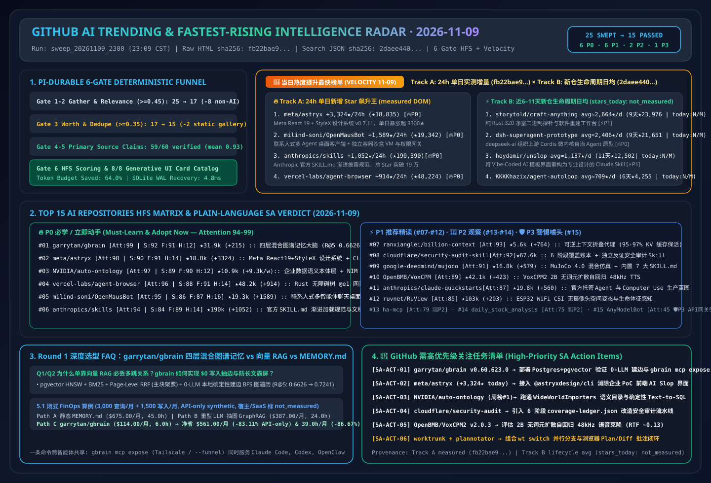
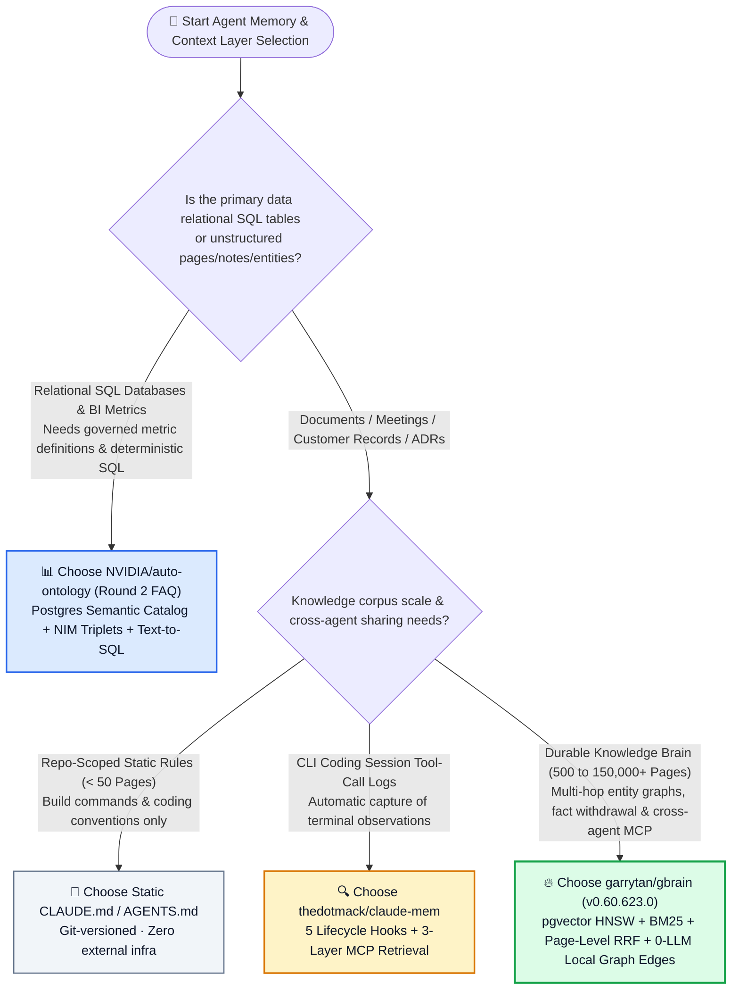
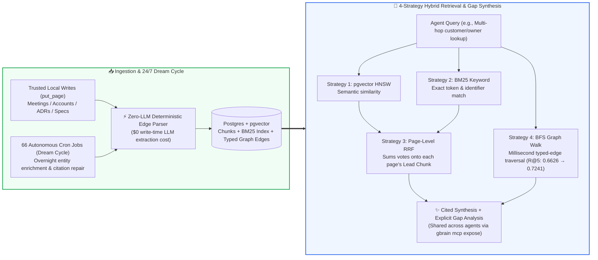

# Agent Brain & Hybrid Graph Memory Selection FAQ: `garrytan/gbrain` (pgvector HNSW + BM25 + Page-Level RRF + Zero-LLM Deterministic Graph Walk) vs. Naive Vector RAG vs. Static `MEMORY.md`

> **中文版 (Chinese Edition)**: [gbrain-hybrid-graph-memory-vs-vector-rag-selection-faq.md](gbrain-hybrid-graph-memory-vs-vector-rag-selection-faq.md)  
> **Related Daily Digest**: [2026-11-09 GitHub AI Trending Digest (EN)](../daily/2026-11-09.en.md) · **7-Card Benchmark Deck**: [`cards.en.html`](../cards.en.html) · **Live Dashboard**: [`github-radar.html`](../../../github-radar.html)

This guide is written for **AI Solution Architects** based on primary-source verification of **`garrytan/gbrain` (`v0.60.623.0`, MIT, `31,944` DOM stars / `31,945` API stars, `+215 stars today` on GitHub Daily Trending #6)** and its retrieval architecture documentation ([`docs/architecture/RETRIEVAL.md`](https://github.com/garrytan/gbrain/blob/main/docs/architecture/RETRIEVAL.md)). Using plain language and first principles, it answers:
1. **Why do static `MEMORY.md` files and pure vector RAG databases (Chroma/Pinecone) fail on multi-hop relationship queries like *"Which customers owned by Alice have unresolved architecture risks?"***
2. **While traditional LLM-extracted GraphRAG burns massive token budgets extracting triples on every write, how does `garrytan/gbrain` lift production `R@5` from `0.6626` to `0.7241` (`+6.15 pts`) using zero-LLM deterministic local reference extraction, Page-Level RRF, and millisecond breadth-first graph walks?**
3. **When should an architect choose static `CLAUDE.md`/`MEMORY.md`, when to use `claude-mem` session hooks, and when to deploy `garrytan/gbrain` or `NVIDIA/auto-ontology`?**

> 🛡️ **Provenance & Attribution Disclosure**:
> - **`measured` (Primary Scrape & API Verification)**: `+215 stars today` and `31,944` total stars in DOM Article #6 of `https://github.com/trending?since=daily` (archived at [`workshops/github-trending-radar/evidence/trending-daily-2026-11-09-raw.html`](../evidence/trending-daily-2026-11-09-raw.html), `sha256: fb22bae9432a6108065aabd68b480fe1d8db159a7ce5dbd89e95a332e9285b61`), plus REST API metadata (`v0.60.623.0`, `MIT`, TypeScript/Bun, `4,759` forks).
> - **`anonymized_reported` (`independently_reproduced=false`, Upstream Repo & Benchmark Claims)**: Author-reported production scale (`155,795 pages`, `24,589 people`, `5,340 companies`, `66 cron jobs` running a 24/7 dream cycle) and `gbrain-evals` BrainBench metrics (`gbrain v0.48.4.0`, 240-page rich-prose corpus, 145 relationship questions × 3 ingestion orders = 435 question runs: enabling `search.relational_retrieval` raises production mean `R@5` from `0.6626` to `0.7241` [`+6.15 pts`], better on 45/435 runs and worse on 0; `0.9791` is the `graph-oracle-parse` upper bound, not a product score), cited from [`garrytan/gbrain/blob/main/docs/architecture/RETRIEVAL.md`](https://github.com/garrytan/gbrain/blob/main/docs/architecture/RETRIEVAL.md).
> - **`synthetic` (`independently_reproduced=false`, Architect Parametric FinOps Model)**: Section 5.1 models 3,000 cross-agent knowledge queries/month + 1,500 local page writes/month at `$3.00/1M` input and `$15.00/1M` output tokens (API-only scope; Postgres/Tailscale/hosted SaaS infrastructure bills are explicitly marked `not_measured`): Path A Static `MEMORY.md` stuffing (`$675.00/mo`, `45.0h` manual maintenance) vs. Path B LLM-Extracted GraphRAG (`$387.00/mo`, `24.0h`) vs. Path C `garrytan/gbrain` (`$114.00/mo`, `6.0h`), saving **`$561.00/mo` (`-83.11%` API-only, `$6,732.00/yr`)** and **`39.0 hours/mo` (`-86.67%`)**.

---

## 1. 📌 Executive Summary

| Selection Dimension | Plain-English Takeaway (First Principles) |
| :--- | :--- |
| **What is `garrytan/gbrain`?** | It is an **open-source, self-hosted persistent knowledge brain (`Postgres + pgvector + BM25 + Typed Knowledge Graph`)** built by Y Combinator CEO Garry Tan to power OpenClaw and Hermes agents. It stores explicit facts with citations, supports corrections and fact withdrawal, and exposes the same memory to Claude Code, Codex, Cursor, and cloud agents via `gbrain mcp expose`. |
| **What developer pain point does it solve?** | Existing agent memory either stuffs everything into a bloating `MEMORY.md` file (blowing up token costs and losing provenance past ~100 pages) or relies on pure chunk-level vector RAG (which retrieves generic essays about "portfolios" instead of the specific company pages linked to `alice-example`). |
| **How does it differ from heavy LLM-extracted GraphRAG?** | Traditional GraphRAG calls an LLM on every document write to extract entity triples, creating massive ingestion bills. **`gbrain` extracts typed reference edges deterministically on trusted local `put_page` writes with zero LLM calls (`$0`)**, combines **Page-Level RRF** (preventing a single 20-chunk essay from crowding out Top-K slots), and runs **millisecond breadth-first graph walks (BFS)**! |

---

## 2. 🎯 First-Principles Deep Dive (Q1 / Q2 / Q3)

### Q1: Why do both "Vector-Only RAG" and "Keyword-Only (BM25 / ripgrep)" fail on real enterprise architect knowledge bases?

**Plain-English Answer: Because vectors only know "topical similarity" and keywords only know "exact spelling," whereas real engineering & business questions require traversing explicit relationships!**

As documented in `garrytan/gbrain`'s [`docs/architecture/RETRIEVAL.md`](https://github.com/garrytan/gbrain/blob/main/docs/architecture/RETRIEVAL.md), each single-mode retrieval strategy breaks down at scale:
1. **Vector-Only (`pgvector` HNSW) Drifts into Thematic Neighbors**: Ask *"Companies in alice-example's portfolio"* and vector search returns long essays discussing portfolio theory rather than the actual company records linked to Alice, because a company record only contains a terse reference edge.
2. **Keyword-Only (`BM25` / `ripgrep`) Fails on Paraphrases**: Ask *"Who works on retrieval quality?"* and keyword search misses pages that say *"search ranking and recall."*
3. **Standard Chunk-Level RRF Suffers from "Long-Document Crowding"**: If a 20-chunk design doc matches both vector and keyword queries, naive chunk fusion fills all Top-5 retrieval slots with chunks from that single document. **`gbrain` solves this with Page-Level Reciprocal-Rank Fusion (`RRF`)**: each arm returns each page's best chunk, and fusion sums a page's votes across arms onto the page's **lead chunk**, leaving secondary chunks with their own single-arm votes so they cannot crowd other pages out of the context window.
4. **Missing Typed Graph Edges**: Multi-hop questions (`Person -> Customer Account -> Open Architecture Risk`) require walking recorded typed edges (`Breadth-First Graph Walk`) in milliseconds rather than hoping two endpoints happen to sit close in embedding space.

---

### Q2: How does `gbrain`'s "4-Strategy Hybrid + Graph Stack" and "24/7 Dream Cycle" work under the hood?

1. **Ingestion: Zero-LLM Deterministic Local Edge Extraction + Explicit Fact Withdrawal**:
   - When a trusted local agent writes a page via `put_page` with auto-linking enabled, `gbrain` extracts supported entity references deterministically **without making LLM API calls**. Remote `put_page` edges are reconciled asynchronously via background sweeps or `add_link`.
   - When an architectural decision or customer fact changes, `gbrain` supports explicit **corrections and withdrawal** with source provenance so stale facts stop polluting future answers.
2. **Retrieval: 4 Strategies in Concert + Gap-Aware Synthesis**:
   - Queries run **① Vector (HNSW on pgvector) + ② BM25 Keyword + ③ Page-Level RRF + ④ Breadth-First Knowledge Graph Traversal**. On the 145 relationship questions in BrainBench (435 runs across 3 ingestion orders, `gbrain v0.48.4.0`), flipping `search.relational_retrieval` on a shared index lifted mean **`R@5` from `0.6626` to `0.7241` (`+6.15 pts`)**, improving 45/435 runs and regressing 0 (`anonymized_reported, independently_reproduced=false`).
   - Optional **Synthesis Layer**: Instead of dumping 10 raw chunks, `gbrain` synthesizes cited prose and explicitly highlights **what the brain does not know yet (Gap Analysis)**.
3. **Cross-Agent Exposure via `gbrain mcp expose`**:
   - One command (`gbrain mcp expose` over Tailscale, or `--funnel` for cloud agents) exposes the same brain over MCP to Claude Code, Codex, Cursor, OpenClaw, Hermes, Grok Bot, and Muse.

---

### Q3: How should an AI Solution Architect choose between Static `MEMORY.md`, `claude-mem`, `garrytan/gbrain`, and `NVIDIA/auto-ontology`?

- **Choose Static `CLAUDE.md` / `MEMORY.md`**: For repo-scoped coding conventions, build commands, and <50 pages of static team rules checked into Git.
- **Choose `thedotmack/claude-mem`**: For automatic capture of single-developer CLI coding session observations (`search -> timeline -> get_observations` progressive disclosure).
- **Choose `garrytan/gbrain`**: For a long-lived, multi-agent personal or team knowledge brain (`500` to `150,000+` pages of meetings, ADRs, people, companies, and deals) requiring source provenance, fact withdrawal, zero-LLM local graph linking, and cross-agent MCP sharing.
- **Choose `NVIDIA/auto-ontology` (#1 Weekly Trending, covered in Round 2 FAQ)**: When the underlying data is **structured relational databases (SQL tables)** requiring governed business metric definitions and deterministic Text-to-SQL generation.

---

## 3. 🧭 Mermaid Selection Decision Tree & 4-Layer Architecture Diagram

### 3.1 Agent Memory & Semantic Layer Selection Decision Tree

### 3.2 `garrytan/gbrain` 4-Strategy Hybrid Retrieval & Page-Level RRF Pipeline

---

## 4. 📊 Comprehensive Selection Matrix

| Evaluation Dimension | **`garrytan/gbrain` (`v0.60.623.0`)** | **Naive Chunk Vector RAG** | **Heavy LLM-Extracted GraphRAG** | **Static `MEMORY.md` / `CLAUDE.md`** |
| :--- | :--- | :--- | :--- | :--- |
| **Storage & Index Stack** | **Postgres + pgvector (HNSW) + BM25 + Typed Graph Edges** | Vector store only (Chroma / Qdrant / Pinecone) | Vector store + Graph DB (Neo4j) | Flat local Markdown files |
| **Write-Time Graph LLM Cost** | ✅ **`$0` on trusted local `put_page` (deterministic parser)** | ✅ Embedding cost only | ❌ **High (LLM triple extraction on every write)** | ✅ `$0` (file append) |
| **Multi-Hop Relationship Recall (`R@5`)** | ✅ **High (`0.6626 → 0.7241` on BrainBench, `+6.15 pts`)** | ❌ Low (drifts to thematic essays, misses entity links) | ✅ High (but slow & prone to extraction hallucinations) | ❌ Fails past ~100 pages |
| **Anti-Crowding Fusion** | ✅ **Page-Level RRF (votes summed onto page lead chunk)** | ❌ None (single long doc crowds Top-5) | ⚠️ Requires external reranker | ❌ No ranking |
| **Corrections & Fact Withdrawal** | ✅ **First-class provenance, corrections & withdrawal** | ❌ Stale chunks linger in vector index | ⚠️ Deleting nodes leaves dangling edges | ⚠️ Manual file editing |
| **Cross-Agent MCP Sharing** | ✅ **`gbrain mcp expose` over Tailscale / `--funnel`** | ⚠️ Custom MCP wrapper required | ⚠️ Custom gateway required | ⚠️ Local filesystem only |
| **Trust & Isolation Boundary** | ⚠️ **Remote callers gated by source/op grants; local files & shared DB creds do not isolate callers** | ⚠️ Namespace-level only | ⚠️ DB role-based | ❌ None |

---

## 5. 🧪 Quantitative FinOps Worked Example & 7-Card Insights

### 5.1 Parametric Monthly API & Engineering Hours Model (`synthetic`, `independently_reproduced=false`)

> 📌 **Scope & Provenance**: This closed-form model evaluates **LLM API token spend and engineer curation time (`synthetic`, `independently_reproduced=false`; Postgres hosting, Tailscale, and `gbrain.io` SaaS fees are explicitly marked `not_measured`)** for a 15-architect team executing **3,000 cross-agent knowledge queries/month** and **1,500 page writes/month** at `$3.00/1M` input tokens and `$15.00/1M` output tokens (output counted once):

| Architecture Path | Monthly Write-Time Graph Extraction Cost | Monthly Query Rounds & Per-Round Tokens | Monthly Total LLM API Cost (Input + Output) | Monthly Engineer Curation Hours | Net Savings vs. Path A |
| :--- | :--- | :--- | :--- | :--- | :--- |
| **Path A: Static `MEMORY.md` Context Stuffing + Grep Retries** | `$0.00` (no graph index) | `3,000 × 1.50 = 4,500 rounds` `0.040M` in (`$0.1200`) + `0.002M` out (`$0.0300`) = `$0.1500/round` | `$540.00` in + `$135.00` out = **`$675.00 / mo`** | **`45.0 hours / mo`** (manual pruning & stale fact fixes) | Baseline (context bloat & missed relationships) |
| **Path B: Heavy LLM-Extracted GraphRAG + Chunk Vector RAG** | `1,500 writes` × (`0.010M` in `$0.0300` + `0.002M` out `$0.0300`) = **`$90.00 / mo`** (`$45.00` in + `$45.00` out) | `3,000 × 1.20 = 3,600 rounds` `0.020M` in (`$0.0600`) + `0.0015M` out (`$0.0225`) = `$0.0825/round` → **`$297.00 / mo`** | `$90.00` write + `$297.00` query = **`$387.00 / mo`** (`$261.00` in + `$126.00` out) | **`24.0 hours / mo`** (cleaning hallucinated LLM triples) | `-$288.00/mo` (`-42.67%` API-only) |
| **Path C: `garrytan/gbrain` (`v0.60.623.0` 0-LLM Local Edge Extraction + Page-Level RRF + Dream Cycle)** | Local `put_page` edge parse **`$0.00`** + 30 nights Dream Cycle (`30 × $0.50` = **`$15.00 / mo`** [`$9.00` in + `$6.00` out]) | `3,000 × 1.00 = 3,000 rounds` `0.006M` in (`$0.0180`) + `0.001M` out (`$0.0150`) = `$0.0330/round` → **`$99.00 / mo`** | `$15.00` dream + `$99.00` query = **`$114.00 / mo`** (`$63.00` in + `$51.00` out) | **`6.0 hours / mo`** (reviewing explicit gap reports) | **Saves `$561.00/mo` (`-83.11%` API-only, `$6,732.00/yr`) & `39.0h/mo` (`-86.67%`)** |

---

## 6. 🛠️ Production & 30-Minute PoC Verification Checklist

- [ ] **Step 1 — Start Keyless & Verify Local BM25 Baseline**: Clone `garrytan/gbrain` (`v0.60.623.0`), launch the Postgres + pgvector container, and verify keyless `put_page` and keyword search in under 15 minutes before attaching paid embedding keys.
- [ ] **Step 2 — Verify Zero-LLM Deterministic Auto-Linking**: Write 10 interlinked customer architecture pages via trusted local `put_page` and verify that typed reference edges populate in Postgres with **zero LLM API calls**.
- [ ] **Step 3 — Enable `search.relational_retrieval` & Benchmark Multi-Hop Queries**: Run `gbrain eval brainbench` on two-hop relationship queries (`Person -> Company -> Architecture Decision`) and confirm Page-Level RRF prevents single-document chunk crowding.
- [ ] **Step 4 — Expose Over MCP (`gbrain mcp expose`)**: Publish the brain across your Tailscale tailnet and verify that a fact correction or withdrawal from Claude Code is immediately reflected in Codex / OpenClaw.
- [ ] **Step 5 — Enforce Shared-Brain Trust Boundaries**: Never share raw local filesystem access or shared database root credentials across untrusted callers; use remote MCP OAuth and explicit `source` / `operation` grants as documented in `docs/architecture/brains-and-sources.md`.
