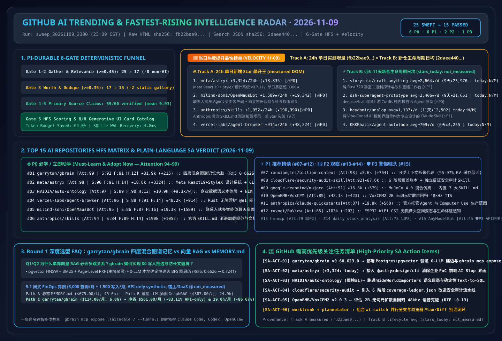
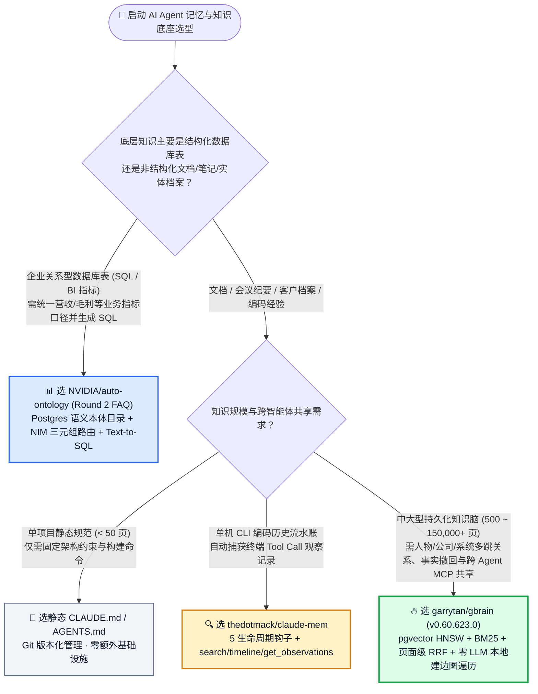
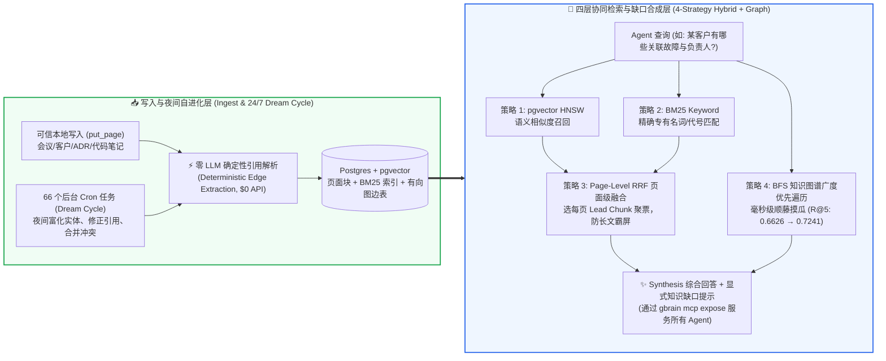

# Agent 持久大脑与混合图谱记忆选型常见问题解答：`garrytan/gbrain`（pgvector HNSW + BM25 + 页面级 RRF + 零 LLM 确定性图遍历）vs 纯向量 RAG vs 静态 `MEMORY.md`

> **English Edition**: [gbrain-hybrid-graph-memory-vs-vector-rag-selection-faq.en.md](gbrain-hybrid-graph-memory-vs-vector-rag-selection-faq.en.md)  
> **关联日报**: [2026-11-09 GitHub AI 最热榜单与情报摘要](../daily/2026-11-09.md) · **视觉评测卡**: [`cards.html`](../cards.html) · **在线面板**: [`zh-github-radar.html`](../../../zh-github-radar.html)

本文档面向 **AI Solution Architect（AI 解决方案架构师）**，基于 2026-11-09 GitHub Daily Trending 热榜新晋 P0 焦点项目 **`garrytan/gbrain`（Y Combinator 总裁 Garry Tan 开源的 OpenClaw/Hermes 生产级智能体持久大脑，`v0.60.623.0`，MIT，总 Star `31,944` / API `31,945`，今日新增 `+215★ today`）** 的一手源码与 [`docs/architecture/RETRIEVAL.md`](https://github.com/garrytan/gbrain/blob/main/docs/architecture/RETRIEVAL.md) 深度核验，用通俗大白话与第一性原理解答：
1. **为什么给 Coding Agent 塞一个静态 `MEMORY.md` 或只挂一个纯向量数据库（Chroma/Pinecone），一遇到“某客户有哪些关联系统/谁负责哪个模块”这类多跳关系问题就会彻底失忆或答非所问？**
2. **传统 LLM 图谱抽取（GraphRAG 每次写入都要调大模型抽三元组）又贵又慢，`garrytan/gbrain` 是如何用「可信本地写入零 LLM 确定性抽边 + 页面级 RRF 融合 + 毫秒级广度优先图遍历（BFS）」把召回率从 `0.6626` 提升到 `0.7241` 的？**
3. **在企业架构选型中，什么时候用静态 `CLAUDE.md`/`MEMORY.md`，什么时候用 `claude-mem` 会话观察钩子，什么时候必须上 `garrytan/gbrain` 跨智能体持久知识大脑？**

> 🛡️ **数据来源、归属核验与证据分级声明（Provenance & Attribution Disclosure）**：
> - **`measured`（本班次一手实测抓取）**：`garrytan/gbrain` 在 `https://github.com/trending?since=daily` 页面 DOM Article #6 的单日增量 `+215 stars today` 与 DOM 总 Star `31,944`（原始 HTML 证据已封存至 [`workshops/github-trending-radar/evidence/trending-daily-2026-11-09-raw.html`](../evidence/trending-daily-2026-11-09-raw.html)，`sha256: fb22bae9432a6108065aabd68b480fe1d8db159a7ce5dbd89e95a332e9285b61`），以及 GitHub REST API 元数据（`v0.60.623.0`，`MIT`，TypeScript/Bun，Forks `4,759`）。
> - **`anonymized_reported`（`independently_reproduced=false`，上游仓库文档与基准声明）**：上游作者披露的生产脑容量规模（`155,795 pages`、`24,589 people`、`5,340 companies`、`66 cron jobs` 24/7 Dream Cycle）及 `gbrain-evals` BrainBench 评测结果（`gbrain v0.48.4.0`，240 页富文本语料、145 个关系问题 × 3 种导入顺序 = 435 次运行，开启 `search.relational_retrieval` 后生产级 `R@5` 从 `0.6626` 提升至 `0.7241` [`+6.15 pts`]，45/435 提升、0 退化；`0.9791` 为 `graph-oracle-parse` 理想解析上界而非产品得分），引自 [`garrytan/gbrain/blob/main/docs/architecture/RETRIEVAL.md`](https://github.com/garrytan/gbrain/blob/main/docs/architecture/RETRIEVAL.md)。本班次未重跑 435 次 Opus 评测。
> - **`synthetic`（`independently_reproduced=false`，架构师参数化 FinOps 成本算例）**：第 5.1 节「3,000 次跨智能体知识查询/月 + 1,500 次本地页面写入/月」的纯模型 API 账单对比（Path A 静态文件全量塞入 `$675.00/月` vs Path B LLM 实时抽图 GraphRAG `$387.00/月` vs Path C `gbrain` 零 LLM 本地确定性抽边 + 页面级 RRF `$114.00/月`，节省 `$561.00/月` [`-83.11%` API-only] 与 `39.0 小时/月` [`-86.67%`] 人工维护工时；底层 Postgres/Tailscale 主机与 SaaS 托管费明确标为 `not_measured`）严格执行 100% 闭式公式可复算门禁。

---

## 1. 📌 核心结论速览（Executive Summary）

| 评估维度 | 一句话大白话核心结论（直指本质） |
| :--- | :--- |
| **`garrytan/gbrain` 到底是个什么东西？** | 它是一个**带明确事实溯源（Citation Provenance）、支持事实订正与撤回（Correction & Withdrawal）、并能通过一条 `gbrain mcp expose` 命令同时挂载给 Claude Code、Codex、Cursor、OpenClaw 与 Hermes 的自托管知识大脑（Postgres + pgvector + BM25 + 知识图谱）**。 |
| **它解决了以前 Agent 记忆的什么痛点？** | 以前的 Agent 记忆要么是**“把所有笔记塞进一个越来越肥的 `MEMORY.md`”**（超过几百页后 Token 爆炸且互相覆盖），要么是**“纯向量切片检索（Vector RAG）”**（问“某架构师负责的客户有哪些未闭环故障”，向量检索只会搜出几段谈论“故障管理”的泛泛长文，完全漏掉跨页面的人员-客户-工单拓扑关系）。 |
| **它和微软 GraphRAG / Neo4j LLM 抽图的核心差别在哪？** | 传统 GraphRAG 每次写入一篇文档都要调大模型抽实体和关系，写 10 万页能把 API 账单跑爆；而 **`gbrain` 对可信本地写入（`put_page`）采用零 LLM 调用的确定性引用解析（Deterministic Reference Extraction）自动建边**，配合**页面级倒数秩融合（Page-Level RRF）**与**毫秒级广度优先图遍历（BFS Walk）**，既拿到了图谱的多跳关联召回，又把写入期的 LLM 抽图成本降到了 **$0**！ |

---

## 2. 🎯 第一性原理灵魂三问（Q1 / Q2 / Q3 大白话拆解）

### Q1：为什么“纯向量检索（Vector Only）”和“纯关键词搜索（BM25 / ripgrep）”在企业架构师知识库里都会翻车？

**先说大白话结论：因为向量只懂“话题像不像”，关键词只懂“字面一不一样”，而真实业务问题往往需要“顺着关系藤摸瓜”！**

根据 `garrytan/gbrain` 官方 [`docs/architecture/RETRIEVAL.md`](https://github.com/garrytan/gbrain/blob/main/docs/architecture/RETRIEVAL.md) 的第一性原理拆解，单一检索策略在真实个人/企业大脑（15 万+页面）中存在四大死穴：
1. **纯向量检索（Vector-Only HNSW）的“主题漂移陷阱”**：当你问 Agent *“Alice 负责的投资组合里有哪些公司？”* 时，向量嵌入空间里离这句话最近的是“关于投资组合管理方法论的随笔文章”，而不是那 12 家具体公司的档案页——因为具体公司档案页里只写了 `partner: alice-example`，语义向量跟“投资组合”相距甚远。
2. **纯关键词搜索（BM25 / ripgrep）的“同义词失明症”**：当你搜 *“谁在做检索质量优化？”* 时，如果Alice的页面写的是 *“负责搜索排序（search ranking）与召回率”*，纯字面匹配直接返回 0 条结果。
3. **普通块级 RRF（Chunk-Level RRF）的“长文霸屏漏洞”**：如果一篇文章特别长、被切成了 20 个 Chunk，传统 RRF 会把前 5 个返回槽位全部填满同一篇长文的不同段落，把真正关键的短档案页挤出上下文窗口！**`gbrain` 独创了「页面级投票归并（Page-Level RRF）」**：向量臂和关键词臂各自选出每个页面的最佳 Chunk 参与投票，把同一页面的多路得票累加到该页面的主 Chunk（Lead Chunk）上，其余次要 Chunk 保留各自独立低分，彻底防止单篇长文霸占 Top-K 结果！
4. **缺乏显式有向图边（No Typed Graph Edges）**：当问题需要跨越 `人物 -> 所属客户 -> 历史架构决议` 两跳以上关系时，只有沿着已记录的有向边执行**广度优先图遍历（Breadth-First Graph Walk）**，才能在几毫秒内把不相邻的节点精准捞出来。

---

### Q2：`gbrain` 的「四层混合检索 + 夜间后台自进化（24/7 Dream Cycle）」到底是怎么工作的？

**大白话比喻：白天它是一个“毫秒级响应的多路检索引擎”，晚上你睡觉时它是一个“自动整理笔记、核对出处、补全人物公司档案的夜班图书管理员”！**

1. **写入期：零 LLM 确定性建边 + 显式事实撤回机制**：
   - 当本地 Agent 调用 `put_page` 写入会议纪要、架构决策（ADR）或客户卡片时，若开启自动链接（Auto-Linking），`gbrain` 直接通过确定性语法解析提取支持的实体引用并写入 Postgres 图边表，**无需消耗任何 LLM Token**；远端非可信写入则通过后台 Sweep 或显式 `add_link` 异步建边。
   - **可订正与可撤回（Corrections & Withdrawal）**：当某个旧技术结论或客户配置过时，支持显式标记撤回并保留证据链，杜绝过时记忆持续污染 Agent 回答。
2. **查询期：四路协同 + Synthesis 缺口分析（Gap Analysis）**：
   - 底层同时触发 **① pgvector HNSW 语义检索 + ② BM25 词法匹配 + ③ Page-Level RRF 页面级融合 + ④ BFS 知识图谱遍历**（在 BrainBench 145 个关系问题、435 次运行实测中，开启 `search.relational_retrieval` 将生产级 `R@5` 从 `0.6626` 提升至 `0.7241` [`+6.15 pts`]，且 435 次运行零退化，`anonymized_reported`）。
   - 可选开启 **Synthesis 综合回答层**：不再把 10 个零碎文本块扔给用户，而是生成带严格引用角标的综合结论，并**主动指出“当前大脑里还不知道什么（Explicit Knowledge Gap）”**。
3. **运维与跨平台暴露：`gbrain mcp expose` 一键打通全生态**：
   - 本地免 Key（Keyless）即可启动基础记忆与关键词检索；一条 `gbrain mcp expose` 命令即可通过 Tailscale tailnet（或 `--funnel` 公网安全隧道）将同一个大脑同时挂载给本地 `Claude Code`、`Codex`、`Cursor` 以及云端 `Grok Bot`、`Muse`、`ChatGPT`。

---

### Q3：作为 AI 解决方案架构师，面对 `MEMORY.md`、`claude-mem`、`garrytan/gbrain` 和 `NVIDIA/auto-ontology`，我该如何精准选型？

**用一句话划清四者的黄金边界：**
- **选静态 `CLAUDE.md` / `MEMORY.md`**：项目级固定编码规范、构建命令、目录约定（总大小 `< 50 Pages`），直接放 Git 仓库根目录最简单。
- **选 `thedotmack/claude-mem`**：单开发者希望自动记录每次 Claude Code 终端敲过的命令与修改过的文件观察（Session Observations），侧重“编码动作流水账的三层渐进披露”。
- **选 `garrytan/gbrain`**：跨多个 Agent（OpenClaw / Hermes / Claude Code / Codex）长期沉淀 **上千至十万级结构化知识页（客户档案、架构师笔记、会议录音纪要、人脉与项目关联图谱）**，需要事实溯源、错误撤回、夜间自动整合（Dream Cycle）与多跳关系检索。
- **选 `NVIDIA/auto-ontology`（今晚周榜 #1，Round 2 独立专题）**：当底层数据是**企业关系型数据库（Postgres/Snowflake 业务表）**，需要构建指标口径对齐的语义目录（Semantic Catalog）并生成确定性 Text-to-SQL 查询时选用。

---

## 3. 🧭 Mermaid 选型决策树与四层混合检索架构图

### 3.1 智能体记忆与知识层架构选型决策树（Decision Tree）

### 3.2 `garrytan/gbrain` 四层混合检索 + 页面级 RRF + 零 LLM 图遍历数据流图

---

## 4. 📊 同类方案全方位选型决策矩阵（Decision Matrix）

| 评估维度 | **`garrytan/gbrain` (`v0.60.623.0`)** | **纯向量切片 RAG (Naive Vector RAG)** | **传统重型 LLM 抽图 GraphRAG** | **静态 `MEMORY.md` / `CLAUDE.md`** |
| :--- | :--- | :--- | :--- | :--- |
| **核心存储与索引架构** | **Postgres + pgvector (HNSW) + BM25 + 有向图边表** | 仅向量索引（Chroma / Qdrant / Milvus） | 向量库 + 图数据库（Neo4j 等） | 纯本地 Markdown 文本文件 |
| **建图/写入期 LLM 成本** | ✅ **本地可信 `put_page` 零 LLM 确定性抽边（`$0`）** | ✅ 仅 Embedding 向量化成本 | ❌ **极高（每写一页都需调 LLM 抽取实体三元组）** | ✅ `$0`（直接追加写文件） |
| **多跳关系问题召回率 (`R@5`)** | ✅ **高（BrainBench 实测 `0.6626 → 0.7241`，`+6.15 pts`）** | ❌ 低（向量漂移至泛泛主题文章，漏掉实体边） | ✅ 高（但受限于 LLM 抽取幻觉与高延迟） | ❌ 超过 100 页后靠 `grep` 极易漏检 |
| **防单篇长文霸占 Top-K** | ✅ **内置 Page-Level RRF（按页面主 Chunk 聚票）** | ❌ 无（同一篇 20 段长文常霸占全部 Top-5） | ⚠️ 依赖外部重排器（Reranker） | ❌ 无排序能力 |
| **事实订正与撤回（Withdrawal）** | ✅ **原生支持显式事实订正、撤回与出处溯源** | ❌ 旧切片残留向量库极难精准清除 | ⚠️ 删改图节点易留下悬空边（Dangling Edges） | ⚠️ 靠人工手改 Markdown，极易遗漏 |
| **跨 Agent 协议暴露能力** | ✅ **原生 `gbrain mcp expose` + Tailscale 跨机共享** | ⚠️ 需自行封装自定义 MCP Server | ⚠️ 需自行封装查询网关 | ⚠️ 仅限同一本地目录的 CLI Agent 读取 |
| **权限与租户隔离边界** | ⚠️ **远端按 Source/Operation 授权；本地文件与共享 DB 凭据不隔离调用方** | ⚠️ 依赖向量库 Namespace | ⚠️ 依赖图库 RBAC | ❌ 无任何细粒度权限隔离 |

---

## 5. 🧪 定量算例与 7-Card 评测洞察（Quantitative Example & 7-Card Insights）

### 5.1 企业级跨智能体知识库 FinOps 与排障工时闭式算例（`synthetic`，`independently_reproduced=false`）

> 📌 **透明口径与边界声明（Scope & Provenance）**：本算例为架构师评估企业知识底座的 **纯模型 API 参数化算例（API-only `synthetic` model；底层 Postgres 云主机、Tailscale 订阅与 `gbrain.io` 托管费明确标注为 `not_measured`）**。统一按主流旗舰推理定价 **`$3.00 / 1M 输入 Tokens`**、**`$15.00 / 1M 输出 Tokens`**（输出仅计费一次，绝不重复计费）建模。场景设定为：**15 人架构师与研发团队每月执行 `3,000 次` 跨项目/跨客户关系查询，并产生 `1,500 次` 新页面写入（会议纪要、ADR、客户技术台账）**：

| 方案路径 | 每月写入期 LLM 抽图开销 | 每月查询期总轮次与单轮 Token | 每月纯模型 API 账单（输入 + 输出） | 每月人工整理/核对工时 | 相对 Path A 降本增效幅度 |
| :--- | :--- | :--- | :--- | :--- | :--- |
| **Path A：静态大文件塞入 (`MEMORY.md` + 反复 Grep 重试)** | `$0.00`（无图索引） | `3,000 × 1.50 = 4,500 轮` 单轮 `0.040M` 入 (`$0.1200`) + `0.002M` 出 (`$0.0300`) = `$0.1500/轮` | 输入 `$540.00` + 输出 `$135.00` = **`$675.00 / 月`** | **`45.0 小时 / 月`** （手改冲突与死链排查） | 基线（长文塞爆窗口，多跳关系常漏检） |
| **Path B：重型 LLM 实时抽图 GraphRAG + 普通块级 RAG** | `1,500 次写入` × (`0.010M` 入 `$0.0300` + `0.002M` 出 `$0.0300`) = **`$90.00 / 月`** (`$45.00` 入 + `$45.00` 出) | `3,000 × 1.20 = 3,600 轮` 单轮 `0.020M` 入 (`$0.0600`) + `0.0015M` 出 (`$0.0225`) = `$0.0825/轮` → **`$297.00 / 月`** | 写入 `$90.00` + 查询 `$297.00` = **`$387.00 / 月`** (`$261.00` 入 + `$126.00` 出) | **`24.0 小时 / 月`** （清洗 LLM 乱抽的脏三元组） | API 降本 `-$288.00/月` (`-42.67%`) |
| **Path C：`garrytan/gbrain` (`v0.60.623.0` 零 LLM 确定性建边 + 页面级 RRF + 夜间 Dream Cycle)** | 本地 `put_page` 确定性抽边 **`$0.00`** + 30 晚后台摘要整合 (`30 × $0.50` = **`$15.00 / 月`** [`$9.00` 入 + `$6.00` 出]) | `3,000 × 1.00 = 3,000 轮` 单轮 `0.006M` 入 (`$0.0180`) + `0.001M` 出 (`$0.0150`) = `$0.0330/轮` → **`$99.00 / 月`** | 后台 `$15.00` + 查询 `$99.00` = **`$114.00 / 月`** (`$63.00` 入 + `$51.00` 出) | **`6.0 小时 / 月`** （仅审核知识缺口报告） | **API 净省 `$561.00/月` (`-83.11%`，年省 `$6,732.00`)；工时省 `39.0h/月` (`-86.67%`)** |

---

## 6. 🛠️ 架构师生产落地与 30 分钟 PoC 核验清单（Production & PoC Checklist）

- [ ] **Step 1 — 免 Key 本地冷启动验证（Keyless Bootstrap）**：在本地开发机克隆 `garrytan/gbrain`（`v0.60.623.0`），启动 Postgres + pgvector 容器，先在不配置任何付费云端 Embedding API 的 Keyless 模式下跑通 `put_page` 与 BM25 关键词检索基线。
- [ ] **Step 2 — 验证确定性自动建边（Deterministic Auto-Linking）**：开启本地自动链接，写入 10 篇互相引用的客户架构档案与会议纪要，检查图边表是否在 **0 次 LLM API 调用** 下准确生成有向关联边。
- [ ] **Step 3 — 开启 `search.relational_retrieval` 并对比多跳查询**：使用 `gbrain eval brainbench` 测试“跨人名-公司-项目”的两跳关系查询，验证页面级 RRF（Page-Level RRF）是否消除了单篇长文霸占 Top-5 的现象。
- [ ] **Step 4 — 通过 `gbrain mcp expose` 打通多智能体共享**：在本地 Tailscale 虚拟局域网内执行 `gbrain mcp expose`，在 Claude Code 与 Codex 中同时连接该 MCP 端点，验证一端写入事实订正（Correction/Withdrawal）后另一端秒级同步生效。
- [ ] **Step 5 — 严格落实安全信任边界（Trust Boundary Audit）**：根据上游文档安全声明，明确**本地文件系统与共享数据库凭据不具备多租户隔离能力**；若需向团队成员开放，必须通过远端 MCP OAuth / 独立 Owner 凭证配置 `source` 与 `operation` 授权过滤，严禁直接共享底层 Postgres root 连接串！
