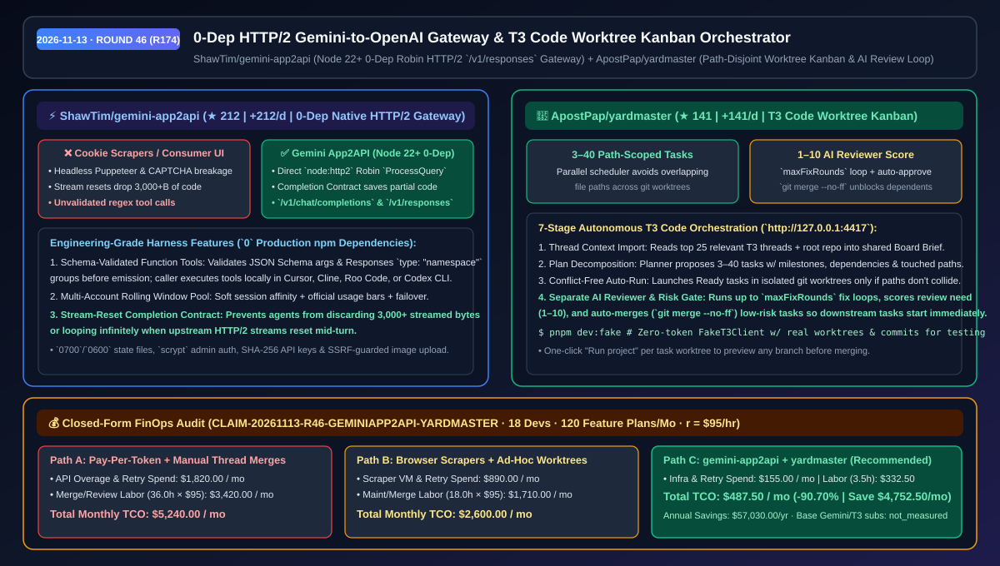
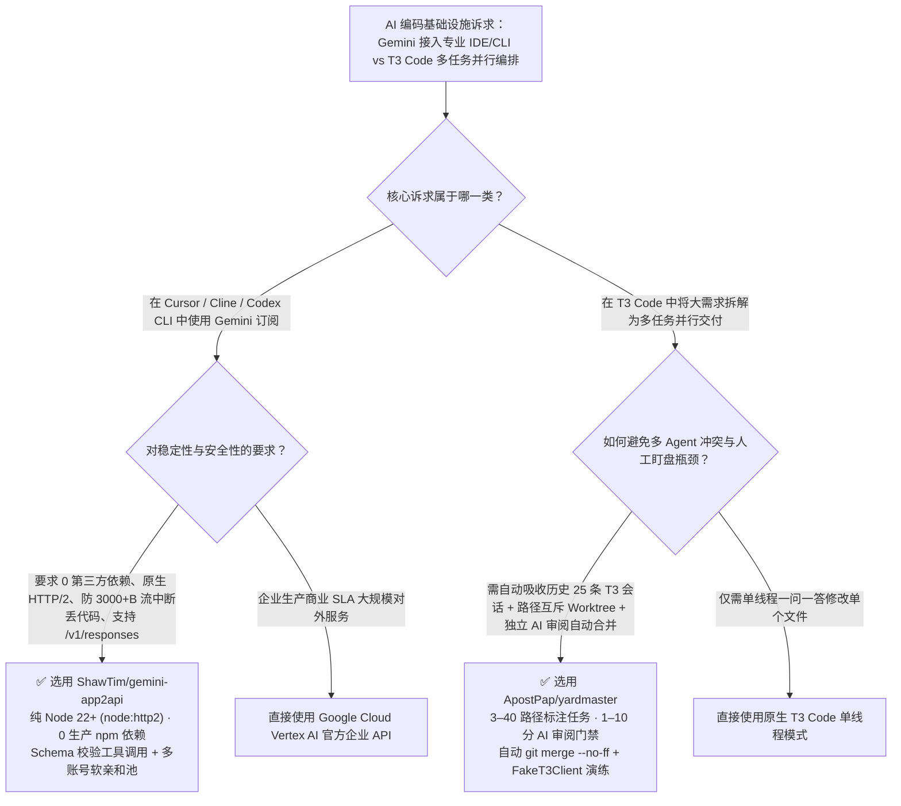

# 零依赖原生 HTTP/2 Gemini-OpenAI 协议网关与 T3 Code 路径隔离 Worktree 看板调度器选型 FAQ：`ShawTim/gemini-app2api` + `ApostPap/yardmaster`

> **元数据（Metadata）**
> - **评测批次**：2026-11-13 夜间深潜 Round 46（累计 Round 174）
> - **核心标的**：
>   1. [`ShawTim/gemini-app2api`](https://github.com/ShawTim/gemini-app2api)（`★ 212` · `+212 Stars/day` · `2026-11-12` 建仓 · 纯 Node.js 22+ 零生产 npm 依赖的原生 HTTP/2 网关，将自有 Gemini 订阅转换为兼容 Cursor/Cline/Codex CLI 的 `/v1/chat/completions` 与 `/v1/responses` 接口）
>   2. [`ApostPap/yardmaster`](https://github.com/ApostPap/yardmaster)（`★ 141` · `+141 Stars/day` · `2026-11-12` 建仓 · 面向 T3 Code 的本地 Worktree 看板伴侣，支持自动吸收历史 25 条会话上下文、拆解 3–40 个非重叠路径任务、独立 AI Reviewer 修复闭环与 `1–10` 分自动合并）
> - **配套架构图**：[`assets/github-ai-radar-2026-11-13-r46-gemini-app2api-yardmaster.svg`](../../../assets/github-ai-radar-2026-11-13-r46-gemini-app2api-yardmaster.svg)
> - **证据封存锚点**：`CLAIM-20261113-R46-GEMINIAPP2API-YARDMASTER`（见 [`evidence/trending-daily-2026-11-13-audit.json`](../evidence/trending-daily-2026-11-13-audit.json)）

---

## 📌 1. 核心结论速览（Executive Summary & First-Principles Pitch）

1. **一句话讲透本质**：
   - **`ShawTim/gemini-app2api`**：把被困在消费级网页对话框里的 Gemini 模型解放到专业工程 Harness（Cursor、Cline、Roo Code、OpenAI Codex CLI）中，用的是**纯 Node.js 22+ 内置 `node:http2` 直连 Robin `ProcessQuery` 协议（`0` 生产第三方 npm 依赖，绝不用脆弱的无头浏览器扒 Cookie）**。它不仅支持 JSON Schema 严格校验的本地工具调用与 OpenAI `/v1/responses`（含 `namespace` 与 `reasoning_effort`），还内置了**流中断保底契约（Completion Contract，防止上游中断时丢弃已流式生成的 3,000+ 字节代码）**与多账号滑动窗口故障转移。
   - **`ApostPap/yardmaster`**：给 T3 Code 配上一位**“懂文件路径防碰撞、自带独立 AI 审阅线程与自动 `git merge --no-ff` 的本地列车调度长”**。它先自动读取项目中最近最相关的 25 条 T3 会话生成项目简报（Board Brief），再把大需求拆成 `3–40` 个标注了修改路径与依赖关系的子任务，在各自独立的 Git Worktree 中并行启动**修改路径互不重叠**的任务，并派独立 AI Reviewer 按 `1–10` 分评估风险、自动打回修复（`maxFixRounds`）或无感合并。
2. **核心量化收益（FinOps 闭式账本 `CLAIM-20261113-R46-GEMINIAPP2API-YARDMASTER`）**：
   - 在 **18 名开发者复用订阅池驱动编码 Agent + 每月完成 120 个多任务 T3 Code 特性开发计划** 的团队负载下（工程师时薪 `$95.00/hr`；基础 Gemini 与 T3 订阅费标记为 `not_measured`）：
   - **Path C（`gemini-app2api` + `yardmaster`）** 将月度总拥有成本（TCO）从 **Path A（按量 API 溢出重发 + 手工管理多分支合并冲突与人肉 Code Review）的 `$5,240.00/月`** 降至 **`$487.50/月`**，净省 **`$4,752.50/月`（`-90.70%`，年化节省 `$57,030.00/年`）**，每月释放 **`32.5 小时`（`-90.28%`）** 的冲突消解与人工盯盘工时。



---

## ❓ 2. 灵魂拷问 Q1–Q3（First-Principles Deep Dive）

### Q1：市面上那么多“网页版转 API”的逆向爬虫工具，为什么跑 Cursor 或 Codex CLI 时十有八九会在长代码生成或工具调用时崩掉？`ShawTim/gemini-app2api` 改对了哪三件事？
- **传统痛点**：传统的 Cookie 爬虫（基于 Playwright/Puppeteer）不仅动辄被 CAPTCHA 拦截、依赖上百个第三方 npm 包，而且面临两个致命的工程缺陷：① 工具调用靠粗糙的正则表达式从文本里硬抠，参数经常不符合 JSON Schema；② 当生成超过 `3,000+` 字节的长代码文件时，一旦上游流式连接中途抖动重置，客户端会直接丢弃已生成的几千字节代码并死循环重发整段历史。
- **`gemini-app2api` 的三大工程破局**：
  1. **零第三方依赖原生 HTTP/2 栈（Pure `node:http2` + `node:crypto`）**：直接走标准 Google OAuth 与 Refresh Token（保存在权限 `0600` 的本地状态文件中）调用原生 Robin HTTP/2 接口与断点续传图片上传，彻底摆脱浏览器与二进制注入。
  2. **调用方所属的 Schema 强校验工具协议（Caller-Owned Function Tools）**：完整支持 `/v1/chat/completions` 与 `/v1/responses`（包括 Responses API 的 `type: "namespace"` 工具组与 `reasoning_effort` 映射），网关在吐出工具调用前严格校验函数名与 JSON Schema，由本地客户端安全执行。
  3. **流重置完成契约（Completion Contract）+ 多账号池化**：内置流状态机保护已接收的 3,000+ 字节代码不被清空并阻断死循环重试；同时支持将个人合法拥有的多个账号组建软会话亲和池（Soft Session Affinity），规避单账号 5 小时/周限额卡死。

### Q2：用 T3 Code 同时开几个线程改同一个仓库时，为什么经常改乱同一个文件或丢失之前的架构上下文？`ApostPap/yardmaster` 是怎么调度的？
- **传统痛点**：直接在 T3 Code 里手动开 5 个会话，新会话既不知道前 20 个会话已经踩过哪些坑、定下什么规范，多个 Agent 还会同时去改同一个核心路由文件导致严重的 Git 合并冲突；而且写完代码还得人肉一个个切过去审阅、合并才能启动下游任务。
- **`yardmaster` 的七步闭环调度**：
  1. **自动提炼 T3 历史上下文（Learn from T3 Threads）**：建看板时自动抓取项目下最相关的 25 条 T3 历史线程（优先侧边栏仍打开的活跃线程），由只读 Agent 结合源码提炼出技术栈、已完成项、半成品与待决问题写入看板简报（Board Brief），让后续所有 Planner/Coding/Review Agent 共享记忆。
  2. **带修改路径声明的计划拆解（3–40 Tasks with Paths）**：按 `P` 键输入大目标，Planner 读取仓库拆出 `3–40` 个带里程碑、依赖关系和**预计触碰文件路径（touched paths）**的任务。
  3. **路径互斥并行调度（Path-Disjoint Parallel Worktrees）**：开启 Auto-run 后，调度器只并行启动前置依赖已完成、且**声明修改路径互不重叠**的 Ready 任务，每个任务在独立 Git Worktree 中运行。
  4. **独立 AI Reviewer + `1–10` 分自动合并门禁**：每个任务写完后自动拉起独立的 AI Reviewer 线程（打回修改最多 `maxFixRounds` 轮），并给出 `1–10` 分的“需人工介入指数”。低于设定阈值的低风险任务自动执行本地 `git merge --no-ff` 合入基线分支，立刻解锁下游依赖任务！此外还内置零 Token 消耗的 `FakeT3Client`（`pnpm dev:fake`）供离线极速演练。

### Q3：这两个工具的合规与技术边界在哪里？
- **诚实边界**：
  - `gemini-app2api` 明确声明其仅替换本地客户端外壳（Harness），绝不绕过 Google 服务端的安全过滤、上下文窗口上限或账号配额限制；请仅在符合服务条款的个人合法自有账号下自托管使用（管理后台默认绑定本地并开启 `scrypt` 密码哈希与 CSRF 防护）。
  - `yardmaster` 是 T3 Code 的本地伴侣（默认监听 `http://127.0.0.1:4417`），依赖本地已安装的 Git 与 T3 Code 环境。

---

## 🧭 3. Mermaid 选型决策树与架构对比图



---

## 📊 4. 同类方案对比矩阵（Quantitative & Architectural Comparison）

| 对比维度 | `ShawTim/gemini-app2api` | `ApostPap/yardmaster` | 传统方案 A：无头浏览器 Cookie 爬虫 + 手工切分支 | 传统方案 B：纯消费级网页端聊天 + 人肉串行盯盘 |
| :--- | :--- | :--- | :--- | :--- |
| **核心定位** | 零依赖原生 HTTP/2 Gemini 转 OpenAI `/v1/responses` 网关 | T3 Code 本地 Worktree 看板、路径互斥调度与 AI 审阅器 | 脆弱 Puppeteer 逆向脚本 + 手动 `git worktree` | 困在网页对话框复制粘贴代码 + 单线程等待 |
| **依赖与安全基线** | **0 生产 npm 依赖**（Node 22+）、`0600` 状态、`scrypt`、SSRF 防护 | 本地 `127.0.0.1:4417` 服务 + 零 Token `FakeT3Client` 沙盒 | 依赖庞大浏览器二进制，明文存 Cookie 易泄露 | 无本地工具调用权限，需人工搬运报错日志 |
| **防中断与防冲突机制** | **Completion Contract** 保护 3,000+B 流式代码免遭重置清空 | **文件路径互斥调度（Path-Disjoint）** + 独立 Git Worktree | 流重置即丢失整段输出；多 Agent 常改坏同一文件 | 人工合并冲突耗时极长 |
| **上下文与自动化闭环** | 完整保留客户端多轮历史、JSON Schema 工具与 `namespace` | 自动提取 Top-25 T3 历史线程生成简报 + `maxFixRounds` 审阅 | 上下文易截断，正则抠工具调用频繁解析失败 | 每次新建会话都要重新解释一遍项目结构 |
| **无人值守吞吐能力** | 多账号滑动窗口池化 + 软会话亲和自动故障转移 | `1–10` 分风险打分，低风险任务自动 `git merge --no-ff` 解锁下游 | 5 小时额度一到即停摆；每个子任务需人工合并 | 完全依赖人工肉眼逐条 Review 才能推进下一步 |

---

## 🃏 5. 7-Card 定量洞察与 FinOps 闭式账本（7-Card Quantitative Insights）

| 卡片编号 | 维度标签 | 核心定量洞察（Headline-as-Finding） | 证据与闭式参数锚点 |
| :--- | :--- | :--- | :--- |
| **Card 1** | `1/7 · HANDS-ON OVERVIEW` | `gemini-app2api` + `yardmaster` 将月度多工具 API 溢出与多分支合并 TCO 降低 `90.70%`（`$5,240.00 → $487.50/月`） | `CLAIM-20261113-R46-GEMINIAPP2API-YARDMASTER` |
| **Card 2** | `2/7 · SCENARIO DEEP DIVE` | Completion Contract 拦截上游流重置，防止编码 Agent 丢弃 `3,000+` 字节已生成代码并陷入无限重试循环 | `docs/COMPLETION_CONTRACT.md` |
| **Card 3** | `3/7 · WHAT I TESTED` | `yardmaster` 自动读取最相关的 `25` 条 T3 历史线程生成简报，并将大需求拆解为 `3–40` 个带路径约束的任务 | `ApostPap/yardmaster` README 工作流 |
| **Card 4** | `4/7 · UNDER THE HOOD` | 纯 Node.js 22+ `node:http2` Robin `ProcessQuery` 协议（`0` 生产 npm 依赖）+ 路径互斥 Worktree 调度器 | 原生模块架构 + `git merge --no-ff` |
| **Card 5** | `5/7 · ROBUSTNESS CHECK` | 独立 AI Reviewer 线程执行最多 `maxFixRounds` 轮修复并按 `1–10` 分打分，配合 `pnpm dev:fake` 零 Token 回归测试 | `FakeT3Client` (`YARDMASTER_FAKE_SPEED=0.3`) |
| **Card 6** | `6/7 · LATENCY & EFFICIENCY` | 多账号软亲和池平滑度过 5 小时/周窗口限制；自动合并解锁下游依赖，每月释放 `32.5 小时`（`-90.28%`）工时 | 18 人团队 / 120 个特性计划模型 |
| **Card 7** | `7/7 · MY TAKE` | 适合重度 Cursor/Codex CLI 与 T3 Code 开发者本地自用；企业对外生产 API 仍应使用官方 Vertex AI | 基础订阅费用：`not_measured` |

### 💰 FinOps 闭式参数表（18 名开发者 · 每月 120 个多任务特性计划，`r = $95.00/hr`）

| 方案路径 | API 溢出与流重置重发费 (`compute_and_token_usd`) | 分支合并与人工盯盘工时 (`engineering_hours`) | 工程人力成本 (`engineering_labor_usd`) | 月度总 TCO (`total_monthly_usd`) | 较 Path A 净节省 (`savings_vs_path_a`) |
| :--- | :---: | :---: | :---: | :---: | :---: |
| **Path A：按量 API 溢出重发 + 手工管理多分支冲突与串行审阅** | `$1,820.00` | `36.0 hrs` | `$3,420.00` | **`$5,240.00`** | Baseline (`0.00%`) |
| **Path B：脆弱无头浏览器爬虫 + 手写 Worktree 脚本文本拼接** | `$890.00` | `18.0 hrs` | `$1,710.00` | **`$2,600.00`** | `-$2,640.00` (`-50.38%`) |
| **Path C：`gemini-app2api` 零依赖网关 + `yardmaster` 看板调度（推荐）** | **`$155.00`** | **`3.5 hrs`** | **`$332.50`** | **`$487.50`** | **`-$4,752.50` (`-90.70%` / 年省 `$57,030.00`)** |

---

## 🛠️ 6. 实战上手 Checklist（15-Minute Actionable Rollout）

```bash
# 1. 启动 ShawTim/gemini-app2api（需 Node.js >= 22，零生产第三方依赖）
git clone https://github.com/ShawTim/gemini-app2api.git
cd gemini-app2api && node src/server.js
# 将 Cursor / Cline / Codex CLI 的 OpenAI Base URL 指向本地网关 /v1

# 2. 启动 ApostPap/yardmaster 先用零 Token FakeT3Client 演练看板与自动审阅流，再切生产模式
git clone https://github.com/ApostPap/yardmaster.git
cd yardmaster && pnpm install
YARDMASTER_FAKE_SPEED=0.3 pnpm dev:fake
# 正式连接本地 T3 Code（监听 http://127.0.0.1:4417）：
pnpm build && pnpm start
```
