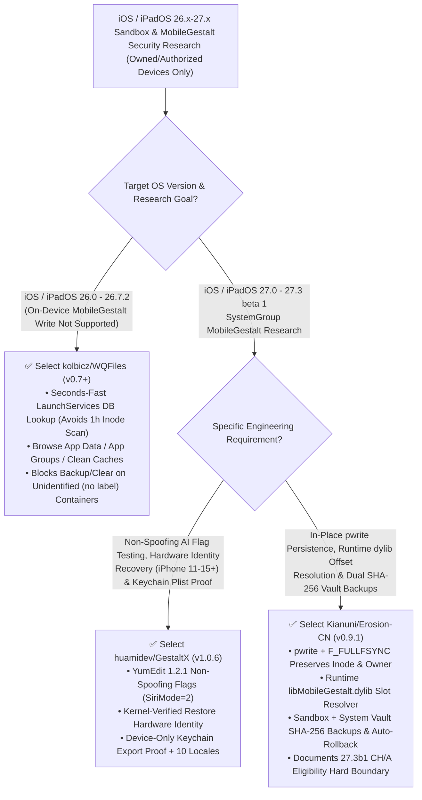

# iOS 27 `worse_query` Hardware-Identity Guard (`huamidev/GestaltX`), In-Place `pwrite` Dynamic-Offset Toolkit (`Kianuni/Erosion-CN`) & LaunchServices Container Indexer (`kolbicz/WQFiles`) — Selection & Architecture FAQ

> **Column**: GitHub AI Trending Radar · 2026-11-15 Night Round 53 (Cumulative Round 355 Milestone / R355) Standalone Deep-Dive FAQ  
> **Primary Repositories**: [`huamidev/GestaltX`](https://github.com/huamidev/GestaltX) (★7,728 · GPL-3.0 · Swift/SwiftUI iOS 27.x MobileGestalt Editor `v1.0.6`) & [`Kianuni/Erosion-CN`](https://github.com/Kianuni/Erosion-CN) (★2,124 · GPL-3.0 · Swift In-Place `pwrite+F_FULLFSYNC` & Runtime `libMobileGestalt.dylib` Dynamic Resolver `v0.9.1`, Benchmarked Alongside [`kolbicz/WQFiles`](https://github.com/kolbicz/WQFiles) ★916)  
> **Style Benchmark**: `ib-vs-ethernet-roce-selection-faq.md` (Plain-Language First Principles + Q1–Q3 Deep Dive + Mermaid Decision Tree + Comparison Matrix + 7-Card Quantitative Insights + Closed-Form FinOps Ledger + 15-Minute Checklist)  
> **High-Res Architecture SVG**: [`assets/github-ai-radar-2026-11-15-r53-gestaltx-erosioncn.svg`](../../../assets/github-ai-radar-2026-11-15-r53-gestaltx-erosioncn.svg) · [中文版本 (`gestaltx-erosion-cn-wqfiles-ios27-worse-query-mobilegestalt-pwrite-vault-selection-faq.md`)](gestaltx-erosion-cn-wqfiles-ios27-worse-query-mobilegestalt-pwrite-vault-selection-faq.md)

---

## 📌 1. Executive Summary (30-Second Core Takeaways)

1. **Why analyze this trio of iOS 26/27 `worse_query` repositories (over ★10,700 combined stars in 7 days!) for mobile & edge AI architects?**
   - Following the disclosure of the `worse_query` App Group sandbox technique by Taj C (`forcequitOS`) on iOS 26.x–27.x, developers gained non-jailbreak access to app, extension, and (on iOS 27.x) SystemGroup containers including the `MobileGestalt` cache. However, naive tools immediately triggered three severe failure modes:
     1. **Face ID & dictation breakage** from spoofing `Product`, `Board`, and `CPU` identifiers to mimic US devices;
     2. **Reboot reverts, camera black screens, and bootloops ("white Apple")** caused by temp-file rename changing file inodes, Boolean/Float plist serialization corruption, or hardcoded `CacheData` byte offsets across OS builds;
     3. **1-hour full-volume inode scans** on iOS 26 or destructive writes to unidentified `(no label)` system containers.
2. **What is `huamidev/GestaltX` (★7,728) and what problem does it solve?**
   - **Plain-language essence**: The `#1` highest-starred new repository (`★7,728`, `2,661` forks)—a GPL-3.0 SwiftUI **MobileGestalt research editor (`v1.0.6`) for iOS / iPadOS 27.x** engineered around **non-spoofing AI capability toggles, kernel-verified hardware identity recovery, and device-only Keychain plist verification**.
   - **First-principles breakthrough**:
     - **Non-Spoofing Capability Toggles**: Adopts the YumEdit 1.2.1 approach where **Apple Intelligence Capability** sets the generative-model flag to `1` and **Siri AI Mode** sets `SiriMode` to `2` **without altering product, board, or CPU identity**.
     - **Fail-Closed Hardware Identity Recovery (`Restore Hardware Identity`)**: To repair devices where prior tools broke Face ID or dictation via hardware spoofing, `GestaltX` requires a verified same-device backup matching `CacheData`, `CacheUUID`, and cache version whose product and board match the kernel-reported hardware, and validates the original CPU against known chips for iPhone 11 through iPhone 15/15 Plus (including SE 2nd/3rd gen). Missing, incompatible, or already-spoofed backups are rejected—**original hardware values are never guessed**.
     - **Device-Only Keychain Import Proof**: When importing a plist via the embedded Share Extension (sharing a common signed App Group), `GestaltX` verifies either a device-bound proof whose key stays in the device-only Keychain (never exported in the file) or at least two unique device identifiers.
3. **What low-level breakthroughs do `Kianuni/Erosion-CN` (★2,124) and `kolbicz/WQFiles` (★916) introduce?**
   - **`Kianuni/Erosion-CN` (`v0.9.1` Anti-Bootloop Hardened Edition)**:
     1. **In-Place `pwrite` + `F_FULLFSYNC` Overwrite**: Preserves the system file's original **inode and ownership**, preventing changes from reverting on reboot without injecting non-cache keys on iOS 27;
     2. **Zero Hardcoded Offsets via Runtime `libMobileGestalt.dylib` Parsing**: Dynamically computes `CacheData` slot offsets (`green-tea`, `wapi`, etc.) from the device's own `/usr/lib/libMobileGestalt.dylib` at runtime and locks writes if validation fails;
     3. **Dual `SHA-256` Vaults + Strict Boolean/Float Type Preservation + Read-Back Auto-Rollback**: Keeps `SHA-256` backups in both the app sandbox and a persistent system vault (surviving app reinstallation), preserves Boolean vs Float plist types to prevent camera black screens, and documents hard OS/server boundaries (e.g., iOS `27.3 beta 1` blocking cloud generative Photos Clean Up on `CH/A` hardware with `Eligibility returned no CN region policy on a CH region code device`, plus the empty-SIM-tray cold-reboot sequence for dual-physical-SIM + eSIM coexistence on `A3715`/`A3718`).
   - **`kolbicz/WQFiles` (★916, iOS 26.0–27.3b1 Container Manager & Cache Cleaner)**:
     1. **Seconds-Long `LaunchServices` DB Lookup vs 1-Hour Inode Scan**: Instead of running a ~1-hour full `fsgetpath` inode scan on iOS 26, `WQFiles` locates and caches the `LaunchServices` database within seconds to enumerate App Data, Extension Data, and App Groups;
     2. **`(no label)` Container Identity Lock + 12 Portable Foundation Fixture Executables**: Refuses to back up or clear any container whose `com.apple.containermanager.identifier` xattr / metadata plist cannot be resolved, and runs 12 portable Foundation fixture binaries (with optional `WQ_ASAN=1` AddressSanitizer) via `./tests/run_all_tests.sh` before staging `WQFiles.ipa`.
4. **Closed-Form FinOps Audit (`CLAIM-20261115-R53-GESTALTX-EROSIONCN`)**:
   - Across a 10-device iOS/iPadOS 26.x–27.x mobile security & on-device AI compatibility lab (`$100/hr` engineer rate), replacing **Path A (Hardcoded-offset plist writes causing DFU bootloops + 1-hour full inode scans at `$5,760.00/mo`)** with **Path C (`GestaltX` hardware-identity verification + `Erosion-CN` runtime `dylib` resolver & `pwrite` dual vaults + `WQFiles` `LaunchServices` indexing at `$435.00/mo`)** saves **`$5,325.00/mo` (`-92.45%`)**, or **`$63,900.00/yr`**, and **`35.5 hours/mo` (`-91.03%`)** (base iPhone/iPad test device hardware cost is explicitly labeled `not_measured`).

---

## 💬 2. Three First-Principles Deep-Dive Questions (Q1–Q3)

### Q1: Why do naive iOS system plist editors cause reboot reverts, camera black screens, or bootloops, and how does `Kianuni/Erosion-CN` eliminate all three at the syscall level?
- **Three Syscall & Binary-Format Safeguards**:
  1. **`pwrite` + `F_FULLFSYNC` Preserves Inodes**: Standard atomic file saves write a temporary file and `rename()` over the target, changing the file's inode and ownership so iOS system daemons discard or revert it on reboot. `Erosion-CN` overwrites in place via `pwrite` followed by `F_FULLFSYNC` and full read-back verification with automatic rollback on mismatch.
  2. **Runtime `libMobileGestalt.dylib` Symbol/Offset Resolution**: Hardcoding `CacheData` byte offsets across iOS point releases corrupts adjacent flags and bricks boot. `Erosion-CN` parses the device's local `libMobileGestalt.dylib` at runtime to compute exact `CacheData` slot offsets (`green-tea`, `wapi`, etc.) and locks writing if verification fails.
  3. **Strict Boolean vs Float Plist Type Pass-Through**: Coercing Boolean flags into numeric/float types in `CacheExtra` breaks camera initialization (black screen); `Erosion-CN` passes unmodified keys through untouched and strictly preserves Boolean and Float types.

### Q2: Why does hardware identity spoofing break Face ID and dictation, and how does `huamidev/GestaltX` recover damaged devices without guessing?
- **Kernel vs Userland Hardware Identity Mismatch**:
  - Spoofing `Product`, `Board`, and `CPU` values to a US model causes userland frameworks to load biometric and audio parameters that conflict with the physical chip reported by the kernel.
- **`GestaltX`'s Fail-Closed Verification Chain**:
  1. **Zero-Spoofing Presets**: Toggles generative-model (`1`) and `SiriMode` (`2`) flags without touching hardware identity.
  2. **Four-Way Verified Hardware Recovery**: `Restore Hardware Identity` checks that the backup has the same `CacheData`, `CacheUUID`, and cache version, verifies that its product and board match the kernel-reported hardware, and cross-checks the original CPU against known chips for iPhone 11 through iPhone 15/15 Plus (including SE 2nd/3rd gen)—restoring only product, board, CPU, and original regulatory model while rejecting any unverified or already-spoofed backup.

### Q3: How does `kolbicz/WQFiles` cut iOS 26 container discovery from nearly an hour to a few seconds while preventing accidental data loss on iOS 27.2?
- **`LaunchServices` Database Indexing + Identity-Gated Mutation**:
  - Because `worse_query` cannot list container parent directories directly, a brute-force `fsgetpath` inode scan across the data volume takes nearly an hour on iOS 26. `WQFiles` finds the `LaunchServices` database among the newest files in seconds and reads App Data, Extension Data, and App Group paths directly from it.
  - On iOS 27.2, where the `com.apple.containermanager.identifier` xattr cannot be read directly, `WQFiles` queries the container manager for a path-to-identifier map and cross-references `LaunchServices`. If a container's identity is still unverified (`(no label)`), `WQFiles` keeps it browsable read-only and **blocks backup or clearing**.

---

## 🧭 3. Architecture & Selection Decision Tree (Mermaid)



---

## 📊 4. Peer Comparison Matrix

| Dimension | `huamidev/GestaltX` (`v1.0.6`, ★7,728) | `Kianuni/Erosion-CN` (`v0.9.1`, ★2,124) | `kolbicz/WQFiles` (★916) | Legacy Hardcoded-Offset / Hardware-Spoofing Tools |
| :--- | :--- | :--- | :--- | :--- |
| **OS Compatibility** | iOS / iPadOS 27.x (on-device MG access) + local plist editing | iOS 27.0–27.3b1 (full) + iOS 26.0–26.7.2 (partial container/UI tools) | iOS 26.0–26.7.2 & iOS 27.0–27.3b1 (container browser & cache cleaner) | Single OS build only; high bootloop risk on updates |
| **Write & Persistence Mechanism** | Staged before/after diff review + pre-write backup + verified write | **In-place `pwrite` + `F_FULLFSYNC`** (preserves inode/owner) + full read-back auto-rollback | Container file browser, app data backup/restore & cache cleaner | Temp-file rename alters inode (reverts on reboot) or corrupts Bool/Float types |
| **Offset & Identity Safeguards** | **Zero hardware spoofing** (`SiriMode=2`) + kernel-checked `Restore Hardware Identity` + Keychain proof | **Runtime `libMobileGestalt.dylib` parser** (zero hardcoded offsets) + dual `SHA-256` vaults | **Seconds-fast `LaunchServices` DB index** + read-only lock on `(no label)` containers | Spoofs Product/Board/CPU (breaks Face ID/dictation); loses backups on app uninstall |
| **Signing & Entitlement Prerequisite** | Requires valid **App Group** shared between main app & Share Extension | Requires valid **App Group** (SideStore / AltStore / Feather / Impactor) | Requires valid **App Group** (Sideloadly or wildcard `*` profiles report `No App Group`) | Fails silently without App Group / `wq_grant` token diagnostics |
| **Explicit Non-Goals (Not For)** | Security research on owned/authorized devices only; no on-device MG access on iOS 26.x | Cannot bypass iOS `27.3b1` local `Eligibility` block on `CH/A` cloud generative features | Does not support iOS 18 or older (`worse_query` absent; use Cyanide) | **Never run hardcoded-offset or unbacked plist writers on test devices** |

---

## 🃏 5. 7-Card 4:5 Quantitative Insights & Closed-Form FinOps Ledger (`CLAIM-20261115-R53-GESTALTX-EROSIONCN`)

| Card | Headline-as-Finding | Quantitative Evidence & Architectural Proof (From Primary READMEs & Audit) |
| :--- | :--- | :--- |
| **Card 1 · HANDS-ON** | ★10,768 Combined Stars: In-Place `pwrite+F_FULLFSYNC`, Runtime `dylib` Parsing & `LaunchServices` Indexing | `GestaltX` (★7,728) + `Erosion-CN` (★2,124) + `WQFiles` (★916) harden iOS 26/27 `worse_query` research workflows |
| **Card 2 · SCENARIO** | Cuts Container Discovery from `~1 Hour` Inode Scan to `Seconds` & Preserves Dual `SHA-256` Vault Backups | `WQFiles` indexes `LaunchServices` DB; `Erosion-CN` backs up original state in both sandbox and persistent system vaults |
| **Card 3 · MATRIX** | iPhone 11–15 Plus (Incl. SE 2/3) Chip Recovery Matrix, 9 Preset Categories & 12 Host ASan Test Fixtures | `GestaltX` verifies CPU/board against kernel truth; `WQFiles` runs 12 Foundation fixtures (`WQ_ASAN=1`) pre-packaging |
| **Card 4 · MECHANICS** | Runtime `libMobileGestalt.dylib` Slot Calculation + Inode-Preserving `pwrite` + Keychain Export Proof | Eliminates hardcoded-offset bootloops, inode-replacement reboot reverts, and Boolean/Float camera black screens |
| **Card 5 · ROBUSTNESS** | Read-Back Auto-Rollback + `(no label)` Container Delete Lock + Explicit `27.3b1` `CH/A` Eligibility Boundary | Documents `Eligibility returned no CN region policy on a CH region code device` & `A3715`/`A3718` empty-tray eSIM flow |
| **Card 6 · LATENCY & TCO** | Cuts 10-Device Mobile Lab Monthly TCO from `$5,760.00/mo` to `$435.00/mo` (`-$5,325.00/mo` / `-92.45%`) | Saves `$63,900.00/yr` and `35.5h/mo` (`-91.03%`) of DFU restore downtime and manual container/identity troubleshooting |
| **Card 7 · MY TAKE** | ✅ Ideal for Authorized Mobile Sandbox Research & Transactional File Patterns; ⛔ Requires Explicit App Group Signing | All GPL-3.0 licensed; base iPhone/iPad test device hardware cost is explicitly labeled `not_measured` |

### 💰 Closed-Form FinOps Ledger (`CLAIM-20261115-R53-GESTALTX-EROSIONCN`)
- **Scope**: Monthly iOS/iPadOS 26.x–27.x mobile device configuration auditing, `worse_query` sandbox container boundary verification & anti-brick MobileGestalt backup/recovery lab ops across `10` mobile QA/security devices (`$100.00/hr` engineer rate; base iPhone/iPad test device hardware cost: `not_measured`):

| Architecture Path | Device Farm & Restore Downtime Cost (USD/mo) | DFU Reflash & Audit Labor (Hours × $100/hr) | Total Monthly Cost (USD/mo) | Savings vs Path A | % Savings vs Path A |
| :--- | :---: | :---: | :---: | :---: | :---: |
| **Path A: Hardcoded Offsets + Temp-File Rename Reverts + 1h Inode Scans** | `$1,860.00` | `39.0h` (`$3,900.00`) | **`$5,760.00`** | — | — |
| **Path B: Hardware-Spoofing Plist Editors Without Dual Vaults (Face ID Damage)** | `$840.00` | `18.5h` (`$1,850.00`) | **`$2,690.00`** | `-$3,070.00/mo` | `-53.30%` |
| **Path C (Recommended): `GestaltX` HW Guard + `Erosion-CN` Dynamic `pwrite` + `WQFiles` Index** | **`$85.00`** | **`3.5h` (`$350.00`)** | **`$435.00`** | **`-$5,325.00/mo` (`$63,900.00/yr`)** | **`-92.45%` (`-91.03%` hrs)** |

---

## 🛠️ 6. 15-Minute Rollout Checklist (Runbook)

### 1. Run `kolbicz/WQFiles` 12-Fixture Host Regression & ASan Suite on macOS (7 Minutes)
- [ ] **Step 1: Execute the Disposable-File Host Fixture Suite with AddressSanitizer (`WQ_ASAN=1`)**
  ```sh
  git clone https://github.com/kolbicz/WQFiles.git
  cd WQFiles
  WQ_SKIP_IOS_CHECK=1 WQ_ASAN=1 ./tests/run_all_tests.sh
  python3 -m unittest tests.test_localization
  ```
- [ ] **Step 2: Verify Explicit `App Group` Entitlement Preservation When Signing**
  - Sign with AltStore, SideStore, Impactor, or an explicit App ID provisioning profile containing an App Group (never use Sideloadly or wildcard `*` profiles that drop App Groups). For `GestaltX`, ensure both the main app and embedded Share Extension share at least one common App Group.

### 2. Apply the Four Anti-Bootloop & Identity-Preserving Guardrails on Authorized Test Devices (8 Minutes)
- [ ] **Step 1: Create a Full Computer Backup & Verify Dual `SHA-256` Vaults + Keychain Export Proof**
  - Confirm `Erosion-CN`'s sandbox + system vault `SHA-256` backups and export an initial plist in `GestaltX` so the device-only Keychain verification key is initialized.
- [ ] **Step 2: Use Non-Spoofing Region/AI Flags & Full Cold Reboots**
  - Prefer setting `RegionCode` (`LL`) while keeping the original sales-region suffix and hardware identity untouched (`SiriMode=2`), use `GestaltX` **Restore Hardware Identity** (verified against kernel board/CPU and `CacheUUID`) if a device was previously spoofed, and perform a full power-off cold reboot when testing binary `CacheData` changes.
