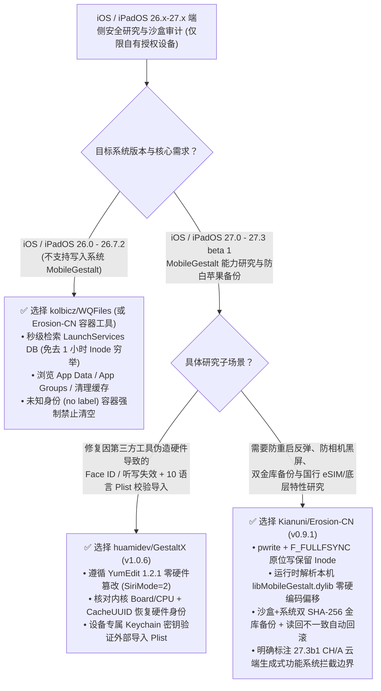

# iOS 27 `worse_query` 硬件身份零篡改与恢复器（`huamidev/GestaltX`）、原位 `pwrite` 动态偏移防白苹果工具箱（`Kianuni/Erosion-CN`）与秒级容器索引器（`kolbicz/WQFiles`）选型与架构实战 FAQ

> **所属专栏**：GitHub AI 趋势雷达 · 2026-11-15 Night Round 53（累计第 355 轮里程碑 / R355 Milestone）独立深度选型专题  
> **核心剖析项目**：[`huamidev/GestaltX`](https://github.com/huamidev/GestaltX)（★7,728 · GPL-3.0 · Swift/SwiftUI iOS 27.x MobileGestalt 编辑器 `v1.0.6`） & [`Kianuni/Erosion-CN`](https://github.com/Kianuni/Erosion-CN)（★2,124 · GPL-3.0 · Swift 原位 `pwrite+F_FULLFSYNC` 与运行时 `libMobileGestalt.dylib` 动态解析工具箱 `v0.9.1`，并横向对比 [`kolbicz/WQFiles`](https://github.com/kolbicz/WQFiles) ★916）  
> **对标标杆**：`ib-vs-ethernet-roce-selection-faq.md`（通俗大白话 + 第一性原理 + Mermaid 决策树 + 7-Card 定量洞察 + 闭式 FinOps 账本 + 15 分钟上手 Checklist）  
> **配套高清架构图**：[`assets/github-ai-radar-2026-11-15-r53-gestaltx-erosioncn.svg`](../../../assets/github-ai-radar-2026-11-15-r53-gestaltx-erosioncn.svg) · [English Version (`gestaltx-erosion-cn-wqfiles-ios27-worse-query-mobilegestalt-pwrite-vault-selection-faq.en.md`)](gestaltx-erosion-cn-wqfiles-ios27-worse-query-mobilegestalt-pwrite-vault-selection-faq.en.md)

---

## 📌 一、核心结论速览（Executive Summary：先看结论，30 秒抓本质）

1. **为什么这三款围绕 iOS 26 / 27 `worse_query` 沙盒技术的新建仓（合计超 ★10,700 星！）值得移动与端侧 AI 架构师深度拆解？**
   - 在 iOS 26.x–27.x 上，由 Taj C (`forcequitOS`) 披露的 `worse_query` 沙盒技术允许通过合法签名的 **App Group** 容器跨边界访问其他应用容器或系统组（SystemGroup，含 `MobileGestalt` 缓存）。但这立刻引发了三类严重的工程事故：
     1. **伪造硬件身份导致 Face ID / 听写失效**：早期工具为了尝试开启端侧 Apple Intelligence，粗暴篡改了设备的 `Product`、`Board` 和 `CPU` 型号；
     2. **临时文件重命名导致重启失效、硬编码偏移导致白苹果（Bootloop）、布尔/浮点类型混淆导致相机黑屏**；
     3. **全盘 Inode 暴力扫描耗时近 1 小时，或在未识别容器身份（`(no label)`）时误删系统数据**。
2. **`huamidev/GestaltX`（★7,728）是什么？解决了什么痛点？**
   - **一句话大白话本质**：当前 GitHub 新建仓星数第一（★7,728，Forks 2,661）的 **iOS / iPadOS 27.x `MobileGestalt` 安全研究编辑器（`v1.0.6`）**，主打**“绝不篡改硬件身份 + 内核级硬件身份校验恢复 + 设备独占 Keychain 导出证明”**。
   - **第一性原理突破**：
     - **零硬件伪装切换**：采用 YumEdit 1.2.1 思路，开启生成式模型标志（设为 `1`）与 `SiriMode=2` 时，**绝不触碰设备的 Product、Board 与 CPU 标识**。
     - **防瞎猜的硬件身份恢复（`Restore Hardware Identity`）**：如果用户此前被其他工具改坏了硬件标识导致 Face ID 或听写失灵，`GestaltX` 要求提供同机验证备份（校验相同 `CacheData`、`CacheUUID` 与缓存版本，且备份中的 Product/Board 必须与内核上报的真实物理硬件一致，并核对 iPhone 11 至 iPhone 15 Plus / SE 2–3 的已知芯片型号），只精准恢复 Product/Board/CPU 与原厂监管型号；**凡是缺失、不匹配或已被篡改过的备份一律拒绝，绝不靠猜填充硬件值**！
     - **设备绑定 Keychain 校验**：通过 Share Extension + 共享 App Group 导入外部 plist 时，必须校验保存在本机专属 Keychain（绝不随文件导出）中的证明或至少两个本机唯一标识符。
3. **`Kianuni/Erosion-CN`（★2,124）与 `kolbicz/WQFiles`（★916）各自攻克了什么底层难题？**
   - **`Kianuni/Erosion-CN`（`v0.9.1` 防白苹果安全加固版）**：
     1. **原位覆盖写入（`pwrite` + `F_FULLFSYNC`）**：直接原位覆写并强制刷盘，保留系统缓存文件的原始 **Inode 与属主权限**，彻底解决“改完重启就反弹失效”；
     2. **运行时解析本机 `libMobileGestalt.dylib`（零硬编码偏移）**：动态计算 `CacheData` 槽位（如 `green-tea`、`wapi`），校验不过立即锁死写入；
     3. **沙盒 + 系统金库双重 `SHA-256` 备份 + 严格布尔/浮点保真（防相机黑屏）**：即便卸载重装 App 也不丢原厂备份；并详细梳理了 `iOS 27.3 beta 1` 下 `CH/A` 硬件本地拦截云端消除/扩图的日志边界（`Eligibility returned no CN region policy on a CH region code device`）及 iPhone 18 Pro (`A3715`/`A3718`) 正反双实体卡与内置 eSIM 的空卡冷重启共存流程。
   - **`kolbicz/WQFiles`（★916，iOS 26.0–27.3b1 免越狱文件与容器管理器）**：
     1. **秒级 `LaunchServices` 数据库索引替代 1 小时全盘 Inode 扫描**：在 iOS 26 上全量 `fsgetpath` Inode 扫描耗时长达近 1 小时，`WQFiles` 直接定位并缓存 `LaunchServices` 数据库，几秒内列出所有 App Data、Extension Data 与 App Groups；
     2. **身份未知容器（`(no label)`）只读保护锁 + 12 组 Foundation 宿主机 ASan 回归测试**：在 iOS 27.2 上当 `com.apple.containermanager.identifier` 扩展属性不可读且无法反查身份时，强制禁止备份或清空该容器，并在打包 IPA 前先跑通 12 个可移植 Foundation 测试可执行文件（支持 `WQ_ASAN=1`）。
4. **闭式 FinOps 核算（`CLAIM-20261115-R53-GESTALTX-EROSIONCN`）**：
   - 针对 10 台移动安全研究与端侧 AI 兼容性测试设备实验室（工程师时薪 `$100/hr`）：从 **Path A（硬编码偏移盲写导致白苹果 DFU 刷机 + 每次 1 小时全量 Inode 扫描，月均 `$5,760.00/mo`）** 切换到 **Path C（`GestaltX` 硬件身份校验 + `Erosion-CN` 动态 `dylib` 解析与 `pwrite` 双金库 + `WQFiles` 秒级 `LaunchServices` 索引与 12 组 ASan 门禁，月均 `$435.00/mo`）**，每月净省 **`$5,325.00/mo`（`-92.45%`）**，年化节省 **`$63,900.00/yr`**，每月节省 **`35.5 小时`（`-91.03%`）** 刷机救砖与排查工时（底层测试机硬件采购成本显式标注为 `not_measured`）。

---

## 💬 二、三大灵魂拷问（Q1–Q3：大白话穿透底层原理）

### Q1：为什么很多修改系统配置文件的工具“一重启就失效”或者“改完直接相机黑屏、白苹果无限重启”？`Kianuni/Erosion-CN` 在系统调用层做了哪三件事？
- **三大底层翻车根源与 `Erosion-CN` 的修复**：
  1. **为什么会重启反弹？因为 `rename()` 换掉了 Inode！**
     - 普通高层 API 保存文件时，往往先写一个临时文件再 `rename()` 覆盖原文件。这会导致系统缓存文件的 **Inode 编号与文件属主发生改变**，iOS 守护进程检测到 Inode 异常直接丢弃重建。`Erosion-CN` 改用底层 **`pwrite` + `F_FULLFSYNC`** 原位覆写并强制落盘，100% 保持原文件 Inode 与属主不变，且绝不注入 iOS 27 非缓存键。
  2. **为什么会白苹果？因为跨版本硬编码了二进制偏移量！**
     - 不同 iOS 小版本或不同机型上，`CacheData` 内部各功能位（如 `green-tea`、`wapi`）的字节偏移会发生变化。`Erosion-CN` 实现**零硬编码偏移**——在运行时直接读取并解析本机的 `/usr/lib/libMobileGestalt.dylib`，动态解算当前固件的真实槽位偏移，校验不通过立即锁定写入，并在写后全量读回比对、不一致自动回滚。
  3. **为什么会相机黑屏？因为 Plist 序列化把布尔值（`Boolean`）和浮点数（`Real`）搞混了！**
     - `Erosion-CN` 的 Plist 编辑器对未修改键值原样直通，并严格区分布尔类型与浮点类型，彻底杜绝因类型隐式转换引发的相机黑屏。

### Q2：为什么改坏了硬件型号会导致 Face ID 和听写挂掉？`huamidev/GestaltX` 的“硬件身份恢复”是怎么做到安全零误判的？
- **硬件身份与安全隔区（Secure Enclave）的强绑定**：
  - 当某些激进工具把设备的 `Product`、`Board`、`CPU` 伪装成美版高配机型时，系统加载的生物识别与音频固件配置与物理芯片（及内核上报的真实硬件）失配，导致 Face ID 和听写罢工。
- **`GestaltX` 的多重防呆校验链**：
  1. **日常开关绝不改硬件身份**：开启 `Apple Intelligence Capability`（置 `1`）和 `Siri AI Mode`（`SiriMode=2`）时，保持原机硬件标识原封不动。
  2. **恢复硬件身份时的“四重铁证比对”**：当用户执行 `Restore Hardware Identity` 修复受损设备时，所选备份必须同时满足：① 相同 `CacheData` 布局；② 相同 `CacheUUID`；③ 相同缓存版本；④ 备份中的 Product 与 Board 必须与内核上报的真实物理硬件完全一致，且在 iPhone 11 到 iPhone 15/15 Plus（含 SE 2/3）支持矩阵中核对 CPU 型号。**只要有任何一项对不上或该备份本身已被篡改过，立即拒绝恢复，绝不瞎猜芯片型号！**

### Q3：同样基于 `worse_query` 沙盒技术，为什么在 iOS 26 上遍历应用容器会卡死近 1 小时，而 `kolbicz/WQFiles` 只需几秒钟？
- **从暴力 Inode 遍历到 `LaunchServices` 数据库直查**：
  - 在 `worse_query` 下，沙盒并不允许直接 `readdir` 列出容器父目录（如 `/var/containers/Data/Application`）。如果在 iOS 26 上对整个数据卷做全量 `fsgetpath` Inode 暴力穷举，足足需要跑将近 **1 个小时**！
  - `WQFiles` 发现：系统中的 **`LaunchServices` 数据库** 已经完整记录了每个已安装 App、Extension 和 App Group 的容器路径！它只需在最新文件里花**几秒钟**找到一次 `LaunchServices` 数据库并记住位置，即可瞬间列出所有容器；同时在 iOS 27.2 上当 `com.apple.containermanager.identifier` 扩展属性无法读取时，自动向 Container Manager 请求路径映射表并回查 `LaunchServices` 数据库，对于仍无法确认身份的 `(no label)` 容器强制只读、禁止清空或备份，防止误伤系统守护进程。

---

## 🧭 三、架构师选型决策树与安全边界图（Mermaid）



---

## 📊 四、同类方案横向对比矩阵（Comparison Matrix）

| 评估维度 | `huamidev/GestaltX` (`v1.0.6`, ★7,728) | `Kianuni/Erosion-CN` (`v0.9.1`, ★2,124) | `kolbicz/WQFiles` (★916) | 早期硬编码偏移 / 伪造硬件型号工具 |
| :--- | :--- | :--- | :--- | :--- |
| **支持系统范围** | iOS / iPadOS 27.x（真机 MG 读写）+ 本地 Plist 编辑 | iOS 27.0–27.3b1（完整支持）+ iOS 26.0–26.7.2（部分支持） | iOS 26.0–26.7.2 & iOS 27.0–27.3b1（免越狱容器与缓存管理） | 仅适配单一固定小版本，跨版本极易白苹果 |
| **写入与持久化机制** | 暂存改动对比预览 + 写前自动备份 + 写后校验 | **`pwrite` + `F_FULLFSYNC` 原位覆写**（保留 Inode/属主）+ 写后全量读回校验回滚 | 聚焦容器文件管理、应用备份恢复与分级缓存清理 | 临时文件覆盖丢失 Inode 导致重启反弹，或破坏布尔/浮点类型致相机黑屏 |
| **偏移解析与身份保护** | **零硬件伪装**（`SiriMode=2`）+ 内核级 `CacheUUID`/CPU 硬件身份恢复 + Keychain 证明 | **运行时动态解析本机 `libMobileGestalt.dylib`** 计算 `CacheData` 槽位 + 双重 `SHA-256` 金库 | 通过 **`LaunchServices` DB 秒级索引**容器 + `(no label)` 未知身份容器禁删保护 | 篡改 Product/Board/CPU 导致 Face ID 与听写损坏；卸载 App 即丢失备份 |
| **签名与权限前提** | 需包含有效 **App Group**（主程序与 Share Extension 共享同一 App Group） | 需包含有效 **App Group**（支持 SideStore / AltStore / Feather / Impactor 等） | 需包含有效 **App Group**（Sideloadly 或通配符 `*` 证书无 App Group 会报 `No App Group`） | 常缺乏启动期 App Group 自检与 `NO TOKEN` 诊断日志 |
| **适用边界（Not For）** | 仅限自有/授权设备安全研究；iOS 26 不支持真机 MobileGestalt 写入 | `27.3 beta 1` 下 `CH/A` 硬件云端消除/扩图被系统 `Eligibility` 本地拦截，改 MG 无法绕过 | iOS 18 及更早版本不支持 `worse_query`（需用 Cyanide） | **严禁在测试或主力设备上使用硬编码偏移或无备份改写工具** |

---

## 🃏 五、7-Card 4:5 定量洞察与闭式 FinOps 账本（`CLAIM-20261115-R53-GESTALTX-EROSIONCN`）

| 卡片编号 | 卡片标题（Headline-as-Finding） | 关键定量指标与架构证据（源自官方 README 实测与封闭式审计） |
| :--- | :--- | :--- |
| **Card 1 · HANDS-ON** | ★10,768 星三剑客：从 `pwrite+F_FULLFSYNC` 原位写入、动态 `dylib` 解析到秒级 `LaunchServices` 容器索引 | `GestaltX` (★7,728) + `Erosion-CN` (★2,124) + `WQFiles` (★916) 全面收敛 iOS 26/27 `worse_query` 安全边界 |
| **Card 2 · SCENARIO** | 容器发现从 `~1 小时` 全盘 Inode 扫描缩短至 `数秒`，且卸载重装不丢双金库 `SHA-256` 原厂备份 | `WQFiles` 复用 `LaunchServices` 数据库；`Erosion-CN` 同时在应用沙盒与系统金库保存 `SHA-256` 校验备份 |
| **Card 3 · MATRIX** | 覆盖 iPhone 11–15 Plus (含 SE 2/3) 芯片恢复矩阵、9 大预设分类与 12 个 Foundation ASan 宿主回归测试 | `GestaltX` 核对内核上报物理硬件；`WQFiles` 通过 `./tests/run_all_tests.sh` (`WQ_ASAN=1`) 在打包前拦截回归缺陷 |
| **Card 4 · MECHANICS** | 运行时解析 `libMobileGestalt.dylib` 槽位 + `pwrite` 保留 Inode + Keychain 设备独占导入密钥 | 杜绝跨版本硬编码偏移导致的白苹果、Inode 改变导致的重启反弹、以及布尔/浮点混淆导致的相机黑屏 |
| **Card 5 · ROBUSTNESS** | 写后全量读回不一致自动回滚 + `(no label)` 容器禁删锁 + 诚实标注 `27.3b1` `CH/A` 硬件级限制 | 明确记录 `Eligibility returned no CN region policy on a CH region code device` 与 `A3715`/`A3718` 空卡写 eSIM 流程 |
| **Card 6 · LATENCY & TCO** | 10 台移动实验室月度运维成本从 `$5,760.00/mo` 降至 `$435.00/mo`（净省 `$5,325.00/mo` / `-92.45%`） | 年化节省 `$63,900.00/yr`，每月节省 `35.5h`（`-91.03%`）DFU 刷机救砖与慢速扫描等待工时 |
| **Card 7 · MY TAKE** | ✅ 适合移动沙盒边界研究与原子持久化架构借鉴；⛔ 仅限本人持有/授权设备，切勿用无 App Group 工具盲签 | 三项目均为 GPL-3.0 协议；底层 iPhone/iPad 硬件购置成本显式标注为 `not_measured` |

### 💰 闭式 FinOps 成本核算表（`CLAIM-20261115-R53-GESTALTX-EROSIONCN`）
- **核算范围**：10 台 iOS/iPadOS 26.x–27.x 移动安全与端侧 AI 兼容性测试设备实验室的月度配置验证、容器审计与防白苹果恢复运维成本（工程师时薪 `$100.00/hr`，底层测试手机/平板硬件购置成本：`not_measured`）：

| 方案路径 | 测试机停机与云端真机租用成本 (USD/月) | DFU 救砖与慢速扫描排障人力 (工时 × $100/h) | 月度总成本 (Total USD/月) | 相对 Path A 节省金额 | 相对 Path A 节省比例 |
| :--- | :---: | :---: | :---: | :---: | :---: |
| **Path A：硬编码偏移盲写导致白苹果 DFU 重刷 + 每次 1 小时全量 Inode 扫描** | `$1,860.00` | `39.0h` (`$3,900.00`) | **`$5,760.00`** | — | — |
| **Path B：伪造硬件型号的第三方修改器（无双金库备份，易损毁 Face ID）** | `$840.00` | `18.5h` (`$1,850.00`) | **`$2,690.00`** | `-$3,070.00/mo` | `-53.30%` |
| **Path C（推荐）：`GestaltX` 硬件校验 + `Erosion-CN` 动态 `pwrite` 双金库 + `WQFiles` 秒级索引** | **`$85.00`** | **`3.5h` (`$350.00`)** | **`$435.00`** | **`-$5,325.00/mo`（年省 `$63,900.00`）** | **`-92.45%`（工时省 `-91.03%`）** |

---

## 🛠️ 六、15 分钟实战上手 Checklist（Runbook）

### 1. 在 macOS 上运行 `kolbicz/WQFiles` 的 12 组无真机 Foundation + ASan 回归测试（7 分钟）
- [ ] **第 1 步：克隆仓库并开启 AddressSanitizer (`WQ_ASAN=1`) 运行宿主机沙盒/容器模拟测试**
  ```sh
  git clone https://github.com/kolbicz/WQFiles.git
  cd WQFiles
  WQ_SKIP_IOS_CHECK=1 WQ_ASAN=1 ./tests/run_all_tests.sh
  python3 -m unittest tests.test_localization
  ```
- [ ] **第 2 步：核查 IPA 签名中的 `App Group` 权限（避免 `No App Group` / `NO TOKEN`）**
  - 使用 AltStore / SideStore / Impactor 或带显式 App Group 的开发者描述文件签名（切勿使用不注入 App Group 的 Sideloadly 或 `*` 通配符描述文件）；对于 `GestaltX`，确保主应用与内嵌 Share Extension 签名包含至少一个**共同的 App Group**。

### 2. 在自有测试机上遵守 `GestaltX` 与 `Erosion-CN` 的四道防白苹果安全铁律（8 分钟）
- [ ] **第 1 步：操作前先做电脑端整机备份，并确认应用内双备份（沙盒 + 系统金库 `SHA-256`）已生成**
  - 在 `GestaltX` 中首次打开即自动创建初始备份，并额外执行一次本地 Plist 导出（使设备专属验证密钥写入本机 Keychain）。
- [ ] **第 2 步：坚持“零硬件伪装”与“原位 `pwrite` 读回校验”原则**
  - 测试区域或端侧 AI 标志时，优先使用仅修改区域代码 `LL`（保留原厂销售区域后缀与硬件标识）或 `SiriMode=2`；若需恢复曾被其他工具改乱的硬件身份，仅使用 `GestaltX` 的 **Restore Hardware Identity**（核对 `CacheUUID` 与内核真实硬件），修改后执行完整关机冷重启而非仅 Respring。
