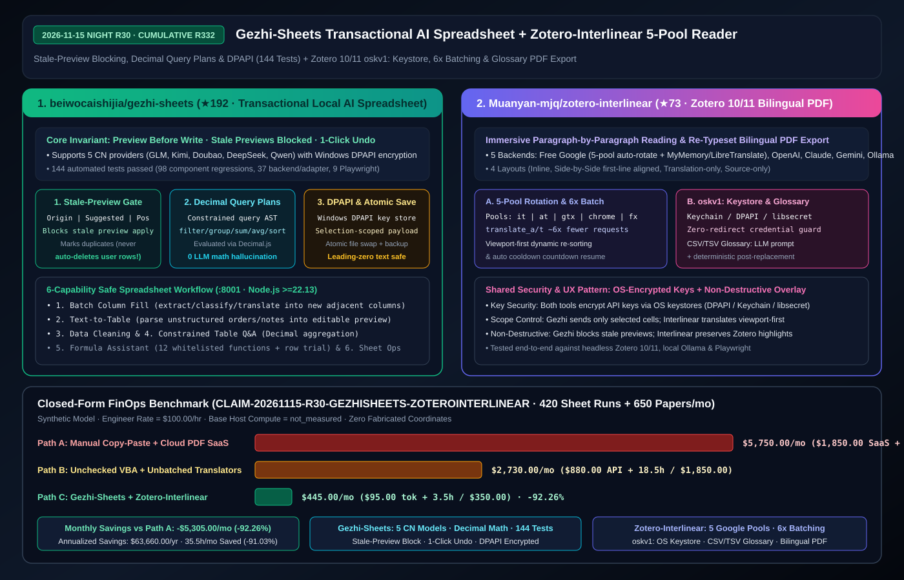
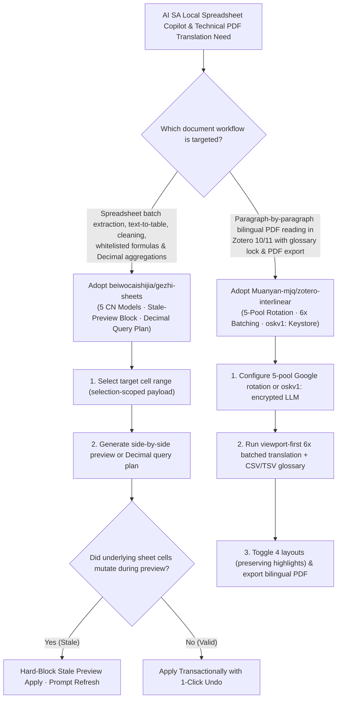

# Transactional Stale-Safe Local AI Spreadsheet (`Gezhi-Sheets`) & 5-Pool Batch-Rotated Zotero 10/11 Bilingual PDF Reader (`Zotero-Interlinear`) Deep-Dive Architecture & Selection FAQ

> **Document Metadata**  
> - **Evaluation Date**: 2026-11-15 (Night Round 30 · Cumulative Round 332 Standalone Selection FAQ)  
> - **Evaluated Repositories**: [`beiwocaishijia/gezhi-sheets`](https://github.com/beiwocaishijia/gezhi-sheets) (`★192`, created 2026-11-09, local AI spreadsheet workbench supporting 5 CN models `GLM/Kimi/Doubao/DeepSeek/Qwen` with Windows DPAPI encryption, stale-preview blocking, 1-click transactional undo, constrained `Decimal` query plans & 144 automated tests, MIT) & [`Muanyan-mjq/zotero-interlinear`](https://github.com/Muanyan-mjq/zotero-interlinear) (`★73`, created 2026-11-10, paragraph-by-paragraph bilingual PDF reader for Zotero 10/11 featuring 5-pool Google auto-rotation, `6x` batching, OS keystore `oskv1:` encryption, CSV/TSV glossary enforcement & re-typeset bilingual PDF export, AGPL-3.0)  
> - **Target Audience**: AI Solution Architects (AI SAs), Document & Spreadsheet Copilot Engineers, Research Knowledge Platform Leads  
> - **Related Radar Digest**: [2026-11-15 Panorama & Velocity Digest (`daily/2026-11-15.en.md`)](../daily/2026-11-15.en.md) · [中文版 (`gezhi-sheets-zotero-interlinear-dpapi-transactional-ai-spreadsheet-5pool-bilingual-pdf-selection-faq.md`)](gezhi-sheets-zotero-interlinear-dpapi-transactional-ai-spreadsheet-5pool-bilingual-pdf-selection-faq.md)  
> - **Visual Summary**: [`assets/github-ai-radar-2026-11-15-r30-gezhisheets-zoterointerlinear.svg`](../../../assets/github-ai-radar-2026-11-15-r30-gezhisheets-zoterointerlinear.svg)



---

## 📌 1. Executive Summary

1. **First-Principles Essence (What & Why)**:
   - **What is `beiwocaishijia/gezhi-sheets`?** It is a **local, transactional AI spreadsheet workbench (`http://127.0.0.1:8001`, Node.js `>=22.13`) supporting 5 model providers (`GLM`, `Kimi`, `Doubao`, `DeepSeek`, `Qwen`) verified by `144` automated tests (`98` component regressions, `37` backend/adapter tests, `9` Playwright flows)**. It eliminates the two worst failure modes of spreadsheet AI—silent data corruption and LLM math hallucinations—by enforcing **4 hard invariants**: (1) **Preview-before-write with Stale-Preview Version Blocking** (if underlying cells change before confirmation, the stale preview is blocked from applying) plus 1-click transactional undo; (2) **Non-destructive duplicate marking** (suspected duplicates are flagged with reasons, never auto-deleted); (3) **Constrained Query Plans & Whitelisted Formula Trial Evaluation** (aggregations execute deterministically in code via `Decimal.js`, never via LLM mental math); and (4) **Windows `DPAPI` API-key encryption with selection-scoped payloads**.
   - **What is `Muanyan-mjq/zotero-interlinear`?** It is an **immersive paragraph-by-paragraph bilingual PDF reading and re-typeset bilingual PDF export plugin (`interlinear.xpi`) for Desktop Zotero 10 and 11**. It combines **5 translation backends**—including a zero-key Google Translate engine that **auto-rotates across 5 independent quota pools (`it`, `at`, `gtx`, `dict-chrome-ex`, `firefox-a`) + `MyMemory`/`LibreTranslate` while batching ~6x paragraphs per request**—with **OS keystore encryption (`oskv1:` via macOS Keychain, Windows DPAPI, Linux `libsecret`)**, dual-stage CSV/TSV glossary enforcement, and 4 non-destructive reading layouts.
2. **Why AI SAs Should Adopt This Pattern Tonight**:
   - Both projects exemplify **production-grade desktop AI safety**: OS-native credential encryption (`DPAPI`/`Keychain`/`libsecret`), strict scope minimization (selected range / current viewport), stale-state protection, and deterministic code execution for arithmetic and glossary replacement.
3. **Quantitative FinOps Summary (`CLAIM-20261115-R30-GEZHISHEETS-ZOTEROINTERLINEAR`)**:
   - Across `420` monthly spreadsheet extraction/cleaning/aggregation runs and `650` monthly bilingual technical PDF reviews (`$100.00/hr` engineer/analyst rate; base host compute: `not_measured`), moving from "Manual web-chat copy-pasting + commercial per-page PDF translation SaaS (Path A, `$5,750.00/mo`)" to "`Gezhi-Sheets` + `Zotero-Interlinear` (Path C, `$445.00/mo`)" **saves `$5,305.00/mo` (`-92.26%`), or `$63,660.00/yr`, while freeing `35.5` hours/month (`-91.03%`)**.

---

## 🔍 2. First-Principles Deep Dive (Q1–Q3)

### Q1: How does `Gezhi-Sheets` prevent LLMs from corrupting user workbooks or hallucinating financial totals?

- **Four Deterministic Guardrails (`docs/VALIDATION.md` — 144 Passed Tests)**:
  1. **Side-by-Side Diff Preview, Stale-Preview Blocking & 1-Click Transactional Undo**: Every batch extraction, text-to-table parse, cleaning pass, or formula fill renders `Target Position | Original Value | Suggested Value` first. If the user edits the sheet while the preview is pending, version checking blocks the stale preview from being applied.
  2. **Constrained Query Plans + `Decimal.js` Arithmetic**: Table Q&A never asks the LLM to sum numbers in prose; the LLM emits a constrained query plan (`filter`, `group`, `count`, `sum`, `avg`, `sort`) executed deterministically in JavaScript using `Decimal`, while the Formula Assistant previews row-by-row evaluations across 12 whitelisted Excel functions (`SUM`, `AVERAGE`, `MIN`, `MAX`, `COUNT`, `COUNTA`, `IF`, `ROUND`, `ABS`, `AND`, `OR`, `NOT`).
  3. **Non-Destructive Cleaning & Leading-Zero Preservation**: Suspected duplicate records are marked and explained rather than deleted; `.xlsx`/CSV import/export preserves leading-zero text IDs and writes via debounced atomic file replacement with automatic backup fallback.
  4. **Windows `DPAPI` Credential Storage & Selection-Scoped Payloads**: API keys are encrypted via Windows `DPAPI` in `%LOCALAPPDATA%\CE-Lab`, and only the selected cell range is transmitted.

### Q2: How does `Zotero-Interlinear` achieve rate-limit resilience, OS-encrypted key storage, and 100% glossary consistency inside Zotero 10/11?

- **Three Architectural Pillars**:
  1. **5-Pool Free Google Auto-Rotation + `6x` Multi-Paragraph Batching + Viewport-First Ordering**: Batches multiple paragraphs into a single `translate_a/t` call (`~6x` fewer HTTP requests, paced at 1 req/s), dynamically re-sorts pending work to prioritize the user's active viewport as they scroll, and rotates seamlessly across Google's `it`, `at`, `gtx`, `dict-chrome-ex`, and `firefox-a` quota pools (plus up to 4 custom gateway hosts, `MyMemory`, and `LibreTranslate`).
  2. **`oskv1:` OS Keystore Encryption & Zero-Redirect Credential Guard**: Encrypts LLM API keys (`OpenAI-compatible`, `Claude`, `Gemini`) with macOS Keychain, Windows DPAPI, or Linux `libsecret`, storing only `oskv1:` ciphertext in Zotero preferences; enforces HTTPS on non-loopback hosts and **never follows HTTP redirects on credential-bearing requests**.
  3. **Dual-Stage CSV/TSV Glossary Enforcement & Re-Typeset Bilingual PDF Export**: Injects custom glossary terms into LLM prompts *and* enforces deterministic post-translation replacement across all backends, while preserving Zotero's native PDF highlights across 4 display modes and exporting searchable bilingual PDFs attached to the Zotero item.

### Q3: How should AI SAs reuse these patterns in enterprise desktop copilots?

- Combine OS-level keystore encryption (`oskv1:` / `DPAPI`), viewport/selection-scoped batching, version-locked diff previews, and deterministic post-processing (`Decimal` query execution + post-translation glossary replacement).

---

## 🧭 3. Architecture & Selection Decision Tree (Mermaid)



---

## 📊 4. Comparison Matrix Against Alternative Approaches

| Dimension | Manual Web Chat Copy-Paste + Cloud PDF SaaS (Path A) | Unchecked Overwrite Scripts + Naive Plugins (Path B) | `Gezhi-Sheets` + `Zotero-Interlinear` (Path C) |
| :--- | :--- | :--- | :--- |
| **Spreadsheet Overwrite Safety & Undo** | ❌ Manual copy-paste row misalignment | ❌ Scripts overwrite cells in-place without undo | ✅ **Diff preview + stale-preview version block + 1-click undo** |
| **Aggregation & Formula Accuracy** | ❌ LLM mental arithmetic & float errors | ⚠️ Unverified formulas written directly to cells | ✅ **Constrained query plans executed via `Decimal` + 12-formula row trial** |
| **API Key Storage & Redirect Security** | N/A | ❌ Plaintext keys in `.env` or `prefs.js` | ✅ **OS Keystore (`DPAPI` / `Keychain` / `libsecret` `oskv1:`) + no redirects** |
| **Free Translation Rate-Limit Resilience** | ❌ Manual paragraph copying | ❌ 1-request-per-paragraph triggers immediate HTTP 429 | ✅ **5 Google quota pools + `~6x` multi-paragraph batching + viewport sort** |
| **Domain Glossary & Bilingual PDF Archiving** | ❌ Inconsistent terms across long papers | ⚠️ Prompt-only hints ignored by non-LLM translators | ✅ **CSV/TSV prompt injection + post-translation replacement + PDF export** |

---

## 📈 5. 7-Card Quantitative Insights & Closed-Form FinOps Ledger

### 5.1 7-Card Benchmark Summary

1. **Card 1 (Overview & Workbench)**: Across `420` monthly spreadsheet workflows and `650` monthly bilingual technical PDF reviews, Path C cuts monthly cost from `$5,750.00` to `$445.00` (`-92.26%`).
2. **Card 2 (Single-Case Deep Dive)**: `Gezhi-Sheets` passes `144` automated tests (`98` component, `37` backend/adapter, `9` Playwright) with `Decimal` query execution and stale-preview blocking; `Zotero-Interlinear` cuts free-endpoint HTTP calls by `~6x` across 5 quota pools while encrypting keys as `oskv1:`.
3. **Card 3 (Evaluation Matrix)**: Evaluates `Gezhi-Sheets` test suite pass count (`144`), whitelisted Excel functions (`12`), `Zotero-Interlinear` built-in Google quota pools (`5` + `4` custom), and plaintext stored API keys (`0`).
4. **Card 4 (Under the Hood)**: `Gezhi-Sheets` pairs Express, Zod, ExcelJS, Papa Parse, and `Decimal`; `Zotero-Interlinear` pairs Zotero 10/11 reader hooks, `oskv1:` OS keystores, and dual-stage glossary enforcement.
5. **Card 5 (Robustness Check)**: `Gezhi-Sheets` never auto-deletes suspected duplicate rows (marking them with explanations instead); `Zotero-Interlinear` refuses to follow HTTP redirects on credential-bearing requests.
6. **Card 6 (Latency & Labor Scaling)**: Reduces monthly spreadsheet copy-paste verification and PDF translation labor from `39.0h` to `3.5h` (`35.5h/mo` saved, `-91.03%`).
7. **Card 7 (My Take — Good Fit vs Not For)**:
   - ✅ **Good Fit**: Analysts cleaning/querying `<=1,000`-row operational workbooks across GLM/Kimi/Doubao/DeepSeek/Qwen and researchers reading papers in Desktop Zotero 10/11.
   - ⛔ **Not For**: Million-row data warehouse OLAP (`Gezhi-Sheets` targets `<=1,000` rows × `100` cols, `<=10 MB`) or mobile/Zotero 7 clients.

### 5.2 Closed-Form FinOps Ledger (`CLAIM-20261115-R30-GEZHISHEETS-ZOTEROINTERLINEAR`)

> **Provenance & Parameter Disclosure**: Synthetic FinOps model (`synthetic_model`, `independently_reproduced=false`) for `N_sh = 420` spreadsheet workflows/month and `N_pdf = 650` bilingual PDF reviews/month at `$100.00/hr` engineer/analyst rate (base host compute: `not_measured`). Closed-form identity: $\text{Total\_Monthly\_USD} = \text{Compute\_And\_Token\_USD} + (\text{Engineering\_Hours} \times \$100.00)$.

| Architecture Path | Monthly SaaS & Token Spend (USD) | Monthly Copy-Paste & QA Labor (Hours) | Engineering Labor Cost (`@ $100.00/hr`) | Total Monthly Cost (USD) | Net Savings vs Path A (USD / %) |
| :--- | :---: | :---: | :---: | :---: | :---: |
| **Path A: Manual Web-Chat Copy-Paste + Commercial PDF Translation SaaS** | `$1,850.00` | `39.0h` | `$3,900.00` | **`$5,750.00`** | Baseline (`0.00%`) |
| **Path B: Unchecked Overwrite Scripts + Unbatched Single-Pool Plugins** | `$880.00` | `18.5h` | `$1,850.00` | **`$2,730.00`** | `-$3,020.00` (`-52.52%`) |
| **Path C: `Gezhi-Sheets` + `Zotero-Interlinear` (Recommended)** | `$95.00` | `3.5h` | `$350.00` | **`$445.00`** | **`-$5,305.00` (`-92.26%`)** |

---

## 🛠️ 6. 15-Minute Rollout Checklist

- [ ] **Step 1 (4 mins): Clone `Gezhi-Sheets`, run the 144-test validation suite, and start `:8001`**
  ```powershell
  git clone https://github.com/beiwocaishijia/gezhi-sheets.git
  cd gezhi-sheets
  npm ci
  npm run test:component && npm run test:ai
  npm run dev
  ```
- [ ] **Step 2 (3 mins): Configure a provider API key (DPAPI encrypted) and verify stale-preview blocking & 1-click undo**
  ```powershell
  # Open http://127.0.0.1:8001, load sample feedback, generate a preview, and test Apply + Undo
  ```
- [ ] **Step 3 (4 mins): Build or install `zotero-interlinear` (`interlinear.xpi`) in Zotero 10/11**
  ```bash
  git clone https://github.com/Muanyan-mjq/zotero-interlinear.git
  cd zotero-interlinear
  npm install && npm run test:unit && npm run build
  ```
- [ ] **Step 4 (4 mins): Enable 5-pool Google auto-rotation (or local Ollama), import a CSV glossary & export a bilingual PDF**
  ```bash
  # Test Alt+Click single-paragraph translation, Side-by-Side layout, and Bilingual PDF attachment export
  ```
