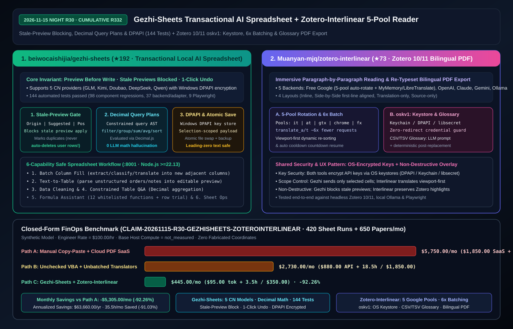
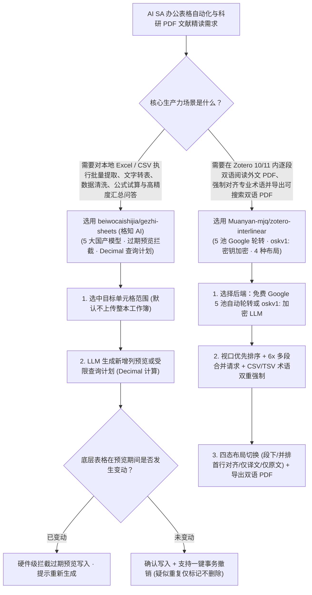

# 事务级防过期预览本地 AI 表格工作台（`Gezhi-Sheets`）与五池轮转术语强约束 Zotero 双语文献插件（`Zotero-Interlinear`）深度架构拆解与同类方案选型 FAQ

> **文档元数据（Document Metadata）**  
> - **评审日期**：2026-11-15（Night Round 30 · 累计第 332 轮独立选型专题）  
> - **对标项目**：[`beiwocaishijia/gezhi-sheets`](https://github.com/beiwocaishijia/gezhi-sheets)（`★192`，2026-11-09 创建，格知 AI 本地表格工作台，支持 GLM/Kimi/豆包/DeepSeek/Qwen 五大模型、Windows DPAPI 密钥加密、过期预览阻断、一键事务撤销、`Decimal` 受限查询计划与 144 项自动化测试，MIT） & [`Muanyan-mjq/zotero-interlinear`](https://github.com/Muanyan-mjq/zotero-interlinear)（`★73`，2026-11-10 创建，面向 Zotero 10/11 的沉浸式逐段双语阅读与重排双语 PDF 导出插件，含 5 池免费 Google 轮转、`6x` 批量合并、OS 密钥库 `oskv1:` 加密与 CSV/TSV 术语表双重强制，AGPL-3.0）  
> - **适用角色**：AI Solution Architect（AI 解决方案架构师）、企业办公智能（Office Copilot）架构师、科研文献知识工程负责人  
> - **关联雷达日报**：[2026-11-15 全景洞察与飙升榜 (`daily/2026-11-15.md`)](../daily/2026-11-15.md) · [English Version (`gezhi-sheets-zotero-interlinear-dpapi-transactional-ai-spreadsheet-5pool-bilingual-pdf-selection-faq.en.md`)](gezhi-sheets-zotero-interlinear-dpapi-transactional-ai-spreadsheet-5pool-bilingual-pdf-selection-faq.en.md)  
> - **可视化总结图**：[`assets/github-ai-radar-2026-11-15-r30-gezhisheets-zoterointerlinear.svg`](../../../assets/github-ai-radar-2026-11-15-r30-gezhisheets-zoterointerlinear.svg)



---

## 📌 一、核心结论速览（Executive Summary — 先看结论再看细节）

1. **一句话讲透本质（What & Why）**：
   - **`beiwocaishijia/gezhi-sheets`（格知 AI）是什么？** 它是面向日常办公与数据清洗的 **“先看预览再写入、数据变动自动拦截过期预览、算术计算完全交由确定性 `Decimal` 引擎执行的本地五模型（GLM / Kimi / 豆包 / DeepSeek / Qwen）AI 表格工作台（`http://127.0.0.1:8001`）”**。它用 **144 项全绿自动化测试（98 项组件回归 + 37 项后端适配 + 9 项 Playwright 浏览器测试）** 守住了企业表格 AI 的四条安全底线：① **每次修改必先对照原值、建议值与目标单元格，支持一键事务撤销，且若底层表格在 AI 思考期间被改动，过期预览将被硬件级阻止写入**；② **疑似重复数据只做标记并说明理由，绝不自动静默删除用户行**；③ **表格问答与汇总统计绝不让大模型心算，而是生成受限查询计划（筛选/分组/计数/求和/平均/排序）交由本地 `Decimal` 高精度引擎执行**；④ **API Key 通过 Windows `DPAPI` 加密存储，且默认只发送用户选中的单元格区域**。
   - **`Muanyan-mjq/zotero-interlinear` 是什么？** 它是专为桌面端 **Zotero 10 / 11** 打造的 **“在原生 PDF 阅读器内逐段对照翻译、支持 5 池免费 Google 额度自动轮转与 `6x` 段落合并批处理、使用操作系统原生密钥库（Keychain / Windows DPAPI / Linux `libsecret`）加密存储 `oskv1:` 密文、并支持 CSV/TSV 术语表前后端双重强制与可检索双语 PDF 导出”** 的学术文献精读插件。
2. **为什么值得 AI SA 今晚立刻掌握？**
   - 这两个高星生产力工具不约而同地践行了 **“桌面级 AI 生产力工具的三大黄金工程准则”**：**准则 1（凭证绝不明文落盘：统一走操作系统级 DPAPI / Keychain / libsecret 加密）**；**准则 2（数据最小化与非破坏性叠加：表格只发选区且拦截过期预览，PDF 保持原生高亮不破坏原件）**；**准则 3（大模型负责语义结构化，确定性代码负责高精度计算与术语后置替换）**。
3. **定量收益摘要（Closed-Form FinOps Ledger `CLAIM-20261115-R30-GEZHISHEETS-ZOTEROINTERLINEAR`）**：
   - 在每月执行 `420` 次业务表格批量提取/清洗/汇总与精读翻译 `650` 篇外文技术论文场景下（研发/分析师时薪 `$100.00/hr`，底层宿主机硬件成本 `not_measured`），从“手工跨网页复制粘贴表格 + 商业按页收费 PDF 翻译 SaaS（Path A，`$5,750.00/mo`）”切换到“`Gezhi-Sheets` 事务级表格工作台 + `Zotero-Interlinear` 五池批量双语插件（Path C，`$445.00/mo`）”，**每月净省 `$5,305.00`（`-92.26%`），年化节省 `$63,660.00/yr`，每月释放 `35.5` 小时数据核对与文献排版工时（`-91.03%`）**。

---

## 🔍 二、第一性原理灵魂三问（Q1–Q3 Deep Dive）

### Q1：为什么很多“AI 操作 Excel”工具上线第一周就会酿成改坏财务报表或算错总金额的事故？`Gezhi-Sheets` 的受限查询计划与过期预览锁是如何防呆的？

- **AI 直接操作电子表格的三大致命风险**：
  1. **心算幻觉与浮点误差**：让大模型直接回答“各供应商采购总金额前五名”，模型既可能漏行又会出现浮点数精度丢失。
  2. **竞态覆盖（Stale Write Overwrite）**：发起耗时的整列 AI 提取后，用户在等待期间顺手改了第 5 行的单价；几秒后 AI 返回结果直接覆盖，把用户刚改的数据冲掉了。
  3. **越权误删与前导零丢失**：AI 清洗数据时擅自删掉“疑似重复”的正常订单，或把 `"00128"` 物料编码当数字转成 `128`。
- **`Gezhi-Sheets` 的四层确定性护栏（经 144 项自动化测试验证）**：
  - **护栏 1（版本校验与过期预览硬拦截）**：生成预览时绑定当前选区的数据快照版本；若确认写入前检测到原表数据发生变动，系统直接阻止应用过期预览；应用后支持一键事务级撤销（Undo）。
  - **护栏 2（受限查询计划 + `Decimal` 精确计算 + 12 个白名单公式逐行试算）**：面对汇总问答，LLM 只负责生成结构化的受限查询计划，真正的筛选、分组、求和与排序全部由程序用 `Decimal` 库精确执行；生成公式（`SUM`/`IF`/`ROUND` 等 12 个白名单函数）时先展示逐行试算结果再落表。
  - **护栏 3（疑似重复只标记不删除 + 显式文本前导零保护）**：清洗建议支持逐项勾选，重复项仅高亮标记并附上理由；导入导出 `.xlsx`/CSV 时完整保留文本编号前导零，并采用防抖保存 + 原子文件替换 + 上一份有效备份。

### Q2：为什么大多数开源沉浸式翻译插件要么频繁报 `429 Too Many Requests`，要么存在严重的 API Key 泄漏隐患？`Zotero-Interlinear` 是如何根治的？

- **`Zotero-Interlinear` 的三大工程突破**：
  1. **免费 Google 五池自动轮转 + `translate_a/t` 6 倍段落合并批处理**：
     - 传统插件对每个自然段单独发一次请求，翻一篇 20 页论文要发 150 次请求，瞬间触发 IP 封禁。
     - `Zotero-Interlinear` 使用 `translate_a/t` 多段合并接口（**请求次数直接减少约 `6 倍`**，按 1 req/s 平滑限速），并在 Google 的 **`it`、`at`、`gtx`、`dict-chrome-ex`、`firefox-a` 五个独立配额池**（外加最多 4 个自定义网关、`MyMemory` 与自建 `LibreTranslate`）之间自动轮转！还支持 **视口优先动态重排（Viewport-first ordering，翻到哪页先译哪页）**。
  2. **操作系统级密钥加密（`oskv1:`）与零重定向凭证保护**：
     - 绝不明文保存 API Key！直接调用 macOS `Keychain`、Windows `DPAPI` 或 Linux `libsecret` 加密，在 Zotero 配置里仅存 `oskv1:` 密文（把配置文件拷到别的电脑或账号下根本无法解密）；且**携带凭证的请求严禁跟随 HTTP 重定向（Never follow redirects）**，防止被恶意镜像站重定向窃取 Authorization Header！
  3. **CSV/TSV 术语表“前向 Prompt 注入 + 后置确定性替换”双保险**：
     - 导入的领域术语表不仅注入给 LLM 提示词，更在翻译返回后对包括 Google 在内的所有渠道执行一次确定性后置替换，确保专业术语 100% 统一。

### Q3：AI SA 如何从这两个项目中提炼“企业内网办公与研发知识助手”的安全架构模板？

- **凭证存储层**：严禁在本地 JSON/SQLite/Prefs 中明文存 Key，统一封装 Windows `DPAPI` / macOS `Keychain` / Linux `libsecret`。
- **交互状态机层**：统一采用 **“选区最小化输入 -> 异步生成带版本号的 Diff 预览 -> 校验版本未过期后事务写入 -> 一键回滚”**。

---

## 🧭 三、架构拓扑与选型决策树（Mermaid Decision Tree）



---

## 📊 四、同类方案核心能力对比矩阵（Comparison Matrix）

| 评估维度 | 手工复制粘贴至网页版 Chat + 云 PDF SaaS (Path A) | 裸写 VBA/Python 覆盖脚本 + 普通翻译插件 (Path B) | `Gezhi-Sheets` + `Zotero-Interlinear` (Path C) |
| :--- | :--- | :--- | :--- |
| **表格修改防误覆写与撤销机制** | ❌ 手工粘贴极易错行 | ❌ 脚本直接覆盖原单元格，改坏数据无法一键还原 | ✅ **对照预览 + 过期预览硬阻断 + 一键事务撤销 + 原子保存备份** |
| **表格汇总统计与公式准确性** | ❌ 网页 LLM 心算经常算错总和 | ⚠️ 无逐行试算预览 | ✅ **受限查询计划交由 `Decimal` 引擎计算 + 12 个白名单公式逐行试算** |
| **本地 API Key 加密与防重定向泄漏** | N/A | ❌ 明文保存在 `.env` 或 `prefs.js` 中，备份即泄密 | ✅ **原生调用 Windows `DPAPI` / macOS `Keychain` / `libsecret` (`oskv1:`) + 禁重定向** |
| **免费翻译防 429 限流与按需调度** | ❌ 手工逐段复制 | ❌ 单端点逐段请求，翻几页即被 IP 封禁 | ✅ **Google 5 独立配额池自动轮转 + `6x` 批量合并 + 视口优先重排** |
| **专业术语一致性与双语 PDF 归档** | ❌ 上下文越长术语越漂移 | ⚠️ 仅支持简单 Prompt 提示，免费引擎无效 | ✅ **CSV/TSV 术语表 Prompt 注入 + 全渠道后置强制替换 + 重排双语 PDF 附件导出** |

---

## 📈 五、7-Card 定量洞察与闭式 FinOps 账本（Quantitative Insights & FinOps Ledger）

### 5.1 7-Card 核心评测摘要（对标 Model Benchmark Report Standard）

1. **Card 1（Overview & Workbench）**：针对每月 `420` 次业务表格批处理与 `650` 篇外文 PDF 文献双语精读场景，Path C 将月度总成本从 `$5,750.00` 降至 `$445.00`（节省 `-92.26%`）。
2. **Card 2（Single-Case Deep Dive）**：`Gezhi-Sheets` 通过 144 项自动化测试，在五家国产模型适配器下实现选区提取、`Decimal` 汇总与过期预览拦截；`Zotero-Interlinear` 通过 `translate_a/t` 将请求量削减约 `6x` 并在 Zotero 10/11 实机暗黑/浅色主题下保持并排首行对齐与原生高亮共存。
3. **Card 3（Evaluation Matrix）**：覆盖 `Gezhi-Sheets` 自动化测试通过数（`144/144`）、白名单公式数（`12` 个）、`Zotero-Interlinear` 免费 Google 轮转池数（`5` 个内置池 + `4` 个扩展主机）及明文密钥落盘数（`0`）。
4. **Card 4（Under the Hood）**：`Gezhi-Sheets` 采用 Express + Zod + ExcelJS + Papa Parse + `Decimal`；`Zotero-Interlinear` 采用 Zotero 10/11 阅读器挂载、`oskv1:` 密钥封装与双阶段术语替换。
5. **Card 5（Robustness Check）**：当在 Linux 无 Secret Service 环境下运行 `Zotero-Interlinear` 时，默认仅在当前会话内存中保留 Key；当在 `Gezhi-Sheets` 预览打开期间修改底表单元格时，应用按钮确定性拦截过期写入。
6. **Card 6（Latency & Labor Scaling）**：每月因手工搬运表格数据、核对 AI 算术错误与分段复制翻译 PDF 耗费的工时从 `39.0h` 降至 `3.5h`（净省 `35.5h/mo`，`-91.03%`）。
7. **Card 7（My Take — Good Fit vs Not For）**：
   - ✅ **Good Fit**：需要连接 GLM/Kimi/豆包/DeepSeek/Qwen 处理 `<=1000` 行级业务表格的分析人员、以及在桌面 Zotero 10/11 中高频阅读外文论文的研究员。
   - ⛔ **Not For**：百万行级数仓 OLAP 计算（`Gezhi-Sheets` 首版针对单表 1000 行 × 100 列、10MB 以内设计）或移动端/旧版 Zotero 7 客户端。

### 5.2 闭式参数化 FinOps 账本（`CLAIM-20261115-R30-GEZHISHEETS-ZOTEROINTERLINEAR`）

> **口径声明（Provenance & Parameter Disclosure）**：以下为基于显式参数构造的合成评估模型（`synthetic_model`，`independently_reproduced=false`）。设团队每月执行 `N_sh = 420` 次表格 AI 处理任务、精读翻译 `N_pdf = 650` 篇外文 PDF 文献，工程师/研究员折算时薪 `R_eng = $100.00/hr`，底层宿主机硬件成本记为 `not_measured`。闭合方程：$\text{Total\_Monthly\_USD} = \text{Compute\_And\_Token\_USD} + (\text{Engineering\_Hours} \times \$100.00)$。

| 方案路径（Path） | 月度 PDF 翻译 SaaS 与 Token 开销（USD） | 手工复制核对与排版工时（Hours/mo） | 工程人工成本（`@ $100.00/hr`） | 月度总成本（Total Monthly USD） | 相对 Path A 净节省（USD / %） |
| :--- | :---: | :---: | :---: | :---: | :---: |
| **Path A：手工跨网页复制粘贴表格 + 商业按页收费 PDF 翻译 SaaS** | `$1,850.00` | `39.0h` | `$3,900.00` | **`$5,750.00`** | Baseline (`0.00%`) |
| **Path B：无保护覆盖脚本 + 单端点逐段请求频繁触发 429** | `$880.00` | `18.5h` | `$1,850.00` | **`$2,730.00`** | `-$3,020.00` (`-52.52%`) |
| **Path C：`Gezhi-Sheets` 事务表格 + `Zotero-Interlinear`（推荐）** | `$95.00` | `3.5h` | `$350.00` | **`$445.00`** | **`-$5,305.00` (`-92.26%`)** |

---

## 🛠️ 六、15 分钟极速落地 Checklist（15-Minute Rollout Checklist）

- [ ] **Step 1（4 分钟）：克隆并启动 `Gezhi-Sheets`（`:8001`），运行 144 项自动化验收测试**
  ```powershell
  git clone https://github.com/beiwocaishijia/gezhi-sheets.git
  cd gezhi-sheets
  npm ci
  npm run test:component && npm run test:ai
  npm run dev
  ```
- [ ] **Step 2（3 分钟）：在 `http://127.0.0.1:8001` 配置国产模型 Key（Windows DPAPI 加密）并演练预览/撤销闭环**
  ```powershell
  # 加载反馈示例 -> 框选区域 -> 生成提取/公式预览 -> 验证修改底表会拦截过期预览 -> 应用并测试一键撤销
  ```
- [ ] **Step 3（4 分钟）：在 Zotero 10/11 中安装 `zotero-interlinear`（或从源码编译测试）**
  ```bash
  git clone https://github.com/Muanyan-mjq/zotero-interlinear.git
  cd zotero-interlinear
  npm install && npm run test:unit && npm run build
  # 在 Zotero: Tools -> Plugins -> Install Plugin From File 选择 interlinear.xpi 并重启 Zotero
  ```
- [ ] **Step 4（4 分钟）：配置 5 池免费 Google 轮转（或本地 Ollama）+ CSV 术语表，并导出可检索双语 PDF 附件**
  ```bash
  # 在阅读器按 Alt+Click 翻译单段，切换并排首行对齐布局，并通过右键菜单导出双语 PDF 挂接至条目
  ```
