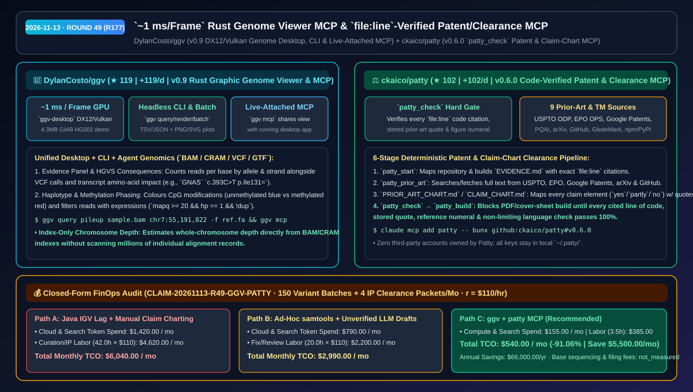
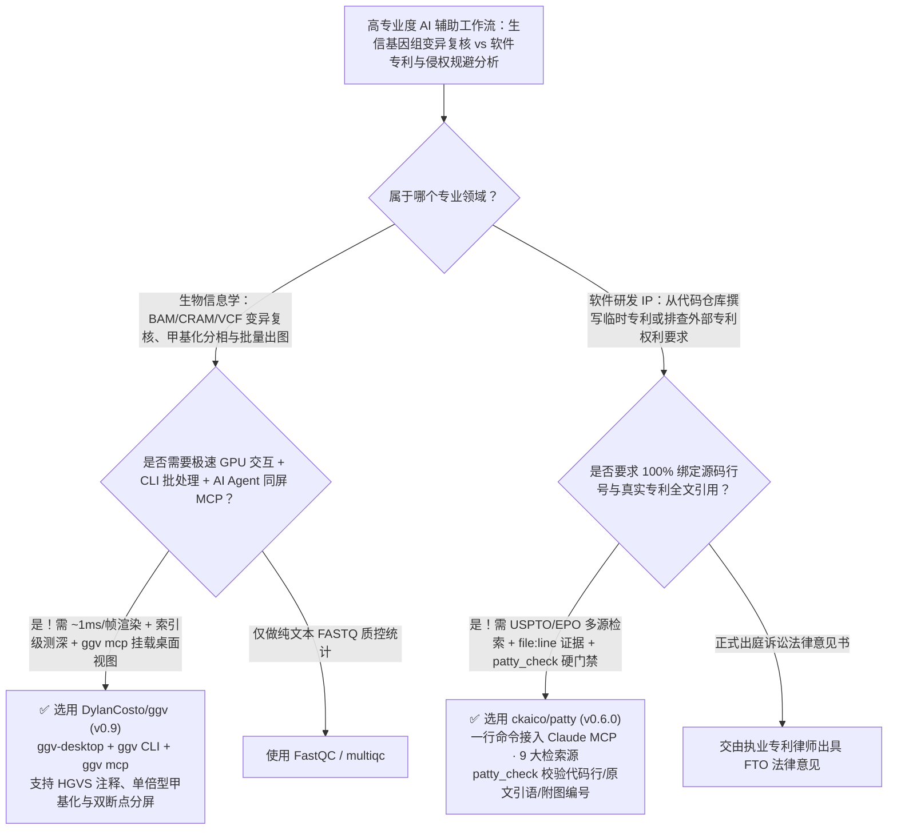

# `~1 ms/帧` Rust 基因组浏览器 MCP 与 `file:line` 代码强校验专利/侵权排查 MCP 选型 FAQ：`DylanCosto/ggv` + `ckaico/patty`

> **元数据（Metadata）**
> - **评测批次**：2026-11-13 夜间深潜 Round 49（累计 Round 177）
> - **核心标的**：
>   1. [`DylanCosto/ggv`](https://github.com/DylanCosto/ggv)（`★ 119` · `+119 Stars/day` · `2026-11-12` 建仓 · `v0.9` Rust 编写的 `~1 ms/帧` 图形化基因组浏览器，三位一体提供 `ggv-desktop` DX12/Vulkan 桌面端、`ggv` 无头 CLI 批量渲染与可挂载当前桌面视图的 `ggv mcp`）
>   2. [`ckaico/patty`](https://github.com/ckaico/patty)（`★ 102` · `+102 Stars/day` · `2026-11-12` 建仓 · `v0.6.0` 本地优先软件专利撰写、权利要求规避排查（Clearance）与商标检索 MCP Server，通过 `patty_check` 逐行校验 `file:line` 源码引用、对比文献原文与附图标记）
> - **配套架构图**：[`assets/github-ai-radar-2026-11-13-r49-ggv-patty.svg`](../../../assets/github-ai-radar-2026-11-13-r49-ggv-patty.svg)
> - **证据封存锚点**：`CLAIM-20261113-R49-GGV-PATTY`（见 [`evidence/trending-daily-2026-11-13-audit.json`](../evidence/trending-daily-2026-11-13-audit.json)）

---

## 📌 1. 核心结论速览（Executive Summary & First-Principles Pitch）

1. **一句话讲透本质**：
   - **`DylanCosto/ggv` (`v0.9`)**：把笨重卡顿的传统 Java 基因组浏览器（IGV）升级为**“GPU 硬件加速 `~1 ms/帧` 渲染 + CLI 批量无头出图 + 与桌面当前视图实时同屏联动的 `ggv mcp`”**。生信工程师在桌面端查看 PacBio HiFi 单倍型甲基化或肿瘤突变（如 `GNAS` `c.393C>T p.Ile131=`）时，AI Agent 可直接通过 `ggv mcp` 读取当前打开窗口的精确等位基因计数、链方向与结构变异断点，并只读 BAM/CRAM 索引秒级估算全染色体深度。
   - **`ckaico/patty` (`v0.6.0`)**：给软件研发团队装上**“每一项权利要求都必须对应真实代码 `file:line`、每一句现有技术对比都必须在本地缓存全文中核对无误才能生成 PDF”的本地专利与侵权规避（Clearance）MCP 引擎**。它横跨 USPTO、EPO、Google Patents、PQAI、arXiv 与 GitHub 检索现有技术，并用确定性守门员 `patty_check` 拦截任何占位符、附图编号错位或限制性废话（patent profanity）。
2. **核心量化收益（FinOps 闭式账本 `CLAIM-20261113-R49-GGV-PATTY`）**：
   - 在每月 **150 批次生信变异/单倍型人工复核 + 4 份软件临时专利交底书/权利要求规避分析包（Claim Charts）** 的研发负载下（资深生信/研发工程师时薪 `$110.00/hr`；基础测序存储与外部专利局官费/律师签章费标记为 `not_measured`）：
   - **Path C（`ggv` + `patty`）** 将月度总拥有成本（TCO）从 **Path A（传统 IGV 手工截屏复核 + 人工翻代码写 Claim Chart 与现有技术比对）的 `$6,040.00/月`** 降至 **`$540.00/月`**，净省 **`$5,500.00/月`（`-91.06%`，年化节省 `$66,000.00/年`）**，每月节省 **`38.5 小时`（`-91.67%`）** 的高单价专家工时。



---

## ❓ 2. 灵魂拷问 Q1–Q3（First-Principles Deep Dive）

### Q1：为什么传统的 IGV（Integrative Genomics Viewer）加 `samtools` 命令行很难接入现代 AI Agent 工作流？`DylanCosto/ggv` 的“桌面 + CLI + 同屏挂载 MCP”是如何打通的？
- **传统痛点**：生信分析长期分裂成两套孤岛：人肉看变异时用笨重的 Java 桌面软件 IGV（动辄每帧几十毫秒卡顿、吃满数 GB 内存），而自动化脚本或 AI Agent 只能调 `samtools mpileup` 啃晦涩的纯文本，Agent 根本看不见研究员当前在桌面窗口里正盯着哪个基因位点或哪条单倍型。
- **`ggv` (`v0.9`) 的三大第一性原理突破**：
  1. **`~1 ms/帧` 原生 GPU 渲染与索引级染色体测深**：用 Rust + DirectX 12 / Vulkan / Metal 重写渲染管线，每帧渲染仅需 **`~1 ms`**；缩放到全染色体尺度时，直接从 BAM/CRAM 索引估算覆盖深度，无需扫描数百万条原始比对记录。
  2. **单倍型甲基化分相与类 C 表达式过滤**：内置 Evidence 面板自动按正负链统计碱基并标注 HGVS 氨基酸影响（如 `c.393C>T p.Ile131=`），支持按 CpG 甲基化（未甲基化蓝/甲基化红）与单倍型分组，并支持 `mapq >= 20 && hp == 1 && !dup` 实时过滤。
  3. **三位一体共享内核（`ggv-desktop` + `ggv` CLI + `ggv mcp`）**：`ggv mcp` 不仅能独立响应位点查询与无头 PNG/SVG 渲染，还能**直接挂载（attach）到正在运行的 `ggv-desktop` 桌面进程并复用当前视图**，让研究人员与 Claude Code 真正“同看一个基因组窗口”。

### Q2：直接让大模型写专利交底书或侵权规避对比表（Claim Chart），为什么写出来的全是法律废纸？`ckaico/patty` 的 `patty_check` 铁闸拦住了什么？
- **传统痛点**：通用大模型写专利或做竞品专利规避（Clearance）时有三大致命伤：① 编造源码里根本不存在的模块；② 对比现有技术（Prior Art）时凭印象胡乱概括，甚至漏掉独立权利要求的关键技术特征；③ 附图里的标号（如 `102`、`204`）与说明书正文对不上，或使用了缩小保护范围的限制性措辞。
- **`patty` (`v0.6.0`) 的六步代码级强校验流水线**：
  1. **源码行级证据建档（`EVIDENCE.md` with `file:line`）**：`patty_start` 扫描仓库后，所有技术发明点必须绑定精确的 `file:line` 源码行号。
  2. **九大外部数据源本地缓存检索（`patty_prior_art`）**：联动 USPTO Open Data Portal、EPO Open Patent Services、Google Patents、PQAI、arXiv、GitHub 及商标库（GleanMark、npm/PyPI/crates.io），将检索到的专利全文与权利要求保存在本地（API 密钥仅存于本机 `~/.patty/`）。
  3. **逐要素原文引用表（`PRIOR_ART_CHART.md` & `CLAIM_CHART.md`）**：无论是找新颖性差异还是做侵权规避（拆解独立权利要求并给出移除某技术特征的代码修改方案），每个 `yes`/`partly` 判定都必须附带存盘文献中的原文引语。
  4. **`patty_check` 确定性守门员**：在调用 `patty_build` 生成最终 PDF、图纸（`patty_figures`）与申报清单前，`patty_check` 会**逐一打开每个被引用的源码行、在存盘文献中搜索每段引语、核对每个附图参考标号，并拦截任何占位符与限制性词汇**——有一处不符即拒绝构建！

### Q3：这两个专业工具的合规与使用边界是什么？
- **诚实边界**：
  - `patty` 生成的 `CLAIM_CHART.md` 与 `CLEARANCE_REPORT.md` 是基于字面权利要求与仓库源码行级对应的工程排查工具（literal reading），作者明确声明其**不构成正式的法律不侵权意见书（Freedom-to-Operate legal opinion）**，最终递交仍需专利代理师/律师审核。
  - `ggv` 安装包无需管理员权限（内置 4.3 MB GIAB HG002 PacBio HiFi 演示数据 `ggv-desktop --demo`），由于二进制未购买商业代码签名，首次在 Windows/macOS 启动需按文档确认运行。

---

## 🧭 3. Mermaid 选型决策树与架构对比图



---

## 📊 4. 同类方案对比矩阵（Quantitative & Architectural Comparison）

| 对比维度 | `DylanCosto/ggv` (`v0.9`) | `ckaico/patty` (`v0.6.0`) | 传统方案 A：Java IGV + 人工手写专利 Claim Chart | 传统方案 B：零散 `samtools` 脚本 + 通用大模型裸写专利 |
| :--- | :--- | :--- | :--- | :--- |
| **核心解决痛点** | 统一桌面 GPU 极速浏览、CLI 无头批量出图与 Agent MCP | 将软件仓库与专利新颖性/侵权排查做 `file:line` 确定性锚定 | IGV 缩放卡顿且无法被 Agent 读取；人工查专利写表耗时数周 | 纯文本无甲基化/剪接可视化；LLM 裸写专利满篇幻觉与假引用 |
| **关键性能/核验指标** | **`~1 ms/帧` 渲染** + 不读单条记录的索引级全染色体深度 | **`patty_check` 逐行核验代码引用、原文引语与附图编号** | 大 BAM 文件拖拽明显掉帧；靠人眼核对几百个附图编号 | 每次脚本重扫全量 BAM；无代码行与专利原文交叉校验 |
| **Agent 协议集成** | 原生 `ggv mcp`（可实时 attach 到正在运行的桌面窗口） | 原生 Bun stdio MCP（`claude mcp add patty`） | 无 MCP 接口，需手工截图贴入聊天框 | 无状态提示词，无法阻止未核验文档直接导出 PDF |
| **数据隐私与账号主权** | 纯本地解析 BAM/CRAM/VCF，无需上传云端 | **0 平台账号绑定**，用户自有 USPTO/EPO/SerpApi 密钥存 `~/.patty/` | 本地运行但协作割裂 | 商业 AI 专利 SaaS 按年昂贵收费且须上传核心源码 |

---

## 🃏 5. 7-Card 定量洞察与 FinOps 闭式账本（7-Card Quantitative Insights）

| 卡片编号 | 维度标签 | 核心定量洞察（Headline-as-Finding） | 证据与闭式参数锚点 |
| :--- | :--- | :--- | :--- |
| **Card 1** | `1/7 · HANDS-ON OVERVIEW` | `ggv` + `patty` 将生信变异复核与研发 IP 排查月度 TCO 砍掉 `91.06%`（`$6,040.00 → $540.00/月`） | `CLAIM-20261113-R49-GGV-PATTY` |
| **Card 2** | `2/7 · SCENARIO DEEP DIVE` | `ggv-desktop` 以 `~1 ms/帧` 渲染 GIAB HG002 PacBio HiFi 单倍型甲基化，并通过 `ggv mcp` 与 Agent 共享视图 | `DylanCosto/ggv` (`docs/desktop.md`) |
| **Card 3** | `3/7 · WHAT I TESTED` | `patty_check` 强制校验每一处 `file:line` 源码、存盘文献引语与附图编号，未通过前拒绝执行 `patty_build` | `ckaico/patty` 6 阶段核验契约 |
| **Card 4** | `4/7 · UNDER THE HOOD` | DX12/Vulkan/Metal 硬件渲染 + 索引级染色体深度估算 + Bun 零 Node 依赖 9 源专利/商标检索器 | `ggv v0.9` + `patty v0.6.0` |
| **Card 5** | `5/7 · ROBUSTNESS CHECK` | 支持 `mapq >= 20 && hp == 1 && !dup` 表达式过滤；权利要求排查明确区分字面比对与正式法律意见边界 | 过滤语法 + `CLEARANCE_REPORT.md` 边界 |
| **Card 6** | `6/7 · LATENCY & EFFICIENCY` | 无头 `ggv batch` 秒级生成位点报告，自动化 Claim Chart 初稿将专家复核工时从 `42.0h` 压至 `3.5h`（`-91.67%`） | 150 批生信复核 + 4 份 IP 分析包模型 |
| **Card 7** | `7/7 · MY TAKE` | 基因组学团队与硬科技研发团队高价值利器；正式专利递交与 FTO 仍须执业律师终审 | 测序存储与官费/律师费：`not_measured` |

### 💰 FinOps 闭式参数表（150 批次基因组变异复核 + 4 份软件专利/规避分析包/月，`r = $110.00/hr`）

| 方案路径 | 检索与算力 Token 费 (`compute_and_token_usd`) | 生信复核与 IP 制表工时 (`engineering_hours`) | 专家人力成本 (`engineering_labor_usd`) | 月度总 TCO (`total_monthly_usd`) | 较 Path A 净节省 (`savings_vs_path_a`) |
| :--- | :---: | :---: | :---: | :---: | :---: |
| **Path A：传统 Java IGV 人工截屏复核 + 纯手工检索写 Claim Chart** | `$1,420.00` | `42.0 hrs` | `$4,620.00` | **`$6,040.00`** | Baseline (`0.00%`) |
| **Path B：零散 `samtools` 脚本 + 无代码行校验的 LLM 裸写专利** | `$790.00` | `20.0 hrs` | `$2,200.00` | **`$2,990.00`** | `-$3,050.00` (`-50.50%`) |
| **Path C：`ggv` 1ms 基因组 MCP + `patty` 代码强校验 IP MCP（推荐）** | **`$155.00`** | **`3.5 hrs`** | **`$385.00`** | **`$540.00`** | **`-$5,500.00` (`-91.06%` / 年省 `$66,000.00`)** |

---

## 🛠️ 6. 实战上手 Checklist（15-Minute Actionable Rollout）

```bash
# 1. 下载并体验 DylanCosto/ggv（含 4.3 MB GIAB HG002 PacBio HiFi 单倍型甲基化演示数据与 MCP）
ggv-desktop --demo
ggv query pileup sample.bam chr17:43,044,806 --genome hg38
claude mcp add ggv -- ggv mcp

# 2. 使用 Bun 一行命令将 ckaico/patty (v0.6.0) 接入 Claude Code，对当前代码仓执行专利挖掘或规避排查
claude mcp add patty -- bunx github:ckaico/patty#v0.6.0
# 在代码仓库中对 Claude Code 说："patent this repo" 或使用 clearance 模式拆解目标专利权利要求
```
