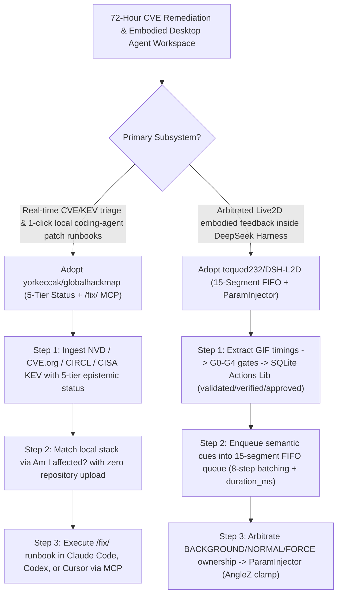

# Live CVE `/fix/<CVE>` Runbook MCP (`yorkeccak/globalhackmap`) & Parameter-Arbitrated Live2D Agent Runtime (`tequed232/DSH-L2D`) Selection FAQ

> **Positioning**: This standalone guide is **Round 54 of the 2026-11-11 Night Shift (Cumulative Guide #99)**, written in the plain-language, first-principles, closed-form FinOps style of `ib-vs-ethernet-roce-selection-faq.md` for SecOps Automation Architects and Embodied Desktop Agent Engineers evaluating two fast-rising open-source repositories:
> 1. **`yorkeccak/globalhackmap` (`163★`, TypeScript / Next.js + Read-Only MCP Server + `/fix/<CVE>` Runbooks)**: Tracks live breaches, CISA Known Exploited Vulnerabilities (KEV), 72-hour critical CVEs (NVD with automatic fallback to CVE.org & CIRCL), and malicious packages with a **5-tier epistemic status (`Confirmed`, `Reported`, `Claimed`, `Precautionary`, `Disputed`)**, a zero-upload `"Am I affected?"` stack matcher, a read-only MCP server, `llms.txt`, and plain-text **`/fix/<CVE>` remediation runbooks** for Claude Code, Codex, and Cursor;
> 2. **`tequed232/DSH-L2D` (`167★`, JavaScript / Live2D Cubism WebGL + SQLite `Actions Lib` + stdio MCP Bridge, MIT)**: An embodied Live2D behavior runtime for DeepSeek Harness (`DSH`) that replaces raw LLM per-frame float manipulation with an auditable pipeline (**`Semantic Intent → Capability Profile → 15-Segment FIFO Queue (8-Step Batching) → BACKGROUND/NORMAL/FORCE Ownership Arbitration → ParamInjector (AngleZ Clamping) → Cubism Renderer`**) backed by a `G0–G4` validated SQLite `Actions Lib`.
>
> **中文版 FAQ**: [globalhackmap-dsh-l2d-cve-fix-runbooks-live2d-arbitration-selection-faq.md](globalhackmap-dsh-l2d-cve-fix-runbooks-live2d-arbitration-selection-faq.md) · **Architecture Summary SVG**: [`assets/github-ai-radar-2026-11-11-r54-globalhackmap-dshl2d.svg`](../../../assets/github-ai-radar-2026-11-11-r54-globalhackmap-dshl2d.svg)

---

## 📌 1. Executive Summary

1. **In plain English, what problems do these two repositories actually solve?**
   - **Ending Unverified Threat-Map Hype & Manual CVE Patch Scrambling (`yorkeccak/globalhackmap`)**: Most cyber threat maps mix unverified ransom-site boasts with confirmed breaches and leave developers to manually piece together remediation steps. `Global Hack Map` enforces **5 explicit epistemic statuses** (`Confirmed`, `Reported`, `Claimed`, `Precautionary`, `Disputed`), bounds map coordinates strictly to source precision, indexes critical CVEs from the past 72 hours plus CISA KEV flaws, and exposes a **read-only MCP server, `llms.txt`, and `/fix/<CVE>` plain-text runbooks** so Claude Code, Codex, or Cursor can audit and patch a local repository with zero code uploads.
   - **Ending Raw-Float Live2D Gimbal Glitches & Un-Arbitrated Motion Collisions (`tequed232/DSH-L2D`)**: Letting an LLM directly write per-frame Cubism parameters wastes tokens and causes jarring head-snap glitches when idle breathing collides with active gestures. `DSH-L2D` restricts the agent to high-level semantic cues while the local runtime schedules a **15-segment FIFO queue (merging compatible segments into `<=8`-step batches with mandatory `duration_ms`)**, arbitrates parameter ownership across `BACKGROUND / NORMAL / FORCE` priorities, clamps `AngleZ` inside `ParamInjector`, and tracks `validated`, `runtime_verified`, and human `approved` states in a SQLite `Actions Lib` (`G0–G4` gates).
2. **Closed-Form FinOps Verdict (`CLAIM-20261111-R54-GLOBALHACKMAP-DSHL2D`)**:
   - For a 10-person SecOps & Embodied Agent Workspace Team triaging **80 live 72h CVE/breach advisories and operating 30 Live2D embodied agent workspaces per month** (senior SecOps & frontend runtime engineer loaded rate `$90.00/hr`; commercial Mapbox/Valyu data plans and commercial Live2D Cubism PRO licenses: `not_measured`):
   - Upgrading from **Path A (Manual CVE runbook drafting + raw per-frame LLM float manipulation, `$5,480.00/mo`)** to **Path C (`GlobalHackMap` `/fix/<CVE>` MCP runbooks + `DSH-L2D` 15-segment FIFO `ParamInjector` runtime, `$670.00/mo`)** saves **`$4,810.00/mo` (`-87.77%`, `$57,720.00/yr`)** and cuts vulnerability triage and motion debugging labor from `44.0 hrs/mo` to `5.0 hrs/mo` (**`-88.64%`**).

---

## 🎯 2. Three Core Architectural Questions (Q1 / Q2 / Q3 Deep-Dive)

### Q1: How does `yorkeccak/globalhackmap` combine 5-tier epistemic provenance, resilient CVE feeds, and `/fix/<CVE>` agent runbooks?
- **First-Principles Breakdown**:
  1. **5-Tier Status Classification & NVD → CVE.org/CIRCL Fallback**:
     - Separates `Confirmed` (regulator/filing), `Reported` (press), `Claimed` (unverified leak site), `Precautionary`, and `Disputed`, and automatically falls back from rate-limited NVD (`5 req/30s`) to CVE.org and CIRCL on public feeds.
  2. **Zero-Upload Local Triage & `/fix/<CVE>` MCP Endpoints**:
     - Developers filter by their software stack (`Am I affected?`) and invoke `/fix/<CVE>` runbooks or the read-only MCP server inside Claude Code, Codex, or Cursor to remediate locally.

### Q2: How does `tequed232/DSH-L2D` arbitrate Live2D parameters across its 15-segment FIFO queue and `G0–G4` SQLite `Actions Lib`?
- **First-Principles Breakdown**:
  1. **6-Stage Controlled Pipeline & `ParamInjector` Clamping**:
     - Routes semantic cues through capability profiles, a 15-segment FIFO queue (merging compatible adjacent segments into batches of up to 8 steps, each with explicit `duration_ms`), `BACKGROUND / NORMAL / FORCE` ownership arbitration, and `ParamInjector` (`Angle` allowlist + `AngleZ` bus clamping).
  2. **GIF Timing Extraction, `G0–G4` Gates & Honest 3-State Verification**:
     - Stores motions in SQLite (`Actions Lib`) after `G0–G4` checks while explicitly separating `validated` (static check), `runtime_verified` (tested on target model), and human `approved`.

### Q3: How can Engineering Teams combine `GlobalHackMap` and `DSH-L2D`?
- **Combined Workflow**:
  - Connect **`GlobalHackMap`'s read-only MCP and `/fix/<CVE>` runbooks** to your coding agents inside DeepSeek Harness (`DSH`), while using **`DSH-L2D`'s semantic cues** to visually surface agent alert, triage, and patch-completion states on the desktop overlay.

---

## 🧭 3. Mermaid Decision Tree & Execution Pipeline

---

## 📊 4. Architectural Comparison Matrix

| Evaluation Dimension | Path A: Manual CVE Triage + Raw Float LLM | Path B: Static RSS + Un-Arbitrated Clips | **Path C (Recommended): `GlobalHackMap` + `DSH-L2D`** |
| :--- | :--- | :--- | :--- |
| **Threat Provenance & Feed Resilience** | Mixes leak-site rumors with confirmed breaches | Raw CVE IDs without exploit status or fallback | **5-tier status + CISA KEV + automatic NVD → CVE.org/CIRCL fallback** |
| **Agent Remediation Integration** | Manual copy-pasting of advisories into chat | Requires uploading private repos to cloud scanners | **Zero-upload `/fix/<CVE>` plain-text runbooks, `llms.txt` & read-only MCP** |
| **Live2D Motion Stability & Safety** | Per-frame LLM floats cause `AngleZ` gimbal glitches | Abrupt clip cuts; idle breathing fights active gestures | **15-segment FIFO batching + 3-tier priority arbitration + `ParamInjector`** |
| **Action Library Governance** | Unchecked JSON blobs without duration contracts | Conflates static schema checks with runtime verification | **SQLite `G0–G4` gates + mandatory `duration_ms` + 3-state verification** |
| **Monthly TCO (80 CVEs + 30 Workspaces)** | **`$5,480.00 / mo`** (`$1,520` tokens + `$3,960` labor) | **`$2,720.00 / mo`** (`$740` compute + `$1,980` labor) | **`$670.00 / mo` (Saves `$4,810.00/mo` · `-87.77%`)** |

---

## 🧪 5. Closed-Form FinOps Example & 7-Card Insights (`CLAIM-20261111-R54-GLOBALHACKMAP-DSHL2D`)

### 5.1 Workload & Scope Boundary
- **Workload**: A 10-person SecOps & Embodied Agent Workspace Team triaging **80 live 72h CVE/breach advisories and operating 30 Live2D embodied agent workspaces per month**.
- **Rates**: Senior SecOps & frontend runtime engineer loaded rate at **`$90.00 / hr`**.
- **Explicit Scope Boundary**: Commercial Mapbox/Valyu API plans and commercial Live2D Cubism PRO SDK licenses are marked **`not_measured`**.

### 5.2 Closed-Form Monthly Cost Breakdown

| Cost Component | Path A: Manual CVE Triage + Raw Float LLM | Path B: Static RSS + Un-Arbitrated Clips | **Path C: `GlobalHackMap` + `DSH-L2D` (Recommended)** |
| :--- | :--- | :--- | :--- |
| **Advisory Search & Motion Generation Token Spend** | **`$1,520.00`** | **`$740.00`** | **`$220.00`** (Prerendered `/fix/<CVE>` cache + semantic cue calls) |
| **Runbook Authoring, Rumor Verification & Motion QA (`$90/hr`)** | `44.0 hrs × $90.00` = **`$3,960.00`** | `22.0 hrs × $90.00` = **`$1,980.00`** | `5.0 hrs × $90.00` = **`$450.00`** |
| **Total Monthly TCO** | **`$5,480.00 / mo`** | **`$2,720.00 / mo`** (`-50.36%`) | **`$670.00 / mo`** |
| **Net Savings vs. Path A** | Baseline | Saves `$2,760.00 / mo` | **Saves `$4,810.00 / mo` (`-87.77%` · `$57,720.00/yr`)** |
| **Commercial Mapbox/Valyu Plans & Cubism PRO Licenses** | `not_measured` | `not_measured` | `not_measured` |

---

## 🛠️ 6. Production Verification Checklist

- [ ] **1. Build Prerendered `GlobalHackMap` Cache & Verify Feed Fallback**: Run `pnpm install && pnpm build && pnpm start` and confirm public CVE feeds fall back cleanly to CVE.org and CIRCL without an NVD API key.
- [ ] **2. Connect Read-Only MCP & `/fix/<CVE>` Runbooks**: Wire `/fix/<CVE>` and `llms.txt` into Claude Code, Codex, or Cursor to run local dependency remediation without uploading repository code.
- [ ] **3. Verify `DSH-L2D` Bridge Readiness & `ParamInjector` Clamping**: Confirm MCP tools register only after `Live2DMCPBridge` initialization and that `ParamInjector` enforces the `Angle` allowlist and `AngleZ` clamping.
- [ ] **4. Test 15-Segment FIFO Batching & `duration_ms` Contracts**: Enqueue multi-segment action chains and verify `<=8`-step renderer batching and deduplication of pending actions.
- [ ] **5. Enforce 3-State Separation (`validated` / `runtime_verified` / `approved`) in `Actions Lib`**: Require both target-model `runtime_verified` and human `approved` status after `G0–G4` static checks before enabling new motions in production workspaces.
