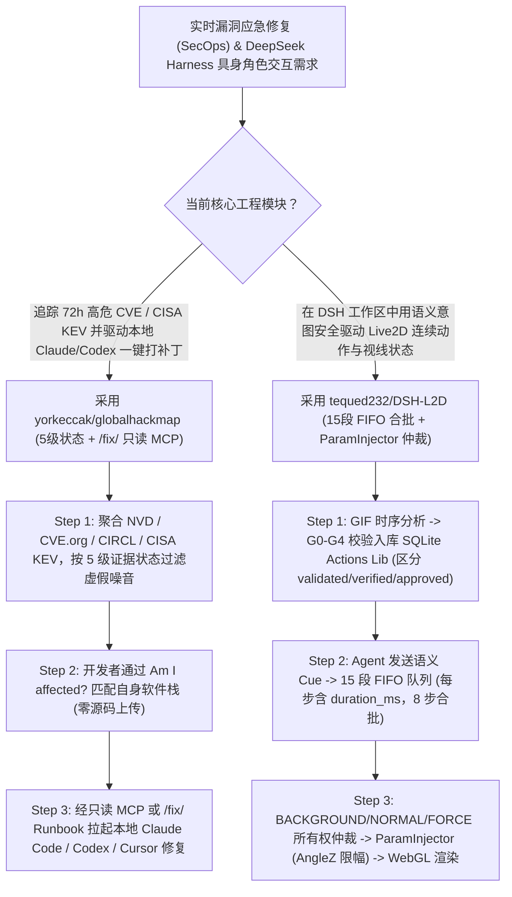

# 全球实时漏洞攻击态势与 `/fix/<CVE>` 修复手册 MCP（`yorkeccak/globalhackmap`）及 Live2D 参数仲裁具身运行时（`tequed232/DSH-L2D`）深度选型 FAQ

> **文档定位**：本专题是 **2026-11-11 夜班第 54 轮（累计第 99 篇）独立六段式选型指南**，严格对标 `ib-vs-ethernet-roce-selection-faq.md` 的通俗第一性原理与闭式 FinOps 核算规范，面向研发安全应急响应（SecOps）架构师与具身桌面智能体（Embodied Desktop Agent）负责人，深度拆解今日在实时漏洞修复手册 MCP 与 Live2D 参数所有权仲裁运行时赛道爆发的两大新锐开源仓：
> 1. **`yorkeccak/globalhackmap`（`163★`，TypeScript / Next.js + 只读 MCP Server + `/fix/<CVE>` 纯文本修复手册）**：将全球公开报告的数据泄露、勒索声称、CISA 本周确认在野利用漏洞（KEV）、近 72 小时高危 CVE（NVD / CVE.org / CIRCL）与恶意软件包汇聚于同一地球仪——严格区分 **五级诚实证据状态（`Confirmed` / `Reported` / `Claimed` / `Precautionary` / `Disputed`）**，无需上传任何私有代码即可通过本地 Coding Agent（Claude Code / Codex / Cursor）直读 **`/fix/<CVE>` 修复 Runbook 与只读 MCP** 一键自查修复！
> 2. **`tequed232/DSH-L2D`（`167★`，JavaScript / Live2D Cubism WebGL + SQLite `Actions Lib` + stdio MCP Bridge，MIT）**：运行在 DeepSeek Harness（DSH）中的 **Live2D 具身行为运行时与参数仲裁控制桥**——严禁大模型直接按帧乱改底层 Cubism 浮点参数，建立**「工作区状态/语义意图 → 模型能力解析 → 15 段 FIFO 动作队列与 8 步合批 → `BACKGROUND/NORMAL/FORCE` 优先级与参数所有权仲裁 → `ParamInjector`（含 `AngleZ` 总线限幅） → Cubism 渲染」**的可追踪执行链，配套 `G0–G4` 五级入库门禁与显式区分 `validated / runtime_verified / approved` 的 SQLite 动作知识库！
>
> **English Version**: [globalhackmap-dsh-l2d-cve-fix-runbooks-live2d-arbitration-selection-faq.en.md](globalhackmap-dsh-l2d-cve-fix-runbooks-live2d-arbitration-selection-faq.en.md) · **架构总结图**: [`assets/github-ai-radar-2026-11-11-r54-globalhackmap-dshl2d.svg`](../../../assets/github-ai-radar-2026-11-11-r54-globalhackmap-dshl2d.svg)

---

## 📌 一、核心结论速览（Executive Summary）

1. **一句话大白话讲透这两个项目到底解决了什么痛点？**
   - **终结“安全告警真假难辨（把黑客单方面勒索吹牛当成既成事实）、且查出高危 CVE 后还要人工翻半天公告拼凑修复命令”的痛点（`yorkeccak/globalhackmap`）**：传统威胁情报地图喜欢用夸张的虚假飞线吓人，或者把暗网勒索团伙未证实的声称（Claimed）和官方确认的入侵（Confirmed）混为一谈。`Global Hack Map` 坚持两项工程诚实性：① **五级证据分级**（`Confirmed` 官方/监管确认、`Reported` 媒体报道、`Claimed` 暗网单方声称、`Precautionary` 预防性下线、`Disputed` 官方否认），地理位置绝不超出信源精度；② **面向 Coding Agent 的一键修复闭环**——实时同步近 72 小时高危 CVE 与 CISA 在野利用清单（NVD 限流时自动回退 CVE.org 与 CIRCL），提供只读 MCP Server、`llms.txt` 与 `/fix/<CVE>` 纯文本修复手册，点一下即可拉起本地 Claude Code、Codex 或 Cursor 在不上传任何源码的前提下自查并打补丁！
   - **终结“让大模型直接操控 Live2D 骨骼参数导致脖子拧断（`AngleZ` 越界）、动作互相打架抽搐、以及把假 Mock 当成生产就绪”的痛点（`tequed232/DSH-L2D`）**：很多 Live2D AI 伴侣让 LLM 直接输出每帧的 `ParamAngleX/Y/Z` 数值，既浪费 Token 又常因呼吸待机微动作与说话动作争抢同一参数而剧烈抽搐。`DSH-L2D` 让 Agent 只发高层语义目标（如“看向用户”“进入思考状态”），由本地运行时通过 **15 段输入 FIFO 队列（相邻兼容段自动合批为最多 8 步的渲染批次，每步强制声明 `duration_ms`）**、**三级优先级（`BACKGROUND / NORMAL / FORCE`）参数所有权仲裁**与 **`ParamInjector`（含 `Angle` 短名白名单与 `AngleZ` 总线限幅）** 安全驱动渲染；同时动作入库必须经过 GIF 帧提取与 **`G0–G4` 校验管线**，严格区分 `validated`、`runtime_verified` 与人工 `approved` 三态！
2. **闭式 FinOps 投资回报结论（`CLAIM-20261111-R54-GLOBALHACKMAP-DSHL2D`）**：
   - 以 10 人研发安全应急（SecOps）与具身工作区前端团队每月响应 **80 起 72h 新增 CVE/供应链安全排查** 并维护 **30 个具身交互式 Agent 工作区实例** 为基准（高级安全与前端运行时工程师含税费率 `$90.00/hr`；Mapbox/Valyu 商业超额配额与 Live2D Cubism 商业发行授权费：`not_measured`）：
   - 从 **Path A（人工搜集拼凑 CVE 修复指南 + 让大模型逐帧输出 Live2D 参数导致冲突抽搐排障，月均 `$5,480.00`）** 升级至 **Path C（`GlobalHackMap` 五级证据分流与 `/fix/<CVE>` MCP 自动排查 + `DSH-L2D` 15 段 FIFO 仲裁运行时与 `G0–G4` 动作库，月均 `$670.00`）**，每月净省 **`$4,810.00/mo`（降幅 `-87.77%`，年省 `$57,720.00/yr`）**，并将漏洞修复手册编写与动画参数排障工时从 `44.0 hrs/mo` 压缩至 `5.0 hrs/mo`（节省 **`-88.64%`**）。

---

## 🎯 二、三大灵魂拷问（Q1 / Q2 / Q3 深度原理解析）

### Q1：`yorkeccak/globalhackmap` 是如何通过五级证据状态、多源 CVE 自动降级与 `/fix/<CVE>` 纯文本协议赋能 Coding Agent 的？
- **第一性原理拆解**：
  1. **五级认知状态机（Epistemic Status）与多源高可用降级**：
     - 将每起事件明确标注为 `Confirmed`、`Reported`、`Claimed`、`Precautionary` 或 `Disputed`，并在文档中强调“未检索到结果绝不等于安全（An absent result is never proof that you are safe）”；
     - 在无 `NVD_API_KEY`（受限于每 30 秒 5 次请求）或无 `VALYU_API_KEY` 时，自动回退至公共 **CVE.org、CIRCL 与 GitHub Advisory Database** 数据源，首次 `pnpm build` 运行约 1 分钟生成预渲染缓存，后续页面毫秒级直出。
  2. **零代码上传的“Am I affected?”自查与 `/fix/<CVE>` Agent 协议**：
     - 开发者无需把私有仓库上传到任何第三方扫描云：只需勾选在用的软件栈，通过只读 MCP Server、`llms.txt` 或 `/fix/<CVE>` 纯文本 Runbook 链接一键预填 Claude Code、Codex 或 Cursor 的本地排查提示词，由本地 Agent 在内网直接完成依赖核查与版本升级。

### Q2：`tequed232/DSH-L2D` 为什么严禁 Agent 直写每帧参数，其“语义意图 → 15 段 FIFO 合批 → `ParamInjector` 仲裁”是如何运作的？
- **第一性原理拆解**：
  1. **六层受控执行链与 `ParamInjector` 托管白名单**：
     - 完整链路为：`DSH 工作区上下文 -> 语义行为意图 -> 模型能力画像 (Model Adapter) -> 15段 FIFO 动作队列 -> 参数所有权与优先级仲裁 (BACKGROUND/NORMAL/FORCE) -> ParamInjector -> Cubism WebGL 渲染`。
     - `ParamInjector` 拒绝任何未知或未托管参数，修复了 `Angle` 短名白名单与 `AngleZ` 总线限幅（防止角色头部旋转越界穿模），且 MCP 工具必须在 `Live2DMCPBridge` 完成初始化就绪后才向宿主注册（杜绝未就绪时伪报工具可用）。
  2. **15 段动作链合批（PR #27）与 SQLite `G0–G4` 三态分离（PR #25）**：
     - 每个动作步强制声明 `duration_ms` 并汇总链级总时长；FIFO 队列支持最多 15 个输入段，将相邻兼容段自动合批（每个 Renderer 批次最多 8 步），对短暂优先级阻塞做有界重试且不重复提交 `pending` 动作；
     - SQLite `Actions Lib` 支持从 GIF 提取帧时序并通过 `G0–G4` 入库校验，严格区分 **`validated`（静态校验通过）**、**`runtime_verified`（真机模型运行时验证）** 与 **`approved`（人工审核放行）**。

### Q3：AI 架构师如何将这两个项目结合进研发安全与桌面工作台？
- **黄金组合落地范式**：
  - 将 **`yorkeccak/globalhackmap`** 的只读 MCP 与 `/fix/<CVE>` 接入研发团队的日常晨会巡检与 Coding Agent，实现 72h 高危 CVE 与 CISA 在野漏洞的零上传本地闭环修复；
  - 在构建 **DeepSeek Harness (`dsh`) 具身桌面助手**时接入 **`tequed232/DSH-L2D`**，当后台 Agent 正在扫描 CVE 或跑编译测试时，通过语义 Cue 驱动 Live2D 角色自然呈现“查阅警戒”“深入思考”与“修复完成”的视觉状态反馈！

---

## 🧭 三、Mermaid 选型决策树与“CVE 修复手册 + 具身仲裁渲染”流水线

---

## 📊 四、同类方案核心能力对比矩阵（Selection Matrix）

| 评估维度 | Path A：人工刷安全公告 + 大模型逐帧写骨骼参数 | Path B：传统静态 CVE 列表 + 固定预制动画切片 | **Path C（推荐）：`GlobalHackMap` + `DSH-L2D`** |
| :--- | :--- | :--- | :--- |
| **威胁情报真实性与降级韧性** | 暗网谣言与真实入侵混杂；NVD 限流即断更 | 仅有干瘪的 CVE 编号，不知是否在野利用 | **5 级诚实状态标注 + CISA KEV 联动 + NVD→CVE.org/CIRCL 自动降级** |
| **Coding Agent 漏洞修复衔接** | 需人工把公告复制给 Agent 并手写排查步骤 | 要求把代码库授权给外部 SaaS 扫描器 | **零代码上传，直接提供只读 MCP、`llms.txt` 与 `/fix/<CVE>` 预填手册** |
| **Live2D 动作平滑度与防崩坏保护** | LLM 直写浮点参数既慢又会导致 `AngleZ` 越界抽搐 | 固定动画切换生硬，待机呼吸与主动作争抢参数 | **15 段 FIFO 队列（8 步合批）+ 三级优先级仲裁 + `ParamInjector` 限幅** |
| **动作资产治理与工程口径诚实度** | 无持久注册表，动作时长未知导致队列卡死 | 把未经真机验证的测试配置直接当生产可用 | **SQLite `G0–G4` 门禁 + 强制 `duration_ms` + 严格区分三态验收口径** |
| **月度总拥有成本（80 漏洞 + 30 工作区）** | **`$5,480.00 / mo`**（`$1,520` Token + `$3,960` 人工） | **`$2,720.00 / mo`**（`$740` 算力 + `$1,980` 人工） | **`$670.00 / mo`（净省 `$4,810.00/mo` · `-87.77%`）** |

---

## 🧪 五、定量 FinOps 算例与 7-Card 洞察（`CLAIM-20261111-R54-GLOBALHACKMAP-DSHL2D`）

### 5.1 测算基准与显式边界（Scope & Boundaries）
- **场景设定**：10 人研发安全应急（SecOps）与桌面智能体工作区团队，每月响应 **80 起 72h 高危 CVE / 第三方组件安全事件排查**，并维护 **30 个具身 Live2D 工作区实例**。
- **费率假设**：高级安全与前端运行时工程师全包时薪 **`$90.00 / hr`**。
- **显式边界声明（Explicit Not-Measured Boundary）**：Mapbox/Valyu 商业 API 高阶配额订阅与 Live2D Cubism PRO 商业发行授权费标记为 **`not_measured`**，本表核算情报检索/动作生成 Token 与工程师应急编写/动画排障工时。

### 5.2 三路径月度成本闭式对照表

| 成本分项 | Path A：人工拼凑 CVE 手册 + LLM 逐帧写参数 | Path B：静态 RSS 看板 + 无仲裁固定动画 | **Path C：`GlobalHackMap` + `DSH-L2D`（推荐）** |
| :--- | :--- | :--- | :--- |
| **威胁情报检索与具身动作驱动 Token 开销** | **`$1,520.00`** | **`$740.00`** | **`$220.00`**（`/fix/<CVE>` 预渲染缓存 + 语义级轻量 Cue 调用） |
| **CVE 修复脚本编写、误报核实与骨骼抽搐排障工时（`$90/hr`）** | `44.0 hrs × $90.00` = **`$3,960.00`** | `22.0 hrs × $90.00` = **`$1,980.00`** | `5.0 hrs × $90.00` = **`$450.00`** |
| **月度总成本（Monthly TCO）** | **`$5,480.00 / mo`** | **`$2,720.00 / mo`**（`-50.36%`） | **`$670.00 / mo`** |
| **相对 Path A 净节省** | 基准线（Baseline） | 净省 `$2,760.00 / mo` | **净省 `$4,810.00 / mo`（`-87.77%` · 年省 `$57,720.00/yr`）** |
| **商业地图/新闻 API 配额与 Cubism 商业授权** | `not_measured` | `not_measured` | `not_measured` |

---

## 🛠️ 六、生产级落地核验 Checklist

- [ ] **1. `GlobalHackMap` 本地预渲染构建与 NVD 降级验证**：运行 `pnpm install && pnpm build && pnpm start`，验证在未配置 `VALYU_API_KEY` 或 `NVD_API_KEY` 时公共威胁流自动回退至 CVE.org 与 CIRCL。
- [ ] **2. 只读 MCP 与 `/fix/<CVE>` 零上传修复演练**：将 `globalhackmap` 只读 MCP 挂载至 Claude Code / Codex / Cursor，拉取 `/fix/<CVE>` 纯文本 Runbook 对本地测试仓库执行无上传依赖升级。
- [ ] **3. `DSH-L2D` Bridge 就绪门禁与 `ParamInjector` 白名单核查**：确认 `Live2DMCPBridge` 初始化完成后才暴露 `tools/list`，并验证 `ParamInjector` 拦截未托管参数且对 `AngleZ` 执行总线限幅。
- [ ] **4. 15 段 FIFO 动作链与 `duration_ms` 契约测试**：向动作队列提交连续语义段，验证相邻兼容段自动合批（`<=8` 步/批）、每个 step 均包含 `duration_ms` 且 `pending` 动作不重复入队。
- [ ] **5. SQLite `Actions Lib` 三态（`validated / runtime_verified / approved`）门禁**：严禁将仅通过静态 `G0–G4` 校验（`validated`）但未经真实模型运行时验证（`runtime_verified`）与人工审批（`approved`）的动作投入生产工作区。
