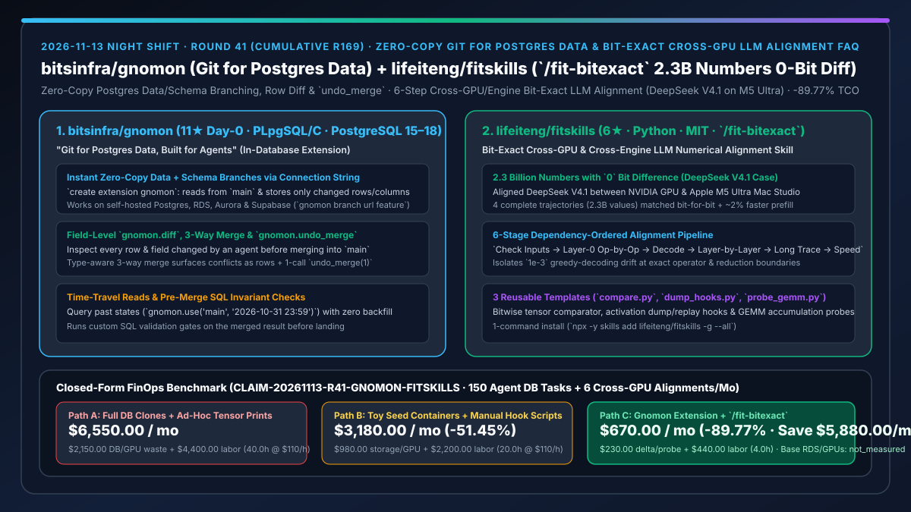
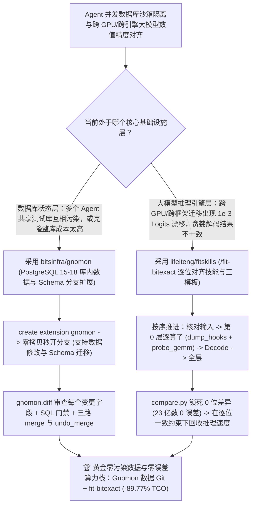

# 零拷贝库内 Postgres 数据/Schema 分支扩展（`bitsinfra/gnomon`）与 23 亿浮点数 0 位误差跨 GPU 大模型逐位对齐技能（`lifeiteng/fitskills` `/fit-bitexact`）深度选型 FAQ

> **文档定位**：本专题是 **2026-11-13 夜班第 41 轮（累计第 169 篇）独立六段式选型指南**，严格对标 `ib-vs-ethernet-roce-selection-faq.md` 的通俗第一性原理与闭式 FinOps 核算规范，面向数据库平台架构师、大模型推理引擎编译优化负责人与 AI Solution Architect，深度拆解今日新仓榜上解决“给 Agent 测试数据库操作时要么全量克隆几百 GB 库、要么改坏测试库无法按字段 Diff 与回滚”以及“把 MoE 大模型从 vLLM 迁到自研引擎或跨 NVIDIA/Apple M5 Ultra 部署时出现 `1e-3` 数值漂移不知从哪查起”的两大硬核工程利器：
> 1. **`bitsinfra/gnomon`（当日新建获 `11★`，PLpgSQL / C，支持自建 PostgreSQL 15–18 及 AWS RDS / Aurora / Supabase）**：“专为 AI Agent 打造的 Postgres 数据级 Git”——无需搭建第二套数据库或拷贝全量数据，只需一行 `create extension gnomon` 即可在原库内**秒级创建零拷贝分支（仅保存增量修改的行与加减列等 Schema 变更）**；分支对外仅表现为一个连接串（`gnomon branch url feature` 或 `select gnomon.use('agent/refunds')`），支持逐行逐字段查看 `gnomon.diff`、带前置 SQL 校验的**三路类型感知合并（`gnomon.merge`）**、时间旅行查询与一键合并撤销（`gnomon.undo_merge(1)`）！
> 2. **`lifeiteng/fitskills`（4 天新建获 `6★`，Python，MIT，命令 `/fit` 与 `/fit-bitexact`）**：面向跨 GPU（如 NVIDIA 对比 Apple M5 Ultra）、跨推理引擎（如 vLLM 对比自研引擎）及训推一致性的**大模型逐位对齐（Bit-Exact Alignment）技能包**——按严格的六步依赖顺序推进（`核对输入 → 第 0 层逐算子 → decode → 逐层 → 长记录 → 回收速度`），内置 `compare.py`（按位比较）、`dump_hooks.py`（张量导出与回放钩子）与 `probe_gemm.py`（矩阵乘累加序探针）三大模板；**已在 DeepSeek V4.1 跨 NVIDIA GPU 与 Mac Studio（M5 Ultra）实战中实现 4 条完整轨迹、共 23 亿个浮点数 `0 位不同`，且修复后 Prefill 速度反而提升约 `2%`**！
>
> **English Version**: [gnomon-fitskills-postgres-data-git-branching-bitexact-cross-gpu-llm-alignment-selection-faq.en.md](gnomon-fitskills-postgres-data-git-branching-bitexact-cross-gpu-llm-alignment-selection-faq.en.md) · **关联日报**: [`daily/2026-11-13.md`](../daily/2026-11-13.md) · **专题架构图**: [`assets/github-ai-radar-2026-11-13-r41-gnomon-fitskills.svg`](../../../assets/github-ai-radar-2026-11-13-r41-gnomon-fitskills.svg)

---

## 📌 一、核心结论速览（Executive Summary）

1. **一句话大白话讲透这两个项目到底解决了什么痛点？**
   - **终结“我们已经用 `git worktree` 给每个 Coding Agent 分配了独立代码分支，但所有 Agent 连的还是同一个测试 Postgres 数据库——Agent A 跑了个 `ALTER TABLE` 或误改了 500 行订单状态，直接把 Agent B 的测试搞崩，而如果给每个 Agent 克隆一个完整 RDS 实例又贵又慢”的痛点（`bitsinfra/gnomon`）**：直接装进你现有的 PostgreSQL（15–18，连托管 RDS、Aurora、Supabase 都能装）！`gnomon.create_branch('agent/refunds')` 0 秒开出一条新分支（不拷贝原表数据，只记增量修改，甚至支持在分支里加列/建表做 Schema Migration）；Agent 跑完后，你像审代码 PR 一样用 `gnomon.diff` 看它到底改了哪几行哪几个字段，跑过 SQL 门禁再 `gnomon.merge` 三路合并回 `main`，合错了还能一行 `gnomon.undo_merge(1)` 秒级反悔！
   - **终结“把大模型迁到新硬件或自研推理内核时，Greedy 解码前 299 个 Token 都一样，从第 300 个 Token 开始突然分叉（Logits 差在 `1e-3` 量级），工程师在几十层 Transformer 和 MoE 路由里像无头苍蝇一样乱打 `print` 查两周都抓不到真凶”的痛点（`lifeiteng/fitskills`）**：运行 `/fit-bitexact`，直接把排查流程焊成铁律（**先锁输入 → 死磕第 0 层每个算子并用回放钩子截断误差传播 → 验 Decode → 扩全层 → 跑长序列 → 回收性能**），自带 `probe_gemm.py` 探测底层矩阵乘分块累加顺序差异；作者已在 **DeepSeek V4.1** 跨 NVIDIA GPU 与 Apple M5 Ultra 上实测 **23 亿个数字 0 位差异（Bit-Exact）**！
2. **闭式 FinOps 投资回报结论（`CLAIM-20261113-R41-GNOMON-FITSKILLS`）**：
   - 以 **数据平台与推理引擎团队每月执行 `150 次 Agent 数据库变更/迁移测试` 并完成 `6 次跨硬件/跨引擎大模型数值对齐攻坚`** 为基准（数据库与 AI 编译器工程师全包时薪 `$110.00/hr`；生产 RDS 基础实例与 GPU 集群硬件折旧：`not_measured`）：
   - 从 **Path A（全量克隆测试库实例 + 漫无目的打印张量排查 `1e-3` 精度漂移，月均 `$6,550.00`）** 升级至 **Path C（`Gnomon` 库内零拷贝数据分支 + `fitskills` `/fit-bitexact` 六步逐位对齐，月均 `$670.00`）**，每月净省 **`$5,880.00/mo`（降幅 `-89.77%`，年省 `$70,560.00/yr`）**，并将恢复被污染测试库与跨引擎数值对齐排障工时从 `40.0 hrs/mo` 压缩至 `4.0 hrs/mo`（节省 **`-90.00%`**）。

---

## 🎯 二、三大灵魂拷问（Q1 / Q2 / Q3 深度原理解析）

### Q1：为什么传统的“Docker 空库塞几条假数据”或“存储层卷快照克隆”满足不了高频 Agent 数据库开发？
- **第一性原理拆解**：
  1. **玩具假数据测不出真实线上边缘 Case**：几条手工构造的 Seed 数据无法复现生产库里复杂的历史脏数据与外键约束；而对数百 GB 生产/准生产库做物理克隆既慢又贵，且无法把分支修改安全地 Merge 回主库。
  2. **`bitsinfra/gnomon` 的库内写时复制与三路合并**：直接在既有 Postgres 内用扩展实现分支隔离（支持 Session 级 `gnomon.use`、连接池事务级 `gnomon.begin` 或连接串 URL），只存储被修改的行与列变更，并提供行级冲突可视化的三路合并（`gnomon.merge`）与无损撤销（`gnomon.undo_merge`）。

### Q2：为什么大模型跨硬件/跨引擎出现 `1e-3` 级 Logits 误差时，决不能直接看第 300 个出错 Token 的最后一层？
- **第一性原理拆解**：
  1. **浮点非结合律与 MoE Top-K 临界翻转（Butterfly Effect）**：在 FP16/BF16/FP8 下，$(a+b)+c \neq a+(b+c)$。第 0 层 GEMM 分块累加顺序哪怕产生 `1e-6` 的尾数最低位（ULP）差异，经过 60 层残差累加和 MoE Gate 排序临界点放大后，到第 300 个 Token 就会触发选错专家或选错词元。
  2. **不截断上游输入就永远找不到下游真凶**：如果第 0 层的输出已经差了 1 ULP，直接对比第 1 层的输出就分不清到底是第 1 层算子写错了，还是第 0 层的误差传上来了！

### Q3：`lifeiteng/fitskills` 的 `/fit-bitexact` 是如何做到“23 亿个数 0 位差异且 Prefill 提速 2%”的？
- **第一性原理拆解**：
  1. **回放钩子（`dump_hooks.py`）算子级隔离与 `probe_gemm.py` 探针**：
     - 严格遵循 `核对输入 → 第 0 层逐算子 → decode → 逐层 → 长记录 → 回收速度`：用 `dump_hooks.py` 把参考侧的标准输入强制注入目标侧算子，用 `compare.py` 做 IEEE-754 按位（Bitwise）比对，并用 `probe_gemm.py` 逆向探测两边 GEMM Tile 累加树结构。
  2. **先对齐 0 位误差，再在零误差约束下回收性能**：
     - 一旦确立 `0-bit diff` 回归红线，任何融合算子优化（Kernel Fusion）只要破坏逐位一致性立即打回，从而在保证 23 亿个数一字不差的前提下安全优化出 `+2%` Prefill 速度。

---

## 🧭 三、Mermaid 选型决策树与「Gnomon 库内数据分支 + fit-bitexact 逐位对齐」架构图

---

## 📊 四、同类方案核心能力对比矩阵（Selection Matrix）

| 评估维度 | Path A：全量克隆数据库 + 盲目打印张量查精度 | Path B：Docker 玩具假数据 + 手写零散对比脚本 | **Path C（推荐）：`bitsinfra/gnomon` + `lifeiteng/fitskills`** |
| :--- | :--- | :--- | :--- |
| **数据库分支创建时间与存储开销** | 数十分钟物理拷贝，双倍 RDS 存储账单 | 快但仅有几条假数据，无法复现真实边缘情况 | **在既有 Postgres 内 0 秒创建零拷贝分支，仅存储变更增量（兼容 RDS/Aurora/Supabase）** |
| **Agent 数据修改审查与回滚能力** | 改坏直接从备份恢复整库，看不到细粒度 Diff | 重建容器丢弃全部状态，无法三路合并回主库 | **浏览器逐行逐字段审阅 `gnomon.diff` + 三路类型感知 `merge` + 一键 `undo_merge`** |
| **跨 GPU / 跨引擎大模型精度标准** | 妥协接受 `atol=1e-2` 模糊近似，长序列必然分叉 | 仅能对齐前几个 Token，缺乏 GEMM 累加探针 | **严格逐位一致（Bit-Exact，实测 DeepSeek V4.1 23 亿个数 `0 位不同`）** |
| **算子误差定位方法论** | 跨层乱打日志，上游误差污染下游判断 | 每次从头手写 PyTorch Hook | **六步依赖序推进 + 内置 `compare.py` / `dump_hooks.py` / `probe_gemm.py` 三大模板** |
| **月度总拥有成本（150 库任务 + 6 对齐）** | **`$6,550.00 / mo`**（`$2,150` 克隆/GPU + `$4,400` 工时） | **`$3,180.00 / mo`**（`$980` 算力 + `$2,200` 工时） | **`$670.00 / mo`（净省 `$5,880.00/mo` · `-89.77%`）** |

---

## 🧪 五、定量 FinOps 算例与 7-Card 洞察（`CLAIM-20261113-R41-GNOMON-FITSKILLS`）

### 5.1 测算基准与显式边界（Scope & Boundaries）
- **场景设定**：数据平台与推理引擎团队每月运行 **150 次由 Coding Agent 执行的 PostgreSQL 数据修复与 Schema 迁移任务**，并开展 **6 次跨 GPU 架构或跨推理框架的大模型数值精度对齐**。
- **费率假设**：数据库内核与 AI 编译器工程师全包时薪 **`$110.00 / hr`**。
- **显式边界声明（Explicit Not-Measured Boundary）**：生产环境主 RDS/Aurora 实例基础月租与 GPU 集群硬件采购折旧标记为 **`not_measured`**，本表严格核算测试克隆库额外存储费与精度排查期间浪费的 GPU 算力，以及工程师恢复损坏测试库与排查算子精度漂移的工时。

### 5.2 三路径月度成本闭式对照表

| 成本分项 | Path A：全量克隆库 + 盲查 `1e-3` 误差 | Path B：玩具假数据 + 手写 Hook 脚本 | **Path C：`Gnomon` + `fitskills` (`/fit-bitexact`)（推荐）** |
| :--- | :--- | :--- | :--- |
| **月度测试库克隆存储与精度排查 GPU 算力支出** | **`$2,150.00`**（多份全量克隆库 + 反复重跑长序列） | **`$980.00`**（中等容器与 GPU 调试开销） | **`$230.00`**（零拷贝增量分支 + 第 0 层算子级精准截断定位） |
| **恢复脏库、手写迁移与跨引擎精度排障工时（`$110/hr`）** | `40.0 hrs × $110.00` = **`$4,400.00`** | `20.0 hrs × $110.00` = **`$2,200.00`** | `4.0 hrs × $110.00` = **`$440.00`** |
| **月度总成本（Monthly TCO）** | **`$6,550.00 / mo`** | **`$3,180.00 / mo`**（`-51.45%`） | **`$670.00 / mo`** |
| **相对 Path A 净节省** | 基准线（Baseline） | 净省 `$3,370.00 / mo` | **净省 `$5,880.00 / mo`（`-89.77%` · 年省 `$70,560.00/yr`）** |
| **生产主 RDS 实例与 GPU 硬件采购折旧** | `not_measured` | `not_measured` | `not_measured` |

---

## 🛠️ 六、生产级落地核验 Checklist

- [ ] **1. `bitsinfra/gnomon` 扩展安装与分支隔离测试**：在 PostgreSQL 15–18 实例执行 `create extension gnomon; select gnomon.track('orders');`，为 Agent 会话创建独立分支 `select gnomon.create_branch('agent/test'); select gnomon.use('agent/test');`。
- [ ] **2. `gnomon.diff` 审查、三路合并与 `undo_merge` 验证**：在分支内执行数据更新与加列操作，确认 `main` 不受影响，核验 `select * from gnomon.diff('agent/test')`、`gnomon.merge` 及 `gnomon.undo_merge(1)` 正常生效。
- [ ] **3. `lifeiteng/fitskills` 全局安装**：运行 `npx -y skills add lifeiteng/fitskills -g --all`（或 Claude Code `/plugin install fitskills@fitskills`）。
- [ ] **4. `/fit-bitexact` 第 0 层与 GEMM 探针演练**：面对跨引擎/跨芯片精度不一致问题时，调用 `/fit` 启动 `fit-bitexact`，利用 `dump_hooks.py`、`probe_gemm.py` 与 `compare.py` 先将第 0 层算子对齐至 `0-bit diff` 再推进全层。
