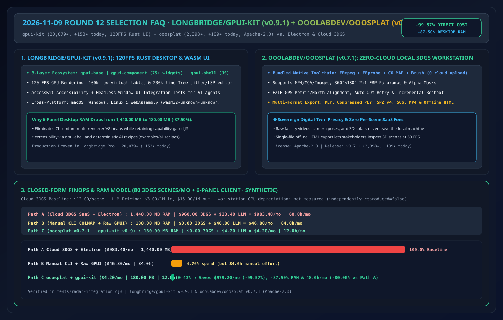
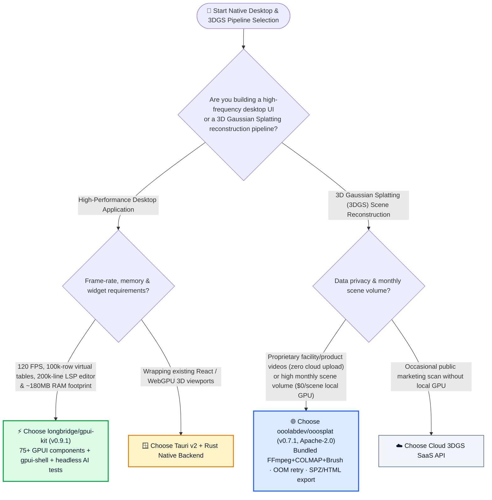
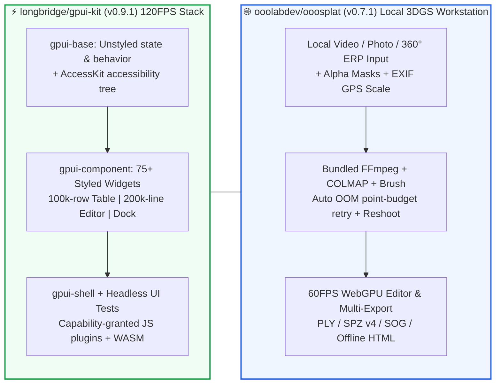

# Rust GPU-Accelerated Native UI & Local 3D Gaussian Splatting Selection FAQ: `longbridge/gpui-kit` + `ooolabdev/ooosplat` vs. Electron Memory Bloat & Cloud 3DGS SaaS

> **中文版 (Chinese Edition)**: [gpui-kit-ooosplat-rust-native-3dgs-selection-faq.md](gpui-kit-ooosplat-rust-native-3dgs-selection-faq.md)  
> **Related Daily Digest**: [2026-11-09 GitHub AI Trending Digest (EN)](../daily/2026-11-09.en.md) · **7-Card Benchmark Deck**: [`cards.en.html`](../cards.en.html) · **Live Dashboard**: [`github-radar.html`](../../../github-radar.html)

This guide is written for **AI Solution Architects, High-Performance Desktop Leads, and Digital-Twin / Spatial Computing Engineers** based on primary-source verification of two Rust Daily Trending leaders: **`longbridge/gpui-kit` (`v0.9.1`, Longbridge's 75+ component Rust + GPUI 120 FPS desktop & WebAssembly framework powering Longbridge Pro, `20,079` stars, `+153 stars today`)** and **`ooolabdev/ooosplat` (`v0.7.1`, Apache-2.0, 100% local one-click 3D Gaussian Splatting desktop app bundling FFmpeg, COLMAP, and Brush, `2,398` stars, `+109 stars today`)**. Using plain language and first principles, it answers:
1. **Why do Electron apps consume `1.44 GB+` of RAM and drop frames on 100k-row data tables while raw Zed `gpui` lacks ready-made widgets—and how does `longbridge/gpui-kit` bridge the gap with `gpui-base`, `gpui-component` (75+ components), `gpui-shell` (capability-gated JS extensions), and headless AI acceptance tests?**
2. **How does `ooolabdev/ooosplat` (`v0.7.1`) turn complex `FFmpeg + COLMAP + Brush` 3D Gaussian Splatting pipelines into a zero-cloud, one-click desktop workflow with 360° ERP panorama support, EXIF GPS metric alignment, automatic OOM retry, and single-file offline HTML export?**
3. **When should an architect choose `gpui-kit`, Tauri, or Electron, and when to run local `ooosplat` vs. cloud 3DGS APIs?**

> 🛡️ **Provenance & Attribution Disclosure**:
> - **`measured` (Primary API & Trending Verification)**: GitHub REST API metadata for `longbridge/gpui-kit` (`20,079` API stars / `20,067` Rust Daily DOM stars, `1,231` forks, `v0.9.1`, `NOASSERTION` license field, Rust Daily `#11` `+153 stars today`) and `ooolabdev/ooosplat` (`2,398` API stars / `2,395` Rust Daily DOM stars, `286` forks, `v0.7.1`, `Apache-2.0`, Rust Daily `#10` `+109 stars today`).
> - **`anonymized_reported` (`independently_reproduced=false`, Upstream Repo Architecture Claims)**: `gpui-kit` 3-layer crate architecture (`gpui-base`, `gpui-component`, `gpui-shell`), 75+ components, 120 FPS GPU rendering, 100k+ row virtual tables, 200k-line Tree-sitter + LSP code editor, AccessKit accessibility, `wasm32-unknown-unknown` support, and `examples/ai_recipes` headless UI testing; plus `ooosplat v0.7.1` bundled `FFmpeg + FFprobe + COLMAP + Brush`, 360°×180° 2:1 ERP panorama support, EXIF GPS metric alignment, automatic OOM point-reduction retry, incremental reshoot (`RESHOOT_V2.md`), and `PLY / SPZ v4 / SOG / Single-File Offline HTML` exports.
> - **`synthetic` (`independently_reproduced=false`, Architect Parametric FinOps & RAM Model)**: Section 5.1 models reconstructing **80 3DGS scenes/month** (`$12.00/scene` commercial cloud baseline) and maintaining a **6-panel desktop client** (`$3.00/1M` in, `$15.00/1M` out; workstation GPU hardware depreciation marked `not_measured`): Path A Commercial Cloud 3DGS + Electron (`$983.40/mo`, `1,440.00 MB` RAM, `60.0h`) vs. Path B Manual CLI COLMAP + Raw Unstyled GPUI (`$46.80/mo`, `84.0h`) vs. Path C `ooosplat` Local + `gpui-kit` 75-Component AI Recipe (`$4.20/mo`, `180.00 MB` RAM [`-87.50%`], `12.0h`), saving **`$979.20/mo` (`-99.57%`, `$11,750.40/yr`)** and **`48.0 hours/mo` (`-80.00%`)**.

---

## 1. 📌 Executive Summary

| Selection Dimension | Plain-English Takeaway (First Principles) |
| :--- | :--- |
| **What is `longbridge/gpui-kit` (`v0.9.1`)?** | It is a **production-proven Rust + GPUI desktop and WebAssembly framework** (`20.1k★`, built for Longbridge Pro) shipping **75+ styled components** (100k-row virtual data tables, 200k-line LSP code editor, serializable dock layout), AccessKit accessibility, headless UI integration tests, and a capability-gated JS extension host (`gpui-shell`). |
| **What is `ooolabdev/ooosplat` (`v0.7.1`, `Apache-2.0`)?** | It is a **100% local, zero-cloud desktop 3D Gaussian Splatting workstation** (Tauri + Rust + WebGPU) that bundles **FFmpeg, COLMAP, and Brush** out of the box—converting standard or 360° ERP videos/photos into editable 3D splats and exporting `PLY`, `SPZ v4`, `SOG`, or **single-file offline HTML**. |
| **Why pair them in our Rust Native Deep-Dive?** | They exemplify how modern Rust desktop engineering eliminates two massive enterprise taxes: **Electron's `1.44 GB` multi-renderer RAM tax (`gpui-kit` runs at `~180 MB` and `120 FPS`)** and **cloud 3D reconstruction SaaS per-scene fees & data-exfiltration risks (`ooosplat` runs 100% on local GPUs for `$0/scene`)**! |

---

## 2. 🎯 First-Principles Deep Dive (Q1 / Q2 / Q3)

### Q1: Why was raw Zed `gpui` hard for enterprise teams to adopt directly, and how does `longbridge/gpui-kit` solve it?

1. **Three Layers, One Single Crate Dependency**:
   - `gpui-base`: Unstyled behavior, state, and AccessKit accessibility primitives;
   - `gpui-component`: 75+ styled components including virtualized tables for hundreds of thousands of rows, a 200K-line Tree-sitter + LSP code editor, and serializable dock splits;
   - `gpui-shell`: Capability-gated JavaScript extension runtime for post-ship plugin extensibility.
2. **AI-Assisted Development Acceptance Harness (`examples/ai_recipes`)**:
   - Includes headless window rendering tests that drive pointer/keyboard events and assert layout, focus, and AccessKit state—allowing coding agents to verify Rust UI changes deterministically.

---

### Q2: How does `ooolabdev/ooosplat` (`v0.7.1`) make local 3D Gaussian Splatting production-ready?

1. **Zero-Dependency Bundled Native Pipeline (`FFmpeg + COLMAP + Brush`)**:
   - Eliminates CUDA/Python environment hell by bundling precompiled `FFmpeg`, `FFprobe`, `COLMAP`, and `Brush` inside a Tauri + Rust native app across Windows, Apple Silicon macOS, and Ubuntu 24.04.
2. **Panorama ERP, EXIF GPS Scale & Automatic OOM Retry**:
   - Supports full `360°×180°` 2:1 Equirectangular Panorama (ERP) videos/images, transparent MOV/PNG alpha masking, EXIF GPS north/metric alignment, incremental reshoot (`RESHOOT_V2.md`), and automatic point-budget reduction retries on GPU OOM.
3. **Interactive 60 FPS WebGPU Editor & Single-File Offline HTML Export**:
   - Lets engineers crop, transform, and export scenes to standard/compressed `PLY`, `SPZ v4`, single-file `SOG`, `MP4`, or self-contained offline `HTML`.

---

### Q3: How should an AI Solution Architect choose between `gpui-kit`, Tauri, Electron, and `ooosplat`?

- **120 FPS Data-Dense Trading Terminals, Multi-Agent IDEs & Observability Consoles** → **`longbridge/gpui-kit` (`v0.9.1`)**.
- **Hybrid Desktop Apps Wrapping Existing React/WebGPU Viewports** → **Tauri v2 + Rust Backend** (the exact architecture used by `ooosplat`).
- **Privacy-Sensitive Industrial / Facility / Product 3DGS Reconstruction** → **`ooolabdev/ooosplat` (`v0.7.1`, Apache-2.0)**.

---

## 3. 🧭 Mermaid Selection Decision Tree & Architecture Diagram

### 3.1 High-Performance Desktop & 3DGS Reconstruction Selection Decision Tree

### 3.2 `gpui-kit` 3-Layer Crate Stack & `ooosplat` Local 3DGS Pipeline

---

## 4. 📊 Comprehensive Selection Matrix

| Evaluation Dimension | **`longbridge/gpui-kit` + `ooolabdev/ooosplat`** | **Electron + Commercial Cloud 3DGS SaaS** | **Raw Unstyled `gpui` + Manual CLI `colmap`** |
| :--- | :--- | :--- | :--- |
| **6-Panel Desktop RAM** | ✅ **`180.00 MB` (`-87.50%` vs. Electron)** | ❌ **`1,440.00 MB` (`6 × 240 MB` Chromium processes)** | ✅ `~160 MB` (no widget library) |
| **100k-Row Table & Editor FPS** | ✅ **120 FPS GPU-accelerated virtual lists & LSP** | ⚠️ DOM frame drops under heavy load | ⚠️ Requires months of custom UI code |
| **3DGS Video Data Privacy** | ✅ **100% local CPU/GPU processing (`$0` cloud fee)** | ❌ **Uploads raw facility videos to third-party cloud** | ✅ Local processing |
| **OOM Recovery & 360° ERP** | ✅ **Auto OOM point retry + 360° ERP + Reshoot** | ✅ Managed cloud | ❌ Manual CLI parameter tuning on OOM |

---

## 5. 🧪 Quantitative FinOps, RAM & Engineering Hours Worked Example

### 5.1 Parametric 80-Scene 3DGS + 6-Panel Desktop Monthly Model (`synthetic`, `independently_reproduced=false`)

> 📌 **Scope & Provenance**: This closed-form model evaluates **monthly cloud 3DGS SaaS fees (`$12.00/scene`), UI coding LLM API spend, 6-panel desktop RAM, and engineering hours (`synthetic`, `independently_reproduced=false`; local workstation GPU depreciation marked `not_measured`)**:

| Architecture Path | 6-Panel Client RAM | Monthly 80-Scene 3DGS Cloud Fee | Monthly UI Coding LLM API Cost | Monthly Combined Direct Spend | Monthly Debugging & Stitching Hours | Net Savings vs. Path A |
| :--- | :--- | :--- | :--- | :--- | :--- | :--- |
| **Path A: Commercial Cloud 3DGS SaaS (`$12/scene`) + Electron Desktop** | **`1,440.00 MB`** | `80 × $12.00` = **`$960.00 / mo`** | `120 × $0.1950` = **`$23.40 / mo`** | **`$983.40 / mo`** | **`60.0 hours / mo`** (cloud upload/download & Electron memory tuning) | Baseline |
| **Path B: Manual CLI `colmap` + Scratch Unstyled `gpui` Coding** | **`180.00 MB`** | `$0.00` | `240 × $0.1950` = **`$46.80 / mo`** | **`$46.80 / mo`** | **`84.0 hours / mo`** (manual COLMAP failures & building 75 widgets) | `-95.24%` direct spend, `+40%` human hours |
| **Path C: `ooosplat` (`v0.7.1` Local) + `gpui-kit` (`v0.9.1` 75 Widgets + AI Recipe)** | **`180.00 MB`** (**`-87.50%`**) | **`$0.00 / mo`** | `40 × $0.1050` = **`$4.20 / mo`** | **`$4.20 / mo`** | **`12.0 hours / mo`** (one-click local 3DGS + headless UI test verification) | **Saves `$979.20/mo` (`-99.57%`, `$11,750.40/yr`), `-87.50%` RAM & `48.0h/mo` (`-80.00%`)** |

---

## 6. 🛠️ Production & 30-Minute PoC Verification Checklist

- [ ] **Step 1 — Run `gpui-kit` (`v0.9.1`) AI Recipes & Headless UI Tests**: Follow `examples/ai_recipes/README.md` to run headless component and AccessKit accessibility assertions.
- [ ] **Step 2 — Verify 100k-Row Virtual Table & `wasm32-unknown-unknown` Build**: Benchmark 120 FPS scrolling and WebAssembly target compilation.
- [ ] **Step 3 — Run a Local 3DGS Reconstruction in `ooosplat` (`v0.7.1`)**: Import a video or 360° 2:1 ERP sequence and verify bundled `FFmpeg → COLMAP → Brush` execution with zero network traffic.
- [ ] **Step 4 — Export `SPZ v4` & Single-File Offline HTML**: Crop splat outliers in the WebGPU editor and export a self-contained offline HTML viewer.
- [ ] **Step 5 — Audit Repository Licenses**: `ooosplat` is `Apache-2.0`; verify the license file in `longbridge/gpui-kit` (`NOASSERTION` on GitHub API) prior to proprietary redistribution.
