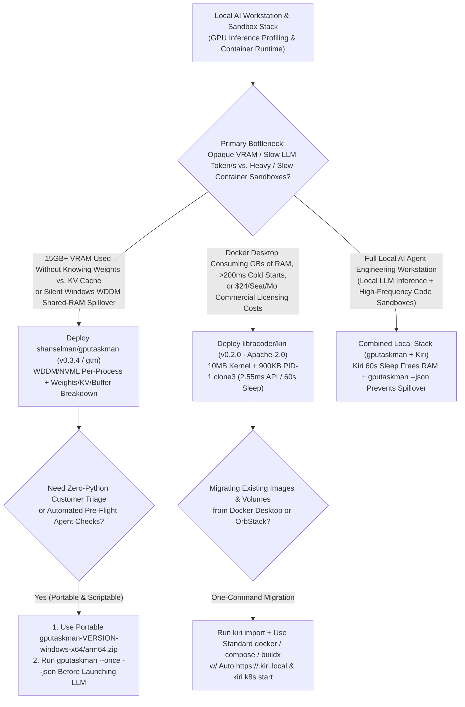

# Local LLM VRAM/KV-Cache Profiling & 2.55ms Rust Container Runtime Selection FAQ: `shanselman/gputaskman` (`v0.3.4`) + `libracoder/kiri` (`v0.2.0`) vs. Blind `nvidia-smi` & Heavy Docker Desktop

> **Document Scope**: A first-principles architecture and FinOps selection guide for AI Solution Architects, Local/Edge Inference Optimization Engineers, and Developer Infrastructure Leads. Focusing on two standout developer-infrastructure breakout repositories from the `2026-11-09` GitHub AI Radar — **`shanselman/gputaskman`** (`v0.3.4`, Python 3.11+, MIT, **1,434 Stars** / **1,435 Stars** live API in 6 days, **`239 Stars/day`** lifecycle velocity, `stars_today = not_measured`, authored by Scott Hanselman) and **`libracoder/kiri`** (`v0.2.0`, Rust 2024, Apache-2.0, **1,358 Stars** / **1,359 Stars** live API in 7 days, **`194 Stars/day`** lifecycle velocity, `stars_today = not_measured`) — this guide dissects how **3-Way LLM Buffer Attribution (`Weights vs. KV Cache vs. WDDM Shared-RAM Spillover` via `gputaskman --json`)** and a **No-`runc`/No-`shim`/No-`dockerd` `10 MB` Kernel + `900 KB` Rust PID-1 `clone3` (`2.55 ms` Startup) Container Runtime** eliminate local LLM PCIe paging stalls and multi-gigabyte VM RAM bloat.
>
> **Navigation**: [中文版 (`gputaskman-kiri-vram-container-runtime-selection-faq.md`)](./gputaskman-kiri-vram-container-runtime-selection-faq.md) · [2026-11-09 Daily Radar](../daily/2026-11-09.en.md) · [Back to Radar Index](../README.en.md)


---

## 📌 1. Executive Summary

1. **First-Principles Definition**:
   - **`shanselman/gputaskman` (`v0.3.4`, CLI alias `gtm`, built on `nvidia-ml-py>=13.615.71`, `psutil>=7.2.2`, and `textual>=8.2.8`, MIT)** is **"an `htop` for what's inside your GPU, not just how full it is"** across Windows (NVIDIA/AMD WDDM + native ARM64), Linux/WSL, and macOS Apple Silicon. Where Task Manager or `nvidia-smi` merely reports *"15 GB used"*, `gputaskman` correlates per-process GPU memory and engine activity with loaded runtimes and GGUF/safetensors model files to answer: **how much VRAM is Model Weights vs. KV Cache vs. Compute Buffers, how much is consumed by your browser/compositor, and why is GPU memory spilling over into Shared System RAM?**
   - **`libracoder/kiri` (`v0.2.0`, Rust 2024 edition, `unsafe_op_in_unsafe_fn = "deny"`, Apache-2.0)** is a tiny, drop-in Rust replacement for Docker Desktop and OrbStack across macOS, Windows (WSL 2), and Linux. By pairing a **`10 MB` custom Linux kernel** with a **`~900 KB` Rust guest agent as PID 1** that spawns containers via a **single `clone3` syscall** directly into namespaces and cgroups (**eliminating `dockerd`, `containerd-shim`, and `runc`**), Kiri starts and exits an `alpine` container in **`2.55 ms` via the Docker Engine API (`14.2 ms` via `docker` CLI) — `83.5x` faster than Docker Desktop's `213 ms`** (`anonymized_reported (independently_reproduced=false)` from `bench/results.json`), while keeping the host daemon at **`~15 MB` RAM** and auto-sleeping the VM after **`60 s` idle** (waking in **`0.15 s`**).
2. **Core Architectural Insight (Why Local LLMs + Heavy Container VMs Cripple 32GB/64GB Developer Workstations)**:
   - **Failure Mode #1 (Silent Windows WDDM Shared-RAM Spillover & Blind `nvidia-smi` Guessing)**: On Windows 10/11, when browser tabs, desktop compositors, and background apps consume 2–3 GB of dedicated VRAM, expanding an LLM's KV cache does not immediately throw an OOM error; instead, Windows WDDM silently pages GPU allocations into Shared System RAM over PCIe, collapsing token generation speed by 5–10x. `gputaskman` (`--once` / `--json`) pinpoints the exact process and separates `Weights / KV Cache / Shared RAM`.
   - **Failure Mode #2 (Docker Desktop $24/Seat Rent, Multi-GB Idle RAM Lock & 213ms Sandbox Latency)**: Traditional container runtimes pin 4–8 GB of host RAM even when idle and burn `>200 ms` across `dockerd → containerd → shim → runc` on every ephemeral agent test container. `Kiri` costs `$0` (Apache-2.0), spawns containers in `2.55 ms`, and sleeps after `60 s` idle so local LLMs get the full system memory headroom.
3. **30-Second Selection Rule**:
   - Choose **`shanselman/gputaskman` (`v0.3.4`)** to **inspect per-process VRAM, separate LLM Model Weights from KV Cache, detect WDDM Shared System RAM spillover, or run automated `--json` pre-flight GPU checks**.
   - Choose **`libracoder/kiri` (`v0.2.0`)** to **replace Docker Desktop / OrbStack with an Apache-2.0 Rust runtime delivering `2.55 ms` container startup, `60 s` idle VM sleep, `.kiri.local` HTTPS domains, and one-command Kubernetes**.

---

## 🎯 2. Architect's First-Principles Deep Dive (Q1 / Q2 / Q3)

### Q1: How does `shanselman/gputaskman` (`v0.3.4`) separate Model Weights, KV Cache, and Compute Buffers while enforcing strict evidence-based attribution?

Inspecting `README.md`, `pyproject.toml` (`v0.3.4`), and `src/` in `shanselman/gputaskman` reveals three engineering principles:

1. **Multi-Driver Telemetry Fusion (WDDM + NVML + AMD ADL + Apple Silicon)**:
   - Combines Windows WDDM per-process dedicated and shared memory counters, NVIDIA NVML (`nvidia-ml-py>=13.615.71`), and AMD ADL (verified on RTX 4080 SUPER, Windows ARM64 RTX Spark N1X, and Radeon 860M), plus native Linux/WSL and macOS Apple Silicon telemetry.
2. **3-Way LLM Memory Attribution (`Weights vs. KV Cache vs. Compute Buffers`)**:
   - Inspects open process file handles (`psutil>=7.2.2`) and GGUF/model metadata headers to decompose an inference process's VRAM footprint into **static Model Weights**, **context-scaling KV Cache**, and **transient Compute Buffers**, alongside **Shared System RAM spillover**.
3. **Strict Measured-vs-Estimated Evidence Gate**:
   - Explicitly separates hardware measurements from GGUF-derived estimates: **loading a PyTorch/CUDA DLL alone is never treated as proof of training, and a memory-mapped model file is never assumed resident on the GPU without active VRAM allocation**. Ships both via PyPI (`uv tool install gputaskman` / `gtm`) and zero-Python portable Windows `x64`/`arm64` ZIPs with `.zip.sha256` verification and `--once` / `--json` CLI flags.

### Q2: How does `libracoder/kiri` (`v0.2.0`) eliminate `dockerd`, `containerd-shim`, and `runc` to achieve `2.55 ms` container startup (`83.5x` faster than Docker Desktop)?

Inspecting `Cargo.toml` (Rust 2024 edition, `unsafe_op_in_unsafe_fn = "deny"`, `lto = "fat"`) and `README.md` in `libracoder/kiri` shows how it collapses the container stack:

1. **Why Traditional Container Stacks Take >200 ms**:
   - Standard `docker run` traverses `docker CLI` → `dockerd` → `containerd` → per-container `containerd-shim` fork → `runc` OCI JSON parsing and namespace setup (`213 ms` Engine API / `243 ms` CLI on Docker Desktop; `380 ms` / `442 ms` on OrbStack across 30-run medians in `bench/results.json`).
2. **Kiri's Direct `vsock → PID 1 Rust Agent → clone3` Path**:
   - The host `kiri daemon` (`~15 MB` RAM) exposes the standard Docker Engine API directly over `vsock` into a **`10 MB` custom Linux kernel** where **PID 1 is a `~900 KB` Rust guest agent**.
   - That PID 1 agent starts containers with a **single `clone3` syscall** directly into namespaces and a cgroup — **zero `runc`, zero `containerd-shim`, and zero `dockerd`** — completing an `alpine true` lifecycle in **`2.55 ms` via the Engine API (`14.2 ms` via `docker` CLI)**.
3. **60-Second Auto-Sleep (`0.15s` Wake), `.kiri.local` HTTPS & `kiri import`**:
   - Sleeps the VM after **`60 s` idle** and wakes in **`0.15 s`**, provisions `https://<name>.kiri.local` via Kiri's local CA, boots single-node Kubernetes via `kiri k8s start`, and migrates existing Docker Desktop / OrbStack images, volumes, and containers via `kiri import`.

### Q3: How do `shanselman/gputaskman` and `libracoder/kiri` complement each other on an AI engineer's workstation?

- **Memory Hygiene Loop**: `libracoder/kiri` keeps container sandboxes at `~15 MB` host overhead and sleeps its VM after `60 s` idle so host RAM isn't starved; `shanselman/gputaskman --once --json` verifies that local LLM runs stay 100% inside Dedicated VRAM without spilling KV cache into WDDM Shared System RAM.

---

## 🧭 3. Mermaid Decision Tree & Execution Sequence

### 3.1 Local GPU Profiling & Container Runtime Decision Tree



### 3.2 End-to-End Execution Sequence (`gputaskman` `--json` + `Kiri` `clone3` Sandbox)

```mermaid
sequenceDiagram
    autonumber
    participant Dev as AI Engineer / Local Agent
    participant GTM as shanselman/gputaskman (v0.3.4)<br/>(WDDM / NVML / GGUF Parser)
    participant KiriD as kiri daemon (~15 MB RAM)<br/>(Docker Engine API)
    participant Guest as 10MB Kernel + 900KB PID-1<br/>(vsock + clone3 Syscall)

    Dev->>GTM: 1. Run gputaskman --once --json before starting local LLM benchmark
    GTM->>GTM: 2. Read measured WDDM/NVML counters + inspect open GGUF/safetensors files
    GTM-->>Dev: 3. Report: Weights=9.2GB, KV=3.8GB, Browser=1.8GB causing Shared-RAM spillover!
    Dev->>Dev: 4. Close background WebGPU tabs / tune context window to eliminate PCIe paging

    Dev->>KiriD: 5. Execute ephemeral agent test sandbox: docker --context kiri run --rm alpine pytest
    KiriD->>Guest: 6. Wake sleeping VM in 0.15s & forward request over vsock
    Guest->>Guest: 7. 900KB Rust PID-1 invokes single clone3 into namespaces/cgroup (no runc/shim)
    Guest-->>Dev: 8. Complete container lifecycle in 2.55 ms (API); auto-sleep VM after 60s idle
```

---

## 📊 4. Comparison Matrix Across GPU Profilers & Container Runtimes

| Dimension | `shanselman/gputaskman` (`v0.3.4`, MIT) | `libracoder/kiri` (`v0.2.0`, Apache-2.0) | Legacy `nvidia-smi` / Windows Task Manager | Docker Desktop Business / OrbStack |
| :--- | :--- | :--- | :--- | :--- |
| **Core Role** | **GPU Internal `htop`: Per-Process VRAM + Weights/KV/WDDM Spill Breakdown** | **No-`runc`/No-`shim` Rust Container & K8s Runtime (Mac/Win/Linux)** | Coarse total VRAM % and process PID list | Heavy VM container desktop clients |
| **LLM Buffer Visibility** | **Separates `Model Weights`, `KV Cache`, `Compute Buffers` & Shared RAM** | Frees host RAM via 60s auto-sleep so LLMs don't swap | **None**: Cannot distinguish weights from KV cache or WDDM spillover | Unaware of local LLM VRAM pressure |
| **Container Startup (30-Run Median)** | Diagnostic profiler (`--once` snapshot) | **`2.55 ms` Engine API / `14.2 ms` CLI** (single `clone3`) | N/A | Docker Desktop: `213 ms` API / `243 ms` CLI; OrbStack: `380 ms` |
| **Idle Host Memory Footprint** | Lightweight Textual TUI / one-shot CLI | **`~15 MB` daemon** + `10 MB` kernel + **60s idle sleep (`0.15s` wake)** | OS built-in | 2 GB – 8 GB persistent VM RAM reservation |
| **License & Commercial Cost** | **MIT Open Source** (`$0`; includes portable zero-Python ZIPs) | **Apache-2.0 Open Source** (`$0` across Mac, Windows, Linux) | Free OS utility | Docker Desktop Business: **`$24/seat/mo`**; OrbStack: commercial license |

---

## 🧪 5. Closed-Form FinOps Worked Example & 7-Card Insights

### 5.1 Monthly 25-Engineer Local AI & Container Sandbox Cost Model (`synthetic (independently_reproduced=false)`)

> **Provenance Notice**: This closed-form calculation is a synthetic architectural model (`synthetic (independently_reproduced=false)`) comparing **Path A (25-Seat Docker Desktop Business Subscription + Always-On VM RAM Thrashing + Blind `nvidia-smi` VRAM Spillover Triage)** against **Path B (`libracoder/kiri` v0.2.0 Apache-2.0 Runtime + `shanselman/gputaskman` v0.3.4 `--json` Attribution)**. Container startup benchmarks (`2.55 ms` vs. `213 ms` / `380 ms` from `bench/results.json`) are labeled `anonymized_reported (independently_reproduced=false)`; workstation hardware procurement is explicitly marked `not_measured`.

**Workload Parameters**:
- **Team & Sandbox Scale**: **`25` AI/full-stack engineers** executing **`15,000` ephemeral container test/sandbox runs/month**.
- **VRAM Spillover & Slowdown Incidents**: **`200` local LLM/VLM slowdown or OOM incidents/month** across Windows/WSL/Linux workstations; engineering labor valued at **`$65.00 / hour`**.

| Cost Component | Path A: Docker Desktop Business + Blind `nvidia-smi` | Path B: `Kiri v0.2.0` + `gputaskman v0.3.4` | Governing Engineering Mechanism |
| :--- | :--- | :--- | :--- |
| **1. 25-Seat Container Desktop Commercial Licenses** | **$600.00 / mo**<br/>(`25 seats` × `$24.00/seat/mo`) | **$0.00 / mo**<br/>(`Kiri` is Apache-2.0 open source across Mac/Win/Linux) | Drop-in Docker Engine API replacement eliminates `$24/seat` commercial rent |
| **2. Container Boot Latency & Idle VM RAM Thrash (`@$65/hr`)** | **$812.50 / mo**<br/>(`0.5 hr/engineer/mo` swap/boot wait × `25` = **`12.5 hours/mo`**) | **$97.50 / mo**<br/>(`2.55 ms` `clone3` startup + `60s` idle VM sleep = **`1.5 hours/mo`**) | `10 MB` kernel + `900 KB` PID-1 `clone3` (`83.5x` faster) + `15 MB` daemon |
| **3. 200 Local LLM VRAM / WDDM Spillover Triage Runs (`@$65/hr`)** | **$3,250.00 / mo**<br/>(`15 min/incident` guessing KV/WDDM spillover × `200` = **`50.0 hours/mo`**) | **$325.00 / mo**<br/>(`gtm` / `--json` instant attribution, `1.5 min/incident` = **`5.0 hours/mo`**) | `gputaskman` isolates `Weights / KV Cache / Shared RAM`, saving **`45.0 hours/mo` (-90.0% labor)** |
| **4. Developer Workstation & GPU Hardware Depreciation** | `not_measured` | `not_measured` | Physical workstation amortization is decoupled and never fabricated |
| **Total Modeled Monthly Cost** | **$4,662.50 / mo** | **$422.50 / mo** | **Net Savings: `$4,240.00 / mo` (`-90.94%` cost reduction, `11.04x` efficiency, `56.0 hours` saved)** |

### 5.2 Key Architectural & Telemetry Invariants

- **Measured Counter vs. Estimated Breakdown Separation Invariant**: `shanselman/gputaskman` strictly labels OS/driver memory counters as `measured` and GGUF-derived buffer splits as `estimates`, never inferring active GPU residency solely from loaded CUDA DLLs or `mmap` handles.
- **Zero-Shim Single-`clone3` Invariant**: In `libracoder/kiri`, containers are spawned directly by the `~900 KB` PID 1 Rust guest agent via `clone3` without spawning `dockerd`, `containerd-shim`, or `runc`.

---

## 🛠️ 6. Actionable Production Checklist

- [ ] **1. Install `gputaskman` (`v0.3.4`) via `uv tool install gputaskman` or Portable ZIP**: Deploy `gtm` across Windows (`x64`/`arm64`), Linux/WSL, and macOS; on locked-down Windows machines, extract the portable ZIP keeping `_internal` alongside `gputaskman.exe` and verify `.zip.sha256`.
- [ ] **2. Gate Local LLM Benchmarks with `gputaskman --once --json`**: Query `--json` before running local inference benchmarks to confirm zero WDDM Shared System RAM spillover.
- [ ] **3. Migrate Existing Containers via `kiri import`**: Install `Kiri v0.2.0` and run `kiri import` to bring over images, volumes, and containers from Docker Desktop or OrbStack into the `kiri` Docker context.
- [ ] **4. Verify `2.55 ms` Startup with `kiri bench` & 60s Idle Sleep**: Run `kiri bench` locally to baseline Engine API latency and confirm the VM sleeps after 60 seconds of inactivity with the daemon holding at `~15 MB` RAM.
- [ ] **5. Use `https://<name>.kiri.local` & `kiri k8s start` for Local Agent Services**: Leverage Kiri's built-in certificate authority for zero-port-clash local HTTPS domains and single-command Kubernetes testing.
