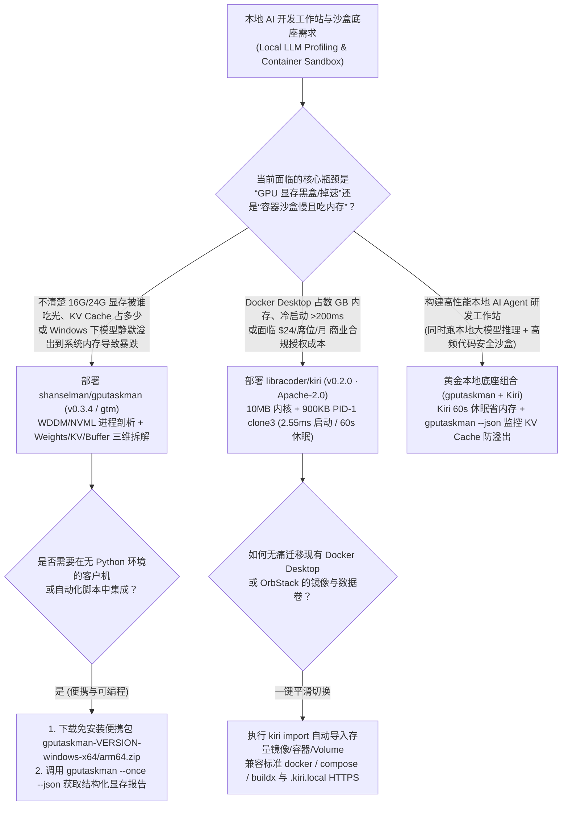
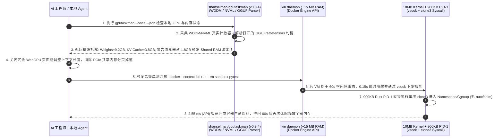

# 本地大模型显存/KV-Cache 透视与 2.55ms 极速容器运行时选型 FAQ：`shanselman/gputaskman` (`v0.3.4`) + `libracoder/kiri` (`v0.2.0`) vs 盲看 `nvidia-smi` 与重型 Docker Desktop

> **文档定位**：面向 AI Solution Architect（AI 解决方案架构师）、端侧/工作站推理优化工程师与 AI 研发基础设施负责人的第一性原理选型指南。聚焦 `2026-11-09` GitHub 新仓爆发追踪中的两大本地 AI 开发者底座利器——微软资深技术专家 Scott Hanselman 开源的 **`shanselman/gputaskman`**（`v0.3.4`，Python 3.11+，MIT，建仓 6 天揽下 **1,434 Stars** / **1,435 Stars** 实时 API，日均斜率 **`239 Stars/day`**，`stars_today = not_measured`）与纯 Rust 跨平台轻量容器引擎 **`libracoder/kiri`**（`v0.2.0`，Rust 2024，Apache-2.0，建仓 7 天揽下 **1,358 Stars** / **1,359 Stars** 实时 API，日均斜率 **`194 Stars/day`**，`stars_today = not_measured`），深度拆解如何用 **“模型权重/KV-Cache/WDDM 共享内存溢出三维归因（`gputaskman --json`）”** 与 **“砍掉 `runc/shim/dockerd` 的 10MB 内核 + 900KB Rust PID-1 `clone3` 2.55ms 容器运行时”** 终结本地推理莫名掉速与容器虚拟机霸占内存之痛。
>
> **阅读导航**：[English Version (`gputaskman-kiri-vram-container-runtime-selection-faq.en.md`)](./gputaskman-kiri-vram-container-runtime-selection-faq.en.md) · [2026-11-09 全景日报](../daily/2026-11-09.md) · [返回雷达首页](../README.md)

---

## 📌 1. 核心结论速览（Executive Summary）

1. **一句话本质定义**：
   - **`shanselman/gputaskman`（`v0.3.4`，命令行简写 `gtm`，基于 `nvidia-ml-py` + `psutil` + `textual`，MIT）** 是专为本地 GPU AI 工作负载打造的 **“显存内部解剖级 `htop`”**（支持 Windows NVIDIA/AMD WDDM、Linux/WSL 及 macOS Apple Silicon）。当系统任务管理器或 `nvidia-smi` 只冷冰冰地显示“已用 15 GB 显存”时，`gputaskman` 能把每个进程的显存占用与加载的运行时、GGUF/safetensors 模型文件关联起来，直接回答：**“这 15 GB 里到底有多少是模型权重（Model Weights）、多少是上下文 KV Cache、多少是桌面合成器/浏览器占的？以及为什么有一部分显存偷偷溢出到了系统内存（Shared GPU Memory）导致生成速度暴跌？”**
   - **`libracoder/kiri`（`v0.2.0`，Rust 2024 Edition，Apache-2.0）** 是面向 macOS、Windows（WSL 2）与 Linux 的 **Docker Desktop / OrbStack 超轻量开源替代品**。它采用定制的 **`10 MB` 极简 Linux 内核**，并将虚拟机内的 **PID 1 直接替换为一个仅 `~900 KB` 的纯 Rust 代理进程**，通过单次 `clone3` 系统调用直接创建 Namespace 与 Cgroup（**彻底砍掉了 `dockerd`、`containerd-shim` 与 `runc` 三层中间商**），实现通过 Docker Engine API 启动并退出容器仅需 **`2.55 ms`（比 Docker Desktop 的 `213 ms` 快约 `83.5 倍`，数据分级：`anonymized_reported (independently_reproduced=false)`）**，且空闲 60 秒自动休眠、宿主机常驻内存仅 `15 MB`。
2. **核心架构洞察（为什么本地跑大模型 + 跑 Agent 容器沙盒经常把 32GB/64GB 电脑卡成幻灯片？）**：
   - **痛点一（Windows WDDM 共享显存静默溢出与“盲看 `nvidia-smi` 猜谜”）**：在 Windows 10/11 下，当浏览器 WebGPU、桌面 DWM 与重型后台应用吃掉 2–3 GB 物理显存后，本地 Ollama / llama.cpp 扩容 KV Cache 时不会直接报 OOM，而是被 WDDM 静默分页到系统内存（Shared GPU Memory），导致 PCIe 带宽成为瓶颈，推理吞吐暴跌 80% 以上。`gputaskman`（支持 `--once` 与 `--json`）一眼揪出吃显存的罪魁祸首及 `Weights / KV Cache / Compute Buffer` 精确占比。
   - **痛点二（Docker Desktop 常驻吃掉数 GB 内存 + `213 ms` 沙盒冷启动拖慢 Coding Agent）**：Coding Agent 每跑一次安全单测沙盒都要调一次 `docker run --rm`，传统 `dockerd → containerd → shim → runc` 链路每次耗费 >200ms，且常驻 VM 霸占 4–8 GB 物理内存。`kiri` 空闲 60 秒即休眠（唤醒仅 `0.15s`），释放宝贵宿主机内存给大模型，并以 `2.55 ms` 瞬时拉起沙盒。
3. **30 秒选型口诀**：
   - 需要**诊断本地 Windows / Linux / WSL / Mac 上大模型显存占用明细（权重 vs KV Cache vs 算子缓冲）、排查 WDDM 共享内存溢出掉速、或让 Agent 通过 `--json` 自检显卡水位** → 选 **`shanselman/gputaskman` (`v0.3.4`)**。
   - 需要**免除 `$24/席位/月` 的 Docker Desktop 商业授权费、把容器冷启动压到 `2.55 ms`、并让容器 VM 在空闲 60 秒后自动休眠释放内存** → 选 **`libracoder/kiri` (`v0.2.0`)**。

---

## 🎯 2. 架构师灵魂拷问（Q1 / Q2 / Q3 First-Principles Deep Dive）

### Q1：`shanselman/gputaskman` (`v0.3.4`) 是如何区分“模型权重 vs KV Cache vs 计算缓冲区”，并且为什么它严禁“仅凭加载了 PyTorch DLL 就断定进程在训模型”？

检视 `shanselman/gputaskman` 的 `README.md`、`pyproject.toml`（`v0.3.4`）与 `src/` 实现，其最核心的架构哲学是 **“将真实硬件测量值与基于证据的模型拆解严格分层（Measured Counters vs. Evidence-Backed Estimates）”**：

1. **多源硬件计数器融合（WDDM + NVML + AMD ADL + Apple Silicon）**：
   - 在 Windows 上融合 WDDM 进程级专用显存（Dedicated VRAM）与共享系统内存（Shared System RAM）计数器、NVIDIA NVML（`nvidia-ml-py>=13.615.71`）以及 AMD ADL（实测覆盖 RTX 4080 SUPER、Windows ARM64 RTX Spark N1X 与 Radeon 860M）；在 Linux/WSL 与 macOS Apple Silicon 上对接各自原生驱动计数器。
2. **三段式 LLM 显存拆解（Weights / KV Cache / Compute Buffers）**：
   - 结合 `psutil>=7.2.2` 扫描进程打开的模型句柄（如 GGUF 头元数据、层数、量化位宽、上下文窗口参数），将单个推理进程的显存占用拆解为 **静态模型权重（Model Weights）**、**随上下文增长的 KV Cache** 以及 **前向计算临时缓冲区（Compute Buffers）**。
3. **反幻觉归因铁律（Strict Evidence Gate）**：
   - 文档明确声明：**“仅仅加载了 PyTorch/CUDA DLL 绝不能证明正在运行某个模型或正在训练；仅仅 `mmap` 映射了一个模型文件也绝不等于该模型已驻留在 GPU 显存中。”** `gputaskman` 严格把硬件计数器标为 `measured`，把基于 GGUF 元数据的缓存拆解标为 `estimated`，并提供免安装单文件 Windows x64/ARM64 便携包（带 `.zip.sha256` 校验）及 `--once` / `--json` 机器可读输出。

### Q2：`libracoder/kiri` (`v0.2.0`) 是怎么做到彻底干掉 `dockerd`、`containerd-shim` 和 `runc`，把容器启动耗时从 `213 ms` 砍到 `2.55 ms`（快 83.5 倍）的？

精读 `libracoder/kiri` 的 `Cargo.toml`（Rust 2024，`unsafe_op_in_unsafe_fn = "deny"`，`lto = "fat"`）与架构说明，可以看到它对传统容器栈做了一次彻底的“第一性原理剃刀手术”：

1. **传统 Docker Desktop 为什么慢（多层进程与 IPC 瀑布）**：
   - 在传统栈中，`docker run` 需要经过：`docker CLI` → `dockerd` 守护进程 → `containerd` → 为每个容器 fork 一个 `containerd-shim` 进程 → 调用 Go 编写的 `runc` 解析 OCI JSON 并配置 Namespace/Cgroup。光是这串进程创建与 gRPC 序列化就要花掉 `>200 ms`。
2. **`Kiri` 的极简三点一线架构（`kiri daemon ── vsock ──► PID 1 Rust Agent ── clone3 ──► Container`）**：
   - 宿主机上的 `kiri daemon`（常驻内存仅 **`~15 MB`**）直接暴露标准 Docker Engine API（因此现有的 `docker`、`docker compose`、`buildx` 零修改直接可用）。
   - 请求通过虚拟套接字 `vsock` 直达跑在 **`10 MB` 定制 Linux 内核**上的 **PID 1 进程（一个仅 `~900 KB` 的纯 Rust 编写的 Guest Agent）**。
   - 这个 `900 KB` 的 PID 1 代理不调用任何外部 `runc` 或 `shim` 二进制，而是直接在内核中执行**一次 `clone3` 系统调用**进入目标 Namespace 与 Cgroup 拉起容器！在 30 次中位数基准测试（`bench/results.json`，运行 `alpine true` 并移除）中，Engine API 耗时仅 **`2.55 ms`**（CLI 端到端 **`14.2 ms`**），而 Docker Desktop 为 `213 ms`（CLI `243 ms`），OrbStack 为 `380 ms`（CLI `442 ms`）。
3. **60 秒空闲休眠、`0.15s` 瞬时唤醒与零配置本地 HTTPS 域名**：
   - 虚拟机在 **60 秒无容器活动后自动进入深度休眠**，当新命令到来时在 **`0.15 秒`** 内瞬时唤醒；内置本地 CA 证书颁发机构自动为每个容器分配 `https://<name>.kiri.local` 域名，且支持 `kiri k8s start` 一键拉起单节点 Kubernetes 与 `kiri import` 一键迁移旧 Docker Desktop 镜像/数据卷。

### Q3：在 AI 工程师工作站与本地 Agent 评测平台上，`gputaskman` 与 `kiri` 如何协同配合？

- **跑任务前/中（`shanselman/gputaskman --json` 显存水位门禁）**：本地 Agent 调度器在启动新模型或扩容上下文前，先调一次 `gputaskman.exe --once --json` 检查专用显存余量、KV Cache 占比以及是否发生了 WDDM 系统内存溢出（Shared RAM Spillover）。
- **跑代码沙盒时（`libracoder/kiri` 极速隔离执行）**：将 Coding Agent 的沙盒执行上下文指向 `docker --context kiri`，利用 `2.55 ms` 极速容器启动跑完测试，且不跑沙盒时 `kiri` 60 秒自动休眠归还全部宿主机内存，绝不跟本地大模型抢 RAM。

---

## 🧭 3. Mermaid 选型决策树与双底座协同架构图（Decision Tree & Architecture Flow）

### 3.1 本地 GPU 观测与轻量容器运行时选型决策树

### 3.2 `gputaskman` 显存剖析 + `Kiri` `clone3` 极速容器协同执行时序图

---

## 📊 4. 同类 GPU 监控与容器运行时方案对比矩阵（Comparison Matrix）

| 评估维度 | `shanselman/gputaskman` (`v0.3.4`, MIT) | `libracoder/kiri` (`v0.2.0`, Apache-2.0) | 传统 `nvidia-smi` / Windows 任务管理器 | Docker Desktop Business / OrbStack |
| :--- | :--- | :--- | :--- | :--- |
| **核心能力定位** | **GPU 内部解剖 `htop`：进程显存 + 模型权重/KV Cache/WDDM 溢出拆解** | **无 `runc/shim/dockerd` 的 Rust 跨平台极速容器与 K8s 运行时** | 仅显示粗粒度总显存百分比与进程名 | 传统重型容器虚拟机与商业桌面客户端 |
| **LLM 显存细分能力** | **支持 `Weights vs. KV Cache vs. Compute Buffer`** 及系统 RAM 溢出 | 容器运行时（通过 60s 休眠避免跟 LLM 抢系统 RAM） | **完全不支持**：看不出是权重还是 KV Cache 撑爆显存 | 不感知宿主机大模型显存分配 |
| **容器启动耗时（中位数）** | 诊断工具（`--once` 毫秒级快照） | **Engine API `2.55 ms` / CLI `14.2 ms`**（单次 `clone3`） | 不涉及容器生命周期 | Docker Desktop：`213 ms` (API) / `243 ms` (CLI)；OrbStack：`380 ms` |
| **宿主机常驻内存开销** | 极轻量 Textual TUI（按需运行或 `--once` 即退） | **守护进程仅 `~15 MB`**，VM 10MB 内核 + **60s 空闲休眠（`0.15s` 唤醒）** | 系统自带命令 | 常驻占用 2 GB – 8 GB 宿主机内存 |
| **开源协议与商业成本** | **MIT 免费开源**（含免 Python 便携版 ZIP） | **Apache-2.0 免费开源**（支持 Mac / Win / Linux 三端） | 免费但信息极度匮乏 | Docker Desktop 企业商用需 **`$24/席位/月`**；OrbStack 闭源付费 |

---

## 🧪 5. 定量 FinOps 算例与 7-Card 评测洞察（Closed-Form Quantitative Model）

### 5.1 封闭式月度 25 人 AI 研发团队容器底座与显存排障成本算例（`synthetic (independently_reproduced=false)`）

> **口径声明**：本算例为合成架构基准模型（`synthetic (independently_reproduced=false)`），用于量化对比 **Path A（25 人团队采购 Docker Desktop 商业订阅 + 常驻 VM 内存挤压等待 + 靠 `nvidia-smi` 盲猜 WDDM 显存溢出）** 与 **Path B（`libracoder/kiri` v0.2.0 Apache-2.0 极速运行时 + `shanselman/gputaskman` v0.3.4 结构化显存剖析）**。文中引用的容器启动基准（`2.55 ms` vs `213 ms` / `380 ms`，来自 `bench/results.json`）标注为 `anonymized_reported (independently_reproduced=false)`；开发工作站物理硬件采购折旧显式标记为 `not_measured`。

**基准工作负载设定**：
- **团队与沙盒调用规模**：**`25` 名 AI 与全栈工程师**，每月在本地开发机上执行 **`15,000` 次容器化测试/Agent 沙盒调用**。
- **本地显存溢出与掉速排障规模**：每月在 Windows / WSL / Linux 工作站上发生 **`200` 次本地大模型推理莫名掉速或显存 OOM 异常**；工程师综合时薪按 **`$65.00 / 小时`** 计。

| 成本分项 | Path A：Docker Desktop 商业版 + 盲看 `nvidia-smi` | Path B：`Kiri v0.2.0` + `gputaskman v0.3.4` | 核心工程机制差异说明 |
| :--- | :--- | :--- | :--- |
| **1. 25 席位容器桌面商业授权订阅费** | **$600.00 / 月** （`25 席位` × `$24.00/席位/月`） | **$0.00 / 月** （`Kiri` 采用 Apache-2.0 开源协议，企业商用免费） | 直接替换商业容器桌面订阅，100% 兼容现有 `docker` / `compose` / `buildx` |
| **2. 容器冷启动与常驻 VM 抢内存导致的等待损耗（@$65/hr）** | **$812.50 / 月** （每人每月因 VM 抢内存触发换页与慢启动损耗 `0.5 小时` = **`12.5 小时/月`**） | **$97.50 / 月** （`2.55 ms` `clone3` 启动 + `60s` 空闲休眠释放 RAM = **`1.5 小时/月`**） | `10 MB` 内核 + `900 KB` PID-1 直调 `clone3`，冷启动提速 **83.5 倍** 且空闲不占内存 |
| **3. 200 次本地 LLM 显存/WDDM 溢出排障工时成本（@$65/hr）** | **$3,250.00 / 月** （盲猜哪个进程/KV Cache 溢出，每次 `15 分钟` × `200` = **`50.0 小时/月`**） | **$325.00 / 月** （`gtm` / `--json` 直出 Weights/KV/Spillover，每次 `1.5 分钟` = **`5.0 小时/月`**） | `gputaskman` 精确区分权重、KV Cache 与共享 RAM 溢出，月省 **`45.0 小时`（-90.0% 工时）** |
| **4. 工程师显卡工作站硬件采购折旧** | `not_measured` | `not_measured` | 物理开发机与显卡硬件折旧与软件诊断/容器层解耦，严禁捏造或归零 |
| **月度可建模总成本（Modeled Total）** | **$4,662.50 / 月** | **$422.50 / 月** | **月度净节省 `$4,240.00`（总成本直降 `-90.94%`，综合成本效率提升 `11.04x`，月省 `56.0 小时`）** |

### 5.2 关键架构与归因不变量（Key Invariants）

- **硬件实测值与模型估算值强隔离不变量（Measured vs. Estimated Separation Invariant）**：`shanselman/gputaskman` 严格区分操作系统/驱动上报的真实物理计数器（`measured`）与通过 GGUF 文件头推导出的缓冲区占比（`estimated`），绝不因为进程加载了 CUDA 动态库就妄下“正在训练”的假结论。
- **单系统调用无 Shim 容器创建不变量（Zero-Shim `clone3` Invariant）**：在 `libracoder/kiri` 中，容器永远由 Guest VM 内的 PID 1 Rust 代理通过单次 `clone3` 直接创建，容器生命周期内不存在任何 `containerd-shim` 或 `runc` 伴生进程开销。

---

## 🛠️ 6. 生产落地核验清单（Actionable Production Checklist）

- [ ] **1. 使用 `uv tool install gputaskman` 或便携包部署 `gtm`**：在开发机上安装 `gputaskman`（`v0.3.4`），Windows 无 Python 环境直接解压 `gputaskman-VERSION-windows-x64/arm64.zip`（务必保留同级 `_internal` 目录并核对 `.zip.sha256`）。
- [ ] **2. 将 `gputaskman --once --json` 接入本地推理启动前自检**：在启动本地 Ollama / vLLM / llama.cpp 服务前，通过 `--json` 检查 `Shared GPU Memory` 是否发生系统内存溢出，以及浏览器/桌面合成器是否侵占了过多专用显存。
- [ ] **3. 执行 `kiri import` 平滑迁移 Docker Desktop / OrbStack**：安装 `Kiri v0.2.0` 后运行 `kiri import` 一键导入存量镜像、容器与数据卷，并通过 `docker --context kiri ps` 验证无缝接管。
- [ ] **4. 复核本机 `kiri bench` 容器启动延迟与 60s 自动休眠**：运行内置的 `kiri bench` 复测本机 Engine API 启动中位数（标杆值 `~2.55 ms`），并验证无容器运行 60 秒后虚拟机自动休眠、宿主机 daemon 内存稳定在 `~15 MB`。
- [ ] **5. 启用 `*.kiri.local` 本地 HTTPS 域名进行微服务联调**：在本地多容器 Agent 联调中直接使用 `https://<service>.kiri.local`（内置本地 CA 自动签发证书），免去手动配置端口映射冲突与自签名证书报错。
