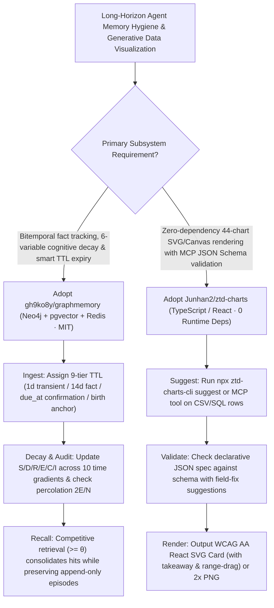

# Bitemporal 6-Variable Decay AI Memory (`gh9ko8y/graphmemory`) & Zero-Dependency 44-Chart Pure-SVG MCP (`Junhan2/ztd-charts`) Selection FAQ

> **Positioning**: This standalone guide is **Round 46 of the 2026-11-11 Night Shift (Cumulative Guide #91)**, written in the plain-language, first-principles, closed-form FinOps style of `ib-vs-ethernet-roce-selection-faq.md` for Long-Term Agent Memory Architects and Generative BI / Data Visualization Leads evaluating two high-signal open-source repositories:
> 1. **`gh9ko8y/graphmemory` (`201★`, Python / FastAPI + Neo4j 5.26 + PostgreSQL `pgvector` + Redis 7 + stdio MCP server, MIT)**: A bitemporal memory service (`valid_from/until` + `tx time`) built on `Graphiti` + `PostgreSQL/pgvector` + `Redis` featuring a **6-variable importance/decay model (`S` Significance, `D` Detail, `R` Retrieval Difficulty, `E` Emotion, `C` Consolidation, `I` Interference)**, **10-tier time-graded recall**, **9-category smart TTLs with `due_at` confirmation and dynamic birth-anchor age calculation**, **percolation-based graph connectivity diagnostics ($\langle k \rangle = 2E/N$)**, and competitive retrieval;
> 2. **`Junhan2/ztd-charts` (`294★`, TypeScript / React, `0` runtime dependencies, `12–26 kB` Brotli, `ztd-charts` + `ztd-charts-cli` + `ztd-charts-mcp`, MIT)**: A library of **44 animated, WCAG AA accessible pure-SVG React charts** (auto-switching to Canvas on 10,000-point stress datasets) built around a **"each card says one thing"** narrative design (single accent highlight + bold `takeaway` + interactive range-drag delta inspection) and backed by a public JSON Schema, CLI (`suggest` / `render`), and 5-tool MCP server (`ztd-charts-mcp`).
>
> **中文版 FAQ**: [graphmemory-ztd-charts-bitemporal-decay-memory-svg-mcp-selection-faq.md](graphmemory-ztd-charts-bitemporal-decay-memory-svg-mcp-selection-faq.md) · **Architecture Summary SVG**: [`assets/github-ai-radar-2026-11-11-r46-graphmemory-ztdcharts.svg`](../../../assets/github-ai-radar-2026-11-11-r46-graphmemory-ztdcharts.svg)

---

## 📌 1. Executive Summary

1. **In plain English, what problems do these two repositories actually solve?**
   - **Ending Eternal Stale Memories & Unauditable Deletions (`gh9ko8y/graphmemory`)**: Standard vector memories treat "I'm busy today" the same as "I was born in 1995," polluting agent prompts months later, while hard deletes destroy audit trails. `GraphMemory` tracks every fact on **two time axes (`valid_from/until` + transaction `tx` time)** and runs a **6-variable cognitive decay loop (`S/D/R/E/C/I`)**: forgetting degrades detail (`D` ceiling drops and `R` floor rises across 10 time gradients from `1d` to `1y`) while keeping the append-only `episodes` ledger intact. It assigns **9 smart TTL tiers** (`1d` transient state, `3d` action, `7d` event, `10d` undated promise, `14d` fact, `3y` identity, `permanent` preferences/immutable facts, plus `due_at` confirmation for dated appointments and dynamic age computation from birth anchors) and exposes 10 tools over stdio MCP.
   - **Ending Rainbow Chart Clutter & Broken LLM Chart JSX (`Junhan2/ztd-charts`)**: When AI agents generate charts using heavy imperative libraries, they frequently hallucinate deeply nested props or produce rainbow-colored charts with no clear takeaway. `ztd-charts` provides **44 zero-dependency SVG charts (`12–26 kB` Brotli)** across 9 families where each card highlights one primary series, states a bold `takeaway` underneath, supports dragging across a range to inspect high/low/delta, includes screen-reader tables at WCAG AA contrast, and lets agents validate declarative JSON specs and render 2x PNG/SVG/React code through `ztd-charts-mcp`.
2. **Closed-Form FinOps Verdict (`CLAIM-20261111-R46-GRAPHMEMORY-ZTDCHARTS`)**:
   - For a 10-person Enterprise AI Companion & Generative BI Team managing **50,000 active user memory profiles and generating 350 executive analytical dashboards per month** (senior full-stack AI engineer loaded rate `$90.00/hr`; managed cloud database instances and commercial BI seat licenses: `not_measured`):
   - Upgrading from **Path A (Flat append-only vector RAG + manual D3/Chart.js JSX debugging and accessibility retrofits, `$5,690.00/mo`)** to **Path C (`GraphMemory` bitemporal 6-variable decay MCP + `ztd-charts` 44-chart SVG/Canvas & MCP spec validator, `$690.00/mo`)** saves **`$5,000.00/mo` (`-87.87%`, `$60,000.00/yr`)** and cuts memory hygiene and chart debugging labor from `45.0 hrs/mo` to `5.0 hrs/mo` (**`-88.89%`**).

---

## 🎯 2. Three Core Architectural Questions (Q1 / Q2 / Q3 Deep-Dive)

### Q1: How do `GraphMemory`'s 6-variable decay (`S/D/R/E/C/I`), 9 TTL classes, and percolation metrics ($\langle k \rangle = 2E/N$) keep long-term memory clean?
- **First-Principles Breakdown**:
  1. **Tri-Store Bitemporal Architecture (Neo4j + PostgreSQL `pgvector` + Redis)**:
     - Neo4j (`Graphiti`) stores entity/relation edges (`RELATES_TO`, `MENTIONS`); PostgreSQL stores bitemporal `fact_state`, 6-variable decay states, append-only `episodes`, and tombstones (`memory_forget`); Redis caches active session recalls.
  2. **6-Variable Decay, Competitive Retrieval & Percolation Health**:
     - Across 10 time gradients (`1d` to `1y`), un-recalled facts lose detail (`D`) and become harder to retrieve (`R`), whereas facts winning competitive retrieval ($\text{Activation} \times \text{Match} \times \text{Fit} \ge \theta$) gain consolidation (`C`). Percolation diagnostics monitor mean degree $\langle k \rangle = 2E/N$, giant component ratio, and isolated entities.

### Q2: How does `Junhan2/ztd-charts` deliver 44 accessible charts with zero runtime dependencies and an AI-native MCP server?
- **First-Principles Breakdown**:
  1. **44 Charts Across 9 Families (`12–26 kB` Brotli) & Auto-Canvas Fallback**:
     - Covers Proportion (`Marimekko`, `Waffle`), Hierarchy (`Sunburst`, `Treemap`), Flow (`Sankey`, `Chord`), Comparison (`Waterfall`, `Pareto`, `Slope`, `Dumbbell`, `Bar race`), Trend (`Candlestick`, `Bump`, `Streamgraph`, `Calendar heatmap`), Distribution (`Ridgeline`, `Beeswarm`, `Violin`), Relationship (`Parallel coordinates`, `Network`), Map (`Tile grid`, `Choropleth`, `Symbol`, `Flow map`), and KPI (`Gauge`, `Bullet`, `Radial bar`), automatically switching to Canvas above 10,000 points.
  2. **5-Tool `ztd-charts-mcp` & `ztd-charts-cli suggest`**:
     - `npx ztd-charts-cli suggest sales.csv` recommends chart specs from raw data; `ztd-charts-mcp` validates JSON specs with actionable suggestions for wrong fields and renders PNG (`--scale 2`), SVG, or React TSX.

### Q3: How should AI Solution Architects combine `GraphMemory` and `ztd-charts`?
- **Combined Architecture**:
  - Store evolving user/business facts, commitments (`due_at`), and timelines in **`GraphMemory`** via `mcp_server.py`, and render temporal trends, cohort flows, and graph health metrics into executive reports via **`ztd-charts-mcp`**.

---

## 🧭 3. Mermaid Decision Tree & Memory-to-Chart Pipeline

---

## 📊 4. Architectural Comparison Matrix

| Evaluation Dimension | Path A: Flat Vector RAG + Heavy D3/JSX Rework | Path B: Basic KV TTL + Static Matplotlib PNGs | **Path C (Recommended): `GraphMemory` + `ztd-charts`** |
| :--- | :--- | :--- | :--- |
| **Temporal Accuracy & Stale Fact Pruning** | Recalls outdated transient states months later | Hard TTL deletes history and raw quotes permanently | **Bitemporal axes + 9 smart TTLs + `due_at` + append-only `episodes`** |
| **Graceful Forgetting & Consolidation** | Static cosine similarity; no decay or interference | Binary keep/drop without detail gradation | **6-variable decay (`S/D/R/E/C/I`) + 10 time gradients + hit consolidation** |
| **AI Chart Generation Reliability & Size** | Frequent LLM prop errors on `200kB+` chart libraries | Static images with no range-drag or responsive layout | **`12–26 kB` zero-dep SVG + MCP schema validator with field suggestions** |
| **Narrative Clarity & WCAG Accessibility** | Multi-color visual noise; screen-reader blind | Lacks keyboard nav and accessible data tables | **Single accent highlight + `takeaway` + range-drag delta + WCAG AA table** |
| **Monthly TCO (50k Profiles + 350 Decks)** | **`$5,690.00 / mo`** (`$1,640` bloat/retries + `$4,050` labor) | **`$2,880.00 / mo`** (`$810` compute + `$2,070` labor) | **`$690.00 / mo` (Saves `$5,000.00/mo` · `-87.87%`)** |

---

## 🧪 5. Closed-Form FinOps Example & 7-Card Insights (`CLAIM-20261111-R46-GRAPHMEMORY-ZTDCHARTS`)

### 5.1 Workload & Scope Boundary
- **Workload**: A 10-person Enterprise AI Companion & Generative BI Team managing **50,000 active user memory profiles and generating 350 analytical dashboards per month**.
- **Rates**: Senior full-stack AI engineer loaded rate at **`$90.00 / hr`**.
- **Explicit Scope Boundary**: Managed cloud database cluster hosting (Neo4j/RDS) and commercial BI seat licenses are marked **`not_measured`**.

### 5.2 Closed-Form Monthly Cost Breakdown

| Cost Component | Path A: Flat Vector RAG + Heavy D3/JSX Rework | Path B: Basic KV TTL + Static Matplotlib PNGs | **Path C: `GraphMemory` + `ztd-charts` (Recommended)** |
| :--- | :--- | :--- | :--- |
| **Stale-Memory Context Bloat & Chart Retry API Spend** | **`$1,640.00`** | **`$810.00`** | **`$240.00`** (9-tier TTL pruning + first-pass MCP schema validation) |
| **Memory Pruning, JSX Debugging & WCAG Retrofit Labor (`$90/hr`)** | `45.0 hrs × $90.00` = **`$4,050.00`** | `23.0 hrs × $90.00` = **`$2,070.00`** | `5.0 hrs × $90.00` = **`$450.00`** |
| **Total Monthly TCO** | **`$5,690.00 / mo`** | **`$2,880.00 / mo`** (`-49.38%`) | **`$690.00 / mo`** |
| **Net Savings vs. Path A** | Baseline | Saves `$2,810.00 / mo` | **Saves `$5,000.00 / mo` (`-87.87%` · `$60,000.00/yr`)** |
| **Managed DB Hosting & Commercial BI Seat Licenses** | `not_measured` | `not_measured` | `not_measured` |

---

## 🛠️ 6. Production Verification Checklist

- [ ] **1. Initialize `GraphMemory` Tri-Store & Run Smoke Suite**: Start Neo4j 5.26, PostgreSQL (`pgvector`), and Redis 7, apply `scripts/init_db.sql` and `scripts/upgrade_chat_memory.sql`, and run `pytest` + `scripts/verify_chat_memory.py`.
- [ ] **2. Verify 9-Category TTLs, `due_at` & Tombstone `memory_forget`**: Test automatic TTL assignment (`1d` transient state vs. `due_at` dated commitments) and confirm `memory_forget` hides facts while preserving `episodes`.
- [ ] **3. Monitor Percolation Connectivity ($\langle k \rangle = 2E/N$) & Deduplication**: Check giant component ratio and isolated entities via `memory_stats` and run `memory_dedupe` over stdio MCP.
- [ ] **4. Register `ztd-charts-mcp` & Load Agent Skill**: Run `claude mcp add ztd-charts -- npx -y ztd-charts-mcp` and validate declarative JSON specs before rendering PNG/SVG/TSX.
- [ ] **5. Verify `<ChartCard>` Takeaway, Range-Drag & 10k-Point Canvas Switch**: Ensure every chart specifies a focused `highlight` and `takeaway` and passes WCAG AA contrast and 10,000-point stress checks.
