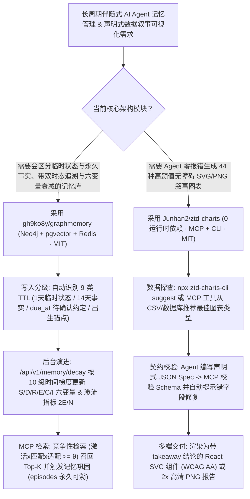

# 双时态六变量衰减 AI 记忆库（`gh9ko8y/graphmemory`）与零依赖 44 种纯 SVG 叙事图表 MCP（`Junhan2/ztd-charts`）深度选型 FAQ

> **文档定位**：本专题是 **2026-11-11 夜班第 46 轮（累计第 91 篇）独立六段式选型指南**，严格对标 `ib-vs-ethernet-roce-selection-faq.md` 的通俗第一性原理与闭式 FinOps 核算规范，面向长周期智能体记忆（Long-Term Agent Memory）架构师与 AI 数据可视化（Generative BI）工程负责人，深度拆解今日在仿生认知衰减记忆与零依赖声明式 SVG 图表赛道爆发的两大新锐开源仓：
> 1. **`gh9ko8y/graphmemory`（`201★`，Python / FastAPI + Neo4j 5.26 + PostgreSQL `pgvector` + Redis 7 + MCP Server，MIT）**：构建在 `Graphiti` 时序知识图谱之上的**双时态（有效时间 `valid_from/until` + 记录时间 `tx time`）AI 长期记忆系统**——独创**六变量认知衰减模型（`S` 意义 / `D` 细节 / `R` 检索难度 / `E` 情绪 / `C` 巩固 / `I` 干扰）**、**10 级时间梯度细节降级**、**9 类内容自动 TTL 与 `due_at` 到期确认状态机**、**渗流理论图谱连通性监控（$\langle k \rangle = 2E/N$ 与巨分量占比）**及竞争性检索巩固机制；
> 2. **`Junhan2/ztd-charts`（`294★`，TypeScript / React，`0` 运行时依赖，体积仅 `12–26 kB` Brotli，含 `ztd-charts-cli` + `ztd-charts-mcp`，MIT）**：专为“像读报告一样一眼看懂结论”打造的 **44 种纯 SVG 动态无障碍 React 图表库**（超万点自动切换 Canvas）——践行**“每张卡片只讲一个重点（单高亮色 + 底部粗体 `takeaway` + 鼠标拖拽区间直接读取涨跌/极值）”**，并为 AI Agent 提供公共 JSON Schema、`ztd-charts-mcp` 五大工具（含字段写错自动修复建议）与一键渲染 PNG / SVG / HTML / React 代码能力！
>
> **English Version**: [graphmemory-ztd-charts-bitemporal-decay-memory-svg-mcp-selection-faq.en.md](graphmemory-ztd-charts-bitemporal-decay-memory-svg-mcp-selection-faq.en.md) · **架构总结图**: [`assets/github-ai-radar-2026-11-11-r46-graphmemory-ztdcharts.svg`](../../../assets/github-ai-radar-2026-11-11-r46-graphmemory-ztdcharts.svg)

---

## 📌 一、核心结论速览（Executive Summary）

1. **一句话大白话讲透这两个项目到底解决了什么痛点？**
   - **终结“向量记忆库把用户三个月前说的‘我现在很忙’当成永久事实、或删掉旧记忆后彻底无法审计当时原话”的痛点（`gh9ko8y/graphmemory`）**：普通 RAG 记忆库没有时间感和遗忘曲线——用户随口说的临时状态（“今天心情不好”）跟永久事实（“籍贯/出生年份”）混在一起永久霸占 Top-K。`GraphMemory` 给每条事实装上**双时态坐标（有效时间 + 事务记录时间）**和**六变量衰减引擎（`S/D/R/E/C/I`）**：临时状态 `1 天`、动作 `3 天`、事件 `7 天`、无日期承诺 `10 天`、普通事实 `14 天`，而有明确日期的约定（如“周六一起去看海”）到日子会进入**「待确认」**状态；更妙的是，它的遗忘不是粗暴删库，而是按 10 级时间梯度**逐步降低细节上限 `D`、拉高检索难度 `R`**（原文账本 `episodes` 只追加永不篡改），被竞争检索命中的记忆则会自动获得 `C`（巩固）加分！
   - **终结“AI 生成的 ECharts/D3 代码五颜六色抓不住重点、经常传错复杂配置项白屏报错、且无障碍合规为零”的痛点（`Junhan2/ztd-charts`）**：让大模型直接手写复杂图表组件时，常因配置项层级太深报错，或者画出一张十几种刺眼颜色堆砌的图。`ztd-charts` 提供 **9 大家族 44 种零运行时依赖的纯 SVG 图表**（从马赛克图 Marimekko、桑基图 Sankey、弦图 Chord、山脊图 Ridgeline、蜂群图 Beeswarm 到 K 线图与流向地图）：默认只高亮核心项并在底部展示一句粗体结论（`takeaway`），支持在任意趋势图上鼠标拖拽一段区间直接浮现该区间的涨跌幅与高低点，内置屏幕阅读器数据表与 WCAG AA 对比度；Agent 只需调 `ztd-charts-mcp` 的 `suggest` 与校验工具写出简明 JSON Spec，即可直出高清 2x PNG、SVG 或 React 组件！
2. **闭式 FinOps 投资回报结论（`CLAIM-20261111-R46-GRAPHMEMORY-ZTDCHARTS`）**：
   - 以 10 人企业级智能助理与数据洞察（Generative BI）工程团队每月维护 **50,000 个活跃用户长期记忆档案** 与自动生成 **350 份高管交互式数据看板/图表报告** 为基准（高级全栈 AI 工程师含税费率 `$90.00/hr`；底层云托管数据库集群月租与外部商业 BI 账号授权费：`not_measured`）：
   - 从 **Path A（扁平向量库过期脏记忆污染上下文重跑 + 大模型手写重型图表库 JSX 报错返工与无障碍改造，月均 `$5,690.00`）** 升级至 **Path C（`GraphMemory` 双时态六变量衰减与 9 级 TTL + `ztd-charts` 44 种零依赖 SVG 图表与 MCP JSON 校验器，月均 `$690.00`）**，每月净省 **`$5,000.00/mo`（降幅 `-87.87%`，年省 `$60,000.00/yr`）**，并将脏记忆清理与图表报错修复工时从 `45.0 hrs/mo` 压缩至 `5.0 hrs/mo`（节省 **`-88.89%`**）。

---

## 🎯 二、三大灵魂拷问（Q1 / Q2 / Q3 深度原理解析）

### Q1：`gh9ko8y/graphmemory` 的“六变量衰减模型（`S/D/R/E/C/I`）”与“渗流图谱连通性监控（$\langle k \rangle = 2E/N$）”是如何协同工作的？
- **第一性原理拆解**：
  1. **三层存储分工（Neo4j 5.26 + PostgreSQL `pgvector` + Redis 7）**：
     - **Neo4j**（基于 `Graphiti`）维护实体及 `RELATES_TO` 事实边 / `MENTIONS` 提及边；
     - **PostgreSQL + pgvector** 维护双时态事实台账（`fact_state`）、六变量状态、只追加原文账本（`episodes`）与墓碑记录（`memory_forget` 逻辑删除但保留原文可审计）；
     - **Redis** 负责高频检索缓存与会话态。
  2. **六变量衰减 + 10 级时间梯度 + 竞争检索巩固**：
     - 每条记忆由 **意义（`S`）、细节（`D`）、检索难度（`R`）、情绪（`E`）、巩固（`C`）、干扰（`I`）** 六个变量共同决定激活度；随着时间跨越 `1天 → 3天 → 7天 → ... → 1年` 共 10 个梯度，细节上限 `D` 自动下调、检索难度下限 `R` 自动抬升，模拟人类“记得大概有这么回事、但具体细节模糊了”的真实口吻；
     - 检索时按 $\text{激活} \times \text{匹配} \times \text{资源适配} \ge \theta$（相对阈值）竞争 Top-K，一旦被成功召回，立即触发记忆再巩固（提升 `C`）；同时针对年龄等时变属性存储**出生锚点**，检索时按当前年份动态计算真实岁数。
  3. **统计物理渗流视角（Percolation Theory）的图谱健康度诊断**：
     - 实时计算知识图谱的平均度 $\langle k \rangle = 2E/N$、最大连通巨分量（Giant Component）占比与孤立实体名单，防止记忆碎片化沦为孤岛。

### Q2：`Junhan2/ztd-charts` 为什么能用 `0` 运行时依赖（`12–26 kB` Brotli）覆盖 44 种专业图表，并让 AI Agent 零报错出图？
- **第一性原理拆解**：
  1. **叙事优先的视觉语法（"Each Card Says One Thing"）与 10,000 点自动 Canvas 降级**：
     - 传统图表库默认给每个系列分配不同亮色，导致读者眼花缭乱。`ztd-charts` 的 `<ChartCard>` 强制将重点系列设为 `accent` 色、其余退为 `ink/neutral` 中性色，并在底部配以醒目的 `takeaway` 结论栏；所有 44 种图表默认输出极其干净的纯 SVG（含滚动入场动画、数据更新平滑过渡与鼠标拖拽区间极值/涨跌测算），当数据点突破 10,000 点压测阈值时自动无缝切换为 Canvas 渲染。
  2. **五工具 `ztd-charts-mcp` + 错字段智能纠偏 + 一文件 `llms.txt`**：
     - 接入 `claude mcp add ztd-charts -- npx -y ztd-charts-mcp` 后，Agent 拥有五大专属工具：列出 44 种图表目录、获取指定图表的 JSON Schema 与示例、根据 CSV/数据行自动推荐最佳图表类型（`suggest`）、**校验 JSON Spec 并针对拼写错误的字段给出精确修改建议**、以及直接服务端渲染为高清 PNG（`--scale 2`）、SVG 或 React TSX 代码！

### Q3：AI 架构师如何将 `GraphMemory` 与 `ztd-charts` 组合成“懂时间演进、会写可视化报告”的业务参谋 Agent？
- **黄金组合落地范式**：
  - 用 **`gh9ko8y/graphmemory`** 的 MCP Server（`add_memory` / `search_memory` / `get_timeline` / `memory_stats`）管理客户跟进记录、项目里程碑承诺（`due_at` 到期自动提醒确认）与双时态事实变迁；
  - 用 **`Junhan2/ztd-charts`** 的 MCP Server 将双时态历史趋势、漏斗转化与图谱连通性指标一键渲染为带 `takeaway` 洞察结论的无障碍 SVG/PNG 简报卡片！

---

## 🧭 三、Mermaid 选型决策树与“双时态记忆 + 叙事图表”流水线

---

## 📊 四、同类方案核心能力对比矩阵（Selection Matrix）

| 评估维度 | Path A：传统扁平向量库 + 手写 D3/ECharts | Path B：简单键值 TTL 缓存 + Matplotlib 静态图 | **Path C（推荐）：`GraphMemory` + `ztd-charts`** |
| :--- | :--- | :--- | :--- |
| **时态回溯与防过期记忆污染** | 无时间轴，“三个月前在忙”至今仍被高分召回 | TTL 一刀切物理删除，彻底丢失历史上下文与原话 | **双时态坐标 + 9 类智能 TTL + `due_at` 确认 + 只追加 `episodes` 账本** |
| **仿生遗忘与记忆巩固机制** | 只有静态余弦相似度，无情绪/巩固/干扰建模 | 无衰减梯度，无法表达“年代久远细节模糊” | **六变量衰减（`S/D/R/E/C/I`）+ 10 级时间梯度 + 竞争检索自动巩固** |
| **AI 出图成功率与包体积开销** | LLM 极易写错重型图表库（数百 kB）的嵌套配置 | 静态图片无法交互拖拽，且样式陈旧缺乏重点高亮 | **JSON Schema MCP 自动纠错 + `12–26 kB` 零依赖 44 种纯 SVG 图表** |
| **图表叙事力与无障碍合规** | 多色杂乱堆砌，无屏幕阅读器支持 | 无键盘导航与隐藏数据表，不满足 WCAG AA | **单高亮色 + 底部 `takeaway` + 拖拽看区间涨跌 + 原生 WCAG AA 数据表** |
| **月度总拥有成本（5万档案+350看板）** | **`$5,690.00 / mo`**（`$1,640` Token + `$4,050` 人工） | **`$2,880.00 / mo`**（`$810` 算力 + `$2,070` 人工） | **`$690.00 / mo`（净省 `$5,000.00/mo` · `-87.87%`）** |

---

## 🧪 五、定量 FinOps 算例与 7-Card 洞察（`CLAIM-20261111-R46-GRAPHMEMORY-ZTDCHARTS`）

### 5.1 测算基准与显式边界（Scope & Boundaries）
- **场景设定**：10 人企业智能助理与数据洞察（Generative BI）工程团队，每月维护 **50,000 个长周期用户记忆档案**，并由 Agent 自动生成 **350 份高管数据可视化报告与交互式看板**。
- **费率假设**：高级全栈 AI 工程师全包时薪 **`$90.00 / hr`**。
- **显式边界声明（Explicit Not-Measured Boundary）**：底层生产级云数据库（Neo4j Aura / AWS RDS）基础实例月租与外部商业 BI 软件（Tableau/PowerBI）席位费标记为 **`not_measured`**，本表核算脏记忆冗余 Token、图表生成重试 API 开销与工程师清洗/调图工时。

### 5.2 三路径月度成本闭式对照表

| 成本分项 | Path A：扁平向量记忆污染 + 手写重型图表 JSX | Path B：简单 KV 缓存 + 静态脚本画图 | **Path C：`GraphMemory` + `ztd-charts`（推荐）** |
| :--- | :--- | :--- | :--- |
| **过期记忆冗余上下文与图表代码报错重试 Token** | **`$1,640.00`** | **`$810.00`** | **`$240.00`**（9 级 TTL 精准过滤 + JSON Schema 一次校验通过） |
| **脏记忆人工排查、图表报错修复与无障碍改造工时（`$90/hr`）** | `45.0 hrs × $90.00` = **`$4,050.00`** | `23.0 hrs × $90.00` = **`$2,070.00`** | `5.0 hrs × $90.00` = **`$450.00`** |
| **月度总成本（Monthly TCO）** | **`$5,690.00 / mo`** | **`$2,880.00 / mo`**（`-49.38%`） | **`$690.00 / mo`** |
| **相对 Path A 净节省** | 基准线（Baseline） | 净省 `$2,810.00 / mo` | **净省 `$5,000.00 / mo`（`-87.87%` · 年省 `$60,000.00/yr`）** |
| **云托管数据库实例月租与商业 BI 席位费** | `not_measured` | `not_measured` | `not_measured` |

---

## 🛠️ 六、生产级落地核验 Checklist

- [ ] **1. `GraphMemory` 三库初始化与端到端冒烟验证**：启动 Neo4j 5.26、PostgreSQL（`pgvector`）与 Redis 7，执行 `scripts/init_db.sql` 与 `scripts/upgrade_chat_memory.sql`，并运行 `pytest` 及 `scripts/verify_chat_memory.py` 确认双时态读写正常。
- [ ] **2. 9 类 TTL、`due_at` 待确认与墓碑删除测试**：验证临时状态（1 天）与有明确日期约定（`due_at`）的分流逻辑，测试 `memory_forget` 墓碑删除后 `episodes` 原文账本仍可完整追溯审计。
- [ ] **3. 图谱渗流连通性（$\langle k \rangle = 2E/N$）与 `memory_dedupe` 巡检**：通过 `/ui` 管理台或 MCP 工具 `memory_stats` 监控巨分量占比与孤立实体列表，定期运行 `memory_dedupe` 合并语义重复事实。
- [ ] **4. `ztd-charts-mcp` 接入与 JSON Spec 自动纠错**：运行 `claude mcp add ztd-charts -- npx -y ztd-charts-mcp` 并加载 `skills/ztd-charts/SKILL.md`，强制 Agent 先用 `suggest` 与 Schema 校验器验证 Spec 再生成前端代码。
- [ ] **5. 10,000 点压测与 WCAG AA 无障碍验收**：核验每个 `<ChartCard>` 均配置了单焦点 `highlight` 与 `takeaway` 结论，并在高密度时序图上验证 10,000 点自动 Canvas 切换及键盘/屏幕阅读器数据表可读性。
