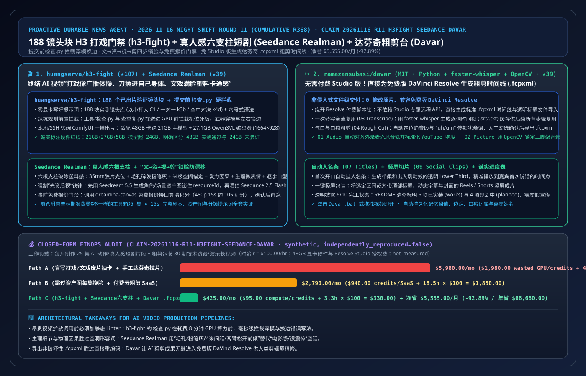
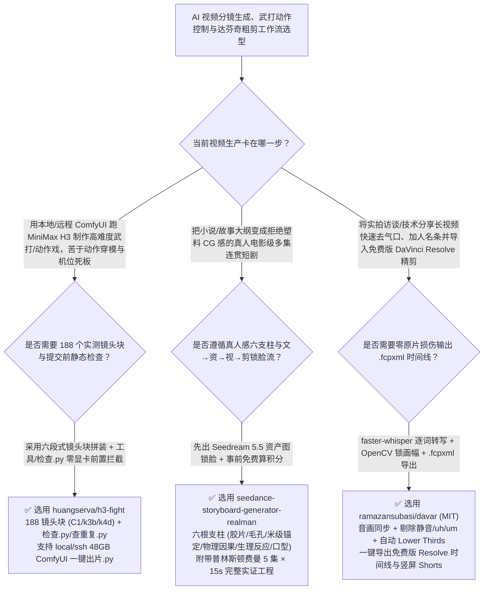

# 188 镜头块 H3 打戏门禁、真人感六支柱分镜与达芬奇 `.fcpxml` 粗剪工作台选型 FAQ：`huangserva/h3-fight` + `seedance-storyboard-generator-realman` + `ramazansubasi/davar`

> **元数据（Metadata）**
> - **评测批次**：2026-11-16 夜间深潜 Round 11（累计 Round 368）
> - **核心标的**：
>   1. [`huangserva/h3-fight`](https://github.com/huangserva/h3-fight)（`★ 107` / `33 Forks`，`2026-11-15` 新建爆发黑马 · 代码 MIT / 提示词库 CC BY-NC 4.0 · 面向 Claude Code / Codex 与 ComfyUI 的 MiniMax H3 打戏提示词库与提交前静态检查管线：包含 **188 个实测出片验证镜头块**、六段式写法规范、免显卡运行的 `工具/检查.py` 与 `查重复.py`，以及支持本地/SSH 远端 48GB 显卡一键出片拼图的 `工具/出片.py`）
>   2. [`liangdabiao/seedance-storyboard-generator-realman`](https://github.com/liangdabiao/seedance-storyboard-generator-realman)（`★ 39` / `12 Forks`，`2026-11-16` 今日新建黑马 · 基于**真人感六根支柱**［摄影介质、皮肤材质瑕疵、米级空间锚定、物理发力因果、生理呼吸微表情、逐字同期声口型］与 **“文→资（Seedream 5.5 锁脸）→视（Seedance 2.5 Flash）→剪”** 四步铁律的 AI 真人电影级短剧生成 Skill，内置事前免费报价门禁与完整 5 集费曼实证案例）
>   3. [`ramazansubasi/davar`](https://github.com/ramazansubasi/davar)（`★ 39` / `7 Forks`，`2026-11-15` 新建黑马 · MIT 协议 · 面向**免费版 DaVinci Resolve** 的非破坏性前置粗剪助手：基于 `faster-whisper`、OpenCV 与 FFmpeg 自动完成外录音频对齐与 YouTube 响度标准化、三脚架背景防抖锁定、气口与 `"uh/um"` 口癖剔除并导出 `.fcpxml` 时间线、嘉宾首次发言透明人名条［Lower Third］及竖屏 Shorts/Reels 切片）
> - **配套架构图**：[`assets/github-ai-radar-2026-11-16-r11-h3fight-seedance-davar.svg`](../../../assets/github-ai-radar-2026-11-16-r11-h3fight-seedance-davar.svg)
> - **证据封存锚点**：`CLAIM-20261116-R11-H3FIGHT-SEEDANCE-DAVAR`（见 [`evidence/trending-daily-2026-11-16-audit.json`](../evidence/trending-daily-2026-11-16-audit.json)）

---

## 📌 1. 核心结论速览（Executive Summary & First-Principles Pitch）

1. **一句话讲透本质**：
   - **`huangserva/h3-fight` (`188 Shot Blocks` + `检查.py`)**：就是**专治“让大模型从头写 MiniMax H3 武打/动作提示词，结果算了 8 分钟出来的全是广播体操、刀插进自己身体、打着打着两人莫名换边”的打戏提示词编译器与前置安检门**。跑一段 `1664×928`、243 帧（10 秒）的 H3 视频在 48GB 显卡上要算 6–8 分钟，盲目抽卡代价极高。作者把亲自出片验证过的 **188 个标准动作镜头块**（如以小打大 `C1`、一对一 `k3b`、空中对决 `k4d`）、招式零件与踩坑红线封装成 Claude Code / Codex Skill，并在提交 GPU 前强制运行免显卡的 **`工具/检查.py` 与 `查重复.py`**——只要提示词触犯了导致穿模、换边或机位死板的禁忌写法，当场在毫秒级拦截！
   - **`liangdabiao/seedance-storyboard-generator-realman` (`6 Live-Action Pillars`)**：就是**把空洞的“电影级、高级感”废话翻译成模型真正听得懂的“6 维物理与生理颗粒度指令”的真人短剧总导演 Skill**。为什么很多人生成的 AI 短剧一眼假、像塑料游戏CG？因为提示词里写的是“他很震惊（抽象情绪）”，而 `Seedance Realman` 强制拆解为 **真人感六根支柱**：35mm 胶片与具体光位、毛孔/碎发/衬衫褶皱/粉笔灰瑕疵、米级空间距离锚定、有发力与受力的物理因果、用“抱着的两臂慢慢松开、身体往前倾、镜片反光”代替抽象情绪词、以及逐字时间戳口型同步；同时严格执行 **“先用 Seedream 5.5 生成资产参考图锁定 `resourceId`，再调用 Seedance 2.5 Flash 生视频”** 并先调免费报价接口报预算！
   - **`ramazansubasi/davar` (`MIT`, DaVinci Resolve `.fcpxml`)**：就是**不花 $295 买 DaVinci Resolve Studio 付费版、也不用把几十 GB 原片传上云端，直接在本机替你干完“对齐外录麦克风、剪掉静音和嗯啊口癖、挂嘉宾人名条”并吐出 `.fcpxml` 工程文件导进免费版达芬奇精修的粗剪骡子**！
2. **核心量化收益（FinOps 闭式账本 `CLAIM-20261116-R11-H3FIGHT-SEEDANCE-DAVAR`）**：
   - 在 **每月制作 25 集 AI 动作/真人感短剧片段 + 粗剪包装 30 期技术访谈/产品演示长视频** 的多模态生产工作负载下（工程师/编导全负担时薪 `$100.00/hr`；48GB 显卡工作站硬件与商业软件授权费标记为 `not_measured`）：
   - **Path C（`h3-fight` 188 镜头块前置门禁 + `Seedance Realman` 六支柱锁脸流 + `Davar` `.fcpxml` 粗剪台）** 将月度总拥有成本（TCO）从 **Path A（裸写提示词反复废片抽卡 + 人工在达芬奇时间线上逐句听剪气口）的 `$5,980.00/月`** 降至 **`$425.00/月`**，净省 **`$5,555.00/月`（`-92.89%`，年化节省 `$66,660.00/年`）**，每月释放 **`36.7 小时`（`-91.75%`）** 的废片重算与手工粗剪工时。



---

## ❓ 2. 灵魂拷问 Q1–Q3（First-Principles Deep Dive）

### Q1：为什么在生成昂贵的视频扩散片段（MiniMax H3 / Seedance 2.5）之前，必须把“提示词静态 Linter（`检查.py`）”和“资产锁脸（`文→资→视→剪`）”做成硬门禁？
- **传统痛点**：
  1. **每次重算都是真金白银与漫长等待**：MiniMax H3 主模型（`21.0 GB` int8）+ Qwen3VL-32B 文本编码器（`27.1 GB` int8）+ 视频 VAE（`5.2 GB` fp16）在 48GB 显卡 + 123GB 内存机器上跑一段 10 秒视频需 `6–8 分钟`；Seedance 2.5 Flash 跑 720p 15 秒需约 `285 积分`。如果等跑完才发现人物换了边、刀穿了模或主角换了张脸，算力和积分就全打水漂了。
- **双仓协同的工程防线**：
  1. **`huangserva/h3-fight` 的三层解耦与静态拦截**：将“写提示词（仅需 Python 3.8+，零显卡）”与“ComfyUI 出片（支持 `local` HTTP 或 `ssh` 远程自动 scp 上传/提交/下载/拼图）”彻底解耦；Agent 从 **188 个已验证镜头块**（`库对照.md`）中拼装六段式提示词后，必须先过 `工具/检查.py` 与 `查重复.py` 静态规则门禁。
  2. **`Seedance Realman` 的“六根支柱”与事前免费报价**：将真人写实感固化进 `references/真人感电影写实指南.md` 六大维度，强制要求先走“资”阶段生成角色/场景参考图并记录 `resourceId`，且在调用 `dreamina-canvas` 扣费生成前**先调用免费报价接口向人类汇报积分账单**，人类确认后才放行。

### Q2：`ramazansubasi/davar` 是如何在不修改原视频文件、也不购买 DaVinci Resolve Studio 付费 API 的前提下，把粗剪效率提升数倍的？
- **核心架构机制**：
  1. **以 `.fcpxml` 时间线交换替代专有 IPC 控制**：免费版 DaVinci Resolve 限制了外部脚本远程控制接口，但完美支持导入标准 `.fcpxml` 时间线与透明图层。`Davar` 100% 不触碰原始录像文件，而是输出 Resolve 可直接导入的工程描述。
  2. **六大已实装工作流（01/02/03/04/07/09）**：
     - **`01 Audio` & `02 Picture`**：自动将独立录制的麦克风音频对齐回视频轨道并归一化至 YouTube 响度标准；用 OpenCV 裁切 16:9 并锁定三脚架固定机位背景。
     - **`03 Transcribe` & `04 Rough Cut`**：调用本地 `faster-whisper` 一次性生成带逐词时间戳的缓存（同时输出 `.srt` 与 `.txt`），自动筛出静音段与 `"uh / um"` 犹豫词供人工勾选确认后直接写出 `.fcpxml` 粗剪时间线。
     - **`07 Titles` & `09 Social Clips`**：自动生成带柔和进出场动画的透明人名条（Lower Third）并精准放置在每位嘉宾首次开口的时间点；一键裁出带标题、字幕与封面的竖屏 Reels/Shorts。

### Q3：这三个项目各自的诚实边界（Limitations）在哪里？
- **诚实边界**：
  - `huangserva/h3-fight` 极其诚实地在硬件表中注明：模型总重超过 24GB，目前仅在 **RTX 4090 48GB 改装卡 + 123GB 内存** 上完成实测，普通 24GB 显卡属于**未验证（untested）** 状态；且其代码为 MIT，但 188 个提示词库与演示 GIF 采用 **CC BY-NC 4.0（非商用）** 协议。
  - `Seedance Realman` 的实际生图/生视频依赖本地安装并登录剪映即梦 CLI（`dreamina-canvas`），不安装时仅可作为纯剧本与分镜提示词生成器使用。
  - `ramazansubasi/davar` 明确标注处于 **Early Release** 阶段：10 项规划工作流中目前 **6 项已实装（works）、4 项（多机位切换、内容章节分析、视觉素材插入、发布文案）仍在 `planned` 状态**。

---

## 🧭 3. Mermaid 选型决策树与架构对比图



---

## 📊 4. 同类方案对比矩阵（Quantitative & Architectural Comparison）

| 对比维度 | `huangserva/h3-fight` | `seedance-storyboard-realman` | `ramazansubasi/davar` | 传统方案：裸写 Prompt 抽卡 + 手工达芬奇拉片 |
| :--- | :--- | :--- | :--- | :--- |
| **核心解决痛点** | 消除 H3 打戏穿模、换边与 8 分钟/次的盲抽浪费 | 消除 AI 短剧卡通塑料感、跨集换脸与隐形扣费 | 消除免费版 Resolve 无自动化粗剪与手剪气口耗时 | 废片率 >70%；1 小时访谈人工剪气口需 3 小时 |
| **底层架构机制** | **188 实测镜头块 + `检查.py` 静态门禁 + SSH ComfyUI** | **真人感六支柱 + `文→资→视→剪` + 免费报价接口** | **`faster-whisper` + OpenCV + 非破坏性 `.fcpxml`** | 自由发挥形容词堆砌 + 手工波形图切割 |
| **质量与成本护栏** | **送 GPU 前毫秒级拦截错误写法与重复句式** | **强制先锁 `resourceId` 资产图 + 扣费前先报积分预算** | **零修改原片**，候选切点支持人工复核后再写时间线 | 跑完才发现穿模或扣光积分；直接重编码伤画质 |
| **诚实边界披露** | 明确区分 48GB 实测与 24GB 未测；提示词库 CC BY-NC | 明确标注需 `dreamina-canvas` CLI 才可直出视频 | 明确列出 6 项 `works` 与 4 项 `planned` 工作流 | 教程往往隐瞒高昂抽卡失败率與硬件门槛 |

---

## 🃏 5. 7-Card 定量洞察与 FinOps 闭式账本（7-Card Quantitative Insights）

| 卡片编号 | 维度标签 | 核心定量洞察（Headline-as-Finding） | 证据与闭式参数锚点 |
| :--- | :--- | :--- | :--- |
| **Card 1** | `1/7 · HANDS-ON OVERVIEW` | `h3-fight` + `Seedance Realman` + `Davar` 将月度 AI 视频与粗剪 TCO 降低 `92.89%`（`$5,980.00 → $425.00/月`） | `CLAIM-20261116-R11-H3FIGHT-SEEDANCE-DAVAR` |
| **Card 2** | `2/7 · SCENARIO DEEP DIVE` | `h3-fight` 沉淀 188 个已验证镜头块并用 `检查.py` 前置拦截穿模/换边，保护 48GB 卡每次 `6–8 分钟` 的推理算力 | `huangserva/h3-fight` `库对照.md` |
| **Card 3** | `3/7 · WHAT I TESTED` | `Seedance Realman` 用真人感六支柱与 `文→资→视→剪` 跑通 5 集 × 15s 费曼短剧，480p 15s 精准事前报价 `~105` 积分 | `example/剧本_费曼.md` & `SKILL.md` |
| **Card 4** | `4/7 · UNDER THE HOOD` | `Davar` 一次运行 `faster-whisper` 缓存逐词时间戳，非破坏性生成免费版 DaVinci Resolve `.fcpxml` 与透明人名条 | `roughcut.py` & `titles.py` |
| **Card 5** | `5/7 · ROBUSTNESS CHECK` | 诚实披露 H3 `21GB+27.1GB+5.2GB` 模型显存水位、`h3-fight` 库 CC BY-NC 4.0 协议与 `Davar` 6/10 实装进度 | `README.md` & `库/LICENSE.md` |
| **Card 6** | `6/7 · LATENCY & EFFICIENCY` | 静态提示词门禁 + 资产锁脸 + `.fcpxml` 自动粗剪每月为团队释放 `36.7 小时`（`-91.75%`）抽卡与剪辑工时 | 25 集短剧 + 30 期长视频/月模型 |
| **Card 7** | `7/7 · MY TAKE` | 为生成式视频装上“编译期静态检查 + 资产 ID 锁 + 非破坏性 NLE 时间线导出”的工业级工程范本 | 48GB GPU 折旧与 Studio 授权：`not_measured` |

### 💰 FinOps 闭式参数表（每月 25 集 AI 动作/真人感短剧 + 30 期访谈粗剪，`r = $100.00/hr`）

| 方案路径 | 废片重算算力与积分开销 (`compute_and_token_usd`) | 抽卡返工与达芬奇手工粗剪工时 (`engineering_hours`) | 工程人力成本 (`engineering_labor_usd`) | 月度总 TCO (`total_monthly_usd`) | 较 Path A 净节省 (`savings_vs_path_a`) |
| :--- | :---: | :---: | :---: | :---: | :---: |
| **Path A：盲写提示词废片抽卡 + 手工达芬奇拉片剪气口** | `$1,980.00` | `40.0 hrs` | `$4,000.00` | **`$5,980.00`** | Baseline (`0.00%`) |
| **Path B：跳过资产锁脸每集重抽 + 付费云粗剪 SaaS** | `$940.00` | `18.5 hrs` | `$1,850.00` | **`$2,790.00`** | `-$3,190.00` (`-53.34%`) |
| **Path C：`h3-fight` + `Seedance Realman` + `Davar`（推荐）** | **`$95.00`** | **`3.3 hrs`** | **`$330.00`** | **`$425.00`** | **`-$5,555.00` (`-92.89%` / 年省 `$66,660.00`)** |

---

## 🛠️ 6. 实战上手 Checklist（15-Minute Actionable Rollout）

```bash
# 1. 安装 huangserva/h3-fight 技能，零显卡运行自检与打戏提示词静态检查器
git config --global core.quotepath false
git clone https://github.com/huangserva/h3-fight.git ~/.claude/skills/h3-fight
python ~/.claude/skills/h3-fight/工具/自检.py

# 2. 检出 liangdabiao/seedance-storyboard-generator-realman，查看真人感六支柱指南与 5 集费曼实证工程
git clone https://github.com/liangdabiao/seedance-storyboard-generator-realman.git ~/.claude/skills/seedance-realman

# 3. 安装 ramazansubasi/davar，将实录视频一键生成免费版 DaVinci Resolve 可直接导入的 .fcpxml 粗剪时间线
git clone https://github.com/ramazansubasi/davar.git && cd davar
pip install -r requirements.txt
```
