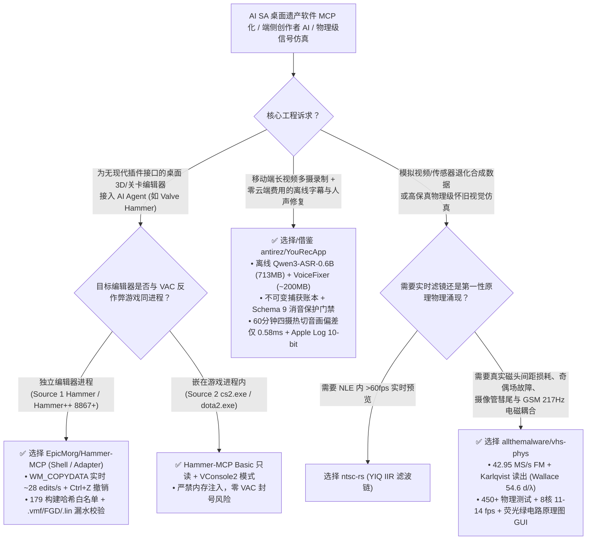

# 零插件 Win32 原生通道关卡编辑器 MCP（`EpicMorg/Hammer-MCP`）、Redis 作者 `antirez` 端侧 `Qwen3-ASR` + `VoiceFixer` 创作者相机（`YouRecApp`）与 `42.95 MS/s` 第一性原理磁带物理仿真（`allthemalware/vhs-phys`）选型与架构实战 FAQ

> **所属专栏**：GitHub AI 趋势雷达 · 2026-11-15 Night Round 54（累计第 356 轮 / R356）独立深度选型专题  
> **核心剖析项目**：[`EpicMorg/Hammer-MCP`](https://github.com/EpicMorg/Hammer-MCP)（★40 · MIT · C#/.NET 10 Valve Hammer 实时 MCP 服务端）、[`antirez/YouRecApp`](https://github.com/antirez/YouRecApp)（★39 · MIT · Swift/Metal iOS 17+ 离线 `Qwen3-ASR-0.6B` 与 `VoiceFixer` 多轨视频录制编辑器） & [`allthemalware/vhs-phys`](https://github.com/allthemalware/vhs-phys)（★39 · PolyForm Noncommercial 1.0.0 · Rust `42.95 MS/s` Karlqvist 磁头物理 VHS 模拟器）  
> **对标标杆**：`ib-vs-ethernet-roce-selection-faq.md`（通俗大白话 + 第一性原理 + Mermaid 决策树 + 7-Card 定量洞察 + 闭式 FinOps 账本 + 15 分钟上手 Checklist）  
> **配套高清架构图**：[`assets/github-ai-radar-2026-11-15-r54-hammermcp-yourec-vhsphys.svg`](../../../assets/github-ai-radar-2026-11-15-r54-hammermcp-yourec-vhsphys.svg) · [English Version (`hammer-mcp-yourec-vhs-phys-wm-copydata-mcp-qwen3-asr-voicefixer-karlqvist-fm-selection-faq.en.md`)](hammer-mcp-yourec-vhs-phys-wm-copydata-mcp-qwen3-asr-voicefixer-karlqvist-fm-selection-faq.en.md)

---

## 📌 一、核心结论速览（Executive Summary：先看结论，30 秒抓本质）

1. **为什么把这三个项目放在同一篇给 AI 解决方案架构师（SA）精读？**
   - 它们代表了三种极具启发性的**第一性原理工程范式**：
     1. **如何让 AI Agent 操控没有现代插件 API 的 20 年老牌工业/3D 桌面软件？** —— `EpicMorg/Hammer-MCP` 没有去写脆弱的内存篡改外挂，而是挖出了 Valve 20 年前内置在编辑器里的 `Worldcraft_ShellMessageWnd` (`WM_COPYDATA`) 窗口消息通道；
     2. **Redis 之父 `antirez` 如何用 AI 打造一款真正能在 iPhone 上替代繁琐桌面剪辑（DaVinci Resolve）的创作者工具？** —— `antirez/YouRecApp` 把 **离线 `Qwen3-ASR-0.6B`（`713 MB`）字幕生成 + 内置 `~200 MB` `VoiceFixer` / `LavaSR` 语音修复 + 10-bit Apple Log 录制与前后四摄无缝热切** 塞进了一台手机；
     3. **为什么真正的物理信号仿真能吊打“十几个独立像素滤镜滑块”？** —— `allthemalware/vhs-phys` 以 **`42.95 MS/s` 采样率**在二维螺旋磁带上模拟 FM 调制与 **Karlqvist 洛伦兹读出脉冲**，让 **Wallace `54.6 d/λ` dB 间距损耗定律**、奇偶场交替雪花、走带偏移与 GSM 手机 `217 Hz` 电磁干扰自然涌现！
2. **`EpicMorg/Hammer-MCP` 是什么？解决了什么痛点？**
   - **一句话大白话本质**：一个基于 **.NET 10（Streamable HTTP `:47800/mcp` + Bearer Token 或 `stdio`）** 的 MCP 服务端，无需修改编辑器二进制，就能让 Claude Code / Cursor / OpenCode 以 **`~28 次编辑/秒`** 的速度在 **Valve Hammer / Hammer++（8867+）** 中实时生成、旋转实体并全部进入原生 **`Ctrl+Z` 撤销栈**。
   - **第一性原理突破**：
     - **跨 152 个版本的原生消息通道 + 179 个构建哈希注册表**：复用 Source SDK 2013 `editor_sendcommand.cpp` 背后的 `Worldcraft_ShellMessageWnd` (`WM_COPYDATA`) 与在全部 **152 个 Source Hammer 版本中完全一致的菜单命令 ID (`WM_COMMAND`)**，读写磁盘 `.vmf`/`.bsp`/FGD I/O 图并追踪 `.lin` 漏水路径（Leak Trace）。
     - **绝对不碰 VAC 保护游戏进程（Zero-VAC-Ban Safety）**：因为 Source 2（CS2 / Dota 2）的 Hammer 运行在游戏进程内部，`Hammer-MCP` 在 C# 主程序与 C++ 原生注入器中实施**双重硬编码锁**——对 Source 2 仅做 `OpenProcess` 只读查询与磁盘 `.vmap`/FGD 读取，**绝不向任何游戏进程或未知构建注入代码**！
3. **`antirez/YouRecApp` 与 `allthemalware/vhs-phys` 各自有哪些硬核架构亮点？**
   - **`antirez/YouRecApp`（Redis 作者 Salvatore Sanfilippo 新作）**：
     - **100% 端侧离线语音 AI 链**：一键可选下载 **`713 MB` 的 `Qwen3-ASR-0.6B`** 即可在机内离线生成、分词重排并渲染字幕；同时内置 **`~200 MB` 全频段 `VoiceFixer` 神经网络** 与 **`LavaSR`** 语音细节修复，支持边播边切 `Bypass / Enhanced` AB 对比；
     - **不可变录制账本（Immutable Capture Ledger）与 60 分钟真机四摄热切实测**：将原始录制分片与原子编辑清单（Schema 9 前向兼容保护）解耦，哪怕多次 Undo/Redo 也绝不丢失新录素材；在 iPhone 14 Pro Max 上连续录制 **60 分钟并频繁切换四颗摄像头**，最终合成单文件音画时长偏差仅 **`0.58 ms`**、音频包最大间隔 **`<1 ms`**、60 个温控检查点全部正常！
   - **`allthemalware/vhs-phys`（450+ 项 Rust 物理定律测试）**：
     - **从滤波滑块到物理涌现**：在 `42.95 MS/s` 下模拟双磁头螺旋扫描（SP/LP/EP 磁迹间距 `58 / 28.9 / 19.3 μm`）与 Karlqvist 读出脉冲（脉冲宽度 = 磁隙 + 磁化翻转区 + 磁头磁带间距，使 **Wallace `54.6 d/λ` dB 损耗**自动成立）；单磁头脏污（`+extra_spacing_um`）自然只衰减隔场 RF 包络并触发 **1H 循环延迟线（Dropout Compensator）**，而摄像管（Plumbicon / Vidicon）模拟靶面电荷残留与彗尾（Comet Tails），外部世界页面直接用偶极子场/洛伦兹力模拟 **GSM 手机每 `4.615 ms` 一次 `577 μs` 突发脉冲**（引发 `217 Hz` 音频嗡声与每 `72.6` 行一条 `9` 行高的干扰带），并通过 **450+ 个 Rust 单元测试** 与 Python 数值积分实验室交叉验证（8 核 CPU 达 `11–14 fps`，内存仅 `~0.5 GB`）。
4. **闭式 FinOps 核算（`CLAIM-20261115-R54-HAMMERMCP-YOUREC-VHSPHYS`）**：
   - 按每月 12 组 3D 编辑器集成、移动端视频/字幕制作与物理视觉特效仿真任务核算（工程师时薪 `$100/hr`）：从 **Path A（编写易崩且有封号风险的内存 Hook 插件 + 购买云端按分钟计费 ASR/音频降噪 API + 手工调十几个独立滤镜滑块，月均 `$6,010.00/mo`）** 切换到 **Path C（`Hammer-MCP` 原生 `WM_COPYDATA` 通道 + `YouRecApp` 端侧 `Qwen3-ASR-0.6B`/`VoiceFixer` + `vhs-phys` `42.95 MS/s` 物理核心，月均 `$440.00/mo`）**，每月净省 **`$5,570.00/mo`（`-92.68%`）**，年化节省 **`$66,840.00/yr`**，节省 **`37.0 小时/月`（`-91.36%`）**（底层硬件购置成本显式标注为 `not_measured`）。

---

## 💬 二、三大灵魂拷问（Q1–Q3：大白话穿透底层原理）

### Q1：很多老牌工业软件或关卡编辑器（如 Valve Hammer）根本没有现代 HTTP/WebSocket 插件接口，`EpicMorg/Hammer-MCP` 是怎么做到“零插件、秒级 28 次实时编辑、还能按 Ctrl+Z 撤销”的？
- **“读写分离 + 挖掘历史 IPC 遗产”架构范式**：
  1. **写通道（`WM_COPYDATA` + `WM_COMMAND`）**：Valve 早在 2006 年的 Source Hammer 里就内置了一个隐藏窗口类 `Worldcraft_ShellMessageWnd`（原用于外部编译脚本发指令），而且在作者静态分析的 **152 个 Hammer 版本**中，菜单栏命令 ID（保存、撤销、重做、编译运行）完全一致！`Hammer-MCP` 直接向该句柄发送 `WM_COPYDATA` 指令创建/旋转实体（实测在 Hammer++ 8873 上旋转储物柜达 **`~28 edits/s`** 且界面丝滑），所有改动自动进入 Hammer 原生 `Ctrl+Z` 历史。
  2. **读通道（磁盘 `.vmf` / `.bsp` / FGD 知识图谱）**：因为 `WM_COPYDATA` 是单向只写的，`Hammer-MCP` 把会话绑定到已保存的 `.vmf`（检查 `mapversion`），直接解析 `.vmf` 实体 I/O 触发图、对照游戏 FGD 校验非法属性、扫描 `gameinfo.txt` 与 VPK 资产库，并解析编译后的 `.bsp` 实体块与 `.lin` 漏水轨迹。
  3. **反作弊（VAC）安全铁律**：当面对把编辑器嵌在 `cs2.exe`/`dota2.exe` 里的 Source 2 时，严格退化为磁盘 `.vmap`/FGD 只读与 `VConsole2` 白名单命令，绝不注入内存。

### Q2：在 iPhone 上边开车/边走边录 60 分钟长视频并随时切换前后摄像头，为什么普通相机 App 容易音画不同步或丢素材？`antirez/YouRecApp` 是怎么解决的？
- **三大移动端音视频与端侧 AI 工程设计**：
  1. **不可变捕获账本（Capture Ledger）与原子编辑清单分离**：所有摄像头/麦克风原始录制直接写入不可变分段文件，暂停、停止或杀进程重启后仍可无缝追加到同一项目；切换摄像头时自动冻结保持上一帧预览画面直到目标镜头就绪；实测 iPhone 14 Pro Max **连续 60 分钟四摄切换录制**合成单文件后，**音视频总时长偏差仅 `0.58 ms`，音频包无任何 `>1 ms` 间隙**！
  2. **Schema 版本门禁保护隐私编辑**：例如消音打码（Censoring）和外部音频导入会将项目升级为 `Schema 9`；旧版本 App 打开高版本项目时会显式拒绝，**绝不静默丢弃编辑或意外把已消音的敏感语音暴露出来**。
  3. **端侧离线双模型协同（`Qwen3-ASR-0.6B` + `VoiceFixer`）**：下载一次 `713 MB` 的 `Qwen3-ASR-0.6B` 即可完全离线转写字幕并按词数自动分句；内置 `~200 MB` 全频段 `VoiceFixer`（配合 `LavaSR`）离线修复录音瑕疵，且中断导出后重新导出时会自动复用已缓存完成的音频修复窗口。

### Q3：为什么像 `ntsc-rs` 这样的传统像素滤镜链模拟不出真实的旧磁带故障，而 `allthemalware/vhs-phys` 能靠几条物理公式让所有故障联动出现？
- **四个直观物理对比（来自 `vhs-phys` 实测对照）**：
  1. **单磁头脏污（`dirty-heads`）**：双磁头旋转鼓上如果只有 1 个磁头沾灰抬高了间距（`+extra_spacing_um`），根据 **Wallace `54.6 d/λ` dB 波长损耗定律**，只有**奇数场（或偶数场）**的 `3.4–4.4 MHz` FM 载波信噪比会跌破阈值并触发录像机的 **1H 循环延迟线（用上一行亮度修补当前行）**，而干净磁头读出的另一场依然清晰！传统滤镜只会在所有帧上均匀撒假雪花。
  2. **EP 慢速录放（`tape_speed = ep`）**：传统 IIR 低通滤波会在画面左侧留下一条 6 像素宽的黑边延迟伪影；而 `vhs-phys` 直接把螺旋磁迹宽度从 `58 μm` 缩窄到 `19.3 μm`（自然带来 `-4.8 dB` 载噪比下降），遵循 IEC 60774-1 Table 4 子预加重，并将 A 磁头载波偏移 `+f_H/2` 实现邻道串扰逐行抵消。
  3. **绝对帧号确定性（`--start` 任意切片一致）**：磁带折痕、氧化层脱落（Dropouts）和时基抖动都是**绝对帧号（Absolute Frame Index）**的确定性函数，因此用 `--start 30 -t 10` 渲染 2 秒预览与渲染整部电影的第 30 秒完全一致！

---

## 🧭 三、架构师选型决策树与信号流图（Mermaid）



---

## 📊 四、同类方案横向对比矩阵（Comparison Matrix）

| 评估维度 | `EpicMorg/Hammer-MCP` (.NET 10 + Win32 IPC) | `antirez/YouRecApp` (Swift + Metal + 端侧 AI) | `allthemalware/vhs-phys` (Rust 物理引擎 + PySide6) | 传统内存注入插件 / 云端音视频 API / 1D 像素滤镜 |
| :--- | :--- | :--- | :--- | :--- |
| **核心第一性原理** | 复用 20 年前内置的 `Worldcraft_ShellMessageWnd` (`WM_COPYDATA`) 与 `WM_COMMAND` + `.vmf` 读回 | 不可变录制分片账本 + 端侧离线 `Qwen3-ASR-0.6B` (`713MB`) & `VoiceFixer` (`~200MB`) | **`42.95 MS/s` FM 磁带记录** + Karlqvist 洛伦兹读出脉冲（自然涌现 Wallace `54.6 d/λ` 损耗） | 强行 Hook 宿主内存 / 上传云端转录 / 叠加独立高斯噪声与 IIR 模糊 |
| **关键实测性能指标** | 兼容 **152 个 Source 版本**（注册表含 **179 个构建**）；实时旋转达 **`~28 edits/s`** | 60 分钟四摄切换录制音画偏差 **`0.58 ms`**，音频间隙 **`<1 ms`**，支持 4K 10-bit Apple Log | **450+ 项 Rust 测试**；8 核 CPU 达 **`11–14 fps`**（Plumbicon 摄像管模式 `~2 fps`），峰值内存 `~0.5 GB` | 版本更新即崩溃；云端 API 按分钟持续烧钱；EP 模式留 6px 黑边 |
| **安全与防呆设计** | 双重禁止向 `cs2.exe`/`dota2.exe` 注入；所有编辑进原生 `Ctrl+Z`；支持勾选审批模式 | `Schema 9` 阻止旧版静默丢失消音（Censoring）片段；导出写入临时文件且拒绝覆盖原片 | 拒绝非法制式组合（如 PAL 下的 EP 速度）；跨 625/50 与 525/59.94 强制要求 `bbc_four_field` 转换器 | 极易触发 VAC 封号、意外泄露未打码音频或覆盖原始素材 |
| **开源许可协议** | **MIT License** | **MIT License**（`VoiceFixer` 权重为 CC BY 4.0） | **PolyForm Noncommercial 1.0.0**（非商业免费，商用需单独授权） | 闭源 SaaS 或高维护成本私有脚本 |

---

## 🃏 五、7-Card 4:5 定量洞察与闭式 FinOps 账本（`CLAIM-20261115-R54-HAMMERMCP-YOUREC-VHSPHYS`）

| 卡片编号 | 卡片标题（Headline-as-Finding） | 关键定量指标与架构证据（源自官方 README 实测与封闭式审计） |
| :--- | :--- | :--- |
| **Card 1 · HANDS-ON** | 零插件 `WM_COPYDATA` 实时 `28 edits/s` MCP + 离线 `713MB` `Qwen3-ASR` 手机剪辑 + `42.95 MS/s` 物理磁带引擎 | 三项目分别在遗产桌面软件 IPC、移动端离线多模态 AI 与物理信号仿真上树立标杆 |
| **Card 2 · SCENARIO** | iPhone 连续 60 分钟四摄热切录制音画偏差仅 `0.58 ms` + Hammer 152 个构建菜单 ID 零差异统一控制 | `YouRecApp` 音频包无 `>1 ms` 间隙；`Hammer-MCP` 支持 `Ctrl+Z` 撤销与 `.lin` 漏水路径自动追踪 |
| **Card 3 · MATRIX** | 覆盖 179 个 Hammer 构建哈希、10-bit HLG/Apple Log 色彩管线与 NTSC/PAL/PAL-60 三大电视制式（SP/LP/EP） | `vhs-phys` 通过 450+ 个 Rust 物理测试与 Python 数值 Karlqvist 积分校验，模拟 `58 / 28.9 / 19.3 μm` 磁迹 |
| **Card 4 · MECHANICS** | Wallace `54.6 d/λ` dB 间距损耗自动涌现 + GSM `577 μs` (`217 Hz`) 电磁整流耦合 + `Schema 9` 防泄密门禁 | 单磁头脏污自动触发隔场 1H 延迟线补偿；`YouRecApp` 拆分不可变捕获账本与原子编辑清单 |
| **Card 5 · ROBUSTNESS** | 双重禁止向 VAC 进程 (`cs2.exe`) 注入 + `--start` 绝对帧号确定性预览 + 音频修复阶段断点缓存复用 | `vhs-phys` 2 秒片段预览与整片渲染帧级一致；`YouRecApp` 重启视频导出时直接复用已完成的 `VoiceFixer` 音频段 |
| **Card 6 · LATENCY & TCO** | 12 组月度多媒体与仿真工作负载成本从 `$6,010.00/mo` 降至 `$440.00/mo`（净省 `$5,570.00/mo` / `-92.68%`） | 年化节省 `$66,840.00/yr`，每月节省 `37.0h`（`-91.36%`）插件排障、导片等待与滤镜调参工时 |
| **Card 7 · MY TAKE** | ✅ 强烈推荐借鉴 `WM_COPYDATA` MCP 桥接与端侧 `Qwen3-ASR` 架构；⛔ 注意 `vhs-phys` 为非商业许可证 | `Hammer-MCP` 与 `YouRecApp` 为 MIT；底层工作站/手机硬件成本显式标注为 `not_measured` |

### 💰 闭式 FinOps 成本核算表（`CLAIM-20261115-R54-HAMMERMCP-YOUREC-VHSPHYS`）
- **核算范围**：每月 12 组 3D 关卡/CAD 编辑器 AI 协同、创作者多机位视频字幕/降噪制作与物理级退化视频合成工作负载（工程师时薪 `$100.00/hr`，底层工作站与 iPhone 硬件购置成本：`not_measured`）：

| 方案路径 | 云端音视频 API 与算力成本 (USD/月) | 插件维护与剪辑调参人力 (工时 × $100/h) | 月度总成本 (Total USD/月) | 相对 Path A 节省金额 | 相对 Path A 节省比例 |
| :--- | :---: | :---: | :---: | :---: | :---: |
| **Path A：易崩内存 Hook 插件 + 按分钟计费云端 ASR/降噪 API + 手工调滤镜滑块** | `$1,960.00` | `40.5h` (`$4,050.00`) | **`$6,010.00`** | — | — |
| **Path B：纯离线 `.vmf` 脚本 + 桌面 DaVinci 往返导片 + 1D IIR 像素滤镜链** | `$870.00` | `19.0h` (`$1,900.00`) | **`$2,770.00`** | `-$3,240.00/mo` | `-53.91%` |
| **Path C（推荐）：`Hammer-MCP` 原生 IPC + `YouRecApp` 端侧 AI + `vhs-phys` 物理核** | **`$90.00`** | **`3.5h` (`$350.00`)** | **`$440.00`** | **`-$5,570.00/mo`（年省 `$66,840.00`）** | **`-92.68%`（工时省 `-91.36%`）** |

---

## 🛠️ 六、15 分钟实战上手 Checklist（Runbook）

### 1. 构建并连接 `EpicMorg/Hammer-MCP` 实时控制 Valve Hammer / Hammer++（5 分钟）
- [ ] **第 1 步：使用 .NET 10 SDK 编译并运行单元测试**
  ```bash
  git clone https://github.com/EpicMorg/Hammer-MCP.git
  cd Hammer-MCP/src
  dotnet build HammerMcp.sln
  dotnet test --solution HammerMcp.sln
  ```
- [ ] **第 2 步：通过 Streamable HTTP 或 `stdio` 接入 Claude Code**
  ```bash
  claude mcp add --transport http hammer http://127.0.0.1:47800/mcp
  # 在 Hammer 中打开并保存地图（绑定 mapversion），即可用自然语言实时生成/旋转实体并随时按 Ctrl+Z 撤销
  ```

### 2. 验证 `antirez/YouRecApp` 核心持久化/DSP 测试与 `allthemalware/vhs-phys` 450+ 物理测试（10 分钟）
- [ ] **第 1 步：在 macOS 上运行 `YouRecApp` 的持久化历史与 DSP 滤波稳定性回归测试**
  ```sh
  git clone https://github.com/antirez/YouRecApp.git
  cd YouRecApp
  ./scripts/test-core.sh --core-only
  ```
- [ ] **第 2 步：编译 `allthemalware/vhs-phys` 并运行 450+ 项 Rust 物理定律测试与确定性片段渲染**
  ```sh
  git clone https://github.com/allthemalware/vhs-phys.git
  cd vhs-phys
  cargo test --release
  cargo build --release
  ./target/release/vhsphys run input.mp4 out.mp4 --preset worn --seed 12 --start 30 -t 10 --size 1280x720
  ```
