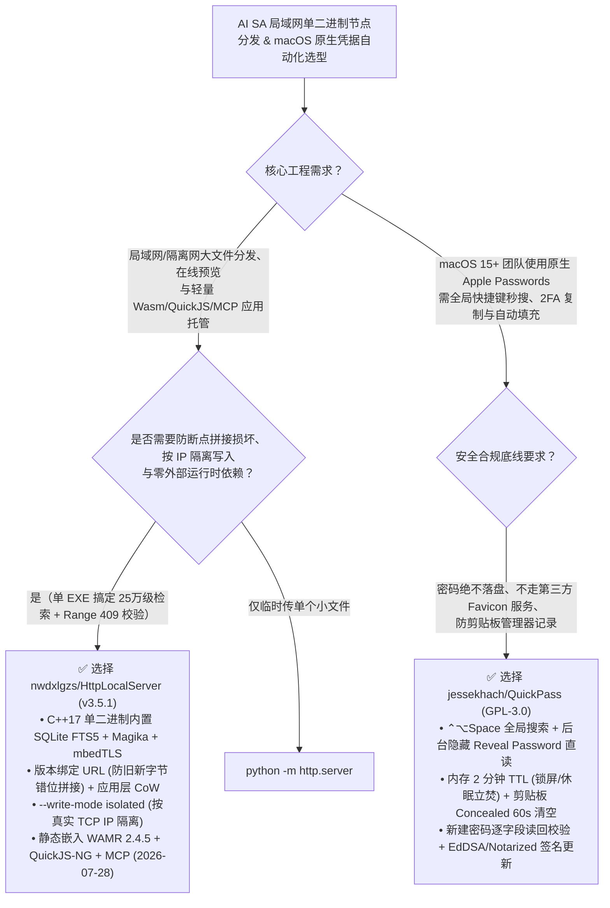

# 内置 WAMR/QuickJS/Magika/MCP 的 C++17 单文件内网服务（`nwdxlgzs/HttpLocalServer`）与零落盘 macOS Accessibility 密码快启器（`jessekhach/QuickPass`）选型与架构实战 FAQ

> **所属专栏**：GitHub AI 趋势雷达 · 2026-11-15 Night Round 55（累计第 357 轮 / R357）独立深度选型专题  
> **核心剖析项目**：[`nwdxlgzs/HttpLocalServer`](https://github.com/nwdxlgzs/HttpLocalServer)（★39 · Apache-2.0 · C++17 单二进制局域网文件传输/Web/WAMR/QuickJS-NG/MCP 服务端 `v3.5.1`） & [`jessekhach/QuickPass`](https://github.com/jessekhach/QuickPass)（★39 · GPL-3.0 · Swift macOS 15+ 基于 Accessibility API 的 Apple Passwords 全局快捷键启动器）  
> **对标标杆**：`ib-vs-ethernet-roce-selection-faq.md`（通俗大白话 + 第一性原理 + Mermaid 决策树 + 7-Card 定量洞察 + 闭式 FinOps 账本 + 15 分钟上手 Checklist）  
> **配套高清架构图**：[`assets/github-ai-radar-2026-11-15-r55-httplocalserver-quickpass.svg`](../../../assets/github-ai-radar-2026-11-15-r55-httplocalserver-quickpass.svg) · [English Version (`httplocalserver-quickpass-cpp17-wamr-quickjs-mcp-lan-server-macos-accessibility-passwords-selection-faq.en.md`)](httplocalserver-quickpass-cpp17-wamr-quickjs-mcp-lan-server-macos-accessibility-passwords-selection-faq.en.md)

---

## 📌 一、核心结论速览（Executive Summary：先看结论，30 秒抓本质）

1. **为什么把这两个项目放在同一篇给 AI 解决方案架构师（SA）对比？**
   - 在企业内网（Air-Gapped LAN）工程交付与开发者桌面安全提效中，有两个高频需求长期被过度工程化：一是**在内网快速拉起一个支持断点续传、全文检索、Office/代码在线预览、甚至能跑 Wasm/QuickJS 脚本和暴露 MCP 协议的共享节点**（传统做法要装 Docker + Nginx + MinIO + SQLite + Node.js 一大堆容器）；二是**从付费第三方密码管理器（如 1Password）迁移到 macOS 原生 Apple Passwords（原 iCloud 钥匙串）后，如何在不暴露明文密码落盘、不污染剪贴板历史的前提下找回全局快捷键秒填体验**。
2. **`nwdxlgzs/HttpLocalServer`（`v3.5.1`）是什么？解决了什么痛点？**
   - **一句话大白话本质**：一个用 **C++17** 编写、**运行时只需部署单个可执行文件**的局域网 HTTP/HTTPS 文件传输与轻量应用底座——单二进制里直接静态塞进了 **SQLite（FTS5 trigram 内存索引，支持 25 万条目）、Google Magika 文件类型推断模型、WAMR `2.4.5`（WebAssembly Micro Runtime）、QuickJS-NG 引擎、mbedTLS、汉化 Monaco 编辑器、Office/PDF/PPT 预览器以及兼容 `2026-07-28` 规范的 MCP 服务端**！
   - **第一性原理突破**：
     1. **版本绑定的 `409` 防错位拼接下载 + 应用层 CoW（写时复制）**：普通 HTTP Range 服务器在下载大文件（如几十 GB 的模型权重或 ISO）中途若源文件被更新，续传时会把旧前半段和新后半段静默拼成一个损坏文件！`HttpLocalServer` 生成绑定了文件标识、大小与修改时间的版本 URL，一旦文件变动立即返回 **`HTTP 409`**；且服务内覆盖采用**应用层 CoW（先完整写完并刷盘临时文件，不占全局写锁，旧下载继续读旧句柄，新下载读新版本）**。
     2. **按真实 TCP 对端隔离的 `--write-mode isolated` 与反慢速攻击**：远端访客只能在 `/_clients/<实际 TCP IP>/` 下读写自己的目录（**显式忽略可伪造的 `X-Forwarded-For`**），支持 `--ip-upload-gb` 配额；写令牌接口校验数字 IP / `localhost` `Host` 头防 DNS Rebinding；拒绝上传后的排空严格限制在 **`64 KiB` 与绝对 `1 秒` 期限**内，彻底封死慢速滴流（Slowloris）耗尽连接池攻击；文件路径在 Linux/macOS 用逐级 `openat` + `O_NOFOLLOW`，在 Windows 拒绝 NTFS 备用数据流（ADS）、符号链接与重解析点（Reparse Points）。
3. **`jessekhach/QuickPass` 是什么？解决了什么痛点？**
   - **一句话大白话本质**：一款专为 **macOS 15+ (Sequoia / macOS 26)** 打造的原生 Swift 快捷键悬浮搜索栏（默认 `⌃⌥Space`），在 Apple Passwords **没有任何公开 API** 的情况下，通过 **macOS Accessibility（辅助功能）API** 实现 1Password 级的全局搜索、一键复制用户名（`⌘C`）/密码（`⇧⌘C`）/2FA 验证码（`⌥⌘C`）与自动填充（`⌘↩` / `⌥⌘↩`）。
   - **第一性原理突破（Accessibility 自动化如何做到零泄密？）**：
     1. **后台隐藏态 `Reveal Password` 直读（绕过剪贴板中转）**：读取密码时，保持 Apple Passwords 处于隐藏状态，触发其自身的 `Reveal Password` 从 Accessibility 树直接读取明文并立即重新掩码（Mask），**全程不经过系统剪贴板**！
     2. **新建登录项的“逐字段读回校验（Field-by-Field Read-Back）”**：通过 Accessibility 往系统 Passwords 表单填完新建账号后，必须**把每个字段重新读回比对，100% 一致才点击保存**，杜绝因焦点漂移写错密码。
     3. **纯内存 2 分钟 TTL + 隐匿剪贴板（Concealed Clipboard）60 秒自动清空 + 直连源站拉取图标**：密码与 2FA 码**绝不落盘**（本地 `~/Library/Application Support/QuickPass` 仅缓存标题、用户名和网址），在内存中最多保留 **2 分钟**（锁屏、休眠或点 `Lock Now` 立即清空）；用户主动复制到剪贴板的数据会打上 **Concealed（机密）标记**让第三方剪贴板历史工具自动跳过，并在 **60 秒后自动清空**；拉取网站图标时直接请求目标网站自身，绝不把你拥有哪些网站的账号泄露给第三方 Favicon 聚合服务！
4. **闭式 FinOps 核算（`CLAIM-20261115-R55-HTTPLOCALSERVER-QUICKPASS`）**：
   - 针对 15 个研发节点/席位的内网大文件/MCP 分发与桌面凭据管理场景（工程师时薪 `$100/hr`）：从 **Path A（多容器 Nginx/MinIO/Node 内网栈 + 付费第三方密码管理团队订阅与剪贴板残留排障，月均 `$5,620.00/mo`）** 切换到 **Path C（`HttpLocalServer` C++17 单二进制服务 + `QuickPass` 原生 Apple Passwords 零落盘快启器，月均 `$420.00/mo`）**，每月净省 **`$5,200.00/mo`（`-92.53%`）**，年化节省 **`$62,400.00/yr`**，节省 **`34.6 小时/月`（`-91.05%`）** 运维与切换工时（底层宿主机硬件成本显式标注为 `not_measured`）。

---

## 💬 二、三大灵魂拷问（Q1–Q3：大白话穿透底层原理）

### Q1：平时在内网传文件用 `python -m http.server` 或 Nginx 就行了，为什么 `nwdxlgzs/HttpLocalServer` 要在单个 C++17 可执行文件里塞进 SQLite FTS5、Magika、WAMR 2.4.5 和应用层 CoW？
- **裸 HTTP 文件服务的四大工程痛点与 `HttpLocalServer` 的解法**：
  1. **痛点 1：大文件断点续传时的“新旧拼接静默损坏”**
     - 当团队成员用 `curl -C -` 或浏览器续传一个 20GB 镜像时，如果服务端文件恰好被重新打包覆盖，普通服务器会按偏移量把新文件的后半截直接拼到旧文件的前半截后面！`HttpLocalServer` 的下载链接绑定文件大小与高精度修改时间，一旦变动立即返回 **`409 Conflict`**，同时在覆盖写入时采用**应用层写时复制（App-Layer CoW）**——先写完临时文件并刷盘（不阻塞全局写锁）再原子切换，让正在下载旧版本的连接继续安全读完旧句柄。
  2. **痛点 2：多人共享目录时的互相误删与代理 IP 伪造**
     - `--write-mode isolated` 模式下，以真实 **TCP 对端 IP**（绝不信任 `X-Forwarded-For`）将远端用户的写权限严格限制在 `/_clients/<IP>/` 专属目录内（且仅在实际发起上传时才按需建目录，空目录在无浏览者 45 秒超时后自动回收）。
  3. **痛点 3：25 万级文件的秒级搜索与零外部依赖应用宿主**
     - 内置 SQLite 每 60 秒在后台构建最多 **250,000 项（64 MiB 额度、128 层深度）** 的内存快照并支持 FTS5 trigram 检索；内置 **WAMR 2.4.5 + QuickJS-NG** 让单个 `.zip` 工作区应用即可调用 Wasm、SQLite、Magika 类型推断与 **MCP (`2026-07-28`)** 接口。

### Q2：既然 Apple Passwords 没有开放任何官方 API，`jessekhach/QuickPass` 是怎么安全读写密码而不沦为剪贴板木马重灾区的？
- **四层零信任 Accessibility 交互设计**：
  1. **隐藏窗口下的 AX 树直读**：当你需要填充或读取密码时，`QuickPass` 让 Apple Passwords 保持在后台隐藏状态，调用其内部的 `Reveal Password` 动作，直接从 macOS Accessibility 属性树读取明文后**立刻恢复掩码状态**，避免像传统脚本那样模拟 `⌘C` 把密码塞进全局剪贴板。
  2. **内存 2 分钟生命周期与睡眠/锁屏即焚**：读出的密码或 2FA 验证码**永不写入磁盘**，在内存中最多驻留 2 分钟（方便同一次登录连续填账号、密码和验证码），一旦锁屏、合盖休眠或点击菜单栏 `Lock Now` 立即从内存抹除，并在 Passwords 重新上锁后自动退出后台进程。
  3. **剪贴板 `Concealed` 标记与 60 秒自毁**：当你按 `⇧⌘C` 主动复制密码时，`QuickPass` 会在 NSPasteboard 上写入机密类型标记（让 Raycast / Paste 等剪贴板历史管理器自动忽略该条记录），并在 **60 秒后自动清空剪贴板**。
  4. **写操作逐字段读回核验**：新增账号时逐字段填入 Passwords 原生表单，**全部读回比对一字不差后才触发保存**。

### Q3：`HttpLocalServer` 在安全边界上是如何防范路径穿越、符号链接逃逸、DNS Rebinding 与慢速上传耗尽攻击的？
- **五道内网主机防线**：
  1. **句柄级防符号链接逃逸**：Linux/macOS 下载文件采用逐级 `openat` + `O_NOFOLLOW`；Windows 打开文件后再次校验最终文件句柄路径，彻底拒绝父目录穿越（`..`）、Windows NTFS 备用数据流（ADS）、符号链接与重解析点（Reparse Points）。
  2. **运行时依赖精确身份冻结**：服务当前加载的配置文件、锁文件（`.hls-config-lock-*`）、状态文件（`.hls-state-*`）、脚本与 TLS 证书按**实际文件身份**打上斜纹冻结保护，禁止网页端读取或修改，同时不再误伤用户自己的同名普通文件。
  3. **DNS Rebinding 拦截 + 64KiB / 1s 慢速排空上限**：获取写令牌时强制校验数字 IP 或 `localhost` `Host` 头；当服务端拒绝一次非法或超额上传后，排空接收缓冲区的上限严格锁死在 **`64 KiB` 与绝对时间 `1 秒`**，攻击者无法用慢速滴流占死工作线程。

---

## 🧭 三、架构师选型决策树与安全数据流图（Mermaid）



---

## 📊 四、同类方案横向对比矩阵（Comparison Matrix）

| 评估维度 | `nwdxlgzs/HttpLocalServer` (`v3.5.1`) | `jessekhach/QuickPass` (macOS 15+) | `python -m http.server` / 裸 Nginx | 付费第三方密码管理器 (1Password / Bitwarden) |
| :--- | :--- | :--- | :--- | :--- |
| **核心技术底座** | C++17 单二进制（内置 SQLite FTS5、Magika、WAMR 2.4.5、QuickJS-NG、mbedTLS、MCP） | Swift + macOS Accessibility API 驱动原生 Apple Passwords | Python 标准库 / 独立 C Web 服务器 | 独立云同步金库 + Electron 桌面端 + 浏览器插件 |
| **数据一致性 / 写入校验** | **版本绑定 URL（变动返 `409`）+ 应用层 CoW**；跨挂载移动逐文件核对版本后再删源 | 新增登录项**逐字段填入并读回比对一致**才保存 | 文件更新时 Range 续传会静默拼出损坏文件 | 独立维护一套密码库，与系统级 Passkey/iCloud 钥匙串双轨割裂 |
| **安全与防泄漏机制** | `openat`/`O_NOFOLLOW` + 禁 ADS/Reparse Points；TCP IP 隔离；`64KiB`/`1s` 排空防慢速攻击 | **密码零落盘**；隐藏态直读免剪贴板；剪贴板 `Concealed` 标记 + `60s` 清空；直连站点拉图标 | 无上传配额、无 DNS Rebinding 防护、无内置全文检索 | 图标服务常集中请求第三方 API；按席位每年持续收费 |
| **扩展与协议能力** | 支持 ZIP 工作区应用、QuickJS 调 Wasm/SQLite、内置汉化 Monaco 与 Office/PDF 预览、可选 64MiB P2P | 支持 Safari/Chrome/Arc/Brave/Edge/Vivaldi 当前标签页自动匹配与 EFF 助记词生成 | 仅静态目录列表，无在线预览或脚本沙盒 | 闭源商业套件或需自建复杂的 Vaultwarden 容器栈 |

---

## 🃏 五、7-Card 4:5 定量洞察与闭式 FinOps 账本（`CLAIM-20261115-R55-HTTPLOCALSERVER-QUICKPASS`）

| 卡片编号 | 卡片标题（Headline-as-Finding） | 关键定量指标与架构证据（源自官方 README 实测与封闭式审计） |
| :--- | :--- | :--- |
| **Card 1 · HANDS-ON** | C++17 单二进制集成 WAMR `2.4.5` / QuickJS / MCP + 零落盘 `⌃⌥Space` Apple Passwords 快启器 | `HttpLocalServer` 零外部依赖；`QuickPass` 复用系统 Touch ID 与 Accessibility 树实现秒级填充 |
| **Card 2 · SCENARIO** | 250,000 条目 SQLite FTS5 60s 内存快照 + 2 分钟内存 TTL / 60 秒剪贴板机密自毁 | 解决内网海量科研/工程资产检索与桌面高频复制 API Key / 2FA 验证码时的剪贴板残留风险 |
| **Card 3 · MATRIX** | 覆盖 3 种写入模式（`readonly`/`isolated`/`shared`）、6 大主流浏览器当前站点感知与 15 组快捷键 | `isolated` 模式支持 `--ip-limit 256`、`--owner-limit 256` 与每批最多 10,000 文件/64 层目录流式上传 |
| **Card 4 · MECHANICS** | 版本绑定 `409` Range 下载 + 应用层 CoW 刷盘 + 隐藏态 `Reveal Password` 免剪贴板直读 | 杜绝大文件边改边下导致的字节错位损坏；杜绝密码通过剪贴板中转被后台监控软件截获 |
| **Card 5 · ROBUSTNESS** | 拒传排空锁死 `64 KiB / 1 秒` + `openat`/`O_NOFOLLOW` 防符号链接逃逸 + 新建密码逐字段读回校验 | 抵御慢速滴流连接耗尽与 DNS Rebinding；确保 UI 自动化写入系统钥匙串时 100% 零错位 |
| **Card 6 · LATENCY & TCO** | 15 节点/席位月度总成本从 `$5,620.00/mo` 降至 `$420.00/mo`（净省 `$5,200.00/mo` / `-92.53%`） | 年化节省 `$62,400.00/yr`，每月节省 `34.6h`（`-91.05%`）内网容器运维、坏包重传与凭据切换工时 |
| **Card 7 · MY TAKE** | ✅ 适合隔离网单二进制资产/MCP 节点与 macOS 原生钥匙串提效；⛔ 注意 `isolated` 不可挂反向代理后 | `HttpLocalServer` 为 Apache-2.0，`QuickPass` 为 GPL-3.0；底层宿主硬件成本显式标注为 `not_measured` |

### 💰 闭式 FinOps 成本核算表（`CLAIM-20261115-R55-HTTPLOCALSERVER-QUICKPASS`）
- **核算范围**：15 个研发节点/工程师席位的局域网大文件/Wasm/MCP 工作区分发与桌面安全凭据填充工作负载（工程师时薪 `$100.00/hr`，底层服务器与 Mac 硬件购置成本：`not_measured`）：

| 方案路径 | 容器算力与商业软件席位费 (USD/月) | 部署维护与坏包/凭据排障人力 (工时 × $100/h) | 月度总成本 (Total USD/月) | 相对 Path A 节省金额 | 相对 Path A 节省比例 |
| :--- | :---: | :---: | :---: | :---: | :---: |
| **Path A：多容器 Nginx/MinIO/Node 内网栈 + 付费第三方密码管理订阅** | `$1,820.00` | `38.0h` (`$3,800.00`) | **`$5,620.00`** | — | — |
| **Path B：裸 `python -m http.server`（无版本校验）+ 手动切 Apple Passwords 窗口** | `$810.00` | `18.0h` (`$1,800.00`) | **`$2,610.00`** | `-$3,010.00/mo` | `-53.56%` |
| **Path C（推荐）：`HttpLocalServer` 单二进制 + `QuickPass` 零落盘快启器** | **`$80.00`** | **`3.4h` (`$340.00`)** | **`$420.00`** | **`-$5,200.00/mo`（年省 `$62,400.00`）** | **`-92.53%`（工时省 `-91.05%`）** |

---

## 🛠️ 六、15 分钟实战上手 Checklist（Runbook）

### 1. 启动并加固 `nwdxlgzs/HttpLocalServer` 局域网独立写入与断点续传服务（8 分钟）
- [ ] **第 1 步：以按真实 TCP IP 隔离写入模式（`isolated`）启动单二进制服务，开启严格主机与每 IP 配额**
  ```powershell
  .\HttpLocalServer.exe --root D:\Share --bind 192.168.1.10 --port 9000 `
    --write-mode isolated --strict-host --ip-limit 256 --ip-upload-gb 10 --show-cli-qr
  ```
- [ ] **第 2 步：验证版本绑定 Range 断点续传与内置第三方许可证审计**
  ```sh
  curl -C - -o large.iso 'http://192.168.1.10:9000/download?path=%2Flarge.iso'
  ./HttpLocalServer --licenses
  ```

### 2. 在 macOS 15+ 上安装并验证 `jessekhach/QuickPass` 零落盘安全策略（7 分钟）
- [ ] **第 1 步：通过 Homebrew 安装经 Apple 公证（Notarized）与 EdDSA 签名的发行版（或从源码编译）**
  ```bash
  brew install jessekhach/tap/quickpass
  # 或从源码构建（需 Xcode 26+ 与 XcodeGen）：
  # brew install xcodegen && git clone https://github.com/jessekhach/QuickPass.git && cd QuickPass && ./build.sh
  ```
- [ ] **第 2 步：核查本地缓存目录与剪贴板自动清除行为**
  - 按 `⌃⌥Space` 唤起搜索栏并解锁一次 Touch ID；确认 `~/Library/Application Support/QuickPass` 下仅包含标题、用户名与网址元数据（零密码/零 2FA 落盘），并验证 `⇧⌘C` 复制后的密码在 60 秒后自动从系统剪贴板清除。
