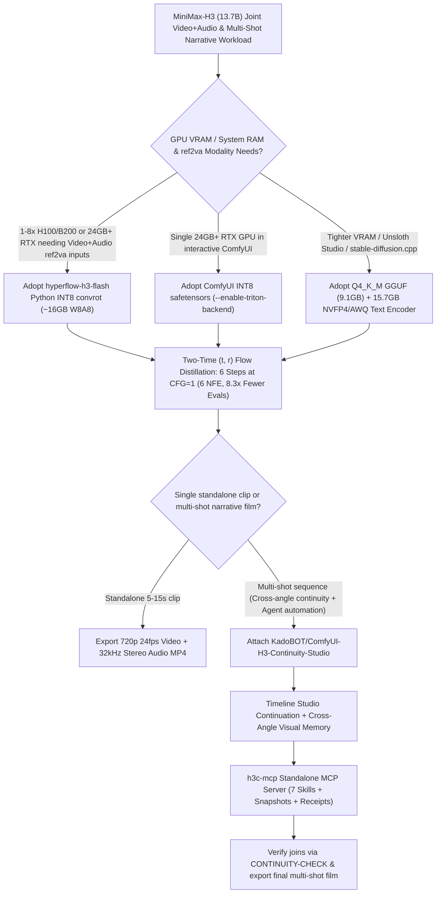

# 13.7B 6-Step Joint Video+Audio Flow Distillation (`hyperflow-h3-flash`) & Multi-Shot Cross-Angle Visual Memory Studio (`ComfyUI-H3-Continuity-Studio`) Selection FAQ

> **Positioning**: This standalone guide is **Round 16 of the 2026-11-11 Night Shift (Cumulative Guide #61)**, written in the plain-language, first-principles, closed-form FinOps style of `ib-vs-ethernet-roce-selection-faq.md` for Multimodal AI and Generative Video Solution Architects evaluating two high-velocity MiniMax-H3 ecosystem repositories:
> 1. **`Video-Rebirth/hyperflow-h3-flash` (`127★`, Apache-2.0)**: Distills `MiniMax-H3` (`13.7B` joint `720p 24fps` video + `32 kHz` stereo audio generation) from `25 steps × 2 CFG = 50 NFE` down to **4–8 steps (6 steps default at `CFG = 1`, `8.3×` fewer function evaluations)** via a two-time `(t, r)` flow embedder, shipping both a **9.1 GB `Q4_K_M` GGUF** (running on a single 24 GB RTX 3090/4090/5090) and a **~16 GB `W8A8 INT8 convrot`** runtime;
> 2. **`KadoBOT/ComfyUI-H3-Continuity-Studio` (`94★`, MIT)**: A multi-shot narrative continuity studio for MiniMax-H3 in ComfyUI featuring an interactive Timeline Studio, continuation modes, Cross-Angle Visual Memory, Qwen Story Studio, and a standalone **`h3c-mcp` MCP server** enabling Codex and Claude Code to orchestrate multi-shot production without browser sync.
>
> **中文版 FAQ**: [hyperflow-h3-flash-continuity-studio-video-audio-selection-faq.md](hyperflow-h3-flash-continuity-studio-video-audio-selection-faq.md) · **Architecture Summary SVG**: [`assets/github-ai-radar-2026-11-11-r16-hyperflow-continuity.svg`](../../../assets/github-ai-radar-2026-11-11-r16-hyperflow-continuity.svg)


---

## 📌 1. Executive Summary

1. **In plain English, what problems do these two repositories actually solve?**
   - **Breaking the 62 GB VRAM Wall & 50-NFE Latency Bottleneck (`Video-Rebirth/hyperflow-h3-flash`)**: While base `MiniMax-H3` (`13.7B`) jointly generates `720p 24fps` video (5–15s) and synchronized `32 kHz` stereo audio, its `bf16` base transformer weighs **62 GB** and requires `25 steps × 2 CFG passes = 50 NFE`, locking out consumer 24 GB RTX GPUs. `hyperflow-h3-flash` introduces **two-time `(t, r)` flow trajectory distillation** and low-rank residual linear layers (`hyperflow-two-time.patch`), collapsing inference to **6 CFG-free steps (`CFG = 1`, `6 NFE` — `8.3×` fewer evaluations)** and packaging weights into a **9.1 GB `Q4_K_M` GGUF** and a **~16 GB `W8A8 INT8 convrot`** build that never downloads the 62 GB base transformer.
   - **Solving Multi-Shot Identity Drift & Manual ComfyUI Splicing (`KadoBOT/ComfyUI-H3-Continuity-Studio`)**: Even with fast single-clip generation, producing a 60-second multi-shot sequence in vanilla ComfyUI suffers from character identity drift across camera angle cuts, jarring frame/audio seams, and browser-bound node graphs that AI coding agents cannot automate. `ComfyUI-H3-Continuity-Studio` adds a multi-box **Timeline Studio**, **Cross-Angle Visual Memory**, MiniMax H3 Context Windows integration, `CONTINUITY-CHECK` seam verification, and a standalone **`h3c-mcp` server** (`mcp_adapter`) with 7 MCP skills and revision receipts for Codex and Claude Code.
2. **Closed-Form FinOps Verdict (`CLAIM-20261111-R16-HYPERFLOW-CONTINUITY`)**:
   - For an AI Video & Audio Production Studio generating **500 multi-shot 60-second sequences per month (`6 shots × 10s = 3,000 joint video+audio shots/mo`)** (`$3.20/GPU-hr` on 80 GB datacenter GPU vs. `$2.20/GPU-hr` on blended INT8/24 GB RTX fleet; technical director loaded rate `$75.00/hr`; external Story LLM API fees and music licensing: `not_measured`):
   - Upgrading from **Path A (Base 62 GB `bf16` MiniMax-H3 at `50 NFE` + manual single-clip stitching, `$5,700.00/mo`)** to **Path C (`hyperflow-h3-flash` 6-step distillation + `ComfyUI-H3-Continuity-Studio` cross-angle memory & `h3c-mcp` automation, `$789.00/mo`)** saves **`$4,911.00/mo` (`-86.16%`, `$58,932.00/yr`)** and cuts manual stitching/re-roll labor from `44.0 hrs/mo` to `7.0 hrs/mo` (**`-84.09%`**).

---

## 🎯 2. Three Core Architectural Questions (Q1 / Q2 / Q3 Deep-Dive)

### Q1: How does `hyperflow-h3-flash` compress `25 steps × 2 CFG (50 NFE)` into `6 steps × 1 CFG (6 NFE)` without breaking 32 kHz stereo audio-visual lip/foley sync—and how should teams choose between `GGUF` and `INT8 convrot`?
- **First-Principles Breakdown**:
  1. **Two-Time `(t, r)` Flow Embedder & CFG-Free Distillation**:
     - Standard diffusion models condition only on the current noise timestep $t$, causing severe Euler integration truncation errors and audio-visual desynchronization when step counts drop below 10. `HyperFlow` conditions on a **two-time pair $(t, r)$** with low-rank linear layers (`hyperflow-two-time.patch`), directly predicting the finite flow integral from $t$ to $r$ while folding Classifier-Free Guidance into a single pass (`CFG = 1`). This yields **`8.3×` fewer function evaluations (`50 -> 6 NFE`)** across `t2va` (text-to-video+audio), `fl2va` (first/last keyframe), and `ref2va` (up to 12 references in prompt order `<Picture 1>`).
  2. **Deterministic Runtime Selection Rule (`GGUF` vs. `W8A8 INT8 convrot`)**:
     - **ComfyUI on 24 GB+ RTX GPUs (16 GB+ System RAM)**: Use single-file **INT8 safetensors** (`fl2va_int8_convrot_comfyui/` or `ref2va_int8_convrot_comfyui/`) with `--enable-triton-backend` or PyTorch built for CUDA 13.0+.
     - **Smaller GPUs, Unsloth Studio, or `stable-diffusion.cpp`**: Use **`Q4_K_M` GGUF (`9.1 GB` / `9.2 GB`)** paired with the `15.7 GB` `qwen3vl_32b_minimax_h3_nvfp4_awq` text encoder (`python main.py --fast-disk` on 16–32 GB RAM PCs). Note that GGUF `ref2va` accepts images only, whereas the **Python `INT8 convrot` package (`~16 GB`) accepts images, videos with soundtrack, and audio clips** and scales across 1–8 H100/H200/B200 GPUs (`--gpus 4`).

### Q2: How does `KadoBOT/ComfyUI-H3-Continuity-Studio` eliminate cross-angle identity drift and enable headless AI agent orchestration via `h3c-mcp`?
- **First-Principles Breakdown**:
  1. **Timeline Studio Continuation Modes & Cross-Angle Visual Memory**:
     - Inside `examples/h3_story_studio.json`, each shot lives in a structured Timeline Box. When continuing across shots or cutting to a new camera angle, the studio routes prior keyframes, still-image subgraph references, and MiniMax H3 Context Windows into the next generation pass, followed by explicit join verification (`docs/CONTINUITY-CHECK.md`).
  2. **Browser-Free Agent Automation via `h3c-mcp` (`mcp_adapter`)**:
     - Instead of requiring a live browser tab to mutate ComfyUI graphs, `ComfyUI-H3-Continuity-Studio` provides a standalone Python 3.11+ stdio MCP server:
       ```bash
       uv run --project "/abs/path/ComfyUI-H3-Continuity-Studio/mcp_adapter" h3c-mcp --studio-url http://127.0.0.1:8188 --check
       ```
     - This exposes saved-project editing, Story/still/render triggers, **7 built-in MCP skills**, snapshot revisions, and retained submission receipts directly to Codex and Claude Code.

### Q3: What production guardrails must Solution Architects enforce when deploying this stack?
1. **Long-Clip 32-Bit Matmul Splitting & WSL2 RAM Ceilings**:
   - When compiling `stable-diffusion.cpp`, apply `hyperflow-two-time.patch` onto upstream commit `3be2378` to enable **32-bit matmul token splitting** on long 15s clips. When running the Python `INT8 convrot` package with CPU offload, ensure `≥69 GiB` system RAM (`--text-encoder-precision fp8`) or `≥91 GiB` (`bf16`), and raise `memory=` in `%UserProfile%\.wslconfig` on WSL2.
2. **Single-Copy Node Installation & Optional Prompt Guides**:
   - Never keep two copies of `ComfyUI-H3-Continuity-Studio` in `custom_nodes/` (both register identical routes). If licensed under MiniMax terms, place `base-en.txt` and `ref-en.txt` in `h3_continuity/h3_guide/` and restart ComfyUI.

---

## 🧭 3. Mermaid Decision Tree & Multi-Shot Production Pipeline



---

## 📊 4. Architectural Comparison Matrix

| Evaluation Dimension | Path A: Base MiniMax-H3 `bf16` (`50 NFE`) + Manual Splicing | Path B: `hyperflow-h3-flash` Standalone CLI Only | **Path C (Recommended): `hyperflow-h3-flash` + `ComfyUI-H3-Continuity-Studio`** |
| :--- | :--- | :--- | :--- |
| **Model Footprint & NFE** | `62 GB` base transformer, `25 steps × 2 CFG = 50 NFE` | **`9.1 GB` (`Q4_K_M`) / `16 GB` (`INT8`), 6 steps `CFG=1` (`6 NFE`)** | **`9.1 GB` GGUF / `16 GB` INT8, `6 NFE` (`8.3×` fewer evals; never downloads 62 GB base)** |
| **Joint 32 kHz Stereo Audio + Video** | Supported, but requires 80 GB VRAM and slow 50-NFE sampling | Supports `t2va`, `fl2va`, and 12-ref `ref2va` in seconds | **Full joint video+audio generation + multi-shot timeline continuation** |
| **Cross-Angle Identity & Join Control** | None; character drifts on camera cuts, requiring manual re-rolls | Single-clip consistency only; manual last-frame extraction between shots | **Cross-Angle Visual Memory + MiniMax H3 Context Windows + `CONTINUITY-CHECK`** |
| **Headless AI Agent Orchestration** | Cannot automate browser-dependent ComfyUI node state | CLI per clip only; no multi-shot project revision state | **Standalone `h3c-mcp` server (no browser sync, 7 MCP skills, snapshots & receipts)** |
| **Monthly TCO (3,000 Shots/Mo)** | **`$5,700.00 / mo`** (`$2,400` GPU + `$3,300` labor) | **`$2,612.00 / mo`** (`$512` GPU + `$2,100` labor) | **`$789.00 / mo` (Saves `$4,911.00/mo` · `-86.16%`)** |

---

## 🧪 5. Closed-Form FinOps Example & 7-Card Insights (`CLAIM-20261111-R16-HYPERFLOW-CONTINUITY`)

### 5.1 Workload & Scope Boundary
- **Workload**: An AI Video Studio producing **500 multi-shot 60-second sequences per month** (`6 shots × 10s = 3,000 joint video+audio shots/mo`).
- **Rates**: 80 GB datacenter GPU at **`$3.20 / GPU-hr`**; blended INT8 / 24 GB RTX fleet at **`$2.20 / GPU-hr`**; technical director / editor loaded rate at **`$75.00 / hr`**.
- **Explicit Scope Boundary**: External Story LLM endpoint API charges and third-party commercial music licensing fees are marked **`not_measured`**.

### 5.2 Closed-Form Monthly Cost Breakdown

| Cost Component | Path A: Base 62 GB `bf16` (`50 NFE`) + Manual Splicing | Path B: `hyperflow-h3-flash` 6-Step CLI + Manual Continuation | **Path C: `hyperflow-h3-flash` + `Continuity-Studio` (Recommended)** |
| :--- | :--- | :--- | :--- |
| **GPU Inference Compute** | `750 hrs × $3.20` = **`$2,400.00`** | `160 hrs × $3.20` = **`$512.00`** | `120 hrs × $2.20` = **`$264.00`** |
| **Technical Director Splicing & QA (`$75/hr`)** | `44.0 hrs × $75.00` = **`$3,300.00`** | `28.0 hrs × $75.00` = **`$2,100.00`** | `7.0 hrs × $75.00` = **`$525.00`** |
| **Total Monthly TCO** | **`$5,700.00 / mo`** | **`$2,612.00 / mo`** (`-54.18%`) | **`$789.00 / mo`** |
| **Net Savings vs. Path A** | Baseline | Saves `$3,088.00 / mo` | **Saves `$4,911.00 / mo` (`-86.16%` · `$58,932.00/yr`)** |
| **External Story LLM & Music Licensing** | `not_measured` | `not_measured` | `not_measured` |

---

## 🛠️ 6. Production Verification Checklist

- [ ] **1. Runtime & Quantization Alignment**: Use single-file INT8 safetensors (`fl2va_int8_convrot_comfyui/`) with `--enable-triton-backend` on 24 GB+ RTX ComfyUI hosts; use `Q4_K_M` GGUF (`9.1 GB`) + `qwen3vl_32b_minimax_h3_nvfp4_awq` (`15.7 GB`) with `python main.py --fast-disk` on 16–32 GB RAM PCs.
- [ ] **2. `stable-diffusion.cpp` Two-Time Patch Check**: Verify `hyperflow-two-time.patch` is applied cleanly on upstream commit `3be2378` so two-time `(t, r)` embeddings and 32-bit matmul token splitting are active.
- [ ] **3. Single-Instance `ComfyUI-H3-Continuity-Studio` Guard**: Confirm only one copy of `ComfyUI-H3-Continuity-Studio` exists in `ComfyUI/custom_nodes/` and that the core `MiniMax H3 Context Windows` node is available.
- [ ] **4. Standalone `h3c-mcp` Health Probe**: Run `uv run --project "/abs/path/ComfyUI-H3-Continuity-Studio/mcp_adapter" h3c-mcp --studio-url http://127.0.0.1:8188 --check` in an isolated Python 3.11+ environment to verify all 7 MCP skills and submission receipt endpoints.
- [ ] **5. Multi-Shot Join & Stereo Audio Continuity Gate**: Load `examples/h3_story_studio.json`, render a multi-box continuation sequence, and inspect cross-angle visual consistency and `32 kHz` stereo audio phase continuity across shot boundaries (`docs/CONTINUITY-CHECK.md`).
