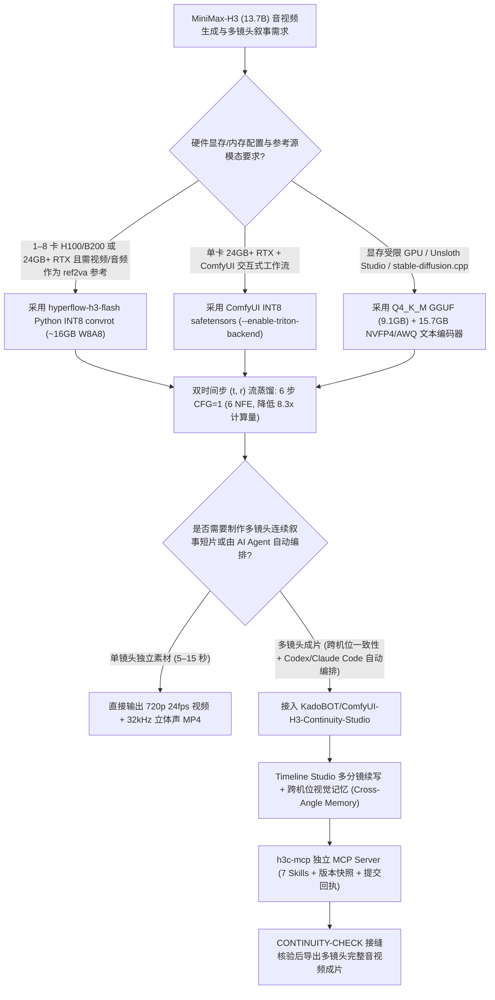

# 13.7B 音视频联合生成 6 步流蒸馏（`hyperflow-h3-flash`）与多镜头跨机位视觉记忆工作台（`ComfyUI-H3-Continuity-Studio`）选型 FAQ

> **文档定位**：本文是 **2026-11-11 夜班多轮深潜 Round 16（累计第 61 篇独立选型专题）**，严格对标 `ib-vs-ethernet-roce-selection-faq.md` 的「通俗大白话 + 第一性原理 + 可核算定量算例」标杆文风，为生成式视频与多模态内容工具链架构师深度拆解今日两款 MiniMax-H3 生态爆款仓库：
> 1. **`Video-Rebirth/hyperflow-h3-flash`（`127★`，Apache-2.0）**：将 `MiniMax-H3`（`13.7B` 视频 + `32 kHz` 立体声音频联合生成大模型）从 `25 步 × 2 CFG = 50 NFE` 蒸馏至 **4～8 步（默认 6 步 `CFG = 1`，函数评估次数降低 `8.3×`）**，提供 **9.1 GB `Q4_K_M` GGUF**（单张 24GB RTX 3090/4090 即可流畅运行）与 **~16 GB `W8A8 INT8 convrot`** 双运行时；
> 2. **`KadoBOT/ComfyUI-H3-Continuity-Studio`（`94★`，MIT）**：专为 MiniMax-H3 打造的多镜头连续叙事工作台，内置时间线编辑器（Timeline Studio）、跨机位视觉记忆（Cross-Angle Visual Memory）、Qwen Story Studio 剧本拆解，以及支持 Codex / Claude Code 无浏览器直连编排的独立 **`h3c-mcp` MCP Server**。
>
> **English Companion**: [hyperflow-h3-flash-continuity-studio-video-audio-selection-faq.en.md](hyperflow-h3-flash-continuity-studio-video-audio-selection-faq.en.md) · **架构总结图**: [`assets/github-ai-radar-2026-11-11-r16-hyperflow-continuity.svg`](../../../assets/github-ai-radar-2026-11-11-r16-hyperflow-continuity.svg)


---

## 📌 一、核心结论速览（Executive Summary）

1. **先用大白话讲透这两个项目到底解决了什么痛点？**
   - **13.7B 音视频大模型“显存爆炸与 50 步慢速推理痛点”（`Video-Rebirth/hyperflow-h3-flash` 解决的问题）**：原版 `MiniMax-H3` 虽然能一步到位同时生成 `720p 24fps` 视频（5～15 秒）和同步的 `32 kHz` 立体声音效/人声，但原版 `bf16` 基底 Transformer 高达 **62 GB**，且每次生成需要跑 `25 步 × 2 次正负向 CFG = 50 NFE`，没有 80GB H100/A100 根本跑不动。`hyperflow-h3-flash` 通过**双时间步 `(t, r)` 流轨迹蒸馏（Two-Time Flow Distillation）+ 低秩残差线性层**，把采样压缩到 **6 步且免除 CFG（`CFG = 1`，仅 `6 NFE`，计算量直降 `8.3×`）**，并压出 **9.1 GB 的 `Q4_K_M` GGUF 权重**和 **16 GB 的 `W8A8 INT8 convrot` 权重**，让消费级 24GB 显卡（RTX 3090 / 4090 / 5090）也能秒级生成音画同步视频！
   - **多镜头成片“跨机位换脸与手工连线地狱”（`KadoBOT/ComfyUI-H3-Continuity-Studio` 解决的问题）**：单段 10 秒视频生成再快，要做一条 60 秒（6 个分镜）的完整短片时，原生 ComfyUI 节点图一旦切换机位角度，主角衣服/脸型就会漂移，镜头接缝处音画容易跳帧，而且 AI 编程助手（Codex / Claude Code）无法直接操控复杂的浏览器画布。`ComfyUI-H3-Continuity-Studio` 提供**多盒时间线（Timeline Studio）+ 跨机位视觉记忆（Cross-Angle Visual Memory）+ 接缝连续性检查（`CONTINUITY-CHECK`）**，并附带独立的 **`h3c-mcp` 服务端**，让 Agent 无需打开浏览器就能通过 7 个 MCP Skill 读写分镜工程、触发渲染并核验提交回执。
2. **闭式 FinOps 核算结论（`CLAIM-20261111-R16-HYPERFLOW-CONTINUITY`）**：
   - 在每月生产 **500 条 60 秒多镜头音视频成片（每条 6 个分镜 × 10 秒 = 3,000 个音视频镜头/月）**基准下（80GB 数据中心 GPU `$3.20/hr`，INT8/RTX 混合算力池 `$2.20/hr`，技术导演/剪辑师全包时薪 `$75.00/hr`；外部剧本 LLM API 与商业音乐版权费：`not_measured`）：
   - 从 **Path A（原版 62GB `bf16` MiniMax-H3 `50 NFE` + 手工单镜头拼接，`$5,700.00/月`）** 升级至 **Path C（`hyperflow-h3-flash` 6 步蒸馏 + `ComfyUI-H3-Continuity-Studio` 跨机位记忆与 `h3c-mcp` 自动化，`$789.00/月`）**，每月净省 **`$4,911.00/月`（降幅 `-86.16%`，年化节省 `$58,932.00/年`）**，人工抽卡与接缝返工工时从 `44.0 小时/月` 降至 `7.0 小时/月`（**节省 `84.09%`**）。

---

## 🎯 二、三大灵魂拷问（Q1 / Q2 / Q3 Deep-Dive）

### Q1：`hyperflow-h3-flash` 为什么能把 `25 步 × 2 CFG (50 NFE)` 压缩到 `6 步 × 1 CFG (6 NFE)` 而不毁掉 32 kHz 立体声音画同步？`GGUF` 与 `INT8 convrot` 到底该怎么选？
- **第一性原理拆解**：
  1. **双时间步 `(t, r)` 嵌入器与免 CFG 蒸馏（Two-Time `(t, r)` Embedder & Low-Rank Linear Layers）**：
     - 普通扩散模型只接收当前噪声时间步 $t$，步数减半时积分截断误差会剧增，导致口型与立体声脚步声错位。`HyperFlow` 引入双时间参数 $(t, r)$（直接烘焙在 `hyperflow-two-time.patch` 与模型结构中），学习从起点 $t$ 到目标步 $r$ 的有限区间流映射，并将正负向引导（Classifier-Free Guidance）蒸馏进单次前向中（`CFG = 1`），仅需 **6 次函数评估（`6 NFE`）** 即可完成 `t2va`（文生音视频）、`fl2va`（首尾帧控制）与 `ref2va`（最多 12 个参考源 `<Picture 1>`）。
  2. **`GGUF` vs. `W8A8 INT8 convrot` 精确选型法则**：
     - **消费级 24GB+ RTX 显卡 + ComfyUI 用户**：首选 `fl2va_int8_convrot_comfyui/` 或 `ref2va_int8_convrot_comfyui/` 单文件 INT8 safetensors（需 16GB+ 内存，启动加 `--enable-triton-backend` 或使用 CUDA 13.0+ PyTorch）；
     - **显存受限设备 / Unsloth Studio / `stable-diffusion.cpp` 用户**：首选 **`Q4_K_M` GGUF（仅 `9.1 GB` / `9.2 GB`）**，搭配 `15.7 GB` 的 `qwen3vl_32b_minimax_h3_nvfp4_awq` 文本编码器（16GB/32GB 内存 PC 启动 ComfyUI 加 `--fast-disk`）；注意 GGUF 版的 `ref2va` 仅支持参考图片，而 **Python `INT8 convrot` 包（`~16 GB`）的 `ref2va` 同时支持参考图片、带音轨视频和独立音频切片**，且支持 1～8 卡 H100/H200/B200 上下文并行（`--gpus 4`）。

### Q2：`KadoBOT/ComfyUI-H3-Continuity-Studio` 是如何解决多镜头续写时的角色漂移与 AI Agent 自动化编排难题的？
- **第一性原理拆解**：
  1. **Timeline Studio 续写模式与跨机位视觉记忆（Cross-Angle Visual Memory）**：
     - 在 `examples/h3_story_studio.json` 工作流中，每个分镜是一个 Timeline Box。当下一个分镜设为 `continue`（续写）或切换景别/机位角度时，节点包会自动管理前序分镜的关键帧、参考静帧（Still-Image Subgraph）与 MiniMax H3 Context Windows，并提供 `CONTINUITY-CHECK` 机制核验镜头衔接处的视觉与音频跳变。
  2. **独立于浏览器的 `h3c-mcp` AI Agent 编排层（`mcp_adapter`）**：
     - 传统 ComfyUI 插件高度依赖前端浏览器 DOM 状态，一旦关闭网页 Agent 就无法下发任务。`ComfyUI-H3-Continuity-Studio` 提供运行在独立 Python 3.11+ 环境下的 stdio MCP 适配器：
       ```bash
       uv run --project "/abs/path/ComfyUI-H3-Continuity-Studio/mcp_adapter" h3c-mcp --studio-url http://127.0.0.1:8188 --check
       ```
     - 它将已保存工程编辑、Story 剧本生成、静帧/视频渲染以及 **7 项内置 MCP Skills**、工程快照修订号（Revisions）与提交回执（Retained Submission Receipts）直接暴露给 Codex 和 Claude Code，无需浏览器同步即可实现无人值守成片生产。

### Q3：生产环境部署这套音视频多镜头流水线有哪些必知的排障红线？
1. **Windows / 长视频 32-bit 矩阵乘分块与 WSL2 内存限制**：
   - 使用 `stable-diffusion.cpp` 跑长视频（如 15 秒）时，必须打上仓库自带的 `hyperflow-two-time.patch`（基于上游 `3be2378`），开启 **32-bit matmul token splitting** 防止长序列注意力溢出；在 Windows WSL2 下使用多卡或 Offload（`bf16` 文本编码器需 `≥91 GiB` RAM，`fp8` 需 `≥69 GiB` RAM）时，务必调高 `%UserProfile%\.wslconfig` 中的 `memory=`。
2. **禁止双份安装 `H3 Continuity` 与可选官方提示词指南加载**：
   - 切勿在 `ComfyUI/custom_nodes/` 下并存两个副本（会重复注册相同节点与路由）；若已合规获取 MiniMax H3 官方提示词指南，需手动将 `base-en.txt` 与 `ref-en.txt` 放入 `h3_continuity/h3_guide/` 并重启 ComfyUI。

---

## 🧭 三、Mermaid 选型决策树与多镜头音视频生成架构



---

## 📊 四、同类方案核心能力对比矩阵（Comparison Matrix）

| 评估维度 | Path A：原版 MiniMax-H3 `bf16` + 手工单镜头拼接 | Path B：`hyperflow-h3-flash` 仅单镜头 CLI 调用 | **Path C（推荐标杆）：`hyperflow-h3-flash` + `ComfyUI-H3-Continuity-Studio`** |
| :--- | :--- | :--- | :--- |
| **模型体积与推理步数（NFE）** | `62 GB` 基底权重，`25 步 × 2 CFG = 50 NFE` | **`9.1 GB` (`Q4_K_M`) / `16 GB` (`INT8`)，6 步 `CFG=1` (`6 NFE`)** | **`9.1 GB` GGUF / `16 GB` INT8，`6 NFE`（提速 `8.3×`，永不下载 62GB 原版）** |
| **32 kHz 立体声音画联合生成** | 支持，但单镜头耗时过长、显存门槛极高（80GB） | 支持 `t2va` / `fl2va` / `ref2va`（多达 12 个参考源） | **全模态音画同步 + 多镜头时间线连续续写** |
| **跨机位角色一致性与接缝控制** | 无记忆，切机位即换脸，需大量人工重抽与剪辑 | 仅单镜头内一致，跨镜头需手工截取尾帧拼接 | **Cross-Angle Visual Memory + MiniMax H3 Context Windows + `CONTINUITY-CHECK`** |
| **AI Agent（Codex / Claude）自动化** | 无法直接操控浏览器动态节点图 | 仅支持单条 CLI 命令，无分镜工程状态管理 | **独立 `h3c-mcp` 服务（无需浏览器同步，支持 7 Skills、快照与提交回执）** |
| **月度总拥有成本（3,000 镜头/月）** | **`$5,700.00 / 月`**（算力 `$2,400` + 人工 `$3,300`） | **`$2,612.00 / 月`**（算力 `$512` + 人工 `$2,100`） | **`$789.00 / 月`（净省 `$4,911.00/月`，降幅 `-86.16%`）** |

---

## 🧪 五、闭式定量 FinOps 算例与 7-Card 评测洞察（`CLAIM-20261111-R16-HYPERFLOW-CONTINUITY`）

### 5.1 基准假设与边界声明
- **评测负载**：AIGC 影视与短剧工作室每月制作 **500 条 60 秒多镜头音画同步成片**（每条含 6 个 10 秒分镜，合计 **3,000 个音视频镜头/月**）。
- **单价基准**：80GB 数据中心 GPU 租用单价 **`$3.20 / GPU-hr`**；INT8 / 24GB RTX 混合推理池单价 **`$2.20 / GPU-hr`**；技术导演/后期剪辑师全包时薪 **`$75.00 / hr`**。
- **显式边界声明（Scope Boundary）**：Story 节点调用的外部大语言模型 API 账单及第三方商业配乐授权费用标记为 **`not_measured`**。

### 5.2 三路径闭式成本核算表

| 成本构成项 | Path A：原版 62GB `bf16` (`50 NFE`) + 手工拼接 | Path B：`hyperflow-h3-flash` 6 步单镜头 + 手工续写 | **Path C：`hyperflow-h3-flash` + `Continuity-Studio`（推荐）** |
| :--- | :--- | :--- | :--- |
| **GPU 推理算力成本** | `750 hrs × $3.20` = **`$2,400.00`** | `160 hrs × $3.20` = **`$512.00`** | `120 hrs × $2.20` = **`$264.00`** |
| **技术导演分镜拼接与抽卡工时（`$75/hr`）** | `44.0 hrs × $75.00` = **`$3,300.00`** | `28.0 hrs × $75.00` = **`$2,100.00`** | `7.0 hrs × $75.00` = **`$525.00`** |
| **月度总成本（Monthly Total）** | **`$5,700.00 / 月`** | **`$2,612.00 / 月`**（`-54.18%`） | **`$789.00 / 月`** |
| **相对 Path A 净节省（Savings）** | 基准线（Baseline） | 节省 `$3,088.00 / 月` | **净省 `$4,911.00 / 月`（`-86.16%` · 年省 `$58,932.00`）** |
| **外部 Story LLM 与商业音源授权** | `not_measured` | `not_measured` | `not_measured` |

---

## 🛠️ 六、生产级落地核验 Checklist（SA Actionable Verification）

- [ ] **1. 运行时精确匹配核验**：在 24GB+ RTX 的 ComfyUI 环境优先选用 `fl2va_int8_convrot_comfyui/` 单文件 INT8 safetensors 并加 `--enable-triton-backend` 启动；在 16GB/32GB 系统内存 PC 上使用 `Q4_K_M` GGUF（`9.1 GB`）+ `qwen3vl_32b_minimax_h3_nvfp4_awq`（`15.7 GB`）并加 `--fast-disk` 启动。
- [ ] **2. `stable-diffusion.cpp` 补丁核验**：若使用 C++ 端侧推理，确认已基于上游提交 `3be2378` 应用 `hyperflow-two-time.patch`，校验 `(t, r)` 双时间嵌入器与长视频 32-bit matmul token splitting 已生效。
- [ ] **3. `ComfyUI-H3-Continuity-Studio` 单实例与路由防冲突检查**：检查 `ComfyUI/custom_nodes/` 确保仅存在唯一一份 `ComfyUI-H3-Continuity-Studio` 副本，并确认 ComfyUI 已包含核心 `MiniMax H3 Context Windows` 节点。
- [ ] **4. 独立 `h3c-mcp` 联通性自检**：在独立 Python 3.11+ 虚拟环境中运行 `uv run --project "/abs/path/ComfyUI-H3-Continuity-Studio/mcp_adapter" h3c-mcp --studio-url http://127.0.0.1:8188 --check`，确认 7 项 MCP Skills 与提交回执接口健康返回。
- [ ] **5. 多镜头接缝连续性门禁（`CONTINUITY-CHECK`）**：在加载 `examples/h3_story_studio.json` 渲染多盒续写序列后，逐一检查相邻 Box 衔接处的跨机位角色一致性与 `32 kHz` 立体声相位平滑度。
