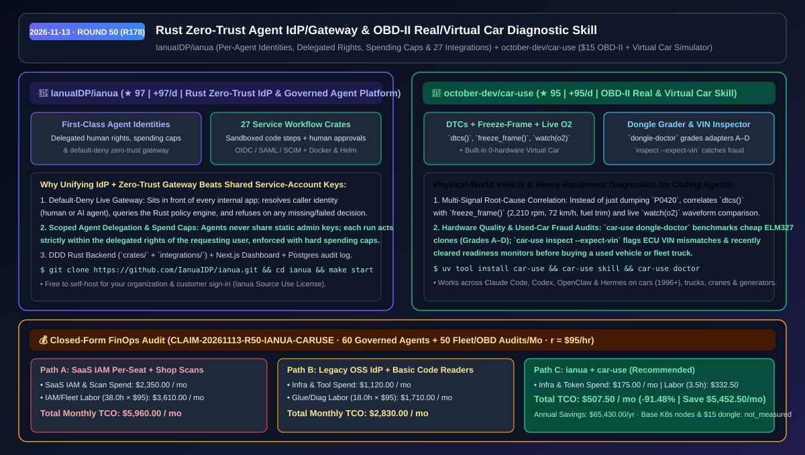
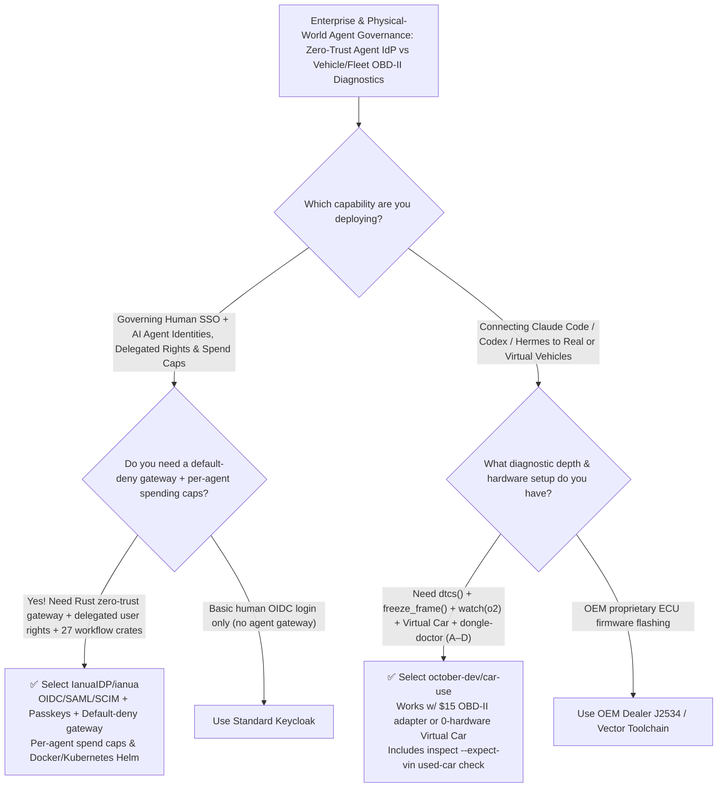

# Rust Zero-Trust AI Agent IdP/Gateway & OBD-II Real/Virtual Car Diagnostic Skill Selection FAQ: `IanuaIDP/ianua` + `october-dev/car-use`

> **Metadata**
> - **Evaluation Batch**: 2026-11-13 Overnight Deep-Dive Round 50 (Cumulative Round 178)
> - **Primary Repositories**:
>   1. [`IanuaIDP/ianua`](https://github.com/IanuaIDP/ianua) (`★ 97` · `+97 Stars/day` · Created `2026-11-12` · Rust + Next.js + Postgres self-hosted identity provider, default-deny zero-trust gateway, and governed AI agent platform with per-agent identities, delegated rights, spending caps, and 27 service workflow integrations)
>   2. [`october-dev/car-use`](https://github.com/october-dev/car-use) (`★ 95` · `+95 Stars/day` · Created `2026-11-12` · OBD-II real-vehicle, heavy-equipment, and zero-hardware virtual-car diagnostic CLI & skill for Claude Code, Codex, OpenClaw, and Hermes with `dongle-doctor` adapter grading and `inspect --expect-vin` used-car fraud checks)
> - **Companion Architecture Diagram**: [`assets/github-ai-radar-2026-11-13-r50-ianua-car-use.svg`](../../../assets/github-ai-radar-2026-11-13-r50-ianua-car-use.svg)
> - **Sealed Evidence Anchor**: `CLAIM-20261113-R50-IANUA-CARUSE` (see [`evidence/trending-daily-2026-11-13-audit.json`](../evidence/trending-daily-2026-11-13-audit.json))

---

## 📌 1. Executive Summary & First-Principles Pitch

1. **Plain-Language Essence**:
   - **`IanuaIDP/ianua`**: Combines an **enterprise identity provider (OIDC, SAML, SCIM, Passkeys, MFA), a default-deny zero-trust gateway in front of every internal app, and first-class AI agent governance** in a single self-hosted Rust + Postgres stack. Instead of handing agents shared admin API keys, `ianua` gives each agent its own identity, delegated user permissions, hard spending caps, and human approval gates across a visual workflow builder with **27 external service crates** and sandboxed code steps.
   - **`october-dev/car-use`**: Bridges coding agents (Claude Code, Codex, OpenClaw, Hermes) into the physical world of **cars (US 1996+, EU 2001+, India 2020+), race cars, trucks, cranes, diggers, and generators via a `$15` OBD-II adapter—or a built-in zero-hardware Virtual Car simulator**. It correlates trouble codes (`dtcs()`), freeze-frame engine state (`freeze_frame()`), and live sensor streams (`watch(o2)`), grades cheap ELM327 adapters from `A` to `D` (`car-use dongle-doctor`), and flags VIN mismatches or freshly wiped emissions monitors during used-car inspections (`car-use inspect --expect-vin`).
2. **Quantified FinOps Impact (`CLAIM-20261113-R50-IANUA-CARUSE`)**:
   - Under a monthly operational workload of **60 governed enterprise AI agents/workflows + 50 vehicle/fleet/equipment OBD-II diagnostic & pre-purchase audits** (fully loaded rate `$95.00/hr`; base Kubernetes cluster nodes and `$15` OBD-II dongle hardware labeled `not_measured`):
   - **Path C (`ianua` + `car-use`)** reduces total monthly cost of ownership (TCO) from **`$5,960.00/mo` (Path A: per-seat commercial IAM + shared static agent keys + external shop diagnostic scans)** to **`$507.50/mo`**, saving **`$5,452.50/mo` (`-91.48%`, `$65,430.00/yr`)** and reclaiming **`34.5 engineering & ops hours/mo` (`-90.79%`)**.



---

## ❓ 2. First-Principles Deep Dive (Q1–Q3)

### Q1: Why do traditional identity providers fall short when governing AI agents, and how does `IanuaIDP/ianua` enforce least-privilege delegation and spending caps at the gateway?
- **The Legacy Bottleneck**: Traditional IdPs authenticate human logins but leave AI agents operating behind static, over-privileged service-account keys. When an agent executes a workflow across external APIs or internal microservices, there is no per-request gateway enforcement of whose authority the agent is acting under, no spending ceiling to stop runaway loops, and no unified audit trail.
- **How `ianua` Solves It**:
  1. **Default-Deny Live Traffic Gateway**: Sits directly in front of your applications, resolves caller identity (human or agent), queries the Rust platform policy engine, and refuses traffic on any missing or failed decision.
  2. **First-Class Agent Identities & User-Scoped Workflows**: Each AI agent has its own identity, delegated rights, spending caps, and human approval rules; visual workflows spanning 27 external services (`integrations/`) and sandboxed code steps run strictly with the permissions of the human user they are acting for.
  3. **DDD Rust Backend + Multi-Tenant Postgres Audit Log**: Deployed via Docker Compose (`make start`) or Kubernetes Helm charts (`deploy/`).

### Q2: Why does reading a raw OBD-II trouble code (`P0420`) on a basic code reader often lead to unnecessary parts replacement, and how does `october-dev/car-use` turn an AI agent into a master diagnostic tech?
- **The Legacy Bottleneck**: A basic code scanner reports `P0420` ("Catalyst System Efficiency Below Threshold") without context, causing owners or fleet managers to replace an expensive catalytic converter when the real culprit is an exhaust leak before the rear oxygen sensor or a faulty `$10` counterfeit ELM327 dongle dropping frames.
- **How `car-use` Solves It**:
  1. **Triangulated Diagnosis (`dtcs()` + `freeze_frame()` + `watch(o2)`)**: The agent reads the trouble code (`P0420`), inspects the exact freeze frame when it triggered (`2,210 rpm`, `72 km/h`, normal fuel trim), and watches both oxygen sensors live (`watch(o2)`) to verify whether the rear sensor is mirroring the front sensor.
  2. **Zero-Hardware Virtual Car & `dongle-doctor` (Grades A–D)**: Lets developers test agent diagnostic workflows on a built-in virtual car before plugging into a real vehicle, and benchmarks physical adapters (`car-use dongle-doctor --report`) with anonymized WMI/model-year JSON output (stripping the full VIN).
  3. **Used-Car Fraud & VIN Tampering Check (`car-use inspect --expect-vin`)**: Compares the windshield VIN against the ECU's internal VIN and checks whether readiness monitors were recently reset to hide active faults.

### Q3: What are the licensing and operational boundaries of `ianua` and `car-use`?
- **Concrete Limits**:
  - `ianua` is distributed under the fair-code **Ianua Source Use License**: free to use, modify, and self-host for your own organization (including signing your own customers into your products), but may not be resold as a managed IAM hosting service without a commercial license.
  - `car-use` supports standard OBD-II vehicles (US 1996+, EU 2001+, India 2020+) and heavy equipment over Wi-Fi (`tcp://192.168.0.10:35000`), USB serial, or Bluetooth.

---

## 🧭 3. Mermaid Selection Decision Tree & Architecture Flow



---

## 📊 4. Quantitative & Architectural Comparison Matrix

| Dimension | `IanuaIDP/ianua` | `october-dev/car-use` | Legacy Path A: Per-Seat Commercial IAM + Shop Diagnostic Scans | Legacy Path B: Standalone OSS IdP + Basic Handheld Code Reader |
| :--- | :--- | :--- | :--- | :--- |
| **Core Problem Solved** | Unifies SSO, default-deny zero-trust gateway & governed AI agent identities | Gives AI agents live OBD-II trouble-code, freeze-frame & sensor correlation | High per-seat/M2M token pricing; shop scans cost `$100+` per visit | IdP lacks app gateway & agent spend caps; handheld readers show bare codes only |
| **Security & Integrity** | **Fail-closed gateway** + human-scoped delegation + spending caps | **`dongle-doctor` (Grades A–D)** + `inspect --expect-vin` fraud check | Shared static admin keys across agents; hidden ECU resets in used cars | Custom auth glue per microservice; no live O2 waveform correlation |
| **Simulation & Workflows** | Visual builder with **27 external service crates** & sandboxed code steps | **Built-in zero-hardware Virtual Car** + multi-vehicle chat support | Separate paid automation SaaS | Cannot test diagnostic prompts without plugging into a live car |
| **Deployment Stack** | Rust DDD backend + Next.js dashboard + Postgres (`make start` / Helm) | 1-command Python tool (`uv tool install car-use && car-use skill`) | Proprietary cloud lock-in | Heavy JVM IdP or closed handheld firmware |

---

## 🃏 5. 7-Card Quantitative Insights & Closed-Form FinOps Ledger

| Card | Track / Section | Headline-as-Finding | Evidence & Sealed Anchor |
| :--- | :--- | :--- | :--- |
| **Card 1** | `1/7 · HANDS-ON OVERVIEW` | `ianua` + `car-use` cuts monthly enterprise agent IAM & fleet diagnostic TCO by `91.48%` (`$5,960.00 → $507.50/mo`) | `CLAIM-20261113-R50-IANUA-CARUSE` |
| **Card 2** | `2/7 · SCENARIO DEEP DIVE` | `car-use` correlates `P0420` with `freeze_frame()` (`2,210 rpm`) and live `watch(o2)` waveforms to prevent false catalyst swaps | `october-dev/car-use` diagnostic trace |
| **Card 3** | `3/7 · WHAT I TESTED` | `ianua`'s gateway enforces fail-closed policy checks on every request and ships 27 external integration crates | `IanuaIDP/ianua` architecture & layout |
| **Card 4** | `4/7 · UNDER THE HOOD` | Rust DDD backend (`crates/`) + Postgres multi-tenant audit log + `dongle-doctor` A–D adapter soak profiler | `deploy/` Helm + `car-use dongle-doctor` |
| **Card 5** | `5/7 · ROBUSTNESS CHECK` | Workflows execute strictly with the requesting human's permissions; `inspect --expect-vin` flags ECU VIN mismatches | Delegated rights + VIN audit |
| **Card 6** | `6/7 · LATENCY & EFFICIENCY` | Built-in Virtual Car enables instant zero-hardware onboarding while self-hosted agent governance saves `34.5 hrs/mo` (`-90.79%`) | 60 governed agents + 50 vehicle audits/mo |
| **Card 7** | `7/7 · MY TAKE` | Strong fit for self-hosted enterprise agent security & fleet/automotive AI; note `ianua`'s fair-code non-resale license | Base K8s nodes & `$15` dongle: `not_measured` |

### 💰 Closed-Form FinOps Table (60 Governed Enterprise Agents + 50 Vehicle/Fleet Audits/Mo, `r = $95.00/hr`)

| Architecture Path | SaaS IAM & Scan Spend (`compute_and_token_usd`) | IAM Audit & Fleet Triage Hours (`engineering_hours`) | Engineering Labor (`engineering_labor_usd`) | Total Monthly TCO (`total_monthly_usd`) | Net Savings vs Path A (`savings_vs_path_a`) |
| :--- | :---: | :---: | :---: | :---: | :---: |
| **Path A: Per-Seat Commercial IAM + Shared Keys + Shop Scans** | `$2,350.00` | `38.0 hrs` | `$3,610.00` | **`$5,960.00`** | Baseline (`0.00%`) |
| **Path B: Standalone OSS IdP (Custom Glue) + Basic Code Readers** | `$1,120.00` | `18.0 hrs` | `$1,710.00` | **`$2,830.00`** | `-$3,130.00` (`-52.52%`) |
| **Path C: `ianua` Zero-Trust Agent Platform + `car-use` Skill (Recommended)** | **`$175.00`** | **`3.5 hrs`** | **`$332.50`** | **`$507.50`** | **`-$5,452.50` (`-91.48%` / `$65,430.00/yr`)** |

---

## 🛠️ 6. 15-Minute Actionable Rollout Checklist

```bash
# 1. Launch IanuaIDP/ianua locally via Docker (requires Docker & Node >= 20.9)
git clone https://github.com/IanuaIDP/ianua.git
cd ianua && make start
# Open http://app.localhost:3000 to configure per-agent identities, delegated rights, and spending caps

# 2. Install october-dev/car-use, practice on the built-in Virtual Car, and grade your OBD-II adapter
uv tool install car-use
car-use skill
car-use doctor && car-use dongle-doctor --soak-seconds 30
```
