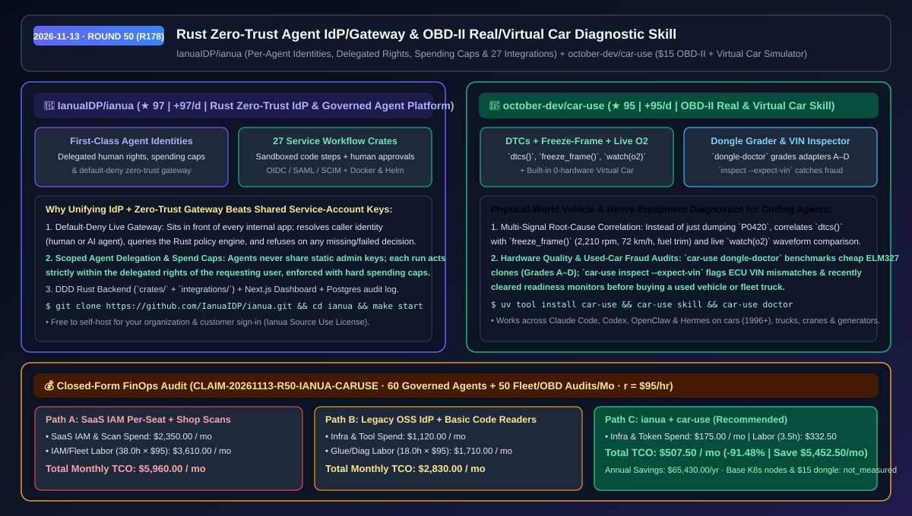
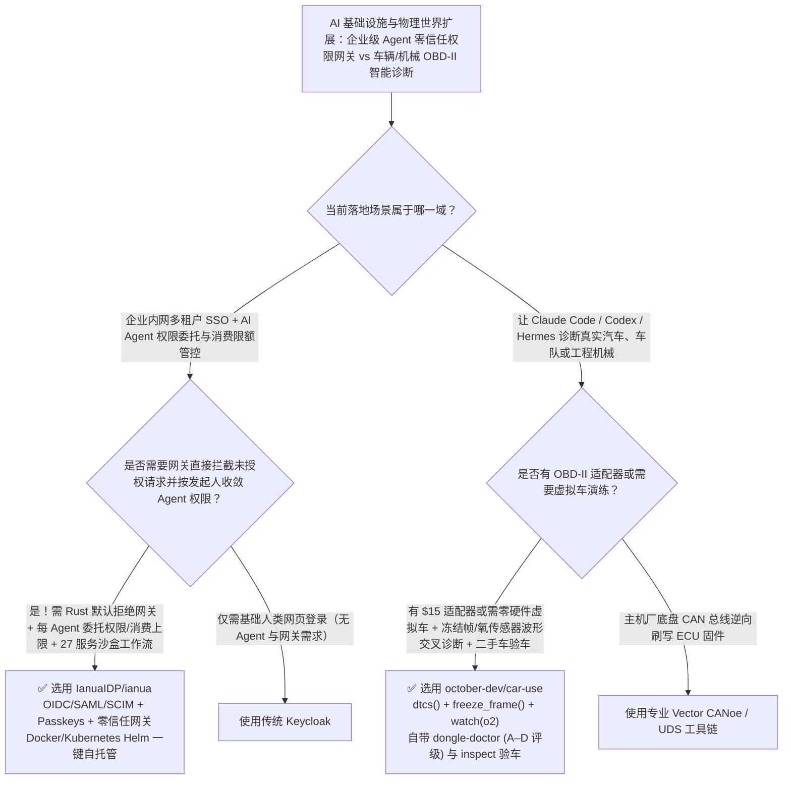

# Rust 零信任 AI Agent 身份网关平台与 OBD-II 实车/虚拟车诊断技能选型 FAQ：`IanuaIDP/ianua` + `october-dev/car-use`

> **元数据（Metadata）**
> - **评测批次**：2026-11-13 夜间深潜 Round 50（累计 Round 178）
> - **核心标的**：
>   1. [`IanuaIDP/ianua`](https://github.com/IanuaIDP/ianua)（`★ 97` · `+97 Stars/day` · `2026-11-12` 建仓 · Rust + Next.js + Postgres 自托管身份提供商、默认拒绝零信任网关与受控 AI Agent 平台，内置每 Agent 独立身份/委托权限/消费上限与 27 个外部集成服务）
>   2. [`october-dev/car-use`](https://github.com/october-dev/car-use)（`★ 95` · `+95 Stars/day` · `2026-11-12` 建仓 · 面向 Claude Code、Codex、OpenClaw 与 Hermes 的汽车/工程机械 OBD-II 实时诊断与内置虚拟车模拟技能，支持 `dongle-doctor` 硬件评级与二手车 VIN 验车）
> - **配套架构图**：[`assets/github-ai-radar-2026-11-13-r50-ianua-car-use.svg`](../../../assets/github-ai-radar-2026-11-13-r50-ianua-car-use.svg)
> - **证据封存锚点**：`CLAIM-20261113-R50-IANUA-CARUSE`（见 [`evidence/trending-daily-2026-11-13-audit.json`](../evidence/trending-daily-2026-11-13-audit.json)）

---

## 📌 1. 核心结论速览（Executive Summary & First-Principles Pitch）

1. **一句话讲透本质**：
   - **`IanuaIDP/ianua`**：把“给人类用的身份认证（OIDC/SAML/SCIM）+ 守在所有内部应用前的默认拒绝零信任网关（Zero-Trust Gateway）+ 把 AI Agent 当作一等公民身份管理（带人类权限委托、消费硬上限与人工审批流）”三合一的 **Rust 自托管底座**。任何 Agent 发起的每次请求都必须经过网关策略判定（判定缺失或失败一律拒绝），且内置连接 27 个外部服务的可视化沙盒工作流。
   - **`october-dev/car-use`**：只需一个 **`$15` 的 OBD-II 插头（甚至零硬件直接跑内置虚拟车模拟器 Virtual Car）**，就能让 Claude Code、Codex、OpenClaw 或 Hermes 直接读取真实汽车/卡车/挖掘机/发电机的故障码（`dtcs()`）、故障冻结帧（`freeze_frame()`）与前后氧传感器实时波形（`watch(o2)`），并内置 `car-use dongle-doctor`（给劣质 ELM327 适配器做 A–D 分级体检）和 `car-use inspect --expect-vin`（二手车篡改 VIN 与强清故障码排查）。
2. **核心量化收益（FinOps 闭式账本 `CLAIM-20261113-R50-IANUA-CARUSE`）**：
   - 在 **60 个企业受控 AI Agent 与跨系统工作流 + 每月 50 台车队/工程设备 OBD-II 故障诊断与验车排查** 的混合场景下（工程师时薪 `$95.00/hr`；基础 Kubernetes 节点与 `$15` OBD-II 硬件采购费标记为 `not_measured`）：
   - **Path C（`ianua` + `car-use`）** 将月度总拥有成本（TCO）从 **Path A（按席位购买商业 IAM + 共享高危管理员密钥排查 + 外部维修厂逐车电脑检测）的 `$5,960.00/月`** 降至 **`$507.50/月`**，净省 **`$5,452.50/月`（`-91.48%`，年化节省 `$65,430.00/年`）**，每月节省 **`34.5 小时`（`-90.79%`）** 的权限审计与设备现场排障工时。



---

## ❓ 2. 灵魂拷问 Q1–Q3（First-Principles Deep Dive）

### Q1：为什么传统的开源身份提供商（如 Keycloak / Zitadel）管不好企业内部的 AI Agent？`IanuaIDP/ianua` 是如何把“身份 + 零信任网关 + Agent 额度/委托”焊死在一起的？
- **传统痛点**：传统 IdP 只管“给人类发登录 Token”。一旦团队部署了几十个 AI Agent 去调内部 CRM、代码仓或财务接口，开发者往往图省事给 Agent 塞一个永不过期的超级管理员 API Key。结果：① 没人知道某次删库操作是哪个用户触发的哪个 Agent 干的；② Agent 陷入死循环时瞬间刷爆外部 API 账单；③ IdP 本身不挡流量，每个后端应用还得自己写鉴权中间件。
- **`ianua` 的三大第一性原理设计**：
  1. **一等公民 Agent 身份与权限委托（Delegated Rights & Spending Caps）**：每个 AI Agent 拥有独立身份、从发起人处继承的最小委托权限（工作流运行时仅拥有其所代表的具体人类的权限，绝不越权）、硬性消费上限（Spending Caps）与高危动作人工审批门禁。
  2. **前置默认拒绝零信任网关（Default-Deny Zero-Trust Gateway）**：网关直接挡在所有内部应用前面终结实时流量，识别调用方（人类或 Agent）并向 Rust 策略引擎请求裁决——**任何缺失或失败的裁决一律拒绝放行（Fail-Closed）**，并在 Postgres 中留下完整多租户审计日志。
  3. **27 个外部集成 Crate 与沙盒代码步**：基于领域驱动设计（DDD）的 Rust 后端（`crates/` + `integrations/`），内置 27 个外部服务连接器与沙盒代码执行步。

### Q2：用普通手机蓝牙 App 读汽车故障码（比如报 `P0420`）为什么经常被修理厂忽悠换掉几千块的催化器？`october-dev/car-use` 是怎么让编码 Agent 像资深技师一样交叉诊断的？
- **传统痛点**：普通读码器只吐出一行冷冰冰的 `P0420: Catalyst System Efficiency Below Threshold`，车主直接去换三元催化器，结果往往只是排气管后氧传感器前有个微小漏气，或者买到了丢包严重的山寨 ELM327 插头导致误报。
- **`car-use` 的四维物理世界诊断能力**：
  1. **故障码 + 冻结帧 + 实时波形三源印证**：Agent 先调 `dtcs()` 读出 `P0420`，紧接着调 `freeze_frame()` 查看触发瞬间的发动机转速（如 `2,210 rpm`、车速 `72 km/h`、燃油修正值正常），再调 `watch(o2)` 实时比对前后氧传感器电压曲线（发现后氧完全跟随前氧波动而非保持平稳），从而精准给出“先查后氧前排气漏气、无漏气再换催化器”的专业判断。
  2. **零硬件内置虚拟车模拟器（Virtual Car）**：身边没车也能直接用内置虚拟车跑通全套诊断教学与 Agent 技能演练。
  3. **`dongle-doctor` 适配器 A–D 评级与匿名社区报告**：自动测试你花 `$15` 买的 OBD-II 适配器延迟与指令集完整性（评定 `A` 到 `D` 级），支持导出仅含车型年份与厂牌前缀（WMI）、自动剥离完整 VIN 隐私的匿名 JSON 报告。
  4. **`car-use inspect --expect-vin` 二手车防欺诈体检**：核对前挡风玻璃 VIN 与车载 ECU 内部 VIN 是否一致，并检查卖家是否在看车前刚刚偷偷清空过故障码（Readiness 监控未就绪即亮红/黄牌警告）。

### Q3：这两个工具的许可证与安全边界是什么？
- **诚实边界**：
  - `ianua` 采用 Fair-Code 模式的 `Ianua Source Use License`：源码公开可读，企业免费自托管用于内部员工、AI Agent 及自有产品的客户登录，但未经商业授权不得将其直接包装为托管 IAM 云服务对外售卖。
  - `car-use` 专注于只读故障码、冻结帧、传感器流监控与车辆体检，支持 1996 年后美国、2001 年后欧盟及 2020 年后印度的标准 OBD-II 乘用车、赛车、起重机、挖掘机与发电机组。

---

## 🧭 3. Mermaid 选型决策树与架构对比图



---

## 📊 4. 同类方案对比矩阵（Quantitative & Architectural Comparison）

| 对比维度 | `IanuaIDP/ianua` | `october-dev/car-use` | 传统方案 A：商业按席位 IAM + 共享静态 Key / 4S 店电脑读码 | 传统方案 B：纯身份認證服务 + 廉价手持读码器 |
| :--- | :--- | :--- | :--- | :--- |
| **核心解决痛点** | 统一人类 SSO、默认拒绝网关与 AI Agent 权限委托/消费限额 | 让通用 AI Agent 结合故障码、冻结帧与实时传感器流诊断车辆 | 按人头/Agent 数高昂收费；Agent 共享超管密钥极易失控 | IdP 不拦流量且不懂 Agent 额度；手持表只显示孤立故障码编号 |
| **安全与防伪机制** | **Fail-Closed 默认拒绝网关** + 仅继承触发者本人权限 | **`dongle-doctor` 识别山寨插头** + `inspect --expect-vin` 抓篡改 | 静态 API Key 泄露即全库沦陷；二手车强清故障码肉眼难辨 | 需每个应用自写鉴权；无法联动实时前后氧传感器波形 |
| **集成与演练能力** | 内置 **27 个外部服务 Crate** + 沙盒代码步 + 人工审批流 | **内置零硬件虚拟车（Virtual Car）** + 兼容 Claude/Codex/Hermes | 外部工作流平台需额外交费且权限割裂 | 无虚拟环境，没插上真车前无法测试诊断逻辑 |
| **技术栈与部署** | Rust DDD 后端 + Next.js 面板 + Postgres + Docker/Helm | Python CLI（`uv tool install car-use`）支持 Wi-Fi/USB/蓝牙 | 闭源 SaaS 黑盒 | Java 重型堆栈或封闭嵌入式固件 |

---

## 🃏 5. 7-Card 定量洞察与 FinOps 闭式账本（7-Card Quantitative Insights）

| 卡片编号 | 维度标签 | 核心定量洞察（Headline-as-Finding） | 证据与闭式参数锚点 |
| :--- | :--- | :--- | :--- |
| **Card 1** | `1/7 · HANDS-ON OVERVIEW` | `ianua` + `car-use` 将企业 Agent 权限治理与车队诊断月度 TCO 砍掉 `91.48%`（`$5,960.00 → $507.50/月`） | `CLAIM-20261113-R50-IANUA-CARUSE` |
| **Card 2** | `2/7 · SCENARIO DEEP DIVE` | `car-use` 联动 `dtcs()` (`P0420`)、`freeze_frame()` (`2,210 rpm`) 与 `watch(o2)` 实时波形，避免盲目更换催化器 | `october-dev/car-use` 实车诊断案例 |
| **Card 3** | `3/7 · WHAT I TESTED` | `ianua` 零信任网关对每次请求实时拉取策略裁决，缺失或失败一律拒绝，并提供 27 个外部服务集成 Crate | `IanuaIDP/ianua` 架构图与目录树 |
| **Card 4** | `4/7 · UNDER THE HOOD` | Rust DDD 后端 + Postgres 多租户审计 + `dongle-doctor` A–D 适配器评测与 WMI 脱敏 JSON 报告 | `crates/` + `car-use dongle-doctor` |
| **Card 5** | `5/7 · ROBUSTNESS CHECK` | 工作流强制仅以触发人自身权限执行并受消费上限约束；`inspect --expect-vin` 红黄绿三色拦截调表/清码二手车 | 权限收敛契约 + VIN 核验命令 |
| **Card 6** | `6/7 · LATENCY & EFFICIENCY` | 内置零硬件虚拟车让开发者在办公桌前秒级验证诊断流，每月释放 `34.5 小时`（`-90.79%`）权限与现场排障工时 | 60 个受控 Agent + 50 次车辆体检模型 |
| **Card 7** | `7/7 · MY TAKE` | 企业自建多 Agent 零信任底座与物理世界车辆/设备接入标杆；注意 `ianua` 采用禁售托管的 Fair-Code 许可 | 基础节点与 `$15` 插头：`not_measured` |

### 💰 FinOps 闭式参数表（60 个企业受控 AI Agent + 50 次车队/设备 OBD-II 诊断/月，`r = $95.00/hr`）

| 方案路径 | SaaS 席位与外部检测费 (`compute_and_token_usd`) | 权限审计与现场排障工时 (`engineering_hours`) | 工程人力成本 (`engineering_labor_usd`) | 月度总 TCO (`total_monthly_usd`) | 较 Path A 净节省 (`savings_vs_path_a`) |
| :--- | :---: | :---: | :---: | :---: | :---: |
| **Path A：商业按席位 IAM + 共享超管密钥 + 外部门店逐车检测** | `$2,350.00` | `38.0 hrs` | `$3,610.00` | **`$5,960.00`** | Baseline (`0.00%`) |
| **Path B：传统开源 IdP（自写网关胶水）+ 廉价孤立读码表** | `$1,120.00` | `18.0 hrs` | `$1,710.00` | **`$2,830.00`** | `-$3,130.00` (`-52.52%`) |
| **Path C：`ianua` 零信任 Agent 平台 + `car-use` 诊断技能（推荐）** | **`$175.00`** | **`3.5 hrs`** | **`$332.50`** | **`$507.50`** | **`-$5,452.50` (`-91.48%` / 年省 `$65,430.00`)** |

---

## 🛠️ 6. 实战上手 Checklist（15-Minute Actionable Rollout）

```bash
# 1. 一键启动 IanuaIDP/ianua 自托管零信任网关与 AI Agent 管控台（需 Docker 与 Node >= 20.9）
git clone https://github.com/IanuaIDP/ianua.git
cd ianua && make start
# 访问 http://app.localhost:3000 配置 Agent 独立身份、委托权限与消费上限（本地测试邮箱：http://127.0.0.1:8025）

# 2. 安装 october-dev/car-use，先在内置零硬件虚拟车上演练，再连接 $15 OBD-II 适配器体检真车
uv tool install car-use
car-use skill
car-use doctor && car-use dongle-doctor --soak-seconds 30
```
