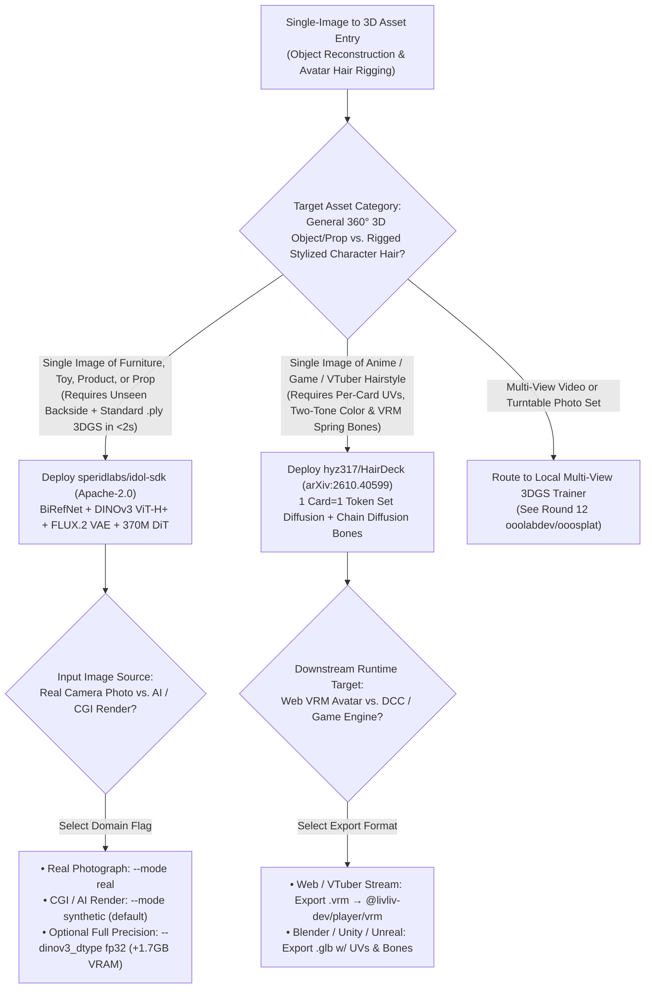

# Single-Image `<2s` 1M-Gaussian 3DGS & Spring-Bone VRM Hair-Card Modeling Selection FAQ: `speridlabs/idol-sdk` + `hyz317/HairDeck` (`arXiv:2610.40599`) vs. Cloud 3D APIs & Manual Hair Rigging

> **Document Scope**: A first-principles architecture and FinOps selection guide for AI Solution Architects, 3D Game/Avatar Pipeline Leads, and E-Commerce 3D Content Engineers. Focusing on two standout single-image-to-3D repositories from the `2026-11-09` GitHub AI Radar — **`speridlabs/idol-sdk`** (Apache-2.0, **941 Stars** / **943 Stars** live API, `stars_today = not_measured`) and **`hyz317/HairDeck`** (`arXiv:2610.40599`, Tsinghua + CMU + CUHK, Apache-2.0, **1,034 Stars**, `stars_today = not_measured`) — this guide dissects how **`< 2s` Single-Image Reconstruction up to `1,048,576` 3D Gaussians on `7.2 GB` Consumer VRAM (`DINOv3 ViT-H+` + `FLUX.2 VAE` + `370M DiT`)** and **`1 Card = 1 Token` Conditional Set Diffusion Paired with Chain Diffusion for VRM Spring Bones** eliminate unseen-backside collapse and "helmet-blob" character hair.
>
> **Navigation**: [中文版 (`idol-sdk-hairdeck-single-image-3d-vrm-selection-faq.md`)](./idol-sdk-hairdeck-single-image-3d-vrm-selection-faq.md) · [2026-11-09 Daily Radar](../daily/2026-11-09.en.md) · [Back to Radar Index](../README.en.md)

---

## 📌 1. Executive Summary

1. **First-Principles Definition**:
   - **`speridlabs/idol-sdk` (Python 3.10+ + PyTorch 2.5+, Apache-2.0)** turns a single photograph, AI image, or render into a complete **3D Gaussian Splatting (`.ply`) object model (`32,768` to `1,048,576` Gaussians, default `262,144`) in `< 2 seconds` using `7.2 GB` of consumer GPU VRAM** (`anonymized_reported (independently_reproduced=false)`). It strips backgrounds via `BiRefNet`, conditions a **`370M`-parameter DiT and `288M` decoder** on **`DINOv3 ViT-H+` and `FLUX.2 VAE`**, and synthesizes full 360° geometry including occluded backsides.
   - **`hyz317/HairDeck` (`arXiv:2610.40599`, Tsinghua + CMU + CUHK, Apache-2.0)** generates **animation-ready stylized 3D hair cards and the spring-bone chains that animate them from a single image**. Encoding each hair card as **one token via a Card VAE**, it uses a **Conditional Set Diffusion Transformer** to generate the hairstyle jointly with per-card UV coordinates, a **Color Model** to predict two-tone gradients and accessories along each card, and a **Chain Diffusion Model** to generate skinned spring-bone chains exported directly as **`.glb` or rigged `.vrm`** (running across Linux CUDA, Windows with automatic model offload, and Apple Silicon MPS without CUDA/Triton).
2. **Core Architectural Insight (Why General-Purpose Single-Image 3D APIs Fail on Both High-Volume Props and Character Hair)**:
   - **Failure Mode #1 (General-Purpose 3D Mesh Generators Fuse Character Hair into an Unrigged "Helmet Blob")**: Game and VTuber avatars require discrete, overlapping UV-mapped hair cards driven by skeletal spring-bone chains. Standard image-to-3D APIs output a single watertight mesh blob with zero internal cards or bones, forcing 3D character artists to spend **3.5 hours per hairstyle** manually placing cards, unwrapping UVs, and painting bone weights. `HairDeck`'s `1 Card = 1 Token` set diffusion + chain diffusion exports rigged `.vrm` hair ready for `@livliv-dev/player/vrm` (see Round 28).
   - **Failure Mode #2 (Cloud Image-to-3D APIs Charge $2.50+/Asset & Struggle on Unseen Backsides)**: `Idol` fuses global semantic priors from `DINOv3 ViT-H+` with high-frequency spatial detail from `FLUX.2 VAE`, provides explicit `--mode real` and `--mode synthetic` domain switches, and runs in `<2s` locally on `7.2 GB` VRAM.
3. **30-Second Selection Rule**:
   - Choose **`speridlabs/idol-sdk`** when converting **single photographs or renders of furniture, products, props, or toys into 360° `.ply` 3D Gaussian splats in `<2 seconds` on consumer GPUs** (use Round 12's `ooolabdev/ooosplat` when reconstructing multi-view video/photo sets).
   - Choose **`hyz317/HairDeck`** when generating **stylized game/avatar hairstyles with per-card UVs, two-tone colors, and rigged VRM spring-bone physics from a single image**.

---

## 🎯 2. Architect's First-Principles Deep Dive (Q1 / Q2 / Q3)

### Q1: How does `speridlabs/idol-sdk` reconstruct up to 1,048,576 3D Gaussians (including unseen backsides) in under 2 seconds on 7.2 GB VRAM?

Inspecting `README.md`, `pyproject.toml`, and `idol/` in `speridlabs/idol-sdk` reveals three architectural pillars:

1. **`BiRefNet` Preprocessing + Dual `DINOv3 ViT-H+` & `FLUX.2 VAE` Conditioning**:
   - `BiRefNet` removes background clutter and frames the subject (`<name>_input.png`).
   - **`DINOv3 ViT-H+`** (`facebook/dinov3-vith16plus-pretrain-lvd1689m`, `bf16` by default or `fp32` for `+1.7 GB` VRAM) supplies semantic 3D symmetry priors to infer occluded backsides, while **`FLUX.2 VAE`** (`black-forest-labs/FLUX.2-dev`) preserves crisp surface textures.
2. **Compact `370M DiT + 288M Decoder` with Time-Shifted Euler Sampling (`rescale_t = 3.0`)**:
   - Runs a 50-step Euler sampler (`cfg_strength = 3.0`, `--rescale_t 3.0` spending more steps at high noise to lock global 3D structure) and decodes `32,768` to `1,048,576` Gaussians (multiples of 32, default `262,144`) into `<name>.ply` plus `<name>_camera.json`.
3. **Explicit Domain Modes (`--mode real` vs. `--mode synthetic`) & `torch.compile`**:
   - Separates real-world camera photographs (`--mode real`) from CGI/AI renders (`--mode synthetic`) and uses `torch.compile` on CUDA to achieve `< 2s` steady-state inference within `7.2 GB` VRAM.

### Q2: How does `hyz317/HairDeck` (`arXiv:2610.40599`) formulate hair generation as `1 Card = 1 Token` Set Diffusion + Spring-Bone Chain Diffusion?

Inspecting `README.md` and `hairdeck/` in `hyz317/HairDeck` shows a 4-stage pipeline:

1. **Card VAE (`1 Hair Card = 1 Token`)**:
   - Encodes each individual 3D hair card (geometry + intrinsic per-card UV coordinates) into a single latent token.
2. **Conditional Set Diffusion Transformer**:
   - Generates the unordered set of hair-card tokens jointly conditioned on the input image, preserving layered strand separation instead of fusing into a watertight blob.
3. **Per-Card Color Model**:
   - Predicts color gradients along every card, capturing two-tone dye patterns and hair accessories.
4. **Chain Diffusion for Spring-Bone Physics & VRM Export**:
   - Synthesizes skeletal bone chains and skinning weights that drive the hair cards, exporting directly to `.glb` or `.vrm` across CUDA, Windows (with automatic offload), and Apple Silicon MPS.

### Q3: How do `idol-sdk` and `HairDeck` integrate with our earlier rounds (`ooosplat` and `@livliv-dev/player`)?

- **Single-Image Props → `speridlabs/idol-sdk`** (`<2s` `.ply` splat) vs. **Multi-View Scene Video → `ooolabdev/ooosplat`** (Round 12).
- **Single-Image Rigged Character Hair → `hyz317/HairDeck`** (`.vrm` with spring bones) → **Browser Playback in `@livliv-dev/player/vrm` (`VrmBody`)** (Round 28).

---

## 🧭 3. Mermaid Decision Tree & Execution Sequence

### 3.1 Single-Image 3DGS & Rigged Hair-Card Decision Tree

### 3.2 End-to-End Execution Sequence (`Idol` `<2s` 3DGS + `HairDeck` VRM Spring Bones)

```mermaid
sequenceDiagram
    autonumber
    participant User as 3D Artist / Avatar Pipeline
    participant Idol as speridlabs/idol-sdk<br/>(370M DiT · 7.2GB VRAM)
    participant HD as hyz317/HairDeck<br/>(Card VAE + Set/Chain Diffusion)
    participant Web as @livliv-dev/player / 3DGS Viewer<br/>(Real-Time Client)

    rect rgb(41, 26, 8)
    Note over User,Idol: Pipeline 1: Single-Image <2s 1M-Gaussian Object (idol-sdk)
    User->>Idol: 1. Submit photo.jpg (--mode real, --num_gaussians 1048576)
    Idol->>Idol: 2. BiRefNet background removal → DINOv3 ViT-H+ & FLUX.2 VAE encoding
    Idol->>Idol: 3. Run 370M DiT (Euler 50 steps, rescale_t=3.0) + 288M Decoder
    Idol-->>Web: 4. Emit photo.ply (1,048,576 Gaussians) + photo_camera.json in <2s
    end

    rect rgb(40, 16, 42)
    Note over User,Web: Pipeline 2: Single-Image Rigged Character Hair (HairDeck)
    User->>HD: 5. Submit character portrait image
    HD->>HD: 6. Conditional Set Diffusion generates hair-card tokens (Card VAE w/ per-card UVs)
    HD->>HD: 7. Color Model predicts two-tone gradients + Chain Diffusion builds spring bones
    HD-->>Web: 8. Export rigged .vrm → load in @livliv-dev/player/vrm w/ live spring physics
    end
```

---

## 📊 4. Comparison Matrix Across Single-Image 3D & Hair Pipelines

| Dimension | `speridlabs/idol-sdk` (`Apache-2.0`) | `hyz317/HairDeck` (`arXiv:2610.40599`) | Commercial Cloud Image-to-3D APIs (Tripo / Meshy) | Manual Blender / Maya Hair-Card Modeling & Rigging |
| :--- | :--- | :--- | :--- | :--- |
| **Output Representation** | **`32,768` to `1,048,576` 3D Gaussians (`.ply`) + camera pose** | **Discrete UV hair cards + two-tone colors + VRM spring bones** | Monolithic watertight triangle mesh | Hand-placed NURBS cards + manual weight painting |
| **Speed & VRAM Footprint** | **`< 2 seconds / object` on `7.2 GB` consumer VRAM** | Automated local inference (CUDA / Win offload / Mac MPS) | 30–90s cloud queue + frequent backside retries | **`~3.5 hours / hairstyle`** of senior 3D artist labor |
| **Hair Animation Readiness** | Rigid/static 3DGS object splats | **Native Spring-Bone chains + skinning weights (`.vrm` / `.glb`)** | **Unusable for hair**: Fuses strands into a rigid helmet blob | Animation-ready but extremely labor-intensive |
| **Occluded Backside Quality** | **`DINOv3 ViT-H+` semantic priors + `FLUX.2 VAE` detail** | Set Diffusion preserves inner/back hair card layers | Prone to Janus faces, flat backs, or smeared textures | Manual artist sculpting |
| **License & Unit Cost** | **Apache-2.0 Free Local Execution (`$0` API fee)** | **Apache-2.0 Free Local Execution (`$0` API fee)** | **`$2.00–$3.00 / gen` (`~$6.00` per accepted prop)** | **`~$192.50 / hairstyle`** in artist labor |

---

## 🧪 5. Closed-Form FinOps Worked Example & 7-Card Insights

### 5.1 Monthly 500 3D Props & 80 Rigged VRM Hairstyles Cost Model (`synthetic (independently_reproduced=false)`)

> **Provenance Notice**: This closed-form calculation is a synthetic architectural model (`synthetic (independently_reproduced=false)`) comparing **Path A (Commercial Cloud Image-to-3D API for 500 Props + Manual Blender Hair-Card Placement & Spring-Bone Rigging for 80 Hairstyles)** against **Path B (Local `speridlabs/idol-sdk` `<2s` 3DGS + `hyz317/HairDeck` Automated VRM Hair Pipeline)**. Reported metrics (`<2s`, `7.2 GB` VRAM, `1,048,576` Gaussians) are labeled `anonymized_reported (independently_reproduced=false)`; base character body modeling and workstation GPU hardware purchase are explicitly marked `not_measured`.

**Workload Parameters**:
- **3D Props Volume**: **`500` 3D props/month** reconstructed from single product/concept images.
- **Rigged VRM Hairstyles Volume**: **`80` stylized animated character hairstyles/month**; 3D character artist labor valued at **`$55.00 / hour`**.

| Cost Component | Path A: Cloud 3D API + Manual Hair Rigging | Path B: Local `Idol` 3DGS + `HairDeck` VRM | Governing Engineering Mechanism |
| :--- | :--- | :--- | :--- |
| **1. 500 Single-Image 3D Props Generation** | **$3,000.00 / mo** (`$2.50/gen` × `2.4x retries` = `$6.00/prop` × `500 props`) | **$15.00 / mo** (`7.2 GB` VRAM local `<2s/prop` GPU electricity/compute) | `Idol` `370M DiT + DINOv3 + FLUX.2 VAE` runs locally at `$0` API cost (**-99.5%**) |
| **2. 80 Stylized Rigged VRM Hairstyles (`@$55/hr`)** | **$15,400.00 / mo** (`3.5 hr/hairstyle` manual cards/UVs/bones × `80` = **`280.0 hours/mo`**) | **$1,110.00 / mo** (`$10.00` local GPU + `0.25 hr/style × 80` = **`20.0 hours/mo`** × `$55`) | `HairDeck` `1 Card=1 Token` + chain diffusion exports rigged VRM, saving **`260.0 hours/mo`** |
| **3. Base Character Body Modeling & GPU Hardware** | `not_measured` | `not_measured` | Base body meshes and workstation hardware are decoupled and never fabricated |
| **Total Modeled Monthly Cost** | **$18,400.00 / mo** | **$1,125.00 / mo** | **Net Savings: `$17,275.00 / mo` (`-93.89%` cost reduction, `16.36x` efficiency, `260.0 hours` saved)** |

### 5.2 Key Model & Geometric Invariants

- **Multiple-of-32 Gaussian Count & Seed Determinism Invariant**: In `speridlabs/idol-sdk`, `--num_gaussians` must lie between `32,768` and `1,048,576` as an exact multiple of `32` (default `262,144`), and a fixed `--seed` produces bit-consistent 3D objects.
- **Discrete Per-Card UV Topology Invariant**: `hyz317/HairDeck` decodes each token through its Card VAE into an independent hair-card mesh with normalized UV coordinates rather than a fused surface mesh.

---

## 🛠️ 6. Actionable Production Checklist

- [ ] **1. Authenticate Hugging Face Access for `DINOv3` & `FLUX.2-dev`**: Request access to `facebook/dinov3-vith16plus-pretrain-lvd1689m` and `black-forest-labs/FLUX.2-dev` and run `hf auth login` before initializing `IdolPipeline`.
- [ ] **2. Batch Directory Inputs in `idol.sample` to Amortize `torch.compile`**: Pass a folder (`python -m idol.sample --image renders/`) or keep `IdolPipeline` warm in memory so subsequent images run in `< 2 seconds` after the initial compile warmup.
- [ ] **3. Match `--mode real` vs. `--mode synthetic` to Input Provenance**: Always set `--mode real` for camera photographs and `--mode synthetic` for CGI/AI renders, inspecting `<name>_input.png` to verify clean `BiRefNet` segmentation.
- [ ] **4. Enable Automatic Model Offload on Windows or MPS on Apple Silicon for `HairDeck`**: Use `run_windows.bat` for automatic VRAM offload on consumer Windows GPUs or native MPS on Apple Silicon Macs (`docs/macos.md`).
- [ ] **5. Verify Exported `.vrm` Hair Physics in `@livliv-dev/player/vrm`**: Load `HairDeck`'s `.vrm` output into `@livliv-dev/player/vrm` to validate two-tone card colors and spring-bone motion under head rotation.
