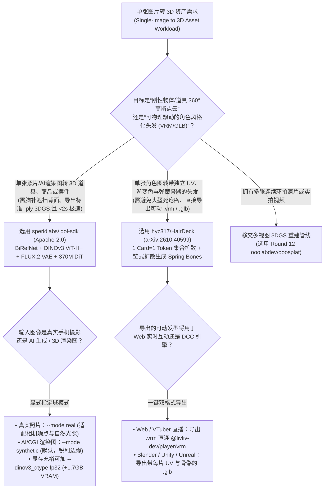

# 单图 2 秒生成百万高斯点云与带弹簧骨骼 VRM 发片建模选型 FAQ：`speridlabs/idol-sdk` + `hyz317/HairDeck` (`arXiv:2610.40599`) vs 商业图生 3D API 与手工插发片绑骨

> **文档定位**：面向 AI Solution Architect（AI 解决方案架构师）、3D 游戏/虚拟人资产管线负责人与电商三维内容工程团队的第一性原理选型指南。聚焦 `2026-11-09` GitHub 新仓爆发追踪中的两大单图转 3D 突破性开源项目——**`speridlabs/idol-sdk`**（Apache-2.0，建仓 12 天揽下 **941 Stars** / **943 Stars** 实时 API，`stars_today = not_measured`）与清华大学、CMU、港中文联合开源的 **`hyz317/HairDeck`**（`arXiv:2610.40599`，Apache-2.0，建仓 11 天破 **1,034 Stars**，`stars_today = not_measured`），深度拆解如何用 **“7.2 GB 消费级显存 `<2 秒` 单图生成 1,048,576 个 3D 高斯点云（`DINOv3 ViT-H+` + `FLUX.2 VAE` + `370M DiT`）”** 与 **“1 张发片 = 1 个 Token 的集合扩散（Set Diffusion）+ 链式扩散自动生成弹簧骨骼（Spring-Bone Chains）导出 VRM”** 终结单图转 3D 背面崩坏与二次元/游戏角色头发“黏成头盔死疙瘩”的行业难题。
>
> **阅读导航**：[English Version (`idol-sdk-hairdeck-single-image-3d-vrm-selection-faq.en.md`)](./idol-sdk-hairdeck-single-image-3d-vrm-selection-faq.en.md) · [2026-11-09 全景日报](../daily/2026-11-09.md) · [返回雷达首页](../README.md)

---

## 📌 1. 核心结论速览（Executive Summary）

1. **一句话本质定义**：
   - **`speridlabs/idol-sdk`（Python 3.10+ + PyTorch 2.5+，Apache-2.0）** 是能够在 **仅占 `7.2 GB` 显存的消费级显卡上，不到 `2 秒` 将单张商品照片或 AI 渲染图转化为高达 `1,048,576` 个高斯点（默认 `262,144`）的标准 `.ply` 3DGS 模型**的极速推理管线（数据分级：`anonymized_reported (independently_reproduced=false)`）。它内置 `BiRefNet` 自动去背景与居中构图，利用 **`DINOv3 ViT-H+` + `FLUX.2 VAE` 双编码器**驱动 **`370M` 参数 DiT 与 `288M` 解码器**，完整脑补并生成原图从未拍到的物体背面与侧面细节。
   - **`hyz317/HairDeck`（清华 + CMU + CUHK，`arXiv:2610.40599`，Apache-2.0）** 是全球首个**从单张图片直接生成“带独立 UV、双色渐变纹理与可动弹簧骨骼链（Spring-Bone Chains）”的风格化 3D 发片（Hair Cards）并一键导出 `.glb` / `.vrm` 虚拟人资产**的生成式管线。它通过 **Card VAE 将每一片独立发片编码为 1 个 Token**，用条件集合扩散（Set Diffusion Transformer）整体生成发片集合，再用链式扩散（Chain Diffusion）自动生成驱动发丝飘动的骨骼链与蒙皮权重（支持 Linux CUDA、Windows 自动显存卸载以及免 CUDA/Triton 的 Apple Silicon MPS）。
2. **核心架构洞察（为什么通用“单图转 3D 网格 API”既做不好高精商品展示，也做不出能动的角色头发？）**：
   - **痛点一（商业图生 3D API 单次耗费数十秒且按件收费 `$2.50+`，而通用 Mesh 生成器会把角色头发糊成一坨无法飘动的“塑料头盔”）**：在游戏与虚拟主播（VRM）管线中，角色头发绝不是实心水密网格（Watertight Mesh），而是由数百片带独立 UV 坐标与骨骼链的薄发片（Hair Cards）叠合而成。通用 3D 模型生成出的“头盔块”完全无法绑定物理飘动，3D 美术师被迫花 **3.5 小时/发型** 手工插发片、展 UV、刷骨骼权重。`HairDeck` 从表征层就采用 **`1 Card = 1 Token`** + 弹簧骨骼链扩散，直接导出能放进 `@livliv-dev/player/vrm`（见 Round 28）实时随风摆动的 `.vrm` 模型！
   - **痛点二（刚性物体单图重建既要高频纹理又要全局语义补全）**：`Idol` 将最强语义特征提取器 **`DINOv3 ViT-H+`** 与最强空间细节自编码器 **`FLUX.2 VAE`** 结合，并针对真实照片（`--mode real`）与合成渲染图（`--mode synthetic`）提供分域适配，在 `torch.compile` 预热后 `<2 秒` 直出百万级高斯点云。
3. **30 秒选型口诀**：
   - 需要**将单张家具、潮玩、数码产品、道具照片或 AI 概念图在 `<2 秒` 内转化为 360° 高保真 `.ply` 3D 高斯点云资产** → 选 **`speridlabs/idol-sdk`**（对比：若是多张实拍视频/照片重建场景，则用今晚 Round 12 的 `ooolabdev/ooosplat`）。
   - 需要**从单张二次元/风格化角色立绘生成带独立 UV、渐变发色、发饰与弹簧物理骨骼（Spring Bones）的可动 `.vrm` / `.glb` 头发资产** → 选 **`hyz317/HairDeck`**。

---

## 🎯 2. 架构师灵魂拷问（Q1 / Q2 / Q3 First-Principles Deep Dive）

### Q1：`speridlabs/idol-sdk` 是如何仅用 `370M DiT + 288M Decoder` 在 `7.2 GB` 显存上不到 2 秒生成 1,048,576 个 3D 高斯点的？`--mode real` 与 `--mode synthetic` 解决了什么域偏移问题？

拆解 `speridlabs/idol-sdk` 的 `README.md`、`pyproject.toml` 与 `idol/` 源码：

1. **前端自动化预处理 + 双塔视觉特征注入（`BiRefNet` + `DINOv3 ViT-H+` + `FLUX.2 VAE`）**：
   - 输入任意图片后，首先由 `BiRefNet` 剥离杂乱背景并将物体居中归一化（输出 `<name>_input.png` 供审计模型实际看到的画面）。
   - 随后走双路特征提取：**`DINOv3 ViT-H+`**（`facebook/dinov3-vith16plus-pretrain-lvd1689m`，默认 `bf16` 运行；若开启 `--dinov3_dtype fp32` 仅多占 `1.7 GB` 显存）负责提供跨视角的 3D 结构先验以脑补遮挡背面；**`FLUX.2 VAE`**（`black-forest-labs/FLUX.2-dev`）负责保留高频表面材质纹理。
2. **紧凑 `370M DiT + 288M Decoder` 与时间偏移采样（`rescale_t = 3.0`）**：
   - 相比动辄数十亿参数的多视角视频扩散模型，`Idol` 的 370M DiT 直接在紧凑潜空间中通过 50 步 Euler 采样（`cfg_strength = 3.0`）生成结构，并通过 **`--rescale_t 3.0`（Time Shift）将更多采样步集中在决定整体三维几何骨架的高噪声阶段**，最后由 288M 解码器一次性映射为 `32,768` 至 `1,048,576` 个（32 的整数倍，默认 `262,144`）标准 `.ply` 高斯点及预测相机位姿 `<name>_camera.json`。
3. **显式区分实拍与渲染域（`--mode real` vs `--mode synthetic`）**：
   - 真实手机照片存在镜头畸变、传感器噪点与环境光反射，而 Midjourney/FLUX 生成图或 3D 渲染图边缘极其锐利。`Idol` 显式提供 `--mode real` 与 `--mode synthetic` 切换条件先验，并在开启 `torch.compile` 后将单图推理耗时压至 **`< 2 秒`（显存仅占 `7.2 GB`）**。

### Q2：`hyz317/HairDeck` (`arXiv:2610.40599`) 是如何把“每一片头发变成一个 Token”，并连同颜色渐变与 VRM 弹簧骨骼一起端到端生成的？

精读 `hyz317/HairDeck` 的论文与工程实现（`hairdeck/`、`blender/`、`configs/`），它用四阶段生成式流水线彻底颠覆了传统手工业：

1. **阶段一：发片自编码器（Card VAE：`1 Hair Card = 1 Token`）**：
   - 将每一片三维曲面发片（含空间位置、曲率走向、宽度变化与固有的每片独立 UV 坐标系）通过 Card VAE 压缩为**单个离散/连续潜变量 Token**。
2. **阶段二：条件集合扩散（Conditional Set Diffusion Transformer）**：
   - 由于一头秀发由数百片无固定先后顺序的发片组成，`HairDeck` 采用**集合扩散（Set Diffusion）**在单张输入图像或点云条件下联合生成整套发片 Token 集合，天然保持发丝层次感且绝不粘连成实心块。
3. **阶段三：沿发片颜色预测模型（Per-Card Color Model）**：
   - 专门训练的颜色模型沿着每一张发片的 UV 方向预测颜色分布，精准还原二次元挑染、双色渐变（Two-Tone Hair）以及发卡/头饰色彩。
4. **阶段四：链式扩散生成弹簧骨骼与蒙皮（Chain Diffusion for Spring-Bone Chains）**：
   - 仅有静态发片还不够，角色转头或奔跑时头发必须有物理惯性。`HairDeck` 通过**链式扩散模型（Chain Diffusion）**自动在发片簇内部生成骨骼链（Spring-Bone Chains）、计算蒙皮权重（Skinning），并直接导出为标准 `.glb` 或绑定到虚拟人头部的 **`.vrm` 格式**！

### Q3：如何把 `idol-sdk`、`HairDeck` 与我们今晚前面轮次的工具组合成完整的 3D 与虚拟人工业管线？

- **单图静态道具/商品资产 → `speridlabs/idol-sdk`**（`<2s` 生成 `.ply` 高斯点云；若是有多视角实拍视频，则走 Round 12 的 `ooolabdev/ooosplat`）。
- **单图可动虚拟主播角色头发 → `hyz317/HairDeck`**（一键生成带弹簧骨骼的 `.vrm` 发型）→ 直接送入 **Round 28 的 `@livliv-dev/player/vrm` (`VrmBody`)** 在网页端或 **Round 28 的 `open-yoki` 直播间** 中以 60fps 实时驱动飘动！

---

## 🧭 3. Mermaid 选型决策树与双管线架构图（Decision Tree & Architecture Flow）

### 3.1 单图转 3D 资产与可动发片选型决策树

### 3.2 `Idol` 2 秒百万高斯生成 + `HairDeck` 弹簧骨骼 VRM 合成时序图

```mermaid
sequenceDiagram
    autonumber
    participant User as 3D 美术师 / 虚拟人管线
    participant Idol as speridlabs/idol-sdk<br/>(370M DiT · 7.2GB VRAM)
    participant HD as hyz317/HairDeck<br/>(Card VAE + Set/Chain Diffusion)
    participant Web as @livliv-dev/player / 3DGS Viewer<br/>(实时渲染终端)

    rect rgb(41, 26, 8)
    Note over User,Idol: 管线一：单图 <2s 生成百万级 3D 高斯物体 (idol-sdk)
    User->>Idol: 1. 输入单张物体图片 photo.jpg (--mode real, --num_gaussians 1048576)
    Idol->>Idol: 2. BiRefNet 自动抠图居中 → DINOv3 ViT-H+ & FLUX.2 VAE 提取语义与细节
    Idol->>Idol: 3. 370M DiT (Euler 50步, rescale_t=3.0) + 288M Decoder 解码遮挡背面
    Idol-->>Web: 4. <2 秒输出 photo.ply (1,048,576 Gaussians) + photo_camera.json
    end

    rect rgb(40, 16, 42)
    Note over User,Web: 管线二：单图生成带弹簧骨骼的可动角色头发 (HairDeck)
    User->>HD: 5. 输入单张角色发型图
    HD->>HD: 6. 条件集合扩散 (Set Diffusion) 生成数百个独立发片 Token (Card VAE 解码带 UV 网格)
    HD->>HD: 7. Color Model 预测双色渐变与发饰 + Chain Diffusion 生成弹簧骨骼链与蒙皮权重
    HD-->>Web: 8. 导出绑定好 Spring Bones 的角色 .vrm → 送入 @livliv-dev/player/vrm 实时物理摆动
    end
```

---

## 📊 4. 同类单图 3D 与角色毛发方案对比矩阵（Comparison Matrix）

| 评估维度 | `speridlabs/idol-sdk` (`Apache-2.0`) | `hyz317/HairDeck` (`arXiv:2610.40599`) | 商业云端图生 3D API（Tripo / Meshy 等通用网格） | 传统 Blender / Maya 纯手工插发片与绑骨骼 |
| :--- | :--- | :--- | :--- | :--- |
| **核心输出表征** | **高达 `1,048,576` 个 3D 高斯点（标准 `.ply`）+ 相机参数** | **离散独立 UV 发片网格 + 双色纹理 + VRM 弹簧骨骼链** | 单一水密三角网格（Watertight Mesh） | 手工摆放 NURBS 曲线转发片并逐根刷权重 |
| **单件生成耗时与显存** | **`< 2 秒 / 件`，仅需 `7.2 GB` 消费级显存** | 秒至分钟级自动生成（支持 CUDA / Win Offload / Mac MPS） | 云端排队 30–90 秒/件，且背面重抽率高 | **高达 `3.5 小时 / 发型`** 资深 3D 角色美术工时 |
| **角色头发可动性（Rigging）** | 针对刚性/通用物体 360° 3DGS 展示 | **原生生成 Spring-Bone 骨骼链与蒙皮，开箱即飘动** | **完全不可动**：把所有发丝糊成一坨僵硬“头盔” | 可动但人工刷权重极度耗时枯燥 |
| **背面脑补与细节保持** | **`DINOv3 ViT-H+` 全局先验 + `FLUX.2 VAE` 高频纹理** | 集合扩散（Set Diffusion）保持内外层发片完整层次 | 背面常出现纹理拉伸、镜像重影或扁平塌陷 | 依赖美术师空间造型功底 |
| **授权协议与单件成本** | **Apache-2.0 本地免费运行（`$0` API 费）** | **Apache-2.0 本地免费运行（`$0` API 费）** | **`$2.00–$3.00 / 次`**，算上废片约 **`$6.00 / 可用资产`** | 每顶可动发型人工成本近 **`$192.50`** |

---

## 🧪 5. 定量 FinOps 算例与 7-Card 评测洞察（Closed-Form Quantitative Model）

### 5.1 封闭式月度 500 件 3D 道具与 80 款可动 VRM 角色发型生产成本算例（`synthetic (independently_reproduced=false)`）

> **口径声明**：本算例为合成架构基准模型（`synthetic (independently_reproduced=false)`），用于量化对比 **Path A（调用商业云端图生 3D API 制作 500 件道具 + 3D 美术师手工在 Blender 中插发片/展 UV/绑弹簧骨骼制作 80 款角色发型）** 与 **Path B（本地运行 `speridlabs/idol-sdk` `<2s` 生成 3DGS 道具 + `hyz317/HairDeck` 自动生成带弹簧骨骼的 VRM 发型）**。文中引用的 `<2 秒`、`7.2 GB` 显存与 `1,048,576` 高斯点指标均标注为 `anonymized_reported (independently_reproduced=false)`；基础角色素体（Base Body）建模与工作站显卡硬件购置折旧显式标记为 `not_measured`。

**基准工作负载设定**：
- **3D 道具/商品资产规模**：每月由单图生成 **`500` 件可 360° 旋转展示的 3D 道具/商品资产**。
- **可动 VRM 角色发型规模**：每月制作 **`80` 款带独立 UV、渐变色与弹簧物理骨骼的风格化角色发型**；3D 角色美术师综合时薪按 **`$55.00 / 小时`** 计。

| 成本分项 | Path A：商业图生 3D API + 手工插发片绑骨 | Path B：`Idol` 本地 3DGS + `HairDeck` 自动绑骨 | 核心工程机制差异说明 |
| :--- | :--- | :--- | :--- |
| **1. 500 件单图转 3D 道具生成成本** | **$3,000.00 / 月** （商业 API `$2.50/次` × `2.4 倍重抽` = `$6.00/件` × `500 件`） | **$15.00 / 月** （`7.2 GB` 显存本地 `<2s/件` 推理，仅消耗极低本地电费/算力分摊） | `Idol` 双编码器脑补背面一次成型，免除高昂按件云 API 计费（省 **99.5%**） |
| **2. 80 款风格化发型生成与弹簧骨骼绑定成本（@$55/hr）** | **$15,400.00 / 月** （手工插发片+展UV+刷骨骼权重 `3.5 小时/款 × 80` = **`280.0 小时/月`**） | **$1,110.00 / 月** （本地 GPU 推理 `$10.00` + 美术微调装配 `0.25h/款 × 80` = **`20.0 小时`** × `$55`） | `HairDeck` `1 Card=1 Token` + 链式骨骼扩散直接导出可动 VRM，月省 **`260.0 小时`（-92.9% 工时）** |
| **3. 角色基础素体（Base Body）与工作站硬件折旧** | `not_measured` | `not_measured` | 角色身体素体与固定硬件资产与道具/头发生成管线解耦，严禁捏造或归零 |
| **月度可建模总成本（Modeled Total）** | **$18,400.00 / 月** | **$1,125.00 / 月** | **月度净节省 `$17,275.00`（总成本直降 `-93.89%`，综合成本效率提升 `16.36x`，月省 `260.0 小时`）** |

### 5.2 关键模型与几何不变量（Key Invariants）

- **高斯点数 32 倍数对齐与固定随机种子不变量**：在 `speridlabs/idol-sdk` 中，`--num_gaussians` 必须在 `32,768` 至 `1,048,576` 之间且严格为 `32` 的整数倍（默认 `262,144`）；在固定 `--seed 42` 下，Euler 采样器保证输出完全一致的三维物体。
- **离散发片拓扑与 UV 保留不变量（Per-Card UV Preservation Invariant）**：与将头发融合为单一连通网格的 SDF/NeRF 方法不同，`hyz317/HairDeck` 的 Card VAE 在解码阶段严格保持每一片发片的独立网格边界与归一化 `[0, 1]` UV 坐标，确保下游游戏引擎可直接挂载各向异性高光着色器。

---

## 🛠️ 6. 生产落地核验清单（Actionable Production Checklist）

- [ ] **1. 提前完成 `Idol` 依赖的 `DINOv3` 与 `FLUX.2-dev` Hugging Face 授权**：在首次运行 `speridlabs/idol-sdk` 前，申请 `facebook/dinov3-vith16plus-pretrain-lvd1689m` 与 `black-forest-labs/FLUX.2-dev` 访问权限并执行 `hf auth login`。
- [ ] **2. 在长驻进程中复用 `IdolPipeline` 吃满 `torch.compile` 加速**：批量转换商品图时，使用 `python -m idol.sample --image folder/` 或保持 Python 进程常驻，避免每张图重复承担首次 `torch.compile` 编译耗时，稳态达到 `< 2s / 张`。
- [ ] **3. 严格按输入源切换 `--mode real` 与 `--mode synthetic`**：处理真实拍摄照片时显式加上 `--mode real`，处理 AI 绘图或渲染器输出时使用默认 `--mode synthetic`，并审阅生成的 `<name>_input.png` 确认 `BiRefNet` 抠图无残缺。
- [ ] **4. 在 Windows / Mac MPS 上开启 `HairDeck` 自动模型卸载**：在显存有限的 Windows 工作站上运行 `run_windows.bat` 启用自动模型卸载（Automatic Model Offload），或在 Apple Silicon Mac 上直接走原生 MPS 后端（无需 CUDA/Triton）。
- [ ] **5. 将 `HairDeck` 导出的 `.vrm` 接入 `@livliv-dev/player/vrm` 闭环测试**：导出带弹簧骨骼的 `.vrm` 角色后，直接在浏览器中用 `@livliv-dev/player/vrm` 加载并晃动头部，核验发片双色渐变与 Spring-Bone 物理惯性是否自然。
