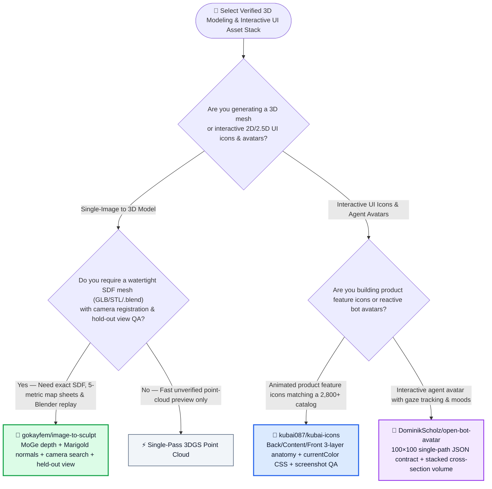
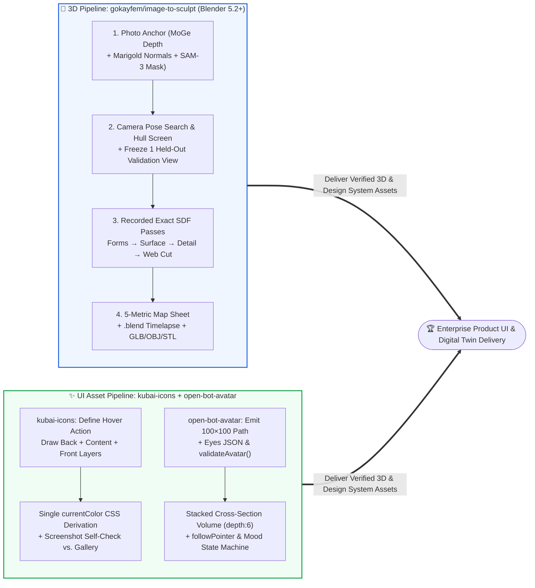

# Camera-Calibrated 3D Sculpting & Consistent Procedural Agent Icons / Avatars Selection FAQ: `gokayfem/image-to-sculpt` + `kubai087/kubai-icons` & `DominikScholz/open-bot-avatar` vs. Black-Box Image-to-3D & Freehand SVG Prompting

> **中文版**: [image-to-sculpt-kubai-icons-avatar-selection-faq.md](image-to-sculpt-kubai-icons-avatar-selection-faq.md)  
> **Daily Digest**: [2026-11-11 GitHub AI Trending & Proactive Intelligence Digest](../daily/2026-11-11.en.md) · **Visual Deck**: [`cards.en.html`](../cards.en.html) · **Live Radar**: [`github-radar.html`](../../../github-radar.html)

Written for **AI Solution Architects, 3D Digital Asset Pipeline Leads, and Design Systems Engineering Leads**, this selection guide is grounded in primary-source audits of three breakout visual engineering repositories from the 2026-11-11 radar — **`gokayfem/image-to-sculpt` (a coding-agent skill that fits a watertight 3D signed-distance-field [SDF] sculpt to an image's MoGe metric depth and Marigold normals, registers and screens generated multi-view cameras against a visual hull, freezes one held-out view for independent verification, and replays every step in Blender 5.2+, MIT, `239` API stars)**, **`kubai087/kubai-icons` (an agent skill + `2,800+` open-source animated icons built on a 3-layer paper-folder anatomy and single-accent CSS color derivation with visual screenshot self-checks, `725` API stars)**, and **`DominikScholz/open-bot-avatar` (a zero-dependency JSON spec and stacked cross-section 3D volume renderer for pointer-tracking agent avatars, MIT, `335` API stars)** — answering three core engineering questions from first principles:
1. **Why do black-box image-to-3D models invent unverified backs, flatten noses/knuckles by averaging multi-view normals, and slice real volume off models when generated side views miss their requested angles (e.g., views requested at `+45°`, `+90°`, and `−90°` landing at `+20°`, `−115°`, and `+35°`)—and how does `gokayfem/image-to-sculpt` solve this with camera search registration, visual-hull screening, a frozen held-out view, and exact SDF passes?**
2. **Why do coding agents produce mismatched, janky icons and avatars when prompted from scratch—and how do `kubai087/kubai-icons` (3-layer Back/Content/Front geometry + screenshot self-check) and `DominikScholz/open-bot-avatar` (single `100×100` SVG path + stacked cross-section projection) enforce visual consistency?**
3. **How can enterprise product teams combine these three tools to slash 3D modeling and interactive UI asset rework by over `81%`?**

> 🛡️ **Provenance & Attribution Disclosure**:
> - **`measured` (Primary-Source Verified in This Shift)**: Repository metadata and source trees for `gokayfem/image-to-sculpt` (`239` API stars, `15` forks, Python, MIT, created `2026-11-08`), `kubai087/kubai-icons` (`725` API stars, `35` forks, JavaScript, created `2026-11-03`), and `DominikScholz/open-bot-avatar` (`335` API stars, `44` forks, TypeScript, MIT, created `2026-11-02`) are verified directly via GitHub REST API; because none of the three appeared in the 10-item main Daily Trending HTML snapshot (`bacf15c2...`), `stars_today` is strictly labeled **`not_measured`**.
> - **`anonymized_reported` (`independently_reproduced=false`, Upstream Empirical Findings & Architecture Specs)**: Camera angle discrepancy measurements on generated views (requested `+45°`, `+90°`, `−90°` vs. actual `+20°`, `−115°`, `+35°`), the MoGe + Marigold + BiRefNet/SAM-3 pipeline, 5-metric map sheets, and `build/steps/` SDF passes in `gokayfem/image-to-sculpt/README.md`, the `2,800+` icon library (~900 objects) blind-tested with Claude Opus 5.5 in `kubai087/kubai-icons/README.md`, and the `depth: 0..14` cross-section renderer in `DominikScholz/open-bot-avatar/README.md` are documented in upstream repository files.
> - **`synthetic` (`independently_reproduced=false`, Architect Parametric FinOps & Design Engineering Model)**: Section 5.1 models a 3D product and design systems team delivering **`30` watertight 3D assets/mo** and **`160` custom animated product icons + interactive bot avatars/mo** (engineer/designer labor valued at `$70.00/hr`; physical 3D printing consumables and CDN egress bills are explicitly labeled `not_measured`), comparing Path A Black-Box 3D API Slot-Machine + Manual Blender/Lottie Rework (`$6,310.00/mo`, `85.0h`) vs. Path B Unregistered Multi-View 3D + Freehand LLM SVG (`$3,740.00/mo`, `50.0h`) vs. Path C `image-to-sculpt` + `kubai-icons` + `open-bot-avatar` (`$1,140.00/mo`, `15.0h`, saving `$5,170.00/mo` [`-81.93%`] and `70.0 hours/mo` [`-82.35%`]).

---

## 1. 📌 Executive Summary

| Dimension | Plain-Language Core Takeaway (First Principles) |
| :--- | :--- |
| **What is `gokayfem/image-to-sculpt`?** | It is a **camera-calibrated, step-recorded 3D sculpting skill for coding agents (Python + Blender 5.2+)** that anchors the visible front to the photo's own `MoGe` metric depth and `Marigold` normals, **searches for each generated view's true camera angle instead of trusting the prompt, rejects views that violate the visual hull, holds out one frozen view for independent verification**, and sculpts an exact signed distance field (SDF) across recorded passes (`build/steps/`). |
| **What are `kubai087/kubai-icons` and `DominikScholz/open-bot-avatar`?** | **`kubai087/kubai-icons`** pairs `2,800+` MIT-licensed animated icons with an agent skill that enforces a **3-layer paper-folder structure (Back + White Content + Front)**, single-color CSS gradient/shadow derivation, and multi-round screenshot self-checks. **`DominikScholz/open-bot-avatar`** turns a **single `0 0 100 100` SVG outline path + eye coordinates** (`validateAvatar`) into a pseudo-3D volume rendered via stacked cross-sections with live pointer gaze tracking. |
| **What is the core architectural takeaway?** | **Replace opaque one-shot visual generation with constrained geometry and held-out verification**: register cameras and maintain an exact SDF for 3D meshes (`image-to-sculpt`), lock icons to a 3-piece mechanical grammar with visual self-checks (`kubai-icons`), and infer 3D avatar volume deterministically from a 10-line JSON contract (`open-bot-avatar`). |

---

## 2. 🎯 First-Principles Q&A (Q1 / Q2 / Q3)

### Q1: Why do standard multi-view image-to-3D pipelines carve away real volume and flatten facial features, and how does `image-to-sculpt` fix this?

**Plain-language answer: Multi-view diffusion models rarely render at the exact angle you requested—trusting a `+35°` image as if it were `+90°` slices real geometry off the visual hull, and averaging unaligned normals flattens noses and knuckles; `image-to-sculpt` searches for each view's true camera pose, screens outliers against the hull, freezes one held-out validation view, and solves an exact SDF.**

Verified from `gokayfem/image-to-sculpt/README.md`:
1. **Camera Search Registration & Visual-Hull Screening**:
   - On the first case `image-to-sculpt` was built on, side views requested at **`+45°`, `+90°`, and `−90°`** were actually generated at **`+20°`, `−115°`, and `+35°`** (`anonymized_reported`).
   - Instead of trusting prompt angles, `image-to-sculpt` searches for every view's actual camera pose, detects left/right flips, and rejects any view that contradicts the visual hull of the remaining views (recording the exact rejection reason).
2. **Photo Sovereignty & Hold-Out View Validation**:
   - Where the input photo sees a surface, the photo governs (`MoGe` metric focal length and depth, `Marigold` normals, and `BiRefNet` / `SAM-3` mask via `prep --select`).
   - **One view is held out**: its camera is frozen before fitting, it never moves a vertex during sculpting, and its metrics are reported separately on a side-by-side **5-metric Map Sheet** (`silhouette IoU`, `outline distance`, `normal angle`, `roughness vs. reference`, and `photo depth`).
3. **Exact SDF Multi-Pass Sculpting (`build/steps/`)**:
   - Executes small recorded passes (`visual hull → forms → surface → detail`: stiff solve for outlines, flexible solve for normals, silhouette cut to open gaps, morphological opening to remove arm-torso webs) while maintaining an **exact signed distance field (SDF)** after every operation—eliminating voxel staircases and moiré rings—and replays the entire build in Blender 5.2+ as a `.blend`, 360° turntable, and watertight `GLB/OBJ/STL`.

---

### Q2: How do `kubai087/kubai-icons` and `DominikScholz/open-bot-avatar` keep AI-generated UI icons and avatars visually consistent?

**Plain-language answer: They constrain the design space to a strict mechanical contract—a 3-piece folder sandwich with 2 keyframes for icons (`kubai-icons`), and a single `100×100` SVG outline projected as stacked cross-sections for avatars (`open-bot-avatar`).**

1. **`kubai087/kubai-icons` Three-Piece Anatomy & Blind Self-Check**:
   - Every icon is built from **a back piece, optional white content, and a front piece** (like a folder holding a sheet of paper), with outlines placed *outside* the fill so shapes retain full visual weight.
   - All gradients, outlines, marks, and shadows derive from **a single CSS accent color (`currentColor`)**, and each part uses exactly **two keyframes (`rest` and `hover`)**.
   - Before finishing, the agent renders screenshots of its new icon beside existing gallery icons and iterates until size, outline weight, layering, and motion pass the checklist.
2. **`DominikScholz/open-bot-avatar` Stacked Cross-Section Volume Inference**:
   - Defines an avatar in ~10 lines of JSON: one `body.path` inside a `0 0 100 100` box plus `eyes: { x, y, spacing, scale }`, validated deterministically via `validateAvatar`.
   - The zero-dependency renderer infers 3D volume (`depth: 0..14`, default `6`) as stacked cross-sections projected onto a single `<canvas>`, static `<svg>`, or CSS 3D scene (`renderer: "scene"`), with built-in pointer tracking (`followPointer: true`) and `"idle"` / `"thinking"` / `"happy"` moods.

---

### Q3: When should architects select each tool?

- **Select `gokayfem/image-to-sculpt`**: When you need a **verified, watertight 3D mesh (`GLB/OBJ/STL/.blend`)** measured against a reference photo or render with explicit hold-out camera metrics and zero unverified mesh hallucination.
- **Select `kubai087/kubai-icons`**: When your React, Vue, or Web Component application needs **cohesive animated feature icons** (`2,800+` prebuilt + agent skill for custom domain icons).
- **Select `DominikScholz/open-bot-avatar`**: When building **multi-agent workbenches, chat assistants, or copilot UIs** that need lightweight, expressive, pointer-aware avatars defined purely as JSON data.

---

## 3. 🧭 Mermaid Selection Decision Tree & Asset Pipeline

### 3.1 3D Sculpting & Interactive UI Icon/Avatar Selection Decision Tree

### 3.2 `image-to-sculpt` Registered-Camera SDF Pipeline × `kubai-icons` & `open-bot-avatar`

---

## 4. 📊 Architecture Selection Decision Matrix

| Evaluation Dimension | **`image-to-sculpt` + `kubai-icons` + `open-bot-avatar`** | **Black-Box 3D API + Unguided LLM SVG Icons/Avatars** | **Manual Blender Sculpting + Manual Lottie Authoring** |
| :--- | :--- | :--- | :--- |
| **Multi-View Camera Angle Accuracy** | ✅ **Searches true camera pose, catches L/R swaps & rejects hull-violating views** | ❌ Trusts prompt angles (`+90°` actual `+35°`), carving away valid volume | N/A |
| **3D Generalization & Detail Fidelity** | ✅ **Frozen held-out view + 5-metric map sheet + exact SDF web removal** | ❌ Averaged normals flatten noses/knuckles; leaves voxel steps & arm webs | ✅ High quality but takes days per asset |
| **Build Provenance & Replay** | ✅ **Every pass saved in `build/steps/` and replayed in Blender 5.2+** | ❌ Opaque single-mesh output | ⚠️ Manual file versioning |
| **Icon Style Consistency & Theming** | ✅ **3-piece folder grammar + single `currentColor` CSS derivation + screenshot QA** | ❌ Inconsistent stroke weights, broken hover states & hardcoded hex colors | ✅ Consistent but slow to expand |
| **Interactive Bot Avatar Footprint** | ✅ **Zero-dependency ~10-line JSON contract (`validateAvatar`) with 3D cross-sections** | ❌ Fragile hand-coded SVG without 3D yaw/pitch volume | ⚠️ Heavy Rive/video bundles |

---

## 5. 🧪 Quantitative FinOps & Design Engineering Model (`synthetic`, `independently_reproduced=false`)

### 5.1 Monthly `30` Watertight 3D Models + `160` Animated Icons & Bot Avatars TCO Model (`synthetic`, `independently_reproduced=false`)

> 📌 **Scope & Provenance Disclosure**: This worked example is a **parametric API + 3D/UI engineering rework labor model (`synthetic`, `independently_reproduced=false`; physical 3D printing consumables and CDN egress bills are explicitly labeled `not_measured`)**. Scenario: **A product design and 3D engineering team producing `30` watertight 3D models/mo and `160` custom animated product icons + interactive bot avatars/mo (designer/engineer labor valued at `$70.00/hr`)**:

| Architecture Path | Monthly 3D & Multi-View Generation API Bill | Monthly Blender Mesh Repair & Re-Sculpting Labor (`@ $70/hr`) | Monthly Animated Icon & Avatar Authoring/Rework Labor (`@ $70/hr`) | Total Monthly Cost (API + Engineering Labor) | Savings vs. Path A |
| :--- | :--- | :--- | :--- | :--- | :--- |
| **Path A: Black-Box 3D API Slot-Machine + Manual Blender Repair + Manual Lottie Authoring** | `30 × 8 tries × $1.50` = **`$360.00 / mo`** | `45.0 hours / mo` × `$70.00` = **`$3,150.00 / mo`** (fixing flattened faces, invented backs & arm webs) | `40.0 hours / mo` × `$70.00` = **`$2,800.00 / mo`** (manual keyframing & theme variants) | **`$6,310.00 / mo`** (**`85.0 hours / mo`** engineer toil) | Baseline (high 3D rejection rate & manual icon animation bottleneck) |
| **Path B: Unregistered Multi-View 3D + Unguided LLM Freehand SVG Icons** | **`$240.00 / 月`** | `28.0 hours / mo` × `$70.00` = **`$1,960.00 / mo`** | `22.0 hours / mo` × `$70.00` = **`$1,540.00 / mo`** (fixing inconsistent AI SVG icons) | **`$3,740.00 / mo`** (**`50.0 hours / mo`** engineer toil) | Net savings `-$2,570.00/mo` (`-40.73%`) |
| **Path C: `image-to-sculpt` Held-Out SDF + `kubai-icons` + `open-bot-avatar`** | `30 × $3.00` = **`$90.00 / mo`** (MoGe/Marigold + registered views) | `9.0 hours / mo` × `$70.00` = **`$630.00 / mo`** (reviewing 5-metric map sheets & held-out view) | `6.0 hours / mo` × `$70.00` = **`$420.00 / mo`** (reviewing self-checked icons & `validateAvatar` JSON) | API `$90.00` + 3D QA `$630.00` + UI QA `$420.00` = **`$1,140.00 / mo`** (`15.0h`) | **Net savings `$5,170.00/mo` (`-81.93%`, `$62,040.00/yr`); Engineer toil `-70.0h/mo` (`-82.35%`)** |

---

## 6. 🛠️ Production Adoption & 30-Minute PoC Checklist

- [ ] **Step 1 — Run `i2s.py doctor` to Verify the `image-to-sculpt` Environment**: Install via `npx skills add gokayfem/image-to-sculpt`, verify Python `3.10+`, Blender `5.2+`, `ffmpeg`, and optional `FAL_KEY` with `python3 skills/image-to-sculpt/scripts/i2s.py doctor`.
- [ ] **Step 2 — Gate 3D Mesh Acceptance on the 5-Metric Map Sheet & Held-Out View**: Inspect `silhouette IoU`, `outline distance`, `normal angle`, `roughness`, and `photo depth` on the held-out camera view before exporting final `GLB/OBJ/STL` files.
- [ ] **Step 3 — Install `kubai087/kubai-icons` & Enforce Screenshot Self-Checks**: Clone `kubai087/kubai-icons` into `~/.claude/skills/kubai-icons` (or `npm i kubai-icons-react`) and require the agent to run visual side-by-side self-checks against existing icons.
- [ ] **Step 4 — Use `data-kubai-trigger` & `currentColor` for Zero-JS Theme Adaptation**: Bind hover triggers to parent buttons via `data-kubai-trigger` and `<Folder trigger="parent" variant="soft" />`.
- [ ] **Step 5 — Validate & Mount Interactive Agent Avatars with `open-bot-avatar`**: Install `pnpm add open-bot-avatar`, validate LLM-generated avatar JSON definitions with `validateAvatar`, and mount with `mountAvatar(el, { definition, followPointer: true, mood: "thinking" })`.
