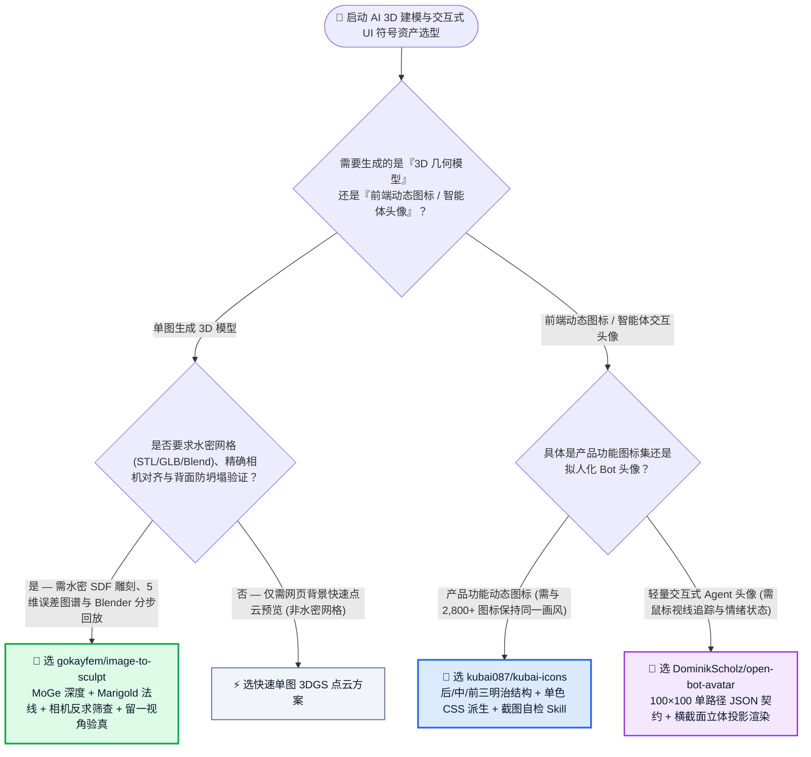
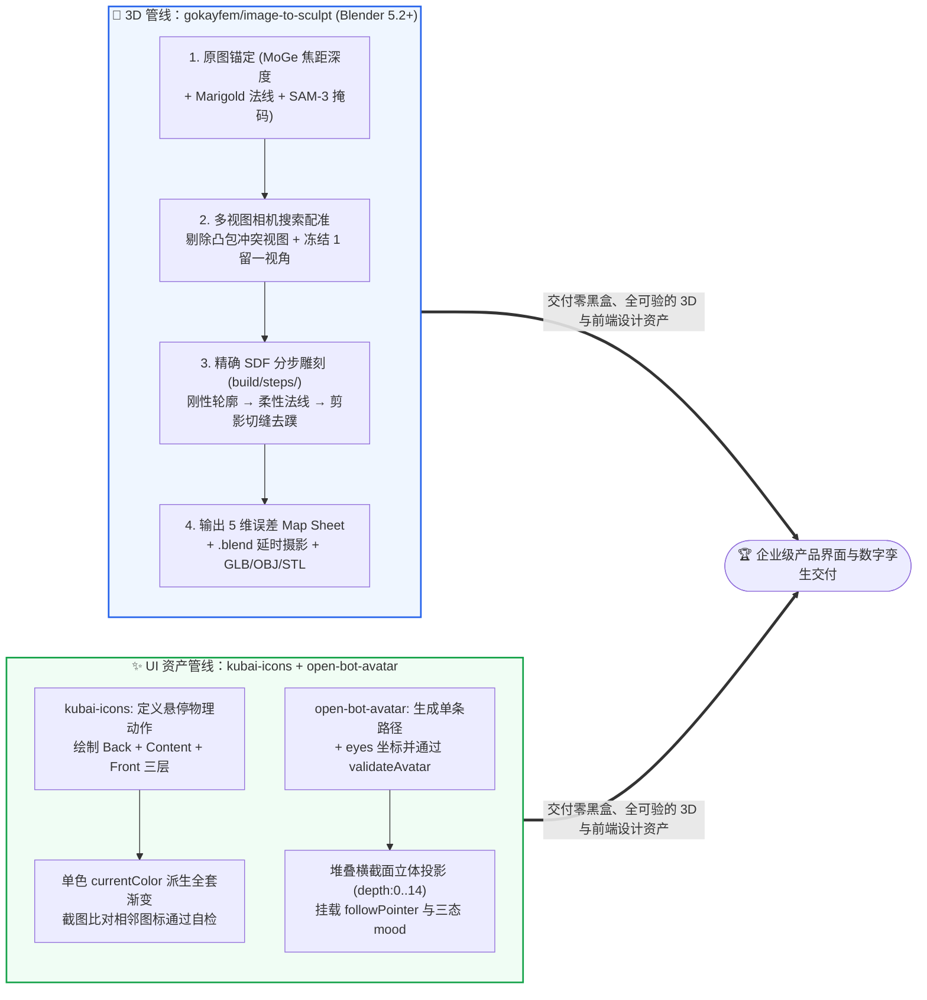

# 单图相机标定可验证 3D 雕刻建模与统一风格动态图标/截面投影 Bot 头像选型常见问题解答：`gokayfem/image-to-sculpt` + `kubai087/kubai-icons` & `DominikScholz/open-bot-avatar` vs 黑盒单图生 3D 模型 & 裸写 SVG 图标

> **English Edition**: [image-to-sculpt-kubai-icons-avatar-selection-faq.en.md](image-to-sculpt-kubai-icons-avatar-selection-faq.en.md)  
> **关联日报**: [2026-11-11 GitHub AI 最热榜单与情报摘要](../daily/2026-11-11.md) · **视觉评测卡**: [`cards.html`](../cards.html) · **在线面板**: [`zh-github-radar.html`](../../../zh-github-radar.html)

本文档面向 **AI Solution Architect（AI 解决方案架构师）、3D 数字资产管线负责人与前端设计系统主管**，基于 2026-11-11 GitHub 新仓爆发榜三款聚焦“可度量 3D 重建与高一致性 UI 视觉资产”的标杆项目 —— **`gokayfem/image-to-sculpt`（将单张图片通过 MoGe 度量深度、Marigold 法线、多视图相机位姿反求、留一视角验真与精确 SDF 渐进雕刻转化为水密 3D 模型与 Blender 延时摄影的 Agent Skill，MIT，建仓 3 天 `239★`）**、**`kubai087/kubai-icons`（包含 2,800+ 统一风格三明治夹心动态图标与视觉自检闭环的 Agent Skill，MIT 图标库，建仓 8 天 `725★`）** 与 **`DominikScholz/open-bot-avatar`（通过单条 `100×100` SVG 路径 + 眼睛坐标契约自动推断横截面立体感并支持视线跟随的零依赖交互式 Agent 头像引擎，MIT，建仓 9 天 `335★`）** 的一手源码与文档深度核验，用通俗大白话与第一性原理解答：
1. **为什么直接调用黑盒“单图生成 3D”大模型时，生成的模型经常背面塌陷、鼻梁指节被抹平、手臂和身体粘连成蹼，且因为多视图扩散模型根本没按你要求的角度生成（要求 `+45°/+90°/-90°`，实际生成的是 `+20°/-115°/+35°`）而把好好的体积切坏？`gokayfem/image-to-sculpt` 是如何用「相机搜索配准 + 凸包筛查 + 留一视角（Hold-Out View）冻结验真 + 精确 SDF 渐进雕刻」破局的？**
2. **为什么让 Coding Agent 自由发挥画产品图标或 AI 助手头像，画出来的风格总是五花八门、悬停动效僵硬？`kubai087/kubai-icons` 的「后底板/白内页/前盖板三层结构 + 单色 CSS 派生 + 截图自检」与 `DominikScholz/open-bot-avatar` 的「单路径横截面立体投影契约」是如何锁死审美下限的？**
3. **在企业 3D 与前端产品工作流中，如何组合使用这三款工具替代昂贵的云端 3D 抽卡与手工动效返工？**

> 🛡️ **数据来源、归属核验与证据分级声明（Provenance & Attribution Disclosure）**：
> - **`measured`（本班次一手实测抓取）**：`gokayfem/image-to-sculpt`（`239` API Stars，`15` Forks，Python，MIT，创建于 `2026-11-08`）、`kubai087/kubai-icons`（`725` API Stars，`35` Forks，JavaScript，创建于 `2026-11-03`）与 `DominikScholz/open-bot-avatar`（`335` API Stars，`44` Forks，TypeScript，MIT，创建于 `2026-11-02`）均通过 GitHub REST API 一手核验；三者不在主日榜 24h DOM 快照内，故 `stars_today` 严格标注为 **`not_measured`**。
> - **`anonymized_reported`（`independently_reproduced=false`，上游仓库实测数据与技术规格）**：`gokayfem/image-to-sculpt` 官方 README 披露的首个测试案例视角偏差实测数据（请求生成 `+45°`、`+90°`、`-90°` 侧视图，实际反求相机角度为 `+20°`、`-115°`、`+35°`）、MoGe + Marigold + BiRefNet/SAM-3 管线、5 维 Map Sheet 对照指标、`kubai087/kubai-icons` 的 `2,800+` 图标库（约 900 个物体）与 Claude Opus 5.5 盲测自检流程、以及 `open-bot-avatar` 的 `depth: 0..14`（默认 `6`）横截面投影契约。
> - **`synthetic`（`independently_reproduced=false`，架构师参数化 FinOps 与设计返工工时算例）**：第 5.1 节「3D 与设计系统团队每月交付 `30 个` 水密可打印/可渲染 3D 资产 + `160 个` 动态产品图标与交互式 Agent 头像（设计师/工程师综合时薪 `$70.00/h`；3D 打印耗材与 CDN 流量费明确标注为 `not_measured`）」的闭式成本对比（Path A 黑盒 3D API 抽卡 + 人工 Blender 修模与手工 Lottie 动效 `$6,310.00/月` vs Path B 无相机配准多视图重建 + 裸 LLM 乱画图标 `$3,740.00/月` vs Path C `image-to-sculpt` + `kubai-icons` + `open-bot-avatar` `$1,140.00/月`，净省 `$5,170.00/月` [`-81.93%`] 与 `70.0 小时/月` [`-82.35%`] 返工工时）。

---

## 1. 📌 核心结论速览（Executive Summary）

| 评估维度 | 一句话大白话核心结论（直指本质） |
| :--- | :--- |
| **`gokayfem/image-to-sculpt` 到底是个什么东西？** | 它是一个**把“盲目抽卡的图生 3D”变成“像精密光学测量一样步步可验的 Blender 5.2+ 雕刻流水线”**的 Agent Skill：用原图的 `MoGe` 深度和 `Marigold` 法线当铁律，对多视图模型生成的侧视图**先搜索真实相机角度、剔除跟凸包打架的坏图、冻结 1 个留一视角（Hold-Out View）做独立考官**，再通过多遍精确符号距离场（SDF）雕刻输出 `.blend` 延时摄影与水密 GLB/OBJ/STL！ |
| **`kubai-icons` + `open-bot-avatar` 到底是什么？** | **`kubai087/kubai-icons`** 是包含 `2,800+` 现成动态图标并教会 Agent 按**“后底板 + 白内页 + 前盖板”三明治结构、单色 `currentColor` 派生全套光影、截图与相邻图标比对自检**来画新图标的技能；**`DominikScholz/open-bot-avatar`** 则是只需写 **1 条 2D 轮廓路径 + 眼睛坐标 JSON**，就能自动按层叠横截面推算出 3D 体积感、还会跟着鼠标转眼珠的零依赖 Agent 头像组件！ |
| **这三者共同揭示了什么生成式视觉架构铁律？** | **拒绝不可控的单次端到端黑盒生成，拥抱“几何物理约束 + 独立留一验证 + 过程分步留痕”**：3D 建模靠相机反求与 SDF 剪影切缝保精度，2D 动态图标靠三层物理隐喻与截图自检保统一，Bot 头像靠 JSON 契约与横截面投影保零依赖交互！ |

---

## 2. 🎯 第一性原理灵魂三问（Q1 / Q2 / Q3 大白话拆解）

### Q1：为什么普通“单图转多视图再重建 3D”总是削掉鼻子或切残模型？`image-to-sculpt` 是怎么治好这个顽疾的？

**先说大白话结论：因为多视图扩散模型是个“角度文盲”——你让它画一张 `+90°` 正侧面，它画出来的其实是 `+35°` 斜侧面；如果你傻乎乎地按 `+90°` 把它投影回去，就会像拿错图纸开刀一样把模型原本的体积生生削掉一块！**

根据 `gokayfem/image-to-sculpt` 官方一手实测与架构拆解：
1. **铁证如山的角度漂移与“搜索配准 + 凸包筛查（Registration & Hull Screening）”**：
   - 作者在首个测试案例中实测发现：向多视图生成器请求 `+45°`、`+90°` 与 `−90°` 三个角度的视图，模型实际画出的相机角度分别是 **`+20°`、`−115°` 与 `+35°`**（`anonymized_reported`）！
   - 因此，`image-to-sculpt` **绝不轻信提示词里的角度**：它通过搜索算法反求每张生成视图的真实相机位姿，自动检测左右镜像翻转，并将每张图与其余视图构成的视觉凸包（Visual Hull）对账——**凡是违反凸包一致性的坏视图（比如多画了一条胳膊或变了姿势）当场剔除并记录驳回原因**！
2. **留一视角冻结验真（One Held-Out View）与原图最高主权**：
   - 在原图看得见的正面区域，严格由原图的 `MoGe`（度量焦距与深度）、`Marigold`（表面法线）与 `BiRefNet`/`SAM-3`（掩码）说了算；
   - 同时**专门挑出 1 个视角作为“留一验证集（Hold-Out View）”**：在拟合前冻结其相机，雕刻过程中绝不用它来移动顶点，最后单独用它汇报泛化误差，彻底杜绝“训练集过拟合自嗨”！
3. **精确 SDF 多遍渐进雕刻与 5 维对照图谱（Map Sheet）**：
   - 摒弃产生锯齿阶梯（Voxel Staircases）和摩尔纹环的粗糙网格操作，每一步都在 `build/steps/` 中保持**精确符号距离场（Exact SDF）**：先用刚性求解（Stiff Solve）锁住外轮廓，再用柔性求解（Flexible Solve）贴合法线细节，最后执行剪影切缝（Silhouette Cut）打开孔洞、形态学开运算去除手臂与躯干间的粘连薄蹼（Webs）。
   - 拒绝输出单一笼统的“质量得分”，而是为每个视角并排生成 **5 维对照图谱（剪影 IoU、轮廓距离、法线夹角、表面粗糙度对比、原图深度）**，并由 Blender 5.2+ 完整回放每一步构建过程！

---

### Q2：`kubai087/kubai-icons` 和 `DominikScholz/open-bot-avatar` 是如何让 Coding Agent 稳定产出大师级动态 UI 元件的？

**先说大白话结论：因为它们不让大模型“自由画画”，而是把图标拆成了“三层夹心机械件（只允许静息和悬停两个姿态）”，把立体头像拆成了“单条 2D 轮廓自动切片堆叠 + 参数化眼睛”！**

1. **`kubai087/kubai-icons` 的四大一致性铁律**：
   - **三层夹心结构（Back + White Content + Front）**：每个图标都像一个夹着白纸的文件夹，且描边（Outline）严格位于填充区域外侧（Outlines sit outside the fill），保证小尺寸下形状依然饱满。
   - **单一 `currentColor` 派生全套光影**：所有渐变、描边、高光与阴影均在 CSS 内由同一个主色自动派生，无需任何 JS 脚本即可随文字颜色或主题一键换肤。
   - **物理动作定义 + 盲测截图自检**：Agent 动手前必须先写出一句话物理语义（如 *“悬停时：文件夹盖掀开 / 挂锁弹开 / 日历翻页”*），画完后必须截图与现有 `2,800+` 图标库并排对比尺寸、轮廓粗细、图层关系与色彩，直到自检清单全过！
2. **`DominikScholz/open-bot-avatar` 的极简 JSON 契约与横截面立体渲染**：
   - Agent 只需要输出一个极简 JSON：`0 0 100 100` 坐标系下的单条 `body.path` SVG 路径 + `eyes: { x, y, spacing, scale }`（由 `validateAvatar` 严格校验）。
   - 渲染器自动从 2D 轮廓推断出多层堆叠横截面（Stacked Cross-Sections，`depth: 0..14`），实时投影到单个 Canvas、静态 SVG 或 CSS 3D 场景（`renderer: "scene"`），自带鼠标/手指视线追踪（`followPointer: true`）与 `"idle"` / `"thinking"` / `"happy"` 三态情绪切换！

---

### Q3：架构师在实战中该如何选型？

- **需要可 3D 打印、进游戏引擎或 Blender 二次编辑的水密 3D 模型**：选 **`gokayfem/image-to-sculpt`**（若只需 2 秒生成网页背景高斯点云且不需要水密网格，可搭配昨日拆解的 `speridlabs/idol-sdk`）。
- **需要一整套风格高度统一、带悬停微动效的产品功能图标（React/Vue/Web Component）**：选 **`kubai087/kubai-icons`**。
- **需要为多智能体工作台、客服机器人或桌面助手配备轻量、会看鼠标且有思考/开心状态的立体感头像**：选 **`DominikScholz/open-bot-avatar`**。

---

## 3. 🧭 Mermaid 选型决策树与端到端资产生产架构图

### 3.1 3D 实体建模与交互式 UI 符号/头像选型决策树（Decision Tree）

### 3.2 `image-to-sculpt` 留一验证 SDF 雕刻 × `kubai-icons` & `open-bot-avatar` 生产管线图

---

## 4. 📊 同类方案全方位选型决策矩阵（Decision Matrix）

| 评估维度 | **`image-to-sculpt` + `kubai-icons` + `open-bot-avatar`** | **黑盒图生 3D API + 裸 LLM 手写 SVG 图标/头像** | **纯人工 Blender 建模 + 设计师手绘 Lottie 动效** |
| :--- | :--- | :--- | :--- |
| **生成侧视图角度漂移防护** | ✅ **自动搜索真实相机位姿，检测左右翻转，剔除违背凸包的坏视图** | ❌ 盲信提示词角度（`+90°` 实为 `+35°`），直接切坏模型体积 | N/A |
| **3D 泛化与五官细节保真度** | ✅ **冻结 1 个留一视角独立评估 + 5 维 Map Sheet + 精确 SDF 去粘连蹼** | ❌ 多视图法线直接平均导致鼻梁/指节扁平，腋下与手指严重粘连 | ✅ 高保真但单件耗时数天 |
| **构建过程可追溯性** | ✅ **`build/steps/` 完整记录每一遍雕刻，支持 Blender 延时摄影回放** | ❌ 黑盒一次性吐出网格，无法定位哪一步出错 | ⚠️ 依赖人工保存历史工程文件 |
| **动态图标视觉一致性与换肤** | ✅ **三层夹心规范 + 单一 `currentColor` 派生渐变阴影 + 2,800+ 图标截图自检** | ❌ 每个图标线条粗细、透视与配色各异，改主题需重改代码 | ✅ 一致但扩展新图标慢 |
| **交互式 Bot 头像体积与眼神** | ✅ **10 行 JSON 契约（`validateAvatar`）零依赖横截面立体投影 + 鼠标跟随** | ❌ 手写复杂 SVG 极易走形且无立体旋转透视 | ⚠️ 需导出重型序列帧或 Rive 文件 |

---

## 5. 🧪 定量算例与 7-Card 评测洞察（Quantitative Example & 7-Card Insights）

### 5.1 月产 30 个水密 3D 模型 + 160 个动态图标与交互式 Bot 头像闭式成本算例（`synthetic`，`independently_reproduced=false`）

> 📌 **透明口径与边界声明（Scope & Provenance）**：本算例为架构师评估 3D 数字资产与前端设计系统生产的 **API + 设计师/工程师修模与动效返工工时参数化算例（`synthetic` model；实体 3D 打印耗材与公网 CDN 分发费明确标注为 `not_measured`）**。场景设定为：**产品与设计工程团队每月需生产 `30 个` 水密可渲染/可打印 3D 角色或商品模型，并新增交付 `160 个` 统一风格动态功能图标与交互式 Agent 头像（3D/UI 工程师综合时薪按 `$70.00 / 小时` 计算）**：

| 方案路径 | 每月 3D 与多视图生成 API 账单 | 每月 Blender 人工修补粘连/扁平五官工时 (`@ $70/h`) | 每月动态图标与交互头像制作/返工工时 (`@ $70/h`) | 每月总综合成本（API + 工程师工时） | 相对 Path A 降本增效幅度 |
| :--- | :--- | :--- | :--- | :--- | :--- |
| **Path A：黑盒 3D API 反复抽卡 + 人工修模 + 手工制作 Lottie 动效** | `30 × 8 次重抽 × $1.50` = **`$360.00 / 月`** | `45.0 小时 / 月` × `$70.00` = **`$3,150.00 / 月`**（手工切开粘连手指、重雕背面与五官） | `40.0 小时 / 月` × `$70.00` = **`$2,800.00 / 月`**（手工调关键帧与配色适配） | **`$6,310.00 / 月`** （耗费 **`85.0 小时 / 月`** 工程工时） | 基线（黑盒 3D 返工极重，手工动效产能受限） |
| **Path B：无相机配准多视图重建 + 裸 LLM 乱画 SVG 图标** | **`$240.00 / 月`** | `28.0 小时 / 月` × `$70.00` = **`$1,960.00 / 月`** | `22.0 小时 / 月` × `$70.00` = **`$1,540.00 / 月`**（人工返工风格割裂的 AI 图标） | **`$3,740.00 / 月`** （耗费 **`50.0 小时 / 月`** 工时） | 综合降本 `-$2,570.00/月` (`-40.73%`) |
| **Path C：`image-to-sculpt` 留一验证 SDF + `kubai-icons` + `open-bot-avatar`** | `30 × $3.00` = **`$90.00 / 月`**（MoGe/Marigold + 配准筛查一次成型） | `9.0 小时 / 月` × `$70.00` = **`$630.00 / 月`**（仅审阅 5 维 Map Sheet 与留一视角报告） | `6.0 小时 / 月` × `$70.00` = **`$420.00 / 月`**（Agent 截图自检通过后直接挂载） | API `$90.00` + 3D 终审 `$630.00` + 图标/头像终审 `$420.00` = **`$1,140.00 / 月`** (`15.0h`) | **月度净省 `$5,170.00/月` (`-81.93%`，年省 `$62,040.00`)；工程工时省 `70.0h/月` (`-82.35%`)** |

---

## 6. 🛠️ 架构师生产落地与 30 分钟 PoC 核验清单（Production & PoC Checklist）

- [ ] **Step 1 — 运行 `i2s.py doctor` 核验 `gokayfem/image-to-sculpt` 本地环境**：安装 `npx skills add gokayfem/image-to-sculpt`，配置 Python `3.10+`、Blender `5.2+`、`ffmpeg` 与可选 `FAL_KEY`，执行 `python3 skills/image-to-sculpt/scripts/i2s.py doctor` 验证依赖就绪（无 Key 时亦可直接用透明 PNG + 本地多角度照片运行）。
- [ ] **Step 2 — 检查 5 维 Map Sheet 与留一视角（Hold-Out View）独立误差**：在每次 3D 雕刻完成后，先查看生成的 Map Sheet 中留一视角的剪影 IoU、轮廓距离与法线夹角，确认无视角角度错配后再导出 GLB/STL。
- [ ] **Step 3 — 部署 `kubai087/kubai-icons` 技能并开启盲测截图自检**：将 `kubai087/kubai-icons` 克隆至 `~/.claude/skills/kubai-icons`（或安装 `npm i kubai-icons-react`），要求 Agent 为新功能补齐图标时必须先定义悬停动作并截图比对相邻图标。
- [ ] **Step 4 — 用 `data-kubai-trigger` 与 `currentColor` 统一主题交互**：在按钮或导航栏父容器上添加 `data-kubai-trigger` 并设置 `<Folder trigger="parent" variant="soft" />`，验证父元素悬停触发与深浅色主题自动跟随。
- [ ] **Step 5 — 用 `DominikScholz/open-bot-avatar` 契约构建可交互智能体头像**：安装 `pnpm add open-bot-avatar`，对大模型生成的头像 JSON 先调 `validateAvatar` 校验 `0 0 100 100` 边界与眼睛坐标，再通过 `mountAvatar(..., { followPointer: true, mood: 'thinking' })` 挂载到 Agent 聊天界面。
