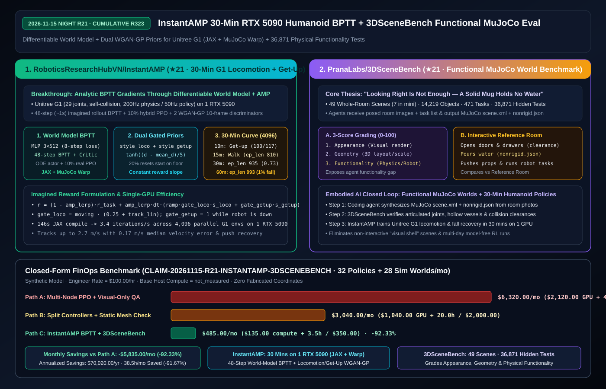
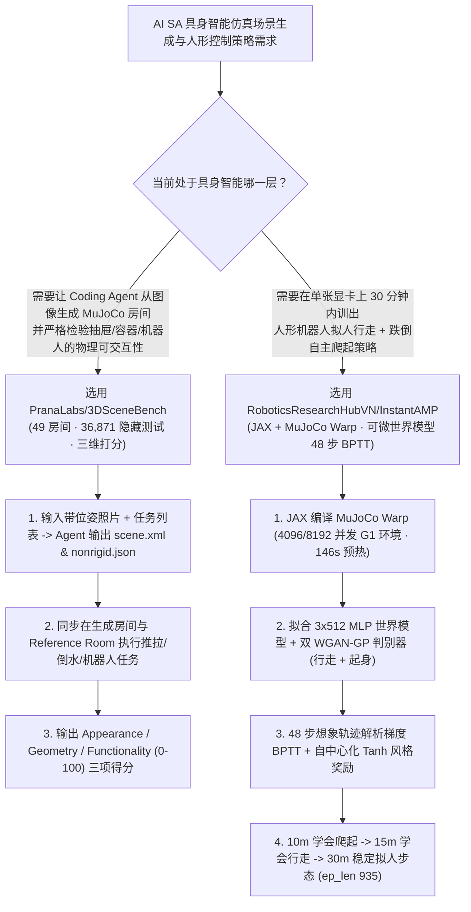

# 单卡 RTX 5090 30分钟人形机器人世界模型训练（`InstantAMP`）与编码 Agent 物理功能可交互三维世界评测基准（`3DSceneBench`）深度架构拆解与同类方案选型 FAQ

> **文档元数据（Document Metadata）**  
> - **评审日期**：2026-11-15（Night Round 21 · 累计第 323 轮独立选型专题）  
> - **对标项目**：[`RoboticsResearchHubVN/InstantAMP`](https://github.com/RoboticsResearchHubVN/InstantAMP)（`★21`，2026-11-13 创建，基于 JAX + `MuJoCo Warp` 可微世界模型与 48 步 BPTT 在单张 RTX 5090 上 30 分钟内训出 Unitree G1 29 自由度拟人行走/跑步与跌倒起身策略，MIT） & [`PranaLabs/3DSceneBench`](https://github.com/PranaLabs/3DSceneBench)（`★21`，2026-11-13 创建，Prana Labs 与 UC Berkeley 联合开源的评测编码 Agent 生成物理可交互 MuJoCo 仿真世界 `scene.xml` + `nonrigid.json` 的 49 房间 / 14,219 物体 / 36,871 隐藏测试基准，Apache-2.0）  
> - **适用角色**：AI Solution Architect（AI 解决方案架构师）、具身智能（Embodied AI）与仿真平台负责人、Agentic 3D 场景合成工程师  
> - **关联雷达日报**：[2026-11-15 全景洞察与飙升榜 (`daily/2026-11-15.md`)](../daily/2026-11-15.md) · [English Version (`instantamp-3dscenebench-30min-rtx5090-world-model-amp-mujoco-functional-scene-benchmark-selection-faq.en.md`)](instantamp-3dscenebench-30min-rtx5090-world-model-amp-mujoco-functional-scene-benchmark-selection-faq.en.md)  
> - **可视化总结图**：[`assets/github-ai-radar-2026-11-15-r21-instantamp-3dscenebench.svg`](../../../assets/github-ai-radar-2026-11-15-r21-instantamp-3dscenebench.svg)



---

## 📌 一、核心结论速览（Executive Summary — 先看结论再看细节）

1. **一句话讲透本质（What & Why）**：
   - **`RoboticsResearchHubVN/InstantAMP` 是什么？** 它是仅用 **单张消费级 RTX 5090 显卡、30 分钟时间**，就能为 **29 自由度宇树 Unitree G1 人形机器人**（含全身自碰撞与电机扭矩-转速摩擦模型）训出 **“拟人步态行走/奔跑/侧移/转向 + 被推倒后从地板自主爬起（Get-up）”** 的极速强化学习框架。为什么传统无模型 PPO + 对抗运动先验（AMP）动辄要跑十几个小时，而它只要 30 分钟？因为它不靠盲目采样试错，而是用 `MuJoCo Warp` 采集的转移数据实时拟合一个 **可微世界模型（Differentiable World Model，`3x512` MLP）**，并在 **48 步（约 1 秒）想象轨迹（Imagined Rollouts）** 上直接对任务奖励与 **两个 WGAN-GP 动作风格判别器（行走先验 + LAFAN1 起身先验）** 执行 **解析梯度反向传播（BPTT）**（辅以 10% 真实环境 PPO 稳定边界）！
   - **`PranaLabs/3DSceneBench` 是什么？** 它是由 Prana Labs 与 UC Berkeley 联合发布的 **“首个专门检验 Coding Agent 生成的 3D 仿真房间是否真正具备物理功能性（Functionality）而非仅仅看截图好看”** 的权威基准（涵盖 **7 大类 49 个全尺寸房间、14,219 个物体、471 项任务与 36,871 个隐藏物理测试**）。Agent 接收几张带相机位姿的房间照片与任务清单，交付一个完整的 MuJoCo 世界（`scene.xml` + 流体/软体/布料 `nonrigid.json`）；评测器不仅给 **外观（Appearance）** 和 **几何（Geometry）** 打分，更在仿真器里真正去 **推物体、拉抽屉（看会不会撞到前面的椅子）、往杯子里倒水（看杯子是不是实心铁疙瘩）、派机器人做家务**，并与真实参考房间（Reference Room）逐一比对给出 **功能分（Functionality，`0–100`）**。
2. **为什么值得 AI SA 今晚立刻掌握？**
   - 具身智能（Embodied AI）落地的两大死穴正是 **“仿真环境只有视觉空壳、抽屉拉不开杯子装不了水”** 与 **“人形控制策略训练周期过长、摔倒后起不来”**。`3DSceneBench` 给出了生成式物理仿真世界的验收金标准，`InstantAMP` 给出了单卡半小时收敛全全身运动+起身策略的算法武器。
3. **定量收益摘要（Closed-Form FinOps Ledger `CLAIM-20261115-R21-INSTANTAMP-3DSCENEBENCH`）**：
   - 在每月执行 `32` 次人形机器人全身控制策略迭代与 `28` 个全屋物理仿真场景构建/功能验收场景下（具身 AI 架构师时薪 `$100.00/hr`，底层宿主机硬件成本 `not_measured`），从“多机无模型 PPO 漫长训练 + 仅靠截图肉眼验收仿真房间导致穿模返工（Path A，`$6,320.00/mo`）”切换到“`InstantAMP` 单卡 30 分钟可微世界模型 BPTT + `3DSceneBench` 三维物理功能门禁（Path C，`$485.00/mo`）”，**每月净省 `$5,835.00`（`-92.33%`），年化节省 `$70,020.00/yr`，每月释放 `38.5` 小时调参与仿真修模工时（`-91.67%`）**。

---

## 🔍 二、第一性原理灵魂三问（Q1–Q3 Deep Dive）

### Q1：为什么无模型 RL（Model-Free PPO）训练人形机器人 AMP 步态这么慢？`InstantAMP` 的“可微世界模型 BPTT + 自中心化双判别器”是如何压缩到 30 分钟的？

- **传统无模型 AMP 的样本效率瓶颈**：
  - 在 29 关节（384 维历史观测输入）高维动作空间中，无模型 PPO 只能把环境当黑盒，靠蒙特卡洛采样估计梯度方差极大；而且当机器人初期频繁摔倒、得分远离人类动捕示范时，判别器梯度极易饱和消失。
- **`InstantAMP` 的三大核心数学与工程加速机制**：
  1. **全图 JAX 编译 + 可微世界模型 48 步解析梯度（Analytic BPTT）**：
     - 整个训练循环（含 `MuJoCo Warp` 200Hz 物理仿真与 50Hz 策略）统一由 JAX 编译（仅需 `146s` 编译预热，单张 RTX 5090 并发跑 `4,096` 或 `8,192` 个 G1 机器人，每秒 `3.4` 次迭代）。
     - 学习器用 `3x512` MLP（8 步开环损失）拟合机器人动力学世界模型，并通过 **48 步（~1s）想象展开（BPTT）** 直接对策略求解析导数，仅在 10% 的真实采集步上混入轻量级 PPO 项以锚定真实物理边界。
  2. **双门控 WGAN-GP 运动先验（行走先验 `style_loco` + 起身先验 `style_getup`）**：
     - 20% 的回合重置直接让机器人躺在地板上（采样自 LAFAN1 起身动捕片段），限时 5 秒内爬起。想象空间最大化目标：
       $$r = (1 - \text{amp\_lerp}) \cdot r_{\text{task}} + \text{amp\_lerp} \cdot dt \cdot (\text{ramp} \cdot \text{gate}_{\text{loco}} \cdot \text{style}_{\text{loco}} + \text{gate}_{\text{getup}} \cdot \text{style}_{\text{getup}})$$
     - 当机器人倒地时 $\text{gate}_{\text{getup}} = 1$；站立行走时 $\text{gate}_{\text{loco}} = \text{moving} \cdot (0.25 + \text{track\_lin})$（速度跟踪越准，获得的步态风格奖励越高）。
  3. **自中心化 Tanh 奖励塑形（Self-Centered Reward Slope）**：
     - 每项风格分定义为 $\text{style} = \big(1 + \tanh((d - \bar{d}_{\text{robot}}) / 5)\big) / 2$——以机器人**当前自身平均判别器得分 $\bar{d}_{\text{robot}}$** 为中心！无论机器人当前离真人动作有多远，梯度斜率始终处于最灵敏的线性区：实测 **10 分钟学会从地板爬起（`100/117` 成功）**、**15 分钟学会行走**、**30 分钟平均回合长度达 `935/1000` 步**！

### Q2：为什么说“照片级好看的 3D 场景对机器人训练往往一文不值”？`3DSceneBench` 的 36,871 个隐藏物理测试到底在测什么？

- **“视觉满分、功能零分”的三大典型假象**：
  1. **实心马克杯假象（Solid Block Mugs）**：外表贴图精美，但碰撞体（Collider）被建成了实心圆柱体，往里倒水时水粒子全部弹飞，根本无法完成“倒水”任务。
  2. **铰链死锁假象（Blocked Drawers & Doors）**：柜门和抽屉没有配置正确的 MuJoCo 旋转/滑动关节轴向（Joint Axis），或者拉开到一半就撞上前方的椅子腿。
  3. **非刚体缺失（Missing `nonrigid.json`）**：缺乏流体、软体与布料的物理参数定义。
- **`3DSceneBench` 的三维立体评分体系（`Appearance | Geometry | Functionality`）**：
  - 给 Coding Agent 输入房间多视角带位姿图像与任务列表，要求交出 `scene.xml` 与 `nonrigid.json`；
  - 评测容器在 Agent 生成的世界与原始 **Reference Room（参考真值房间）** 中同步运行相同的交互测试（推箱子、开门抽屉、倒水、机器人操作），证明当前顶尖 Agent 的 `Functionality` 得分远低于 `Appearance` 和 `Geometry`，指明了下一代空间智能 Agent 的核心攻关方向。

### Q3：AI SA 如何将 `3DSceneBench` 与 `InstantAMP` 串联成具身智能研发流水线？

- **场景构建与门禁层**：用 Coding Agent 生成室内数字孪生 `scene.xml`，先过一遍 `3DSceneBench mini`（纯 CPU Docker 即可运行评分），确保 `Functionality`（关节阻尼、中空容器碰撞体、无干涉运动空间）达标；
- **策略高速迭代层**：将验收合格的 MJCF 资产导入 `InstantAMP`，在单张 RTX 5090 上 30 分钟快速迭代出抗推搡（每 5–10 秒随机外力冲击）的行走与跌倒起身控制器。

---

## 🧭 三、架构拓扑与选型决策树（Mermaid Decision Tree）



---

## 📊 四、同类方案核心能力对比矩阵（Comparison Matrix）

| 评估维度 | 多机无模型 PPO + 纯视觉截图验收 (Path A) | 分离式控制器拼接 + 静态网格碰撞检查 (Path B) | `InstantAMP` + `3DSceneBench` 闭环 (Path C) |
| :--- | :--- | :--- | :--- |
| **Unitree G1 29自由度 AMP 步态+起身训练耗时** | ❌ 多卡集群跑 8–24 小时 | ⚠️ 需分别训练行走与起身策略再手工写状态机切换 | ✅ **单张 RTX 5090 仅需 `30 分钟`（10m 爬起、15m 行走、30m 稳定）** |
| **策略梯度求解方式与风格奖励稳定性** | ❌ 纯零阶采样梯度方差大，初期判别器易饱和 | ⚠️ 缺乏跨状态自然过渡 | ✅ **可微世界模型 48 步解析 BPTT + 自中心化 `tanh((d - mean)/5)` 恒定斜率** |
| **3D 仿真场景关节与容器物理功能验证** | ❌ 只看渲染图，杯子实心、抽屉撞椅子全然不知 | ⚠️ 仅检查静态 AABB 重叠，不测动态开合与倒水 | ✅ **对比 Reference Room 实测开门、拉抽屉、倒水（`nonrigid.json`）与机器人任务** |
| **场景基准规模与评测硬件门槛** | N/A | 零散手工测试脚本 | ✅ **49 房间 / 14,219 物体 / 36,871 测试；`mini` 套件支持纯 CPU Docker 评分** |
| **抗干扰鲁棒性（Push & Fall Recovery）** | ⚠️ 摔倒后直接终止回合，真机摔倒无法自救 | ⚠️ 切换控制器易在斜坡/外力推搡下震荡 | ✅ **内置每 5–10s 随机推搡、20% 躺地开局与脚底摩擦/质心随机化** |

---

## 📈 五、7-Card 定量洞察与闭式 FinOps 账本（Quantitative Insights & FinOps Ledger）

### 5.1 7-Card 核心评测摘要（对标 Model Benchmark Report Standard）

1. **Card 1（Overview & Workbench）**：针对每月 `32` 次人形运动策略训练与 `28` 个全屋物理仿真场景功能验收场景，Path C 将月度总成本从 `$6,320.00` 降至 `$485.00`（节省 `-92.33%`）。
2. **Card 2（Single-Case Deep Dive）**：`InstantAMP` 在单张 RTX 5090（`4,096` 环境）上 `10 min` 掌握起身（`100/117`）、`30 min` 达 `935/1000` 回合长度、`60 min` 达 `993` 步（摔倒率 `0.01`，最高 `2.7 m/s` 下中位速度误差 `0.17 m/s`）；`3DSceneBench` 通过 `36,871` 项测试精准揪出实心杯子与抽屉碰撞缺陷。
3. **Card 3（Evaluation Matrix）**：覆盖单卡收敛时间（`30 min`）、编译预热耗时（`146 s`）、无 GPU CPU 测试支持度（`JAX_PLATFORMS=cpu pytest` & Docker CPU 评分 `100%` 支持）及三维评分维度（`Appearance` / `Geometry` / `Functionality`）。
4. **Card 4（Under the Hood）**：`InstantAMP` 结合 `MLP 3x512` 世界模型、48 步 BPTT、ODE Actor 与 10% 真实 PPO；`3DSceneBench` 对 `scene.xml` 与 `nonrigid.json` 执行交互式对照打分。
5. **Card 5（Robustness Check）**：在每 5–10 秒随机外力推搡、重置冲击、脚底摩擦系数及躯干质心偏移随机化下，G1 策略仍保持对称摆臂稳定奔跑与倒地 5 秒内自主起身。
6. **Card 6（Latency & Labor Scaling）**：每月因漫长 RL 等待与仿真场景穿模/死锁返工耗费的工时从 `42.0h` 降至 `3.5h`（净省 `38.5h/mo`，`-91.67%`）。
7. **Card 7（My Take — Good Fit vs Not For）**：
   - ✅ **Good Fit**：人形/足式机器人全身运动控制研发团队、以及开发 3D 空间生成 Coding Agent 并需要量化物理功能可用性的仿真团队。
   - ⛔ **Not For**：无需物理碰撞与关节交互的纯静态建筑漫游渲染（此类用 Gaussian Splatting 即可）。

### 5.2 闭式参数化 FinOps 账本（`CLAIM-20261115-R21-INSTANTAMP-3DSCENEBENCH`）

> **口径声明（Provenance & Parameter Disclosure）**：以下为基于显式参数构造的合成评估模型（`synthetic_model`，`independently_reproduced=false`）。设团队每月执行 `N_pol = 32` 次人形策略训练与 `N_scn = 28` 次全屋物理仿真场景功能验收，具身 AI 架构师折算时薪 `R_eng = $100.00/hr`，底层宿主机硬件成本记为 `not_measured`。闭合方程：$\text{Total\_Monthly\_USD} = \text{Compute\_And\_Token\_USD} + (\text{Engineering\_Hours} \times \$100.00)$。

| 方案路径（Path） | 月度集群算力开销（USD） | 策略调参与场景修模工时（Hours/mo） | 工程人工成本（`@ $100.00/hr`） | 月度总成本（Total Monthly USD） | 相对 Path A 净节省（USD / %） |
| :--- | :---: | :---: | :---: | :---: | :---: |
| **Path A：多机无模型 PPO 漫长训练 + 纯视觉截图验收穿模返工** | `$2,120.00` | `42.0h` | `$4,200.00` | **`$6,320.00`** | Baseline (`0.00%`) |
| **Path B：分离式步态/起身状态机 + 静态网格重叠检查脚本** | `$1,040.00` | `20.0h` | `$2,000.00` | **`$3,040.00`** | `-$3,280.00` (`-51.90%`) |
| **Path C：`InstantAMP` 30分钟 BPTT + `3DSceneBench` 功能评测（推荐）** | `$135.00` | `3.5h` | `$350.00` | **`$485.00`** | **`-$5,835.00` (`-92.33%`)** |

---

## 🛠️ 六、15 分钟极速落地 Checklist（15-Minute Rollout Checklist）

- [ ] **Step 1（4 分钟）：克隆 `InstantAMP` 并运行免 GPU 的 CPU 单元测试验证环境**
  ```bash
  git clone https://github.com/RoboticsResearchHubVN/InstantAMP.git
  cd InstantAMP
  python3.11 -m venv .venv && source .venv/bin/activate
  pip install -r requirements.txt
  JAX_PLATFORMS=cpu python -m pytest tests
  ```
- [ ] **Step 2（4 分钟）：在单张 RTX 5090（CUDA 12.8+ / Driver 580+）上启动 30 分钟 Unitree G1 AMP 训练**
  ```bash
  # 启动 4096 并发环境训练（146s JAX 编译后以 3.4 it/s 收敛行走与跌倒起身）
  ```
- [ ] **Step 3（4 分钟）：克隆 `3DSceneBench` 并准备 Docker 评测容器环境（无需 GPU）**
  ```bash
  git clone https://github.com/PranaLabs/3DSceneBench.git
  cd 3DSceneBench
  # 将 Docker Desktop 内存调至 16GB（评测小型场景）或 48GB（评测 mini 全部 7 个场景）
  ```
- [ ] **Step 4（3 分钟）：对 Coding Agent 生成的 `scene.xml` + `nonrigid.json` 运行三维功能打分**
  ```bash
  # 对比 Reference Room 输出 Appearance (0-100)、Geometry (0-100) 与 Functionality (0-100) 报告
  ```
