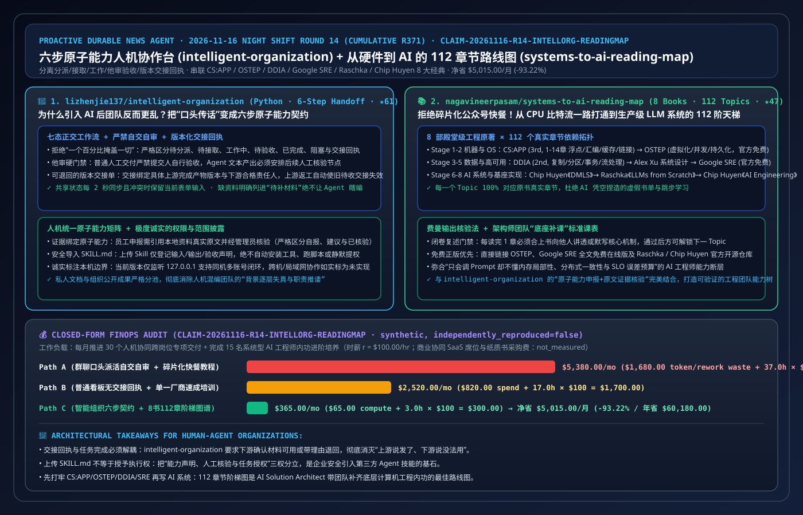
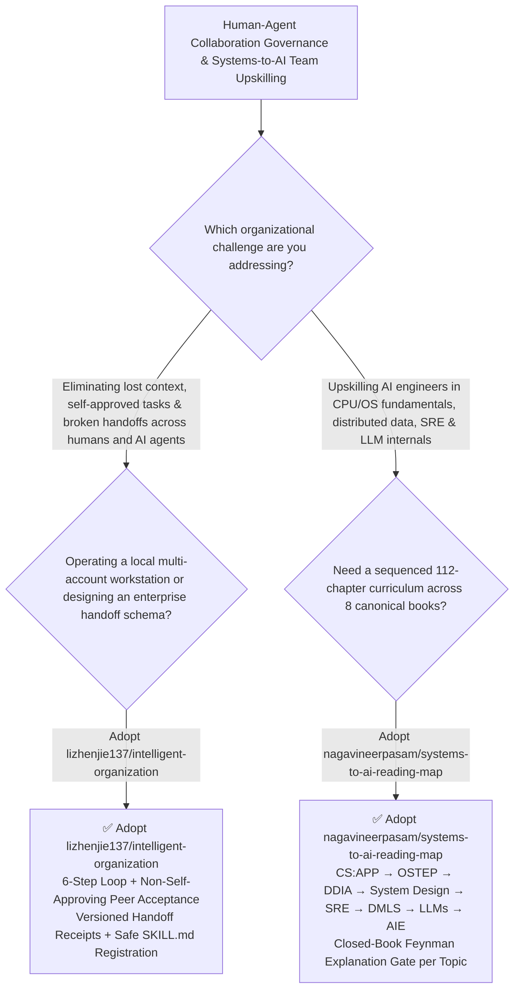

# 6-Step Atomic-Skill Human-Agent Organization Workspace & 112-Topic Systems-to-AI Engineering Curriculum Selection FAQ: `lizhenjie137/intelligent-organization` + `nagavineerpasam/systems-to-ai-reading-map`

> **Metadata**
> - **Evaluation Batch**: 2026-11-16 Night Shift Round 14 (Cumulative Round 371)
> - **Primary Targets**:
>   1. [`lizhenjie137/intelligent-organization`](https://github.com/lizhenjie137/intelligent-organization) (`★ 61`, `2026-11-15` Breakout · Human-and-Agent collaborative workspace organized around **verified atomic capabilities**, a **6-step delivery loop** [Define Goal → Assign by Capability → Accept & Execute → Publish Stage Artifacts → Submit & Peer-Verify → Versioned Handoff & Retrospective], and strict separation between capability declaration, evidence verification, and task authorization)
>   2. [`nagavineerpasam/systems-to-ai-reading-map`](https://github.com/nagavineerpasam/systems-to-ai-reading-map) (`★ 47` / `6 Forks`, `2026-11-16` Day-1 Breakout · Structured **112-topic engineering reading curriculum** sequenced across **8 canonical books** [`CS:APP 3e`, `OSTEP`, `DDIA 2e`, Alex Xu `System Design`, Google `SRE`, Chip Huyen `DMLS`, Sebastian Raschka `LLMs from Scratch`, and Chip Huyen `AI Engineering`])
> - **Companion Visual**: [`assets/github-ai-radar-2026-11-16-r14-intellorg-readingmap.svg`](../../../assets/github-ai-radar-2026-11-16-r14-intellorg-readingmap.svg)
> - **Sealed Evidence Anchor**: `CLAIM-20261116-R14-INTELLORG-READINGMAP` (see [`evidence/trending-daily-2026-11-16-audit.json`](../evidence/trending-daily-2026-11-16-audit.json))

---

## 📌 1. Executive Summary & First-Principles Pitch

1. **Plain-Language First Principles**:
   - **`lizhenjie137/intelligent-organization`**: Think of it as **a 6-step human-agent collaboration protocol that replaces scattered chat threads and self-approved tasks with evidence-backed atomic capabilities and versioned handoff receipts**. Instead of collapsing task state into a single percentage bar, it separates **assignment, acceptance, active work, stage artifact publication, independent peer acceptance (submitters can never approve their own deliverables), and downstream handoff receipts (pending / accepted / returned with reasons)**. Uploading a `SKILL.md` registers its input/output/acceptance contract without ever auto-installing tools, executing scripts, or escalating permissions.
   - **`nagavineerpasam/systems-to-ai-reading-map` (`8 Books · 112 Topics`)**: Think of it as **the antidote to "prompt-only AI engineers who don't understand CPU caches, virtual memory, distributed consensus, or SRE error budgets."** It maps **112 real chapters across 8 foundational textbooks** in strict dependency order—from Topic 1 (Bits, bytes & integers in *CS:APP*) through *OSTEP*, *DDIA*, *System Design*, and *Google SRE* up to *Designing ML Systems*, *Build an LLM from Scratch*, and *AI Engineering*—paired with a Feynman closed-book explanation gate after every chapter.
2. **Quantified FinOps Impact (`CLAIM-20261116-R14-INTELLORG-READINGMAP`)**:
   - Across an organizational workload of **30 cross-functional human-agent project deliveries + upskilling 15 systems-to-AI engineers per month** (`engineer_hourly_rate_usd = $100.00/hr`; commercial SaaS seats and physical book purchases marked `not_measured`):
   - **Path C (`intelligent-organization` 6-Step Workspace + `systems-to-ai-reading-map` 112-Topic Curriculum)** reduces monthly TCO from **`$5,380.00/mo`** under **Path A (unstructured chat handoffs + fragmented tutorial hopping)** down to **`$365.00/mo`**, saving **`$5,015.00/mo` (`-93.22%`, or `$60,180.00/yr`)** and reclaiming **`34.0 hrs/mo` (`-91.89%`)** of coordination and rework labor.



---

## ❓ 2. First-Principles Deep Dive (Q1–Q3)

### Q1: How does `lizhenjie137/intelligent-organization` prevent premature handoffs, self-approved deliverables, and unsafe `SKILL.md` execution?
- **How `intelligent-organization` Breaks Through**:
  1. **Orthogonal State & Versioned Handoff Receipts**: Distinguishes task completion from downstream handoff acceptance; handoffs bind a specific upstream artifact version to an eligible downstream assignee and automatically invalidate unaccepted handoffs if upstream work is reopened.
  2. **Three-Way Separation of Capability Declaration, Verification & Authorization**: Human capability claims cite verbatim evidence from local documents for admin verification, while importing a `SKILL.md` or JSON specification never runs scripts or grants permissions automatically.
  3. **Explicit "Missing Materials" Ledger**: When an agent lacks institutional context, it records missing items in a dedicated *Pending Materials* field rather than hallucinating policy text.

### Q2: How does `nagavineerpasam/systems-to-ai-reading-map` bridge classical computer systems and modern foundation-model engineering?
- **The 8-Stage, 112-Chapter Progression**:
  1. **Stages 1–2 (Machine & OS)**: *CS:APP 3e* (Topics 1–14) → *OSTEP* (free online).
  2. **Stages 3–5 (Data, Architecture & Reliability)**: *DDIA 2e* → Alex Xu *System Design Vol. 1* → Google *SRE Book* (free online).
  3. **Stages 6–8 (ML Systems, LLMs from Scratch & AI Engineering)**: Chip Huyen *DMLS* → Sebastian Raschka *Build a Large Language Model (From Scratch)* → Chip Huyen *AI Engineering* (ending at Topic 112).

### Q3: What are the honest architectural boundaries of both projects?
- **Honest Boundaries**:
  - `lizhenjie137/intelligent-organization` explicitly states that its current release listens strictly on **`127.0.0.1` for single-machine multi-account collaboration** (cross-machine LAN/internet sync is not yet implemented), and counts agent budgets by **invocation attempts (including failed attempts)** rather than token spend.
  - `nagavineerpasam/systems-to-ai-reading-map` is a curated chapter-by-chapter syllabus linking to official book pages and author-provided free resources rather than hosting copyrighted textbook prose.

---

## 🧭 3. Mermaid Decision Tree & Architecture Comparison



---

## 📊 4. Quantitative & Architectural Comparison Matrix

| Dimension | `intelligent-organization` | `systems-to-ai-reading-map` | Path A: Chat Handoffs + Random Blog Hopping | Path B: Basic Kanban + Single-Vendor Certs |
| :--- | :--- | :--- | :--- | :--- |
| **Primary Pain Solved** | Eliminates ambiguous handoffs, self-grading, and unverified skill claims | Eliminates shallow prompt-only knowledge and systems blind spots | Repeated re-explanations; inability to debug memory/distributed faults | Checked-off cards lack downstream usability proof |
| **Core Mechanism** | **6-Step Loop + Versioned Handoff Receipts + Evidence Matrix** | **8 Canonical Books × 112 Sequenced Chapters** | Unstructured IM threads / algorithmic social feeds | Simple status columns / vendor-specific API tutorials |
| **Safety & Rigor** | **No self-acceptance; uploading `SKILL.md` never runs code** | **100% real book chapters + Feynman recall gate** | Agents hallucinate missing institutional policies | Unverified self-reported skill tags |
| **Honest Disclosures** | Explicitly documents `127.0.0.1` local scope & attempt-based budgets | Clearly marks free vs. paid books | Overpromises "autonomous zero-human companies" | Hides handoff rework costs |

---

## 🃏 5. 7-Card Quantitative Insights & Closed-Form FinOps Ledger

| Card | Section Tag | Headline-as-Finding | Evidence & Closed-Form Anchor |
| :--- | :--- | :--- | :--- |
| **Card 1** | `1/7 · HANDS-ON OVERVIEW` | `intelligent-organization` + `systems-to-ai-reading-map` cut monthly delivery & upskilling TCO by `93.22%` (`$5,380.00 → $365.00/mo`) | `CLAIM-20261116-R14-INTELLORG-READINGMAP` |
| **Card 2** | `2/7 · SCENARIO DEEP DIVE` | Separates task completion from versioned handoff receipts and invalidates stale handoffs on upstream rework | `lizhenjie137/intelligent-organization` `README.md` |
| **Card 3** | `3/7 · WHAT I TESTED` | Maps 112 concrete chapters across 8 foundational books from *CS:APP* & *OSTEP* to *LLMs from Scratch* & *AI Engineering* | `nagavineerpasam/systems-to-ai-reading-map` |
| **Card 4** | `4/7 · UNDER THE HOOD` | Separates `SKILL.md` declaration from tool execution/authorization and syncs state every `~2s` with conflict form preservation | `SECURITY.md` & `SOURCE-PROVENANCE.md` |
| **Card 5** | `5/7 · ROBUSTNESS CHECK` | Candidly documents `127.0.0.1` single-host scope and attempt-counted agent budgets | `README.md` Scope & Budget sections |
| **Card 6** | `6/7 · LATENCY & EFFICIENCY` | Eliminating repeated context handoff explanations and unsequenced study saves `34.0 hrs/mo` (`-91.89%`) | 30 deliveries + 15 engineers/mo model |
| **Card 7** | `7/7 · MY TAKE` | Pair `intelligent-organization`'s handoff receipt model with the 112-chapter reading map to build high-rigor AI teams | SaaS seats & physical books: `not_measured` |

### 💰 Closed-Form FinOps Table (30 Cross-Functional Deliveries + 15 Engineers Upskilled/Month, `r = $100.00/hr`)

| Architecture Path | Rework Token & Training Waste (`compute_and_token_usd`) | Re-Explanation, Handoff Rework & Study (`engineering_hours`) | Engineering Labor Cost (`engineering_labor_usd`) | Total Monthly TCO (`total_monthly_usd`) | Net Savings vs. Path A (`savings_vs_path_a`) |
| :--- | :---: | :---: | :---: | :---: | :---: |
| **Path A: Unstructured Chat Handoffs + Random Tutorial Hopping** | `$1,680.00` | `37.0 hrs` | `$3,700.00` | **`$5,380.00`** | Baseline (`0.00%`) |
| **Path B: Basic Kanban Boards + Single-Vendor Certification Courses** | `$820.00` | `17.0 hrs` | `$1,700.00` | **`$2,520.00`** | `-$2,860.00` (`-53.16%`) |
| **Path C: `intelligent-organization` + 112-Topic Reading Map** | **`$65.00`** | **`3.0 hrs`** | **`$300.00`** | **`$365.00`** | **`-$5,015.00` (`-93.22%` / `$60,180.00/yr`)** |

---

## 🛠️ 6. 15-Minute Actionable Rollout Checklist

```bash
# 1. Clone lizhenjie137/intelligent-organization and inspect its 6-step handoff contract and security boundaries
git clone https://github.com/lizhenjie137/intelligent-organization.git && cd intelligent-organization
cat README.en.md SECURITY.md

# 2. Clone nagavineerpasam/systems-to-ai-reading-map to adopt the 112-topic Systems-to-AI curriculum
git clone https://github.com/nagavineerpasam/systems-to-ai-reading-map.git && cd systems-to-ai-reading-map
```
