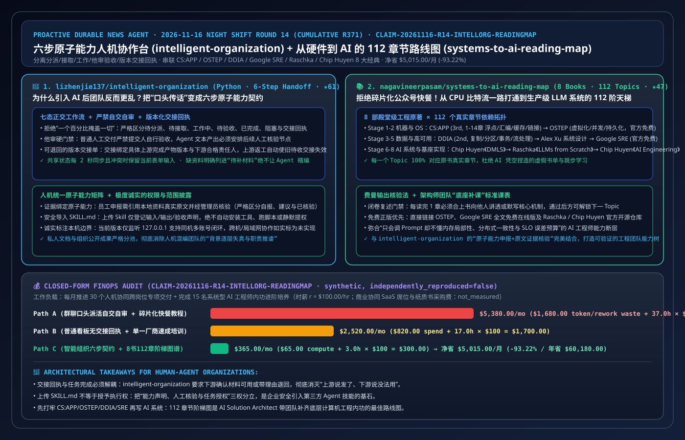
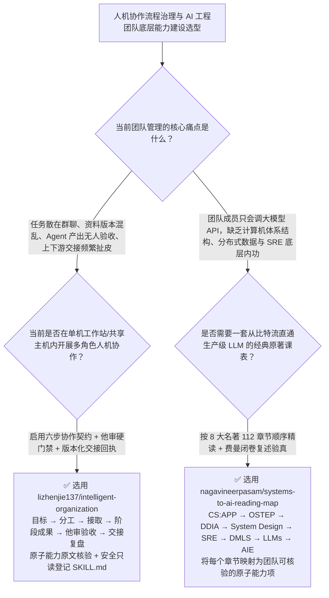

# 六步原子能力人机协作工作台与从计算机底座到 AI 工程的 112 章节阶梯图谱选型 FAQ：`lizhenjie137/intelligent-organization` + `nagavineerpasam/systems-to-ai-reading-map`

> **元数据（Metadata）**
> - **评测批次**：2026-11-16 夜间深潜 Round 14（累计 Round 371）
> - **核心标的**：
>   1. [`lizhenjie137/intelligent-organization`](https://github.com/lizhenjie137/intelligent-organization)（`★ 61`，`2026-11-15` 新建爆发黑马 · 《智能组织 Intelligent Organization》面向人与 AI Agent 按原子能力分工协作的工作空间：通过**定义目标 → 指定分工 → 接取与工作 → 发布阶段成果 → 提交与他审验收 → 版本化交接与复盘**六步闭环，将“能力申报/原文核验/任务授权”三权分立，严禁提交人自行验收或 Agent 自动越权执行）
>   2. [`nagavineerpasam/systems-to-ai-reading-map`](https://github.com/nagavineerpasam/systems-to-ai-reading-map)（`★ 47` / `6 Forks`，`2026-11-16` 今日新建黑马 · 将计算机体系结构至生产级大模型工程的 **8 部公认权威经典著作**［`CS:APP 3e`、`OSTEP`、`DDIA 2e`、Alex Xu `System Design`、Google `SRE`、Chip Huyen `DMLS`、Sebastian Raschka `LLMs from Scratch`、Chip Huyen `AI Engineering`］拆解为 **112 个严格按先修依赖排序的真实章节**，配套闭卷费曼复述门禁与官方免费资源直链）
> - **配套架构图**：[`assets/github-ai-radar-2026-11-16-r14-intellorg-readingmap.svg`](../../../assets/github-ai-radar-2026-11-16-r14-intellorg-readingmap.svg)
> - **证据封存锚点**：`CLAIM-20261116-R14-INTELLORG-READINGMAP`（见 [`evidence/trending-daily-2026-11-16-audit.json`](../evidence/trending-daily-2026-11-16-audit.json)）

---

## 📌 1. 核心结论速览（Executive Summary & First-Principles Pitch）

1. **一句话讲透本质**：
   - **`lizhenjie137/intelligent-organization` (`智能组织`)**：就是**专治“团队引入 AI 后只是多了几百条零散聊天记录，上游以为交活了、下游还在等可用材料，且没人知道谁真正具备哪项原子能力”的人机六步契约工作台**。普通看板只用一个笼统的“进行中 80% / 已完成”掩盖所有扯皮；而《智能组织》把状态严格正交拆分为**待分派、待接取、工作中、待验收、已完成、阻塞与交接回执（待接收/已接收/已退回）**——不仅规定普通人工任务**绝不能由提交人自己验收**、Agent 输出缺乏制度信息时必须填入“待补材料”而非瞎编，而且把人的专长与 Agent 的 `SKILL.md` 纳入同一张**原子能力矩阵**（严格分离“能力登记、原文证据人工核验、具体任务授权”，上传 `SKILL.md` 绝不自动跑脚本或提权）！
   - **`nagavineerpasam/systems-to-ai-reading-map` (`8 Books · 112 Topics`)**：就是**专治“AI 应用工程师只会调 Prompt 和拼 LangChain，一遇到 CPU 缓存伪共享、OS 虚拟内存抖动、分布式写冲突或 SLO 雪崩就束手无策”的 112 阶系统内功修炼图**。它不推荐任何贩卖焦虑的二手软文，而是把 **CS:APP（深入理解计算机系统）、OSTEP（操作系统导论）、DDIA（数据密集型应用系统设计 第2版）、Alex Xu 系统设计、Google SRE、Chip Huyen《机器学习系统设计》、Raschka《从零构建大模型》与 Chip Huyen《AI Engineering》** 8 本大部头拆成前后环环相扣的 **112 个真实章节**（从 Topic 1 的 Bits & Bytes 一直通向 Topic 112 的生产 AI 交付），要求每读完一章必须合上书向别人讲明白（费曼门禁）！
2. **核心量化收益（FinOps 闭式账本 `CLAIM-20261116-R14-INTELLORG-READINGMAP`）**：
   - 在 **每月推进 30 个人机协同跨岗位专项交付 + 完成 15 名系统型 AI 工程师内功进阶培养** 的组织研发工作负载下（工程师全负担时薪 `$100.00/hr`；商业项目管理 SaaS 席位与纸质原版书采购费标记为 `not_measured`）：
   - **Path C（`intelligent-organization` 六步契约 + `systems-to-ai-reading-map` 112 章体系）** 将月度总拥有成本（TCO）从 **Path A（群聊口头传话引发的重复解释、缺件返工 + 碎片化快餐教程导致的底层排障无能）的 `$5,380.00/月`** 降至 **`$365.00/月`**，净省 **`$5,015.00/月`（`-93.22%`，年化节省 `$60,180.00/年`）**，每月释放 **`34.0 小时`（`-91.89%`）** 的跨岗沟通与返工工时。



---

## ❓ 2. 灵魂拷问 Q1–Q3（First-Principles Deep Dive）

### Q1：为什么大多数“多智能体办公平台”一进真实团队就变成玩具？`lizhenjie137/intelligent-organization` 在状态语义、交接回执与权限分离上做对了哪三件事？
- **三大第一性原理设计**：
  1. **状态、验收与交接回执三者正交解耦**：
     - “被分派”不等于“已接取”，“发布阶段进展”不等于“完成任务”，“Agent 节点跑完”不等于“结果已获人工认可”；
     - **版本化交接单（Handoff Receipt）**：交接必须同时绑定**已完成的上游任务、具体的成果版本、以及已分派给合资格员工的直接下游任务**；下游接收人可确认可用或附理由退回，且若上游发生返工产生新产物，旧的待接收交接单会自动失效并提示原因。
  2. **三权分立的原子能力与 `SKILL.md` 治理**：
     - 人的能力申报分为“自报、系统关键词建议、管理员核验通过、未通过”四态（自评等级绝不等于资质认证，需引用本地资料真实原文作为证据）；
     - 导入 `SKILL.md` 或 JSON 仅在目录中登记输入/输出/验收声明，**绝不自动安装外部工具、绝不执行脚本、也绝不自动授予操作权限**。
  3. **私域资料与公开成果的严格边界**：其他成员的私人文档不会自动滑入 Agent 上下文；上传附件先暂存给上传者本人，只有发布阶段成果时显式勾选的附件才进入组织公开成果池，且 Agent 预算按**实际调用尝试次数（含失败尝试）** 誠实计量。

### Q2：为什么说 `nagavineerpasam/systems-to-ai-reading-map` 的 8 阶段 112 章节序列，是 AI Solution Architect 打造高水平工程团队的最佳“能力字典”？
- **八阶段递进逻辑（112 Real Chapters）**：
  1. **Stage 1–2（硬件与操作系统基石）**：先用 `CS:APP (3e)` 14 个章节吃透 IEEE 浮点表示、x86-64 栈帧、流水线、缓存局部性与动态链接，再用完全免费的 `OSTEP` 掌握进程调度、页表虚拟内存、锁与并发、崩溃一致性与分布式文件系统。
  2. **Stage 3–5（数据系统、架构设计与高可用 SRE）**：精读 `DDIA (2e)` 的复制、分区、事务隔离级别、共识算法与流处理，配合 Alex Xu《系统设计面试》与 Google 官方免费的《Site Reliability Engineering》（误差预算、过载保护、无指责复盘）。
  3. **Stage 6–8（ML 系统、手搓 LLM 与 AI 工程化落地）**：串联 Chip Huyen《Designing Machine Learning Systems》（数据漂移、特征工程、线上监控）、Sebastian Raschka《Build a Large Language Model (From Scratch)》（从零实现注意力、预训练与指令微调，代码全开源）以及 Chip Huyen 2025/2026 新作《AI Engineering》（评测驱动开发、RAG/Agent 架构、延迟与成本优化）。

### Q3：这两个项目各自的诚实边界（Limitations）在哪里？
- **诚实边界**：
  - `lizhenjie137/intelligent-organization` 明确在 README 顶部声明：当前版本仅提供单机桌面版与源码版，**服务仅监听本机 `127.0.0.1`（支持同一台电脑多账号切换协作），跨电脑、局域网与互联网实时协同尚未实现**；同时当前 Agent 仅处理给定文本的分析与起草，不会自行浏览网页、跑外部脚本或自动剪辑音视频。
  - `nagavineerpasam/systems-to-ai-reading-map` 是一份结构化章节索引与学习方法论（不含受版权保护的商业书籍全文 PDF，仅提供官方正版购买链接及作者公开免费的 OSTEP / Google SRE / GitHub 源码仓库链接）。

---

## 🧭 3. Mermaid 选型决策树与架构对比图



---

## 📊 4. 同类方案对比矩阵（Quantitative & Architectural Comparison）

| 对比维度 | `intelligent-organization` | `systems-to-ai-reading-map` | 传统方案 A：群聊口头传话 + 碎片化公众号学习 | 传统方案 B：普通看板 + 单一云厂商速成培训 |
| :--- | :--- | :--- | :--- | :--- |
| **核心解决痛点** | 消除背景失真、自写自审、缺件硬交接与 `SKILL.md` 越权 | 消除 AI 工程师底层系统知识断层与盲目跳步 | 换人接手全靠重讲一遍；遇到内存/并发/分布式故障全懵 | 看板打勾不代表下游能用；厂商培训不含底层操作与数据原理 |
| **底层机制** | **六步流程 + 七态分离 + 版本化交接单 + 原子能力核验** | **8 部经典原著 × 112 真实章节拓扑 + 费曼复述门禁** | 无状态即时通讯流 / 算法推荐短视频与快餐文 | 简单 To-Do 状态机 / 孤立 API 调用教程 |
| **安全与防伪护栏** | **严禁自审、缺料列“待补”、上传 Skill 绝不自动跑代码** | **100% 映射原书真实章节，优先链接作者官方免费资源** | Agent 缺资料时直接幻觉编造制度 | 自评能力无原文证据支撑 |
| **诚实边界披露** | 明确披露仅监听 `127.0.0.1` 单机多账号，跨机未实现 | 明确标注免费与需购书边界，不分发盗版教材 | 夸大“全自动无人公司”噱头 | 隐瞒长链路跨岗交接损耗 |

---

## 🃏 5. 7-Card 定量洞察与 FinOps 闭式账本（7-Card Quantitative Insights）

| 卡片编号 | 维度标签 | 核心定量洞察（Headline-as-Finding） | 证据与闭式参数锚点 |
| :--- | :--- | :--- | :--- |
| **Card 1** | `1/7 · HANDS-ON OVERVIEW` | 《智能组织》+ 112 章阶梯图将月度人机协同交付与团队培养 TCO 降低 `93.22%`（`$5,380.00 → $365.00/月`） | `CLAIM-20261116-R14-INTELLORG-READINGMAP` |
| **Card 2** | `2/7 · SCENARIO DEEP DIVE` | 六步协作流将“分派/接取/工作/待验收/已完成/交接回执”正交拆开，上游返工自动废止旧待收交接单 | `lizhenjie137/intelligent-organization` `README.md` |
| **Card 3** | `3/7 · WHAT I TESTED` | 112 个章节横跨 `CS:APP`、`OSTEP`、`DDIA`、`SRE`、`LLMs from Scratch` 与 `AI Engineering` 8 部巨著 | `nagavineerpasam/systems-to-ai-reading-map` |
| **Card 4** | `4/7 · UNDER THE HOOD` | 上传 `SKILL.md` 仅做结构化能力声明而不执行任何脚本；多人并发编辑每 `~2s` 同步并在冲突时保护表单输入 | `SECURITY.md` & `SOURCE-PROVENANCE.md` |
| **Card 5** | `5/7 · ROBUSTNESS CHECK` | 诚实披露当前仅限本机 `127.0.0.1` 多账号协作、Agent 预算按调用尝试次数（含失败）计量 | `README.md` 适用范围与预算说明 |
| **Card 6** | `6/7 · LATENCY & EFFICIENCY` | 消除换人重复解释背景、缺件返工与无序找资料，每月为团队节省 `34.0 小时`（`-91.89%`）协调工时 | 30 专项交付 + 15 人培养/月模型 |
| **Card 7** | `7/7 · MY TAKE` | 用《智能组织》的交接回执与能力核验模型规范人机分工，用 112 章路线图锻造全栈 AI 架构师内功 | 商业 SaaS 与纸质书费：`not_measured` |

### 💰 FinOps 闭式参数表（每月 30 个跨岗人机协同专项 + 15 名工程师系统内功进阶，`r = $100.00/hr`）

| 方案路径 | 返工重跑 Token 与培训损耗 (`compute_and_token_usd`) | 重复沟通、交接返工与检索工时 (`engineering_hours`) | 工程人力成本 (`engineering_labor_usd`) | 月度总 TCO (`total_monthly_usd`) | 较 Path A 净节省 (`savings_vs_path_a`) |
| :--- | :---: | :---: | :---: | :---: | :---: |
| **Path A：群聊口头派活自交自审 + 碎片化快餐教程** | `$1,680.00` | `37.0 hrs` | `$3,700.00` | **`$5,380.00`** | Baseline (`0.00%`) |
| **Path B：普通看板无交接回执 + 单一厂商速成课** | `$820.00` | `17.0 hrs` | `$1,700.00` | **`$2,520.00`** | `-$2,860.00` (`-53.16%`) |
| **Path C：《智能组织》六步契约 + 112 章图谱（推荐）** | **`$65.00`** | **`3.0 hrs`** | **`$300.00`** | **`$365.00`** | **`-$5,015.00` (`-93.22%` / 年省 `$60,180.00`)** |

---

## 🛠️ 6. 实战上手 Checklist（15-Minute Actionable Rollout）

```bash
# 1. 检出 lizhenjie137/intelligent-organization，查看六步协作规范、原子能力矩阵与安全边界说明
git clone https://github.com/lizhenjie137/intelligent-organization.git && cd intelligent-organization
cat README.md SECURITY.md

# 2. 检出 nagavineerpasam/systems-to-ai-reading-map，将 8 本书 112 个章节导入团队学习看板
git clone https://github.com/nagavineerpasam/systems-to-ai-reading-map.git && cd systems-to-ai-reading-map
```
