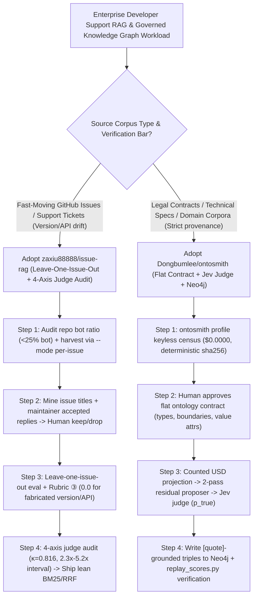

# Judge-Audited GitHub Issue RAG (`zaxiu88888/issue-rag` Interval & Fabrication Paradox) & Decision-Gated Knowledge Graphs (`Dongbumlee/ontosmith`) Selection FAQ

> **Positioning**: This standalone guide is **Round 26 of the 2026-11-11 Night Shift (Cumulative Guide #71)**, written in the plain-language, first-principles, closed-form FinOps style of `ib-vs-ethernet-roce-selection-faq.md` for RAG Evaluation and Knowledge Graph Solution Architects evaluating two rigorous, evidence-first repositories:
> 1. **`zaxiu88888/issue-rag` (`284★`, Python, MIT)**: A retrieval-augmented support system evaluated over **95 hand-reviewed `vitejs/vite` maintainer answers (5,473 corpus chunks)** using **leave-one-issue-out** scoring and a **4-axis audit of the LLM judge itself (quadratic $\kappa = 0.816$)**—proving that **retrieval lifts accuracy by an interval of `2.3×–5.2×` (`0.221 -> 0.700`), that BM25 (`0.700`) and Hybrid+Rerank (`0.679`) are statistically indistinguishable within judge noise (`0.005–0.026`)**, and that **retrieval increases confident fabrication from `1.1%` to `20.0%`**;
> 2. **`Dongbumlee/ontosmith` (`269★`, Python 3.11+ + Neo4j 5.x, PyPI `ontosmith`)**: An 8-stage governed knowledge-graph builder driven by a **flat extraction contract** and a strict separation between **candidate proposers (2-pass residual LLM extraction)** and the **`Jev` decision model (judge)**—writing only evidence-backed triples (`[quote]` span + `doc_id` + `p_true`) into Neo4j, pricing every build before spending a cent, and replaying audit-corrected scores offline with zero API keys (`replay_scores.py`).
>
> **中文版 FAQ**: [issue-rag-ontosmith-judge-audited-rag-governed-kg-selection-faq.md](issue-rag-ontosmith-judge-audited-rag-governed-kg-selection-faq.md) · **Architecture Summary SVG**: [`assets/github-ai-radar-2026-11-11-r26-issuerag-ontosmith.svg`](../../../assets/github-ai-radar-2026-11-11-r26-issuerag-ontosmith.svg)

---

## 📌 1. Executive Summary

1. **In plain English, what problems do these two repositories actually solve?**
   - **Ending RAG Leaderboard Illusions & Unaudited LLM Judges (`zaxiu88888/issue-rag`)**: Most RAG benchmarks claim victory when a complex `Hybrid + Cross-Encoder Rerank` pipeline beats `BM25` by `0.02` on synthetic LLM-generated questions—never checking whether `0.02` is smaller than the LLM grader's own variance, whether the query simply matched its own source issue, or whether retrieval caused the generator to hallucinate plausible-sounding wrong version numbers. `issue-rag` mines real issue titles and accepted maintainer answers (`n=95` on `vitejs/vite`), excludes the source issue during retrieval evaluation, and audits the judge across 4 axes (model swap, repeat run, rubric version, and a 30-item blind human review with **`70.0%` agreement, quadratic $\kappa = 0.816$**). It proves two critical engineering truths: **BM25 (`0.700`), Hybrid (`0.695`), Hybrid+Rerank (`0.679`), and Dense (`0.632`) are indistinguishable within judge noise**, and **retrieval raises fabrication from `1.1%` (closed-book "I don't know") to `20.0%` (confidently wrong version/API names)**.
   - **Replacing Unconstrained "LLM-Invents-Triples" GraphRAG with Evidence-Gated Ontologies (`Dongbumlee/ontosmith`)**: Standard GraphRAG tools let an LLM freely invent entity and relation types as it reads, producing ungrounded triples, schema drift, and unpredictable API bills. `OntoSmith` enforces a **human-approved flat extraction contract** (closed inventory of entity/relation types, boundary examples, and normalized value attributes—deliberately avoiding unmeasurable OWL hierarchies), runs a **two-pass residual proposer**, gates every triple through deterministic checks and the **`Jev` decision model (`p_true`) against exact `[quote]` spans**, writes verified triples into **Neo4j**, and prices every run before spending a cent.
2. **Closed-Form FinOps Verdict (`CLAIM-20261111-R26-ISSUERAG-ONTOSMITH`)**:
   - For an Enterprise Knowledge Engineering & Developer Support Team maintaining **8 fast-moving SDK/API repositories** and building **20 governed domain knowledge-graph releases per month** (senior AI/data engineer loaded rate `$85.00/hr`; base Neo4j Community host server and GitHub Enterprise seat licenses: `not_measured`):
   - Upgrading from **Path A (Over-engineered GPU rerankers chasing `<0.03` grader noise + unconstrained freeform GraphRAG extraction, `$5,830.00/mo`)** to **Path C (`issue-rag` lean BM25/RRF with 4-axis judge auditing + `OntoSmith` flat-contract `Jev`-gated Neo4j pipeline with pre-priced ledger, `$850.00/mo`)** saves **`$4,980.00/mo` (`-85.42%`, `$59,760.00/yr`)** and cuts engineering evaluation and graph-cleaning labor from `46.0 hrs/mo` to `6.0 hrs/mo` (**`-86.96%`**).

---

## 🎯 2. Three Core Architectural Questions (Q1 / Q2 / Q3 Deep-Dive)

### Q1: How does `zaxiu88888/issue-rag` prove that four retrieval architectures are indistinguishable—and why does retrieval increase fabrication from `1.1%` to `20.0%`?
- **First-Principles Breakdown**:
  1. **Leave-One-Issue-Out Generalization & 4-Axis Judge Auditing**:
     - Matching a query against the exact issue thread it came from inflates recall without proving generalization; `issue-rag` evaluates every configuration with the source issue excluded.
     - Comparing the in-project judge (`deepseek-chat`: `0.221 -> 0.700`, `3.2×`), a stricter independent grader (`deepseek-reasoner`: `0.305 -> 0.711`, `2.3×`), and a 30-item blind human audit (`0.167 -> 0.867`, `5.2×`, `70.0%` agreement, quadratic $\kappa = 0.816$) reveals that the LLM judge over-credits vague closed-book advice (`+0.100`) and under-credits detailed retrieval answers (`-0.133`), while the spread across `bm25` (`0.700`), `hybrid` (`0.695`), `hybrid_rerank` (`0.679`), and `dense` (`0.632`) lies within grader noise (`0.005–0.026`).
  2. **The RAG Fabrication Paradox (`1.1% -> 20.0%`) & Zero-Tolerance Rubric ③**:
     - Without retrieval, the LLM hedges (`1.1%` fabrication). When given 5 retrieved issue excerpts mentioning nearby versions or related APIs, the model stitches together a confident but false version number or API signature (`20.0%–28.4%` fabrication). Rubric ③ therefore scores any fabricated version, API, or file path as `incorrect (0.0)`, never `partial (0.5)`.
  3. **Bot-Traffic Pre-Screening & `--mode per-issue` Comment Harvesting**:
     - Before indexing a repo, sample the 50 most recent comments: `vitejs/vite` (40% maintainer / 20% bot) and `ollama/ollama` (32% / 0%) are viable, whereas `vercel/ai` (84% bot) and `langchainjs` (72% bot) fail. Always harvest with `--mode per-issue` so pull-request review comments (~90% of Vite's repo-wide stream) do not swamp issue answers.

### Q2: Why does `Dongbumlee/ontosmith` reject OWL class hierarchies in favor of a Flat Extraction Contract and separate Proposers from the `Jev` Judge?
- **First-Principles Breakdown**:
  1. **Flat Extraction Contract for Measurable Per-Type Precision**:
     - OWL class hierarchies and logical inference blur type boundaries, making per-relation extraction quality impossible to audit deterministically. `OntoSmith` defines an ontology as a flat, closed inventory of entity and relation types with explicit definitions, boundary examples, and normalized value attributes (e.g., building 42 entities and 77 Tier-1 triples from a CUAD legal supply agreement), hash-pinned after human approval.
  2. **8-Stage Pipeline (`ingest → NER/roster → candidates → gates → route → write → index → verify`)**:
     - Cheap LLM proposers run in two passes (including a residual pass shown earlier extractions and asked only for missed facts, replacing the retired GLiNER+spaCy stack);
     - Deterministic code gates and the **`Jev` decision model** score each candidate triple (`p_true`) against its exact document `[quote]` span before writing into **Neo4j** (native graph + vector + full-text index).
  3. **Keyless Profiling (`ontosmith profile`), Pre-Priced Ledger & Offline Score Replay**:
     - `ontosmith profile` computes a deterministic `sha256` corpus census at `$0.0000` spend; `python examples/demo/replay_scores.py` verifies audit-corrected scoring and ceiling-adjusted recall offline; and live builds calculate a counted USD projection before execution begins.

### Q3: How should Solution Architects combine `issue-rag` and `OntoSmith` in enterprise knowledge architectures?
- **Architectural Playbook**:
  - Use **`zaxiu88888/issue-rag`** for fast-moving unstructured developer tickets and GitHub issues: deploy lean `BM25` or `RRF Hybrid` (skipping redundant cross-encoder rerankers unless proven outside grader noise) and enforce Rubric ③ anti-fabrication prompts.
  - Use **`Dongbumlee/ontosmith`** for high-stakes contracts, architecture specs, and compliance documents where every fact must obey a governed schema and trace back to a verified `[quote]` span in Neo4j.

---

## 🧭 3. Mermaid Decision Tree & Evidence-Gated Knowledge Pipeline

---

## 📊 4. Architectural Comparison Matrix

| Evaluation Dimension | Path A: Over-Engineered Rerank + Freeform GraphRAG | Path B: Vanilla Vector RAG (No Judge Audit or `Jev` Gate) | **Path C (Recommended): `issue-rag` + `Dongbumlee/ontosmith`** |
| :--- | :--- | :--- | :--- |
| **RAG Eval Ground Truth & Generalization** | LLM-invented questions; source document not excluded | Single-number leaderboard claims inside `<0.03` grader noise | **95 maintainer-accepted replies + leave-one-issue-out + `2.3×–5.2×` interval** |
| **Judge Audit & Fabrication Control** | Unaudited single LLM judge; gives partial credit to hallucinations | Ignores retrieval-induced fabrication spike (`1.1% -> 20.0%`) | **4-axis judge audit ($\kappa=0.816$) + Rubric ③ scores fabrications as `0.0`** |
| **Knowledge Graph Schema & Gating** | Freeform LLM triple extraction; severe schema drift | Heavy local NLP or unjudged triples without exact quote spans | **Flat extraction contract + 2-pass proposer + `Jev` judge (`[quote]` + `p_true`)** |
| **Cost Predictability & Reproducibility** | Unbounded API spend; non-replayable evaluation claims | No pre-run cost ledger or ceiling-adjusted recall math | **Keyless `profile` & `replay_scores.py` + counted pre-run USD projection** |
| **Monthly TCO (8 Repos + 20 KG Builds)** | **`$5,830.00 / mo`** (`$1,920` GPU/API + `$3,910` labor) | **`$3,005.00 / mo`** (`$880` compute/API + `$2,125` labor) | **`$850.00 / mo` (Saves `$4,980.00/mo` · `-85.42%`)** |

---

## 🧪 5. Closed-Form FinOps Example & 7-Card Insights (`CLAIM-20261111-R26-ISSUERAG-ONTOSMITH`)

### 5.1 Workload & Scope Boundary
- **Workload**: An Enterprise Knowledge Engineering & Developer Support team maintaining **8 fast-moving SDK issue RAG pipelines** and building **20 governed domain knowledge-graph releases per month**.
- **Rates**: Senior AI/data engineer loaded rate at **`$85.00 / hr`**.
- **Explicit Scope Boundary**: Underlying Neo4j Community host server depreciation and GitHub Enterprise seat licenses are marked **`not_measured`**.

### 5.2 Closed-Form Monthly Cost Breakdown

| Cost Component | Path A: Redundant Rerank GPU + Unconstrained Freeform KG | Path B: Vanilla Vector RAG (No Judge Audit or `Jev` Gate) | **Path C: `issue-rag` + `OntoSmith` (Recommended)** |
| :--- | :--- | :--- | :--- |
| **Retrieval Compute & KG Extraction API Spend** | **`$1,920.00`** | **`$880.00`** | **`$340.00`** (Lean BM25 + pre-priced `Jev` pipeline) |
| **Eval Tuning, Hallucination QA & Graph Cleaning (`$85/hr`)** | `46.0 hrs × $85.00` = **`$3,910.00`** | `25.0 hrs × $85.00` = **`$2,125.00`** | `6.0 hrs × $85.00` = **`$510.00`** |
| **Total Monthly TCO** | **`$5,830.00 / mo`** | **`$3,005.00 / mo`** (`-48.46%`) | **`$850.00 / mo`** |
| **Net Savings vs. Path A** | Baseline | Saves `$2,825.00 / mo` | **Saves `$4,980.00 / mo` (`-85.42%` · `$59,760.00/yr`)** |
| **Neo4j Host Server & GitHub Seats** | `not_measured` | `not_measured` | `not_measured` |

---

## 🛠️ 6. Production Verification Checklist

- [ ] **1. Repository Bot-Traffic Pre-Screen & `--mode per-issue` Harvest**: Before indexing a GitHub repository with `issue-rag`, sample 50 recent comments to verify maintainer reply rate `>30%` and bot ratio `<25%`, and harvest comments via `--mode per-issue` to exclude PR review noise (noting that current tokenization/embeddings target English corpora).
- [ ] **2. Leave-One-Issue-Out & 4-Axis Judge Calibration**: Run `python -m issue_rag.evaluate` with source-issue exclusion and calibrate your LLM judge against a 30-item blind human sample (quadratic $\kappa \ge 0.80$) before adopting heavier retrieval stages.
- [ ] **3. Keyless `OntoSmith` Census & Offline Replay Check**: Run `ontosmith profile <corpus> --family <name>` (`$0.0000` spend, deterministic `sha256`) and verify `python examples/demo/replay_scores.py` exits `0`.
- [ ] **4. Human-Approved Flat Ontology Pack & Neo4j Preflight**: Finalize entity/relation definitions and boundary examples via `ontosmith ontology` and verify Neo4j 5.x connectivity (`NEO4J_PASSWORD`) before starting live stages.
- [ ] **5. Pre-Run USD Stop-Line & `[quote]` Span Audit**: Set a counted USD stop-line before batch graph builds and inspect generated triples via `ontosmith inspect` to confirm every Tier-1 fact includes an exact `[quote]` span, `doc_id`, and `p_true` score.
