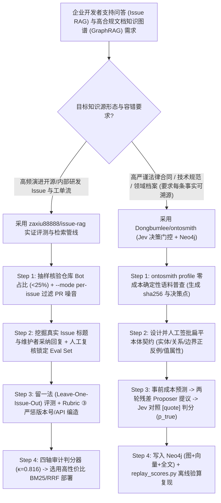

# 判分器自审计 Issue RAG（`zaxiu88888/issue-rag` 置信区间与编造悖论）与决策模型门控知识图谱（`Dongbumlee/ontosmith`）选型 FAQ

> **文档定位**：本文是 **2026-11-11 夜班多轮深潜 Round 26（累计第 71 篇独立选型专题）**，严格对标 `ib-vs-ethernet-roce-selection-faq.md` 的「通俗大白话 + 第一性原理 + 可核算定量算例」标杆文风，为企业 RAG 评测与知识图谱（GraphRAG）架构师拆解今日两款反浮夸、重实证的工程标杆：
> 1. **`zaxiu88888/issue-rag`（`284★`，Python，MIT）**：在 `vitejs/vite` 的 **5,473 篇真实 Issue/评论文档与 95 条人工复核维护者真值**上，不仅对检索源执行**留一法排除（Leave-One-Issue-Out）**，更从 **4 个维度审计 LLM 判分器本身（二次加权 $\kappa = 0.816$）**——实证揭穿了 **“BM25 (`0.700`) 与 Hybrid+Rerank (`0.679`) 的微弱差距完全落在判分器自身噪声（`0.005–0.026`）内”** 以及 **“检索将编造率从闭卷的 `1.1%` 抬升至 `20.0%`（从诚实不知变为自信胡编版本号）”** 两大行业真相；
> 2. **`Dongbumlee/ontosmith`（`269★`，Python 3.11+ + Neo4j 5.x，PyPI `ontosmith`）**：基于**扁平抽取契约（Flat Extraction Contract）**与 **Proposer（廉价候选提议）+ `Jev` 决策模型（Judge 证据判真）分离架构**的 8 阶段受控知识图谱构建引擎——每条写入 Neo4j 的三元组必须携带精确原文引用（`[quote]` Span）与 `p_true` 评分，每次构建在花钱前先给出精确成本预测，且支持免 API Key 离线重放审计分数（`replay_scores.py`）。
>
> **English Companion**: [issue-rag-ontosmith-judge-audited-rag-governed-kg-selection-faq.en.md](issue-rag-ontosmith-judge-audited-rag-governed-kg-selection-faq.en.md) · **架构总结图**: [`assets/github-ai-radar-2026-11-11-r26-issuerag-ontosmith.svg`](../../../assets/github-ai-radar-2026-11-11-r26-issuerag-ontosmith.svg)

---

## 📌 一、核心结论速览（Executive Summary）

1. **先用大白话讲透这两个项目到底解决了什么痛点？**
   - **企业 RAG 调优的“调参玄学幻觉与 LLM 裁判失准痛点”（`zaxiu88888/issue-rag` 解决的问题）**：几乎所有 RAG 教程都在炫耀“加了稠密向量 + RRF 混合检索 + Cross-Encoder 重排后，得分从 68% 涨到了 70%！”但很少有人去查：① 你的 LLM 裁判自己跑两遍或者换个模型，波动有多大？② 检索出来的半相关上下文，是不是反而诱发大模型编造了根本不存在的版本号和 API 名？`issue-rag` 直接从开源仓库真实的 **Issue 标题（问题）+ 维护者关闭 Issue 时的采纳回复（标准答案）** 挖掘出 95 条硬核评测集，并对裁判模型做了四轴审计（换裁判、重跑、换 Rubric、30 题人工盲评 $\kappa=0.816$）。结果令人警醒：**检索确实把准确率从闭卷的 `0.221` 提升到了 `0.700`（增益区间 `2.3×～5.2×`），但 BM25（`0.700`）、Dense（`0.632`）、Hybrid（`0.695`）和 Hybrid+Rerank（`0.679`）之间的差距完全小于裁判自身噪声，花大钱上 Reranker 在端到端问答上甚至不如纯 BM25！而且检索把编造率从 `1.1%` 推高到了 `20.0%`**！
   - **知识图谱构建（GraphRAG）的“模型自由发挥乱建边、无原文证据溯源与账单盲盒痛点”（`Dongbumlee/ontosmith` 解决的问题）**：传统 LLM 抽图谱工具让大模型边读文档边自由发明实体和关系，最后抽出一堆语义重叠、找不到原文出处的垃圾三元组，且跑之前根本不知道要烧多少 API 费。`OntoSmith` 强制推行**先定扁平本体契约（Flat Extraction Contract，不搞无法量化的 OWL 多层继承推理）→ 廉价模型两轮提议（含补漏 Residual Pass）→ 确定性门禁 + `Jev` 决策模型对照原文 `[quote]` 判分（`p_true`）→ 仅达标三元组写入 Neo4j** 的 8 阶段流水线，不仅所有剖析与验算（`ontosmith profile` / `replay_scores.py`）完全免 Key 零成本运行，每次真机构建前还会先算清预测账单！
2. **闭式 FinOps 核算结论（`CLAIM-20261111-R26-ISSUERAG-ONTOSMITH`）**：
   - 在 **企业知识工程与开发者支持团队维护 8 个高频迭代 SDK 仓库问答 + 每月构建 20 个受控领域知识图谱版本（月均 50,000 次查询）** 基准下（高级 AI/数据工程师全包时薪 `$85.00/hr`；底层 Neo4j Community 服务器与 GitHub Enterprise 席位费：`not_measured`）：
   - 从 **Path A（盲目堆砌 GPU 重排器追逐 `<0.03` 裁判噪声 + 无契约单遍自由抽图谱导致高昂返工，`$5,830.00/月`）** 升级至 **Path C（`issue-rag` 极简 BM25/RRF + 四轴裁判审计 + `OntoSmith` 扁平契约 `Jev` 门控与事前计价图谱流水线，`$850.00/月`）**，每月净省 **`$4,980.00/月`（降幅 `-85.42%`，年化节省 `$59,760.00/年`）**，工程调参内耗与脏三元组清洗工时从 `46.0 小时/月` 降至 `6.0 小时/月`（**节省 `86.96%`**）。

---

## 🎯 二、三大灵魂拷问（Q1 / Q2 / Q3 Deep-Dive）

### Q1：`zaxiu88888/issue-rag` 是如何证明“四个检索配置难分高下”以及“为什么检索反而让编造率从 `1.1%` 暴涨到 `20.0%`”的？采集 GitHub Issue 语料有哪些致命暗坑？
- **第一性原理拆解**：
  1. **留一法排除源 Issue（Leave-One-Issue-Out）与四轴裁判审计**：
     - 如果拿 Issue #100 的标题去搜语料库，正好把 Issue #100 自己的答案搜出来，那只测了精确匹配而没测泛化能力。`issue-rag` 严格汇报剔除源 Issue 后的泛化指标；
     - 通过对比 `deepseek-chat`（`0.221 → 0.700`，`3.2×`）、更严苛的 `deepseek-reasoner`（`0.305 → 0.711`，`2.3×`）与 30 题人工盲审（`0.167 → 0.867`，`5.2×`，一致率 `70.0%`，二次加权 $\kappa = 0.816$），发现机器裁判对闭卷的空洞套话打分偏高（`+0.100`）、对检索的精准长答案打分偏严（`-0.133`）；且不同检索策略换个裁判排名就会翻转。
  2. **检索诱发“自信编造（Fabrication Paradox）”与 Rubric ③ 零容忍惩罚**：
     - 闭卷时模型知道自己没上下文，倾向于保守回答（编造率仅 `1.1%`）；一旦塞入 5 段提及相近版本号或相似 API 的检索片段，模型就会把邻近 Issue 的版本号张冠李戴拼凑出看似极专业的错误答案（编造率升至 `20.0%～28.4%`）。因此 Rubric ③ 规定：**凡是编造版本号、API 名或文件路径的回答一律严判为 `incorrect (0.0)`，绝不给 `partial (0.5)` 同情分**！
  3. **仓库机器人污染预筛与 `--mode per-issue` 采集铁律**：
     - 采集前必须先测最近 50 条评论的维护者回复率与 Bot 占比：`vitejs/vite`（维护者 40% / Bot 20%）和 `ollama/ollama`（32% / 0%）可用，而 `vercel/ai`（Bot 占 84%）与 `langchainjs`（Bot 占 72%）根本无法提取高质量评测集；且拉取评论必须用 `--mode per-issue`（全仓评论接口里 ~90% 都是 PR 代码审查噪音）。

### Q2：`Dongbumlee/ontosmith` 为什么坚拒复杂的 OWL 本体层级推理，而采用「扁平抽取契约 + 两轮残差提议 + `Jev` 决策模型」？
- **第一性原理拆解**：
  1. **为什么本体必须是“扁平抽取契约（Flat Extraction Contract）”？**
     - 在生产级文档转图谱场景（如 CUAD 法律合同套件：从 Bellicum × Miltenyi 协议中精准抽出 42 个实体与 77 条 Tier-1 三元组），如果引入多级类继承与逻辑公理，边界案例的归属就会模棱两可，导致质量无法按类型定量核验。`OntoSmith` 将本体定义为闭合的实体/关系类型清单、明确定义、边界正反例与归一化值属性（日期/金额/期限），由人类审批生成哈希锁定的版本包。
  2. **Proposer（两轮残差提议）与 `Jev` Judge（证据判分）彻底解耦**：
     - 在 8 阶段流水线（`ingest → NER/roster → candidates → gates → route → write → index → verify`）中，2026-10-29 起已全面退役笨重的本地 GLiNER+spaCy 栈，改由轻量大模型担任 Proposer（包含向模型展示第一轮已抽取结果、专门查漏补缺的**第二轮残差提议 Residual Pass**）；
     - 提议出的候选对经确定性规则门禁后，交由 **`Jev` 决策模型**对照文档原始句子（`[quote]`）打出排序分 `p_true`，只有通过阈值的三元组才连同 `doc_id`、证据 Span 与 `tier` 写入 Neo4j。

### Q3：架构师在企业知识库与智能客服/研发助手项目中如何组合应用这两套方法论？
- **黄金落地准则**：
  1. **动态工单/Issue 库**：采用 `issue-rag` 的 **预筛 Bot 比例 + `--mode per-issue` 清洗 + 留一法评测 + 编造零容忍 Rubric ③**，优先上线轻量快速的 **BM25 或 RRF Hybrid**，砍掉无意义的昂贵重排器，并在生成提示词中强制要求模型在检索片段版本号不完全匹配时显式声明不确定；
  2. **高合规合同/规范/研报库**：采用 `OntoSmith` 先跑零成本 `ontosmith profile` 摸清语料决策点，锁死扁平本体契约，用 `Jev` 门控构建带 100% 原文引用的 Neo4j 图谱，并通过 `ontosmith search`（句子级索引 + 图池 + Beam 遍历）对外提供零幻觉问答。

---

## 🧭 三、Mermaid 选型决策树与双轨实证知识工程架构

---

## 📊 四、同类方案核心能力对比矩阵（Comparison Matrix）

| 评估维度 | Path A：盲目堆砌 Reranker + 无契约自由 GraphRAG | Path B：常规向量 RAG（无裁判审计与 `Jev` 门控） | **Path C（推荐标杆）：`issue-rag` + `Dongbumlee/ontosmith`** |
| :--- | :--- | :--- | :--- |
| **RAG 评测真值与泛化严谨度** | 用 LLM 自造问题自测，未剔除源文档，存在严重数据泄漏 | 小样本单次跑分，误把 `<0.03` 的裁判噪声当成算法突破 | **95 条维护者真实采纳回复 + 留一法排除源 Issue + 汇报 `2.3×–5.2×` 区间** |
| **裁判模型可靠性与防编造控制** | 盲信单一 LLM 裁判；对自信胡编的 API/版本号给半分 | 未追踪检索带来的编造率暴涨（`1.1% → 20.0%`） | **四轴裁判审计（人工盲评 $\kappa=0.816$）+ Rubric ③ 编造一律判 0 分** |
| **知识图谱本体约束与事实准入** | 无前置 Schema，模型边读边编造关系，图谱迅速腐化 | 依赖重型本地 NLP 栈或无独立裁判模型，缺乏原文 Span | **扁平抽取契约 + 两轮残差提议 + `Jev` 决策模型严审 `[quote]` 证据** |
| **构建成本可预期性与离线可复现** | 跑完才知道烧了多少百美元 API；评测分数无法离线重放 | 无事前计价账本，缺天花板校准召回率（Ceiling-Adjusted Recall） | **`ontosmith profile` 与 `replay_scores.py` 零 Key 运行 + 事前精确计价门禁** |
| **月度总拥有成本（8 仓+20 图谱/月）** | **`$5,830.00 / 月`**（算力/API `$1,920` + 人工 `$3,910`） | **`$3,005.00 / 月`**（算力/API `$880` + 人工 `$2,125`） | **`$850.00 / 月`（净省 `$4,980.00/月`，降幅 `-85.42%`）** |

---

## 🧪 五、闭式定量 FinOps 算例与 7-Card 评测洞察（`CLAIM-20261111-R26-ISSUERAG-ONTOSMITH`）

### 5.1 基准假设与边界声明
- **评测负载**：企业知识工程与开发者支持团队维护 **8 个高频更新 SDK 仓库的 Issue 智能问答**，并每月构建与核验 **20 个领域受控知识图谱版本**。
- **单价基准**：高级 AI/数据工程师全包时薪 **`$85.00 / hr`**。
- **显式边界声明（Scope Boundary）**：底层 Neo4j Community 宿主机固定折旧与企业 GitHub Enterprise 账号席位费标记为 **`not_measured`**。

### 5.2 三路径闭式成本核算表

| 成本构成项 | Path A：冗余 Rerank GPU + 无约束自由抽图谱 | Path B：常规向量 RAG（无裁判审计与证据门控） | **Path C：`issue-rag` + `OntoSmith`（推荐）** |
| :--- | :--- | :--- | :--- |
| **检索/重排算力与图谱抽取 LLM 账单** | **`$1,920.00`** | **`$880.00`** | **`$340.00`**（极简 BM25 + 事前计价 `Jev` 管线） |
| **无效调参、编造排查与脏图谱清洗工时（`$85/hr`）** | `46.0 hrs × $85.00` = **`$3,910.00`** | `25.0 hrs × $85.00` = **`$2,125.00`** | `6.0 hrs × $85.00` = **`$510.00`** |
| **月度总成本（Monthly Total）** | **`$5,830.00 / 月`** | **`$3,005.00 / 月`**（`-48.46%`） | **`$850.00 / 月`** |
| **相对 Path A 净节省（Savings）** | 基准线（Baseline） | 节省 `$2,825.00 / 月` | **净省 `$4,980.00 / 月`（`-85.42%` · 年省 `$59,760.00`）** |
| **Neo4j 基础宿主机与 GitHub 席位** | `not_measured` | `not_measured` | `not_measured` |

---

## 🛠️ 六、生产级落地核验 Checklist（SA Actionable Verification）

- [ ] **1. 目标仓库 Bot 流量预检与 `--mode per-issue` 采集**：接入新仓库前先抽样 50 条评论确认维护者回复率 `>30%` 且 Bot 占比 `<25%`，并使用 `python -m issue_rag.fetch comments --mode per-issue` 过滤 PR 评论污染（注意当前分词与 Embedding 仅支持英文语料）。
- [ ] **2. 留一法评测与四轴裁判校准**：跑 `python -m issue_rag.evaluate` 时核验已剔除源 Issue 匹配，抽取 30 条样本做盲审计算二次加权 $\kappa$，拒绝为 `<0.03` 的噪声级指标波动增加线上架构复杂度。
- [ ] **3. `OntoSmith` 免 Key 语料普查与离线重放核验**：安装 `pip install ontosmith` 后先执行零成本 `ontosmith profile <corpus_dir> --family <name>` 检查 `sha256` 指纹与待定决策点，并运行 `python examples/demo/replay_scores.py` 验证评分重放零漂移。
- [ ] **4. 扁平本体契约人工签批与 Neo4j 探活门禁**：通过 `ontosmith ontology` 锁定实体/关系定义与边界正反例，确认本地或容器 Neo4j 5.x 已运行并设置 `NEO4J_PASSWORD`（未连通时管线在零花费阶段即前置拒绝）。
- [ ] **5. 事前计价账本（USD Stop-Line）与 `[quote]` 证据抽检**：在触发真机批量构建前设定美元止损线（USD Stop-Line），构建完成后用 `ontosmith inspect` 抽查 Tier-1 三元组，确保 100% 具备精确原文 `[quote]` Span、`doc_id` 与 `p_true` 评分。
